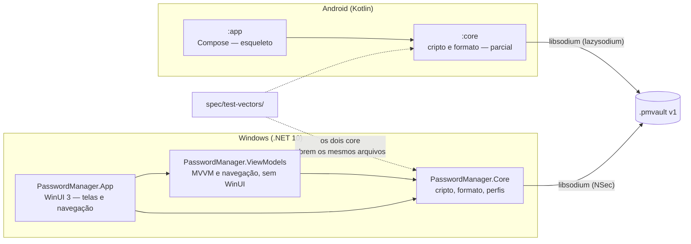
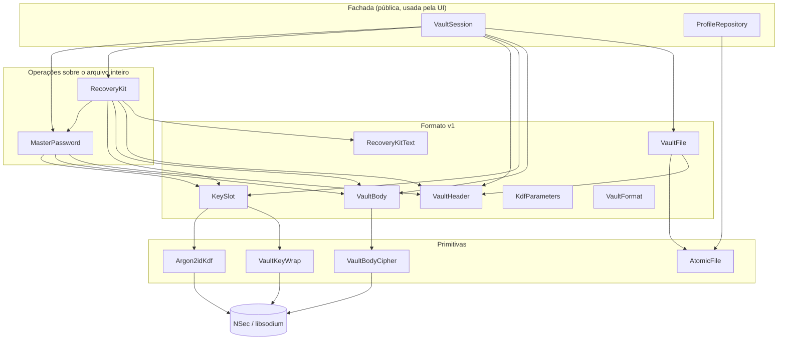
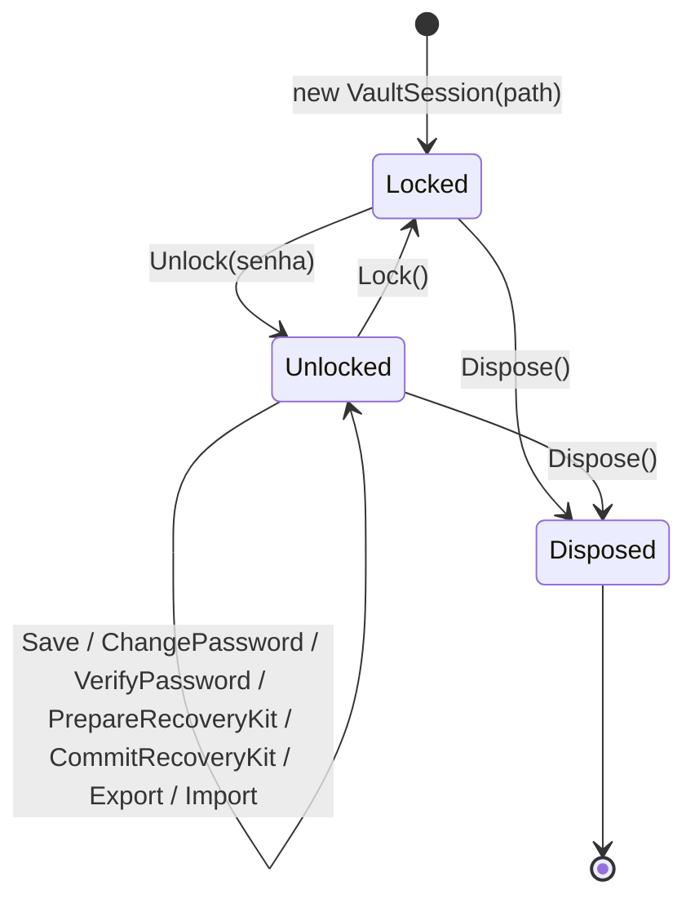
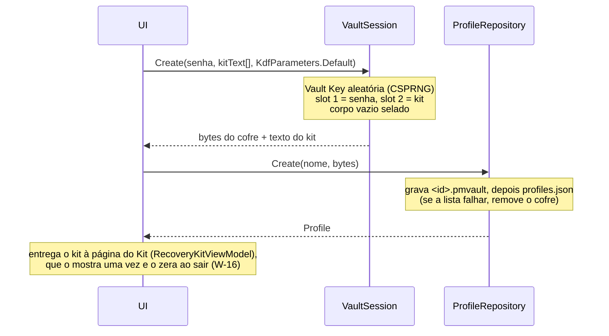
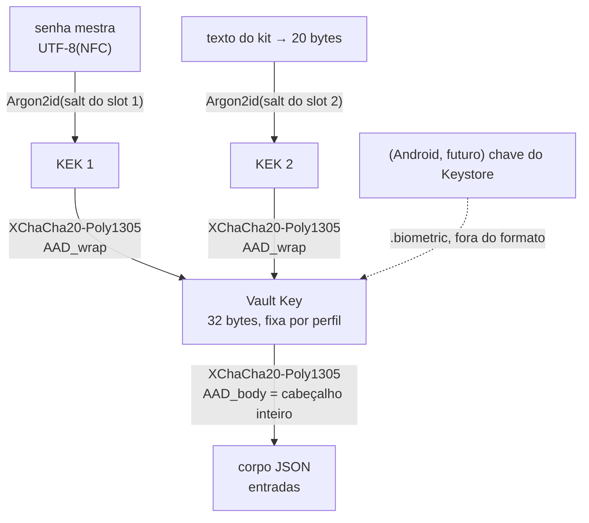
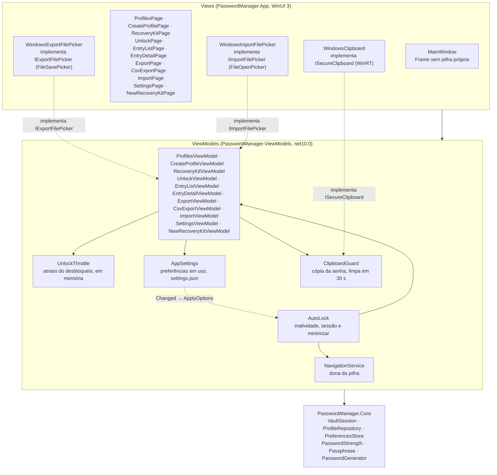
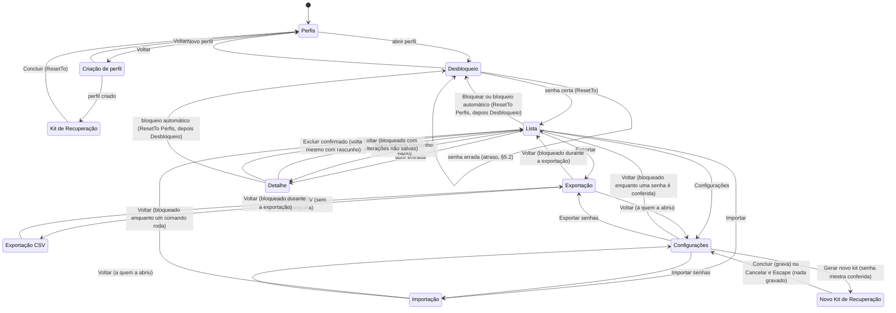

# Arquitetura do sistema

> Retrato do código em 09/11/2026, depois da W-29 (com testes E2E; fases F1 e F2 do [épico Windows](epic-windows-release.md) concluídas, a F2 com a W-11, a W-12, a W-13 e a W-14; a F3 tem a W-15, a W-16, a W-17 e a W-18 prontas, com a medição na máquina modesta da W-17 ainda pendente; a F4 tem a W-19, busca e filtros da lista; a W-20, detalhe e edição com criação e exclusão de entradas; a W-21, gerador de senhas no detalhe; a W-22, área de transferência, que completa a F4; a W-23, exportação `.pmvault`, a primeira história da F5; a W-24, exportação CSV, a segunda da F5; a W-25, importação de `.pmvault` e de CSV, a terceira da F5; e a W-26, tela de configurações, a quarta da F5, que a completa; a W-27, ícones do app e identidade visual, a primeira da F6; a W-28, a migração para MSIX, com o app empacotado por padrão; e a W-29, o build de release self-contained de x64 e ARM64, com ReadyToRun, o `.msix` por RID e as medidas de pacote e de inicialização, deixando a F6 com a W-30 e a W-31 ainda abertas).
> Deve ser atualizado no mesmo PR de toda mudança relevante (AGENTS.md §9).
> Regras obrigatórias: [AGENTS.md](../AGENTS.md). Layout de bytes: [vault-format.md](vault-format.md). Ameaças: [threat-model.md](threat-model.md).
> Este documento descreve **como o código está organizado**; quando houver conflito, AGENTS.md e vault-format.md prevalecem.

## 1. Visão geral

Gerenciador de senhas offline com dois apps nativos que compartilham **um único formato de arquivo** (`.pmvault` v1):



Princípios que moldam a arquitetura (AGENTS §1): segurança, offline de verdade, simplicidade, leveza.

- **Toda a lógica de cripto e formato fica no `Core`/`core`**, sem dependência de UI. A UI só chama operações de alto nível.
- **Nenhum código de rede** nos dois lados. O Android remove a permissão `INTERNET` no manifest; o Windows não tem pacote de rede e é empacotado em MSIX só com a capability `runFullTrust`, sem `internetClient` (§9.16).
- **Mesma biblioteca base (libsodium)** nas duas plataformas, para que um arquivo de uma abra na outra.

## 2. Estado atual

| Parte | Estado |
|---|---|
| Formato v1 (`vault-format.md`) | Layout fechado (W-01). Congela quando o `core` Android passar nos vetores. |
| `PasswordManager.Core` (Windows) | **Completo para a F1**: KDF, wrap, corpo, arquivo, perfis, troca de senha, Kit de Recuperação, `VaultSession` e vetores (W-02…W-10). Mais `Passwords/` (W-16): estimador de força, gerador de frase-senha e a lista de palavras embutida; e (W-21) o gerador de senhas, tudo fora da pilha do cofre (§4.2). E (W-23) `VaultFile.WriteExport`, que grava a exportação no caminho que o usuário escolheu, sem `.bak` (§4.2 e §5.5). E (W-24) `VaultCsv`, o CSV sem criptografia gravado no caminho escolhido, sem `.bak` (§4.2 e §9.12), e `VaultSession.VerifyPassword`, que confere a senha mestra sem mudar a sessão nem o disco (§4.3). E (W-25) a importação: `VaultCsv.ParseAndZero`, que lê o CSV, e `VaultImport`, com os limites, a regra de duplicados e a mescla (§4.2 e §9.13); `VaultSession.Import` passou a rodar o Argon2id fora da trava da sessão (§4.3). E (W-26) a troca de credenciais e as preferências: `VaultSession.PrepareRecoveryKit` e `CommitRecoveryKit` (o Kit novo em duas fases, com o `RecoveryKitReplacement`), e o `VaultFile.WriteCredentialChange`, por onde passam o `ChangePassword` e o `CommitRecoveryKit` e que, depois de gravar, copia o arquivo novo por cima do `.bak` (§4.2, §4.3 e §5.3); mais `Preferences/` (`AppPreferences` e `PreferencesStore`, o `settings.json`), fora da pilha do cofre (§4.1, §4.2 e §9.14). |
| `PasswordManager.App` (WinUI 3) | Telas de perfis, desbloqueio, lista e detalhe ligadas por um `Frame` (W-11), com o fluxo coberto por testes E2E (FlaUI, só Debug). Todo texto da tela vem de `Strings/pt-BR/Resources.resw`, com testes que impedem texto literal (W-12, §9.4). Segue o tema do sistema (inclusive ao vivo e na barra de título), tem nomes acessíveis, funciona só com o teclado e tem contraste AA nos dois temas, tudo coberto por testes (W-13, §9.5). Com o cofre aberto (lista e detalhe), a janela fica fora das capturas de tela (`WDA_EXCLUDEFROMCAPTURE`), também coberto por testes (W-14, §9.6). Seleção de perfis com criação (nome, senha mestra com confirmação), renomear e excluir com confirmação, tudo coberto por testes E2E (W-15, §5.6, §9.3 e §9.5). A criação tem medidor de força só informativo, botão de sugestão de frase-senha e o aviso de que o app não recupera a senha; depois de criar, uma página protegida mostra o Kit de Recuperação uma única vez e só sai por "Concluir", depois de marcar que o kit foi anotado (W-16, §5.1 e §9.2), também coberta por testes E2E. O desbloqueio tem atraso progressivo depois de uma senha mestra errada (1, 2, 4, 8, 16 e depois 30 s) com contagem regressiva na tela; enquanto o Argon2id roda, a página mostra um indicador de progresso com nome acessível e o Voltar fica bloqueado (W-17, §5.2 e §9.2), tudo coberto por testes E2E. O cofre aberto (lista e detalhe) se bloqueia sozinho por inatividade (5 min), ao bloquear a sessão do Windows e, se a opção estiver ligada, ao minimizar; o bloqueio volta a pilha para `[Perfis, Desbloqueio]` (W-18, §5.2 e §9.3), também coberto por testes E2E. A lista de entradas tem busca ao vivo e os filtros "Só favoritas" e "Pasta", cobertos por testes de ViewModel e E2E (W-19, §9.7). A tela de detalhe é também o editor da entrada: edita todos os campos, mostra a senha só depois de "Mostrar senha", cria e exclui entradas, e grava pelo `VaultSession` de forma atômica, coberto por testes de ViewModel e E2E (W-20, §9.8). O gerador de senhas (W-21, §9.9) fica no formulário do detalhe: botão Gerar senha, tamanho de 8 a 128 (padrão 20) num `Slider` e as caixas de maiúsculas, números e símbolos, coberto por testes de ViewModel e E2E. A área de transferência (W-22, §9.10): o botão Copiar senha no detalhe e o Ctrl+C na senha mostrada passam por uma só regra (a cópia some em 30 s ou ao bloquear, e fica fora do histórico do Win+V), coberta por testes de ViewModel e E2E. A exportação `.pmvault` (W-23, §9.11): o botão Exportar na lista abre uma página própria, com a senha de exportação digitada duas vezes e o diálogo de salvar do Windows, coberta por testes de ViewModel e E2E. A exportação CSV (W-24, §9.12): um link no fim da página de exportação abre a página do CSV, com o aviso de arquivo sem criptografia, o reconhecimento, a senha mestra digitada de novo e o diálogo de salvar, coberta por testes de ViewModel e E2E. A importação (W-25, §9.13): o botão Importar na lista abre uma página própria que lê um `.pmvault` (pedindo a senha dele) ou um CSV do Bitwarden, do KeePass ou do próprio app, mostra uma prévia com os duplicados e só grava, uma vez, depois de "Confirmar importação"; coberta por testes de Core, ViewModel e E2E. A tela de configurações (W-26, §9.14): o botão Configurações da lista abre uma página só, com o tempo de inatividade e o bloqueio ao minimizar (guardados em `settings.json`, fora do cofre), a troca da senha mestra, um Kit de Recuperação novo (mostrado uma vez e gravado só em "Concluir") e os caminhos para exportar e importar; coberta por testes de Core, ViewModel e E2E. Ícones e identidade visual (W-27, §9.15): o `.exe` e a janela levam o mesmo ícone, dos 78 arquivos de `Assets/`, gerados por `art/Build-AppAssets.ps1` e cobertos por testes estáticos e E2E. Empacotamento MSIX (W-28, §9.16): o app builda empacotado por padrão, com `Package.appxmanifest` só com `runFullTrust`, o cofre em `<ApplicationData.Current.LocalFolder>\vaults` e um pacote `.msix` sem assinatura; testado por guardas estáticas do manifesto e por um E2E do cofre empacotado. Build de release (W-29, §9.17): `tools/Publish-Release.ps1` publica self-contained para x64 e ARM64 com ReadyToRun e gera o `.msix` sem assinatura por RID; `tools/Measure-Release.ps1` mede o pacote e a inicialização, e o `.exe` Release publicado é exercitado por um smoke test. |
| `PasswordManager.ViewModels` (`net10.0`, sem WinUI) | Navegação (`NavigationService`, pilha pura) e onze ViewModels de página (Perfis, Criação de perfil, Kit de Recuperação, Desbloqueio, Lista, Detalhe, Exportação, Exportação CSV, Importação, Configurações e Novo Kit de Recuperação), testados sem janela (W-11; a criação de perfil veio na W-15 e o Kit de Recuperação na W-16). `PageViewModel.AllowsScreenCapture` diz se a janela pode ser capturada com aquela página (W-14, §9.6). O `UnlockThrottle` (W-17) guarda, por perfil e só em memória, o atraso progressivo do desbloqueio; o app cria um e o passa a todos os ViewModels que levam ao desbloqueio (§5.2). O `AutoLock` (W-18) é a política do bloqueio automático, sem WinUI: observa a navegação e manda bloquear a lista aberta (§5.2). A busca da lista (W-19) tem a parte pura em `EntrySearch` (normalização, termos e casamento, §9.7); o `EntryListViewModel` ganhou os filtros e o `FilteredEntries`. O `EntryDetailViewModel` (W-20) guarda o rascunho da entrada e as regras de salvar, descartar, voltar e excluir; o `EntryListViewModel` ganhou `Commit`, `Remove`, `NewEntry` e `LastOpened`, e refaz o índice, `Folders` e o filtro a cada gravação (§9.8). O `EntryDetailViewModel` também gera a senha (W-21, `GeneratePasswordCommand`, §9.9). O `ClipboardGuard` (W-22, §9.10) guarda a cópia pendente da senha e a limpa em 30 s ou ao bloquear, pela porta `ISecureClipboard` (a implementação fica no App); os ViewModels de página o recebem pelo construtor, como o `UnlockThrottle`. A exportação (W-23, §9.11) tem `ExportViewModel`, `ExportRequest`, `ExportOutcome`, `IExportFilePicker` (o seletor de arquivo, que o App implementa e que chega ao comando como parâmetro, não pelo construtor) e `NewPasswordRules`, a regra da senha que também usa a criação de perfil. A exportação CSV (W-24, §9.12) tem `CsvExportViewModel`, `CsvExportRequest` e `ExportDestination` (a regra da pasta de cofres, extraída do `ExportViewModel`); `ExportOutcome` ganhou `WrongPassword`; a lista ganhou, internos, `VerifyMasterPassword`, `ExportCsv`, `PasswordRetryDelay`, `RecordPasswordFailure` e `RecordPasswordSuccess`. A importação (W-25, §9.13) tem `ImportViewModel`, `ImportStage`, `ImportError`, `ImportPreviewRow` e `IImportFilePicker` (o seletor de arquivo, que o App implementa e que chega ao comando como parâmetro, como o da exportação); a lista ganhou `OpenImportCommand` e, internos, `CurrentEntries`, `DecryptImport`, `SaveEntries` e `ApplySavedEntries` (o antigo `Write` virou os dois últimos, sem mudar o comportamento). A configuração (W-26, §9.14) tem `SettingsViewModel`, `SettingsOutcome`, `ChangePasswordRequest`, `NewRecoveryKitViewModel` e o `AppSettings`, que guarda as preferências em uso, as grava e avisa quando mudam; o app cria um `AppSettings` e o passa por construtor, logo depois de `clipboard`, aos cinco ViewModels que levam à lista e ao desbloqueio (como o `UnlockThrottle`); o `AutoLock` ganhou `ApplyOptions`, que o app liga ao `Changed` do `AppSettings` (§5.2). A lista ganhou `OpenSettingsCommand`, o interno `Settings` e, internos, `ChangeMasterPassword`, `PrepareRecoveryKit` e `CommitRecoveryKit`. |
| `:core` (Android) | Parcial: KDF, wrap, corpo, cabeçalho, slots e arquivo. Faltam Kit de Recuperação, troca de senha, sessão, perfis e o teste dos vetores. |
| `:app` (Android) | Esqueleto: tela vazia de perfis, `FLAG_SECURE`, sem `INTERNET`, sem backup. |
| `spec/test-vectors/` | 4 vetores (`empty`, `entries-unicode`, `recovery-kit`, `export`) abertos pelo Core Windows. |

## 3. Estrutura do repositório

```
AGENTS.md                         regras para pessoas e agentes (CLAUDE.md só importa este arquivo)
THIRD-PARTY-NOTICES.md            avisos de terceiros (lista de palavras EFF, CC BY; §12)
docs/                             formato, ameaças, épico, este documento
spec/test-vectors/                vetores compartilhados (<nome>.pmvault + <nome>.json)
windows/
  global.json                     SDK .NET 10 + runner Microsoft.Testing.Platform (rodar dotnet a partir de windows/)
  Directory.Build.props           Nullable, warnings como erro, analisadores, lockfiles
  Directory.Packages.props        versões NuGet centralizadas
  art/                            mestres do ícone (icon-master.png e glyph-master.png) e Build-AppAssets.ps1, que gera Assets/ (W-27, §9.15)
  tools/                          Publish-Release.ps1 (publish self-contained e MSIX por RID) e Measure-Release.ps1 (tamanho e inicialização), W-29, §9.17
  src/PasswordManager.Core/       Crypto/, Vault/, Storage/, Profiles/, Passwords/, Preferences/ (o `settings.json`, §9.14)
  src/PasswordManager.App/        WinUI 3: Views/, App.xaml.cs (composição), NativeMethods.cs (chamadas Win32 de §9.6 e do bloqueio automático, §5.2), WindowsClipboard.cs (área de transferência, §9.10), WindowsExportFilePicker.cs (diálogo de salvar da exportação, `ForVault` e `ForCsv`, §9.11 e §9.12), WindowsImportFilePicker.cs (diálogo de abrir da importação, §9.13), textos em Strings/pt-BR/Resources.resw, `Assets/` (os ícones, W-27, §9.15) e `Package.appxmanifest` (o manifesto MSIX, W-28, §9.16; o pacote gerado em `AppPackages/` fica fora do git)
  src/PasswordManager.ViewModels/ net10.0 sem WinUI: Navigation/, os ViewModels de página, o UnlockThrottle (atraso do desbloqueio, §5.2), o AutoLock (bloqueio automático, §5.2) o `EntrySearch` (busca da lista, §9.7) o `ClipboardGuard` (área de transferência, §9.10) e a exportação `.pmvault` (`ExportViewModel` e a regra de senha `NewPasswordRules`, §9.11) e a exportação CSV (`CsvExportViewModel` e `ExportDestination`, §9.12) e a importação (`ImportViewModel` e `IImportFilePicker`, §9.13) e as configurações (`SettingsViewModel`, `NewRecoveryKitViewModel` e o `AppSettings`, as preferências em uso, §9.14)
  tests/PasswordManager.Core.Tests/   xUnit v3, espelha as pastas do Core + TestVectors/
  tests/PasswordManager.ViewModels.Tests/   xUnit v3, ViewModels e fluxo de navegação
  tests/PasswordManager.App.E2E.Tests/      xUnit v3 + FlaUI UIA3, dirige o app Debug real (§9.3); também tem as guardas estáticas de texto em Localization/ (§9.4) e de acessibilidade e tema em Accessibility/ (§9.5) e a guarda do pacote em Packaging/ (§9.16) e as do build de release e do app publicado (§9.17)
android/
  gradle/libs.versions.toml       todas as versões
  core/                           com.passwordmanagement.core (crypto/, vault/)
  app/                            com.passwordmanagement.android (Compose)
```

## 4. Core do Windows

### 4.1 Camadas

Cada camada só usa a de baixo. A UI deve usar só o topo (`VaultSession` e `ProfileRepository`).



A pasta `Passwords/` (W-16: `PasswordStrength`, `Passphrase` e `Wordlist`; W-21: `PasswordGenerator`) **não está nesse diagrama**: não usa o formato nem a cripto do cofre e não toca no disco. Ela serve aos ViewModels da criação de perfil, que medem a senha digitada e sugerem uma frase-senha (§5.1), e ao detalhe da entrada, que gera uma senha (§9.9). A única dependência dela é o `RandomNumberGenerator` do .NET.

O `VaultCsv` (W-24, também em `Vault/`) fica fora desse diagrama pelo mesmo motivo: o CSV não é o formato do cofre, e ele só usa o `AtomicFile` para gravar (§9.12). Desde a W-25 ele também lê CSV (`ParseAndZero`), e o `VaultImport` (as regras de uma importação, também em `Vault/`) fica fora pelo mesmo motivo. A importação de um `.pmvault` passa pela `VaultSession.Import`, que já está no diagrama (§5.5 e §9.13).

A pasta `Preferences/` (W-26: `AppPreferences` e `PreferencesStore`) também **não está nesse diagrama**, como `Passwords/`: o `settings.json` não é o formato do cofre, não usa a cripto dele e não guarda nada de um cofre. A única coisa que ela usa da pilha é o `AtomicFile`, para gravar sem `.bak` (§9.14). O `RecoveryKitReplacement` (o Kit novo que ainda não foi gravado) fica em `Vault/` e só existe como resultado da `VaultSession` (§4.3).

### 4.2 Responsabilidades

| Pasta | Tipo | Visibilidade | Papel |
|---|---|---|---|
| `Crypto/` | `Argon2idKdf` | pública | Senha (`char`, normalizada em NFC → UTF-8) ou segredo binário → KEK de 32 bytes. Zera os buffers intermediários. |
| | `VaultKeyWrap` | interna | XChaCha20-Poly1305 da Vault Key com a KEK e o `AAD_wrap`. |
| | `VaultBodyCipher` | interna | XChaCha20-Poly1305 do JSON do corpo com o `AAD_body`. |
| `Storage/` | `AtomicFile` | interna | `.tmp` → flush → (`.bak`) → rename. O rename tenta de novo por cerca de 300 ms, porque outro processo que abre o arquivo logo depois da escrita (um antivírus, por exemplo) o faz falhar por alguns milissegundos; arquivo preso por mais tempo ainda falha. Usado pelo cofre (com `.bak`, ou sem ele na troca de credenciais, que copia o `.bak` depois, §4.2 `VaultFile`), por `profiles.json` (sem `.bak`), pelo CSV de `VaultCsv.WriteFile` (sem `.bak`) e pelo `settings.json` de `PreferencesStore.Save` (W-26, sem `.bak`). |
| `Vault/` | `VaultFormat` | pública | Constantes do formato, espelhadas em `VaultFormat.kt`. |
| | `KdfParameters` | pública | Memória/iterações do Argon2id; `Default` = 64 MiB/3; validação dos limites; leitura de um slot. |
| | `VaultHeader` | pública | `Parse` (validação completa da leitura, na ordem da spec) e `Build` (slots em ordem de tipo). Expõe `BodyOffset` e os `VaultSlotRange`. |
| | `KeySlot` | pública | Cria e abre os slots tipo 1 (senha) e tipo 2 (kit). |
| | `VaultBody` | pública | `Seal`/`Open` do corpo; `Reseal` interno (mesmo conteúdo, cabeçalho novo, nonce novo). |
| | `VaultFile` | pública | `Read` devolve os bytes crus (quem valida é o `VaultHeader.Parse`); `Write` valida antes de tocar o disco e grava atomicamente com `.bak`. Nunca recorre ao `.bak` sozinho. `WriteExport(caminho, bytes)` (W-23) valida o cabeçalho e exige exatamente um slot tipo 1 e nenhum slot de kit; grava no caminho que o usuário escolheu com `AtomicFile` e `keepBackup: false`, sem criar pasta. Lança `ArgumentException` antes de tocar o disco quando o número de slots não bate. **Troca de credenciais (W-26)**, internos: `WriteCredentialChange(caminho, bytes)` valida o cabeçalho, grava com `AtomicFile` e `keepBackup: false` e só então chama `RefreshBackup(caminho)`, que copia o arquivo novo por cima do `<caminho>.bak` e engole `IOException` e `UnauthorizedAccessException`. É **a exceção deliberada** à regra de que o `.bak` guarda a versão anterior (AGENTS §3.3): uma cópia da versão anterior ainda abriria com a credencial que acabou de ser trocada (§5.3). Não passa por `Write` porque o `keepBackup: true` copia o arquivo antigo para o `.bak` **antes** da troca e não captura a falha, então um `.bak` preso por outro programa derrubaria a gravação da troca. Uma gravação que falha deixa o arquivo e o `.bak` como estavam; uma queda entre a gravação e a cópia deixa o `.bak` antigo até o próximo `Save` (§13). |
| | `MasterPassword` | pública | `Change` (senha atual → nova) e `Reset` (Vault Key já conhecida → nova senha). Só o slot tipo 1 muda. |
| | `RecoveryKit` / `RecoveryKitText` | pública / interna | Gerar, substituir, abrir e redefinir a senha pelo kit; texto Crockford base32 8×4. |
| | `VaultCsv` | pública | CSV sem criptografia (W-24, §9.12). `Serialize(entradas)` devolve os bytes do arquivo: UTF-8 sem BOM, cabeçalho `name,url,username,password,notes,folder`, RFC 4180 (campo entre aspas só com vírgula, aspas, CR ou LF, e aspas internas dobradas), CRLF no fim de cada registro, inclusive o último. Surrogate solitário lança `ArgumentException`. Não neutraliza `=`, `+`, `-` e `@` (§13). `WriteFile(caminho, bytes)` grava com `AtomicFile` e `keepBackup: false`, sem criar pasta. `ParseAndZero(bytes, agora)` (W-25) lê o arquivo de volta (regras em §9.13): decodifica UTF-8 estrito, aceita os cabeçalhos do próprio app, do Bitwarden, do KeePassXC e do KeePass 1.x, devolve um `ImportFile` e **zera** os bytes recebidos e o texto decodificado antes de retornar, seja qual for o resultado. |
| | `VaultImport` | pública | As regras de uma importação (W-25), iguais para `.pmvault` e CSV: os limites (`MaxFileBytes` 32 MiB, `MaxEntries` 20.000, `MaxFieldChars` 65.536); `ReadFile(caminho)` (abre com `FileShare.Read`, confere o tamanho antes de alocar e devolve um array fixado); `FromContent(conteúdo)` (as regras de registro e o limite, sobre o corpo decifrado de um `.pmvault`); `Plan(existentes, importadas)` (quais são duplicadas); `Merge(existentes, importadas, política, agora)` (a lista final). Não toca no cofre: quem chama grava com `VaultSession.Save`. |
| | `ImportFile`, `ImportPlan`, `ImportMergeResult` | pública | Resultados da importação, todos `class` e não `record`, para nenhum membro gerado imprimir entradas. `ImportFile`: `Entries`, `RejectedLines` e `IgnoredColumns`. `ImportPlan`: `IsDuplicate[]`, `NewCount` e `DuplicateCount`. `ImportMergeResult`: `Entries`, `Added`, `Replaced` e `Skipped`. |
| | `DuplicatePolicy` | pública | O que fazer com um duplicado: `Skip` (padrão), `Duplicate` ou `Replace`. |
| | `VaultImportException`, `ImportFileError` | pública | O arquivo inteiro recusado: `TooLarge`, `TooManyEntries`, `InvalidEncoding`, `InvalidHeader` ou `MalformedCsv`, com `Line` (1 baseada, ou a posição da entrada; 0 quando não há). A mensagem é fixa e nunca traz conteúdo. |
| | `VaultSession` | pública | Fachada com estado: `Create`, `Unlock`, `Lock`, `Save`, `ChangePassword`, `VerifyPassword`, `PrepareRecoveryKit`, `CommitRecoveryKit`, `Export`, `Import`. O `Import` roda o Argon2id fora da trava (§4.3). O `ChangePassword` e o `CommitRecoveryKit` gravam por `VaultFile.WriteCredentialChange` (§5.3 e §5.4). |
| | `RecoveryKitReplacement` | pública | O Kit de Recuperação novo, pronto e **ainda não gravado** (W-26): resultado do `PrepareRecoveryKit`, entregue ao `CommitRecoveryKit`. Classe selada com construtor e membros internos: guarda só a referência ao arquivo de onde partiu e os bytes do arquivo novo, ou seja, só texto cifrado, nunca o texto do kit nem a Vault Key, e não sobrescreve `ToString`. |
| | `VaultEntry`, `VaultContent`, `VaultJsonContext`, `UtcTimestampConverter` | pública / interna | Modelo do corpo e JSON source-generated (camelCase, datas `.fffZ`). `VaultEntry.ToString()` nunca mostra segredos. |
| | `VaultFormatException`, `VaultAuthenticationException` | pública | Erros tipados (ver 8). |
| `Profiles/` | `ProfileRepository` | pública | `profiles.json`: listar, validar nome, criar (grava o cofre e depois a lista), renomear, apagar (lista primeiro, depois `.pmvault`/`.bak`/`.tmp`). |
| | `Profile`, `ProfileNameError`, `ProfileStoreException` | pública | Modelo, erros de validação do nome, erro de armazenamento. |
| `Passwords/` | `PasswordStrength`, `PasswordStrengthLevel` | pública | Estimador de força sem dependência (decisão D4 do épico): `EstimateBits` e `Evaluate` (ver abaixo). Só informativo. |
| | `Passphrase` | pública | `Generate(n)` devolve uma frase-senha em `char[]` (6 palavras da lista EFF curta, minúsculas, separadas por `-`; de 4 a 12 palavras aceitas) e `EntropyBits(n)`. Cada índice vem de `RandomNumberGenerator.GetInt32(1296)`, sem viés de módulo. A frase nunca é uma `string` aqui, e quem chama zera o array. Seis palavras dão cerca de 62 bits e no mínimo 23 caracteres, então a frase sempre passa do mínimo de 12. |
| | `Wordlist` | interna | A EFF Short Wordlist #1, com 1.296 palavras únicas, **embutida como recurso** (`PasswordManager.Core.Passwords.eff_short_wordlist_1.txt`): não há arquivo dela em disco em tempo de execução. Carrega uma vez e falha alto se o recurso não tiver exatamente 1.296 palavras únicas. `Contains(ReadOnlySpan<char>)` consulta sem alocar. Ver §12. |
| | `PasswordGenerator` | pública | Gerador de senhas (W-21): `Generate(length, uppercase, digits, symbols)` devolve um `char[]` de 8 a 128 caracteres (padrão 20; fora disso, `ArgumentOutOfRangeException`). Minúsculas sempre; maiúsculas (A–Z), números (0–9) e os 28 símbolos de `SymbolCharacters` (sem espaço, aspas nem barra invertida) se ligados. Cada caractere é `alfabeto[RandomNumberGenerator.GetInt32(n)]`, sem viés de módulo e sem embaralhar. Cada classe ligada precisa aparecer ao menos uma vez: se não aparece, o array é zerado e a senha inteira é sorteada de novo (rejeição, até 1.000 vezes; depois, `InvalidOperationException`). Quem chama zera o array; a senha não vira `string` aqui. |
| `Preferences/` | `AppPreferences` | pública | As preferências do app (W-26): `record` selado e validado, com `IdleTimeoutMinutes` e `LockOnMinimize`. O tempo só aceita um valor de `AllowedIdleTimeoutMinutes` (1, 2, 5, 10, 15, 30 e 60 min); outro valor lança `ArgumentOutOfRangeException`. **Não existe "nunca"**: um cofre aberto sempre bloqueia (AGENTS §3.5). `Default` é 5 min e sem bloqueio ao minimizar. Globais, não por perfil, e nada além disso: sem id de perfil, caminho nem data. |
| | `PreferencesStore` | pública | Lê e grava o `settings.json`, ao lado do `profiles.json` (formato e regras em §9.14). `Load(pasta)` nunca lança exceção por problema do arquivo e **nunca grava**: arquivo ausente, ilegível, com mais de 4 KiB (`MaxFileBytes`) ou com JSON inválido ou de tipo errado dá `AppPreferences.Default`. `Save(pasta, preferências)` usa o `AtomicFile` com `keepBackup: false` e não cria a pasta; `IOException` e `UnauthorizedAccessException` sobem. |
| | `PreferencesFile`, `PreferencesJsonContext` | interna | O formato em disco (dois campos, chave ausente fica no padrão e chave desconhecida é ignorada) e o JSON source-generated em camelCase, como o do cofre. |

As APIs de baixo nível trabalham com **bytes do arquivo inteiro** (`ReadOnlySpan<byte> file` → `byte[]` novo). Elas não tocam no disco; só `VaultFile` e `ProfileRepository` fazem I/O. Isso torna cada operação testável em memória e deixa a escrita atômica num único lugar.

**Estimador de força** (`PasswordStrength`, W-16). O D4 do épico foi decidido sem dependência: um port de zxcvbn seria um pacote novo (AGENTS §7) e traria dicionários grandes.

- **Ideia**: o custo da senha é o menor número de bits para descrevê-la como uma sequência de pedaços, achado por programação dinâmica. Um pedaço pode ser:
  - um caractere por força bruta, a `log2` do tamanho do conjunto de classes presentes na senha inteira (minúsculas 26, maiúsculas 26, dígitos 10, símbolos ASCII e espaço 33, qualquer não ASCII 100); um par substituto conta como um caractere;
  - uma palavra de 3 letras ou mais, da lista EFF (palavras de 3 a 5 letras, `log2(1296)` bits) ou da lista própria de senhas comuns (60 palavras em pt-BR e inglês, `static readonly` no arquivo, `log2(60)` bits), casada sobre uma cópia em minúsculas com as trocas de leet (`@`/`4`→a, `3`→e, `1`/`!`→i, `0`→o, `$`/`5`→s, `7`→t); +1 bit se tem maiúscula e +1 se usou leet;
  - um bloco de 1 a 4 caracteres repetido (`blocos*c + log2(vezes)`);
  - uma sequência de 3 ou mais caracteres, seguindo o alfabeto ou os dígitos (passo +1 ou −1) ou uma fileira de teclado (`qwertyuiop`, `asdfghjkl`, `zxcvbnm`, `1234567890`) nos dois sentidos (`c + log2(tamanho) + 1`);
  - um ano `19dd` ou `20dd`, casado na cópia em minúsculas (`log2(200)`).
- **Faixas** (decisão de produto): menos de 30 bits é muito fraca, até 45 fraca, até 60 razoável, até 80 forte, e 80 ou mais muito forte.
- **Segredo**: a senha nunca vira `string`. Só os primeiros 128 caracteres são analisados, em duas cópias em `stackalloc` (minúsculas, e minúsculas com leet) que são limpas num `finally`; cada caractere além disso soma só o custo de força bruta. Um par substituto nunca é partido nessa fronteira. Nunca lança exceção por causa da entrada, e nada é logado.
- **Limite**: é uma heurística pequena, não um zxcvbn. Não conhece nomes, datas fora do formato de ano, nem dicionários grandes. Por isso é só informativa: a única regra que bloqueia continua sendo o mínimo de 12 caracteres.

### 4.3 `VaultSession`: estado e ciclo de vida



- **Enquanto desbloqueada**, guarda a Vault Key num buffer **pinned** (o GC não move nem copia), os bytes do arquivo aberto e o `VaultContent` decifrado.
- **`Lock()`** zera a chave com `CryptographicOperations.ZeroMemory` e descarta o arquivo e o conteúdo. Pode ser chamado várias vezes. Depois de `Dispose`, `Lock`/`Dispose` não fazem nada e o resto lança `ObjectDisposedException`.
- **Uma trava privada em todo membro**: um `Lock` vindo de outra thread espera a gravação em andamento e nunca deixa selar o corpo com a chave zerada. O bloqueio automático (W-18) não depende disso: a troca de sessão chega à thread de UI pela fila do dispatcher (§5.2). A mesma trava serializa as gravações, que o `VaultFile` exige. **A exceção é o `Import`** (W-25): ele segura a trava só para conferir o estado e roda o Argon2id e a abertura do corpo fora dela, porque o custo vem do arquivo importado (os limites do cabeçalho permitem até 1 GiB e 32 passadas) e um `Lock` não pode esperar por um custo que um arquivo escolheu. O `Import` não usa a chave nem o conteúdo da sessão, então um `Lock` durante a execução volta na hora e o `Import` ainda devolve o conteúdo do arquivo; quem chama confere que o cofre continua aberto antes de usar o resultado (§9.13).
- **Estado muda só depois que a gravação dá certo**: em falha de I/O, sessão e disco continuam iguais.
- `Create`, `Unlock`, `ChangePassword`, `PrepareRecoveryKit`, `VerifyPassword`, `Export` e `Import` rodam Argon2id com os parâmetros do cofre (`KdfParameters.Default` nos novos; o tempo medido está abaixo; no `Import`, os parâmetros são os do arquivo importado): **a UI deve chamá-los fora da thread de UI**.
- `Create` é estático: devolve os bytes do cofre novo e o texto do kit, e quem grava é o `ProfileRepository.Create`.
- `VerifyPassword(senha)` (W-24) confere a senha mestra abrindo só o slot tipo 1, com os parâmetros que esse slot grava, num `stackalloc` zerado no `finally`. Não muda a sessão nem o disco. Senha errada lança `VaultAuthenticationException`; sessão bloqueada, `InvalidOperationException`; sessão descartada, `ObjectDisposedException`. Roda sob a trava da sessão, então um `Lock` que chega durante a conferência espera o fim dela (§13).
- **Kit novo em duas fases (W-26)**, para o kit antigo continuar valendo até o usuário anotar o novo (fluxo em §5.4):
  - `PrepareRecoveryKit(kitText)` gera o kit, monta o arquivo novo com o slot tipo 2 (um cofre sem slot de kit ganha um) e devolve um `RecoveryKitReplacement`. Roda sob a trava, custa um Argon2id e **não grava nada**; o `kitText` só é escrito quando dá certo, com exatamente `RecoveryKit.TextLength` caracteres (outro tamanho lança `ArgumentException`);
  - `CommitRecoveryKit(replacement)` grava o arquivo preparado por `VaultFile.WriteCredentialChange` e troca o arquivo da sessão. Só vale para o arquivo exato de onde o `Prepare` partiu (comparação por referência): se a sessão gravou outro arquivo desde então (um `Save` ou um `ChangePassword`), lança `InvalidOperationException` sem gravar, então nunca desfaz uma gravação mais nova. Também lança `InvalidOperationException` com a sessão bloqueada. Em falha de I/O ou de permissão, sessão e disco ficam como estavam e o mesmo `replacement` pode ser gravado de novo. Depois de gravado, um segundo `Commit` do mesmo `replacement` lança `InvalidOperationException`, porque o arquivo da sessão já é outro;
  - largar o `replacement` sem gravar não custa nada: o kit antigo segue valendo.
- **Troca de credenciais e `.bak` (W-26)**: o `ChangePassword` e o `CommitRecoveryKit` gravam por `VaultFile.WriteCredentialChange` (§4.2), não por `Write`. Depois da gravação o `.bak` passa a ter o arquivo **novo**, para a credencial trocada não abrir mais a cópia ao lado do cofre (§5.3). O `Save` continua guardando a versão anterior no `.bak`, como sempre.

**Tempo de desbloqueio medido (W-17)**

Medição de `VaultSession.Unlock` (ler o arquivo, derivar a KEK, desembrulhar a Vault Key e abrir o corpo) com `KdfParameters.Default` (64 MiB, 3 iterações, paralelismo 1), em Release, depois de 1 execução de aquecimento e com 5 medidas. A AGENTS §3.2 pede um desbloqueio entre ~0,5 e 1,5 s; o teste falha se a mediana passar de 1,5 s.

| Máquina | CPU | RAM | Sistema | Mín. | Mediana | Máx. | Data |
|---|---|---|---|---|---|---|---|
| Desenvolvimento (execução 1) | AMD Ryzen 7 9700X, 8 núcleos / 16 threads | 31 GB | Windows 11 (10.0.26200), x64 | 39,9 ms | 40,5 ms | 42,0 ms | 28/10/2026 |
| Desenvolvimento (execução 2) | a mesma | a mesma | o mesmo | 36,4 ms | 37,2 ms | 37,5 ms | 28/10/2026 |
| Máquina modesta | **pendente** (a medir pelo usuário) | | | | | | |

- **A máquina de desenvolvimento não é modesta.** O critério da W-17 ("medido em máquina modesta") só fecha quando a linha de baixo for preenchida. Até lá ela fica **pendente**.
- **Custo padrão**: a mediana de ~40 ms está bem abaixo da faixa de ~0,5 a 1,5 s da AGENTS §3.2 (que fala de um Android de entrada). Se o custo padrão deve subir é decisão do usuário, fora da W-17, que não mudou `KdfParameters.Default` (§13).
- **Comando** (a partir de `windows/`; é um teste explícito, que uma execução normal nunca roda, em `tests/PasswordManager.Core.Tests/Vault/UnlockTimingMeasurement.cs`):

  ```
  dotnet test --project tests/PasswordManager.Core.Tests/PasswordManager.Core.Tests.csproj -c Release --filter-class "PasswordManager.Core.Tests.Vault.UnlockTimingMeasurement" --explicit only --show-live-output on --output Detailed
  ```

  Sem `--output Detailed` as linhas do teste não aparecem no `dotnet test`. O teste cria um cofre fictício numa pasta temporária (apagada no fim) e imprime os parâmetros do KDF, o sistema, a arquitetura, o número de processadores lógicos, a CPU, a memória e o mínimo, a mediana e o máximo.
- **Em outra máquina, sem o SDK**: rode `dotnet build tests/PasswordManager.Core.Tests/PasswordManager.Core.Tests.csproj -c Release`, copie `tests/PasswordManager.Core.Tests/bin/Release/net10.0/` para a máquina (precisa só do runtime .NET 10) e, nessa pasta, rode:

  ```
  PasswordManager.Core.Tests.exe -class "PasswordManager.Core.Tests.Vault.UnlockTimingMeasurement" -explicit only -showLiveOutput
  ```

  A linha da máquina modesta entra na tabela com esses números.

## 5. Fluxos principais

### 5.1 Criar perfil



Na tela de criação (`CreateProfileViewModel`, W-15 e W-16), a parte da UI faz o seguinte:

- Valida antes de qualquer Argon2id: o nome pelas mesmas regras do `ProfileRepository.ValidateDisplayName`; a senha com pelo menos 12 caracteres (contados como escalares Unicode) e a confirmação igual à senha. O mínimo é `CreateProfileViewModel.MinimumPasswordLength`.
- Roda `VaultSession.Create` e `ProfileRepository.Create` em `Task.Run`, com `KdfParameters.Default`. O `await` **não usa `ConfigureAwait(false)`**, para a navegação voltar à thread de UI.
- O texto do kit vai para um buffer. Se o perfil é criado, o buffer **passa para o `RecoveryKitViewModel`** (a `CreateAsync` não o zera nesse caso) e a navegação vai para a página do Kit; em qualquer falha, o `finally` o zera sem mostrá-lo.
- Os dois `char[]` da senha entram no comando (`NewMasterPassword`), que os zera no `finally`, mesmo em falha.
- Com a lista corrompida (`LoadFailed`), o botão de criar fica desabilitado, porque `Create` e `ValidateDisplayName` lançariam exceção.

**Medidor, sugestão e Kit (W-16)**

- **Medidor de força, só informativo.** A cada `PasswordChanged` do campo de senha, a página chama `UpdateStrength`, que grava `Strength` (`PasswordStrength.Evaluate`, faixas em §4.2). O texto "Força da senha: …" e uma barra (`ProgressBar`) seguem esse nível; os dois ficam ocultos com o campo vazio. **Nada é bloqueado pelo medidor**: uma senha fraca de 12 caracteres ou mais é aceita, e a única regra que impede a criação continua sendo o mínimo de 12 (cobre os testes `Create_WeakButTwelveRunes_IsAccepted` e `CreateProfile_StrengthMeter_FollowsPasswordAndDoesNotBlock`).
- **Sugestão de frase-senha.** O botão "Sugerir frase-senha" executa `SuggestPassphraseCommand`: `Passphrase.Generate()` vira `Suggestion` (uma `string`) e o `char[]` é zerado no `finally`. A página põe a frase **nos dois campos de senha** e a mostra em um texto abaixo, sem seleção (não dá para copiá-la), com a dica para memorizar ou anotar. Com a frase nos campos, o usuário só digita o nome e cria. O comando fica indisponível enquanto uma criação roda, como o Voltar, para a frase não mudar debaixo da senha em uso.
- **Quando a sugestão some.** `UpdateStrength` apaga `Suggestion` quando o texto digitado não é vazio e difere dela (o usuário escreveu outra coisa). Campo vazio ou texto igual a mantém, porque a página esvazia os campos depois de cada tentativa de criar e a frase mostrada continua sendo a mesma. `OnNavigatedFrom` apaga `Suggestion` e volta `Strength` para `None`.
- **Aviso de que não há recuperação.** O texto estático da página de criação diz que o app não recupera a senha mestra e que um Kit de Recuperação será mostrado uma única vez; sem a senha e sem o kit, o perfil fica inacessível (AGENTS §3.4).
- **Página do Kit.** Com o perfil criado, `NavigateTo(new RecoveryKitViewModel(kit, repo, nav))` substitui o antigo `GoBack`. A página mostra o título, a explicação, o texto do kit (Crockford base32, 8 grupos de 4), as instruções e a caixa "Anotei o Kit de Recuperação e entendo que, sem a senha mestra e sem o kit, as senhas deste perfil não podem ser recuperadas." (esse é o reconhecimento explícito de que não há recuperação). **Concluir** só fica habilitado com a caixa marcada (`KitSaved` → `DoneCommand.CanExecute`, e o comando ignora uma chamada direta sem a caixa). Concluir faz `ResetTo(new ProfilesViewModel(repo, nav))`, então a lista de perfis volta atualizada e **sem nada para voltar**. A página **não tem Voltar nem Escape**. O `RecoveryKitViewModel` assume o `char[]` do kit e o zera com `Array.Clear` em `OnNavigatedFrom`; depois disso, `KitText` fica vazio. Não há botão de imprimir nem de copiar: copiar exigiria as regras de área de transferência da W-22.
- Com o kit em tela, a janela fica excluída da captura (§9.6), e o texto do kit só existe na tela até sair da página.

### 5.2 Desbloquear, editar, bloquear

1. `new VaultSession(repo.GetVaultPath(id))` → `Unlock(senha)`.
2. `VaultFile.Read` lê os bytes e `VaultHeader.Parse` os valida; `KeySlot` deriva a KEK **só do slot tipo 1** e desembrulha a Vault Key; `VaultBody.Open` decifra o corpo com o cabeçalho inteiro como AAD.
3. A UI lê `Content` e chama `Save(novoConteúdo)`: o corpo é re-selado com nonce novo e gravado atomicamente; o arquivo anterior vira `.bak`.
4. `Lock()` ao sair, ou pelo bloqueio automático (inatividade, sessão do Windows e, com a opção, minimizar; W-18, abaixo).

Senha errada, arquivo adulterado e slot adulterado aparecem todos como a mesma `VaultAuthenticationException`, sem detalhe do motivo.

**Gravação de entradas (W-20)**

Editar ou criar uma entrada não tem fluxo próprio no `Core`. O `EntryDetailViewModel` monta o registro novo (mantém `Id` e `CreatedAt` de uma edição; `UpdatedAt` vira o instante atual, em milissegundos), e o `EntryListViewModel.Commit` (ou `Remove`, na exclusão) chama `VaultSession.Save` **de forma síncrona**, na thread de UI. A gravação é a de sempre: arquivo temporário, `flush`, troca atômica e `.bak`. Se falhar (`IOException` ou `UnauthorizedAccessException`), a sessão e o arquivo ficam como estavam e o rascunho continua com as alterações, com o erro na tela (§9.8). Desde a W-25 o `Write` da lista é `SaveEntries` (só a sessão e o disco, que pode rodar fora da thread de UI) seguido de `ApplySavedEntries` (só a lista, na thread de UI, e sem efeito se o cofre foi bloqueado entre os dois), sem mudar o comportamento da edição; a importação chama os dois em momentos diferentes (§9.13).

**Atraso progressivo e progresso (W-17)**

Na tela de desbloqueio (`UnlockViewModel` e `UnlockPage`), o atraso depois de uma senha errada é só da UI (AGENTS §3.4): a proteção real contra tentativas é o Argon2id. A política fica em `UnlockThrottle` (no `ViewModels`, não no `Core`), porque não mexe em cripto nem no formato.

- **Regra**: depois da n-ésima senha errada seguida, o desbloqueio fica bloqueado por `min(2^(n-1), 30)` s: 1, 2, 4, 8, 16, 30, 30… (`UnlockThrottle.DelayAfter`; não estoura com n grande). Só a `VaultAuthenticationException` conta. `VaultFormatException`, `IOException` e `UnauthorizedAccessException` (`UnlockError.VaultUnreadable`) não iniciam atraso. Um desbloqueio com sucesso zera a contagem **daquele perfil**.
- **Estado**: por perfil (`Guid`), **só em memória**, durante a vida do app, atrás de um `System.Threading.Lock`. O `App.OnLaunched` cria um único `UnlockThrottle(TimeProvider.System)` e o passa explicitamente (não há DI) a `ProfilesViewModel`, `CreateProfileViewModel`, `RecoveryKitViewModel`, `UnlockViewModel` e `EntryListViewModel`. Por isso Voltar e abrir o perfil de novo, ou Bloquear e desbloquear de novo, mantêm a contagem regressiva.
- **Não é persistido: reiniciar o app zera o atraso. É um limite aceito.** Quem tem o teclado na mão pode copiar o `.pmvault` e atacá-lo fora do app, então só o Argon2id protege de verdade (AGENTS §3.4). Nenhum arquivo novo em disco (§7).
- **Relógio monotônico e injetado**: `UnlockThrottle(TimeProvider)` usa `GetTimestamp` e `GetElapsedTime`, então mudar a hora do Windows não encurta nem alonga o atraso (coberto por `RemainingDelay_WallClockChanges_DoNotShortenOrExtendTheDelay`). Os testes usam o `ManualTimeProvider` (escrito à mão, com `Advance`), sem esperar em tempo real e sem pacote novo.
- **O ViewModel é síncrono e a View move a contagem**: o `UnlockViewModel` expõe `RetrySeconds` (o tempo que falta, arredondado para cima; 0 quer dizer que pode tentar) e `RefreshRetryDelay()`, que lê o relógio de novo. `OnNavigatedTo` e o fim de cada tentativa errada chamam `RefreshRetryDelay()`. A `UnlockPage` roda um `DispatcherQueueTimer` de 250 ms **só enquanto `RetrySeconds > 0`**, que chama `RefreshRetryDelay()` a cada passo e se para em 0 e no `Unloaded`.
- **Durante a contagem**: o botão Desbloquear fica desabilitado (`UnlockPage.CanSubmit`, que o botão e o Enter dividem) e Enter não faz nada (a tecla é consumida, a senha não é copiada e o campo **mantém o texto**). O `PasswordBox` continua habilitado (o foco não pula) e o Voltar continua permitido. O texto "Aguarde N s para tentar de novo." (`UnlockRetryCountdown`, no resw, §9.4) aparece abaixo das mensagens de erro. Uma chamada direta ao comando é ignorada: o array é zerado, nenhum Argon2id roda e a contagem de erros não muda.
- **Durante o Argon2id**: o `Voltar` e o Escape (que é o acelerador dele) ficam indisponíveis (`GoBackCommand` só executa com `!UnlockCommand.IsRunning`; uma chamada direta também é ignorada), o mesmo padrão da criação de perfil (§9.2). O `ProgressRing` `UnlockProgress` aparece só nesse intervalo (§9.5).
- **Tempo do Argon2id**: ver §4.3. Na máquina de desenvolvimento ele leva ~40 ms, então o indicador mal aparece lá; o comportamento é garantido por teste de ViewModel (abaixo, §9.3) e não pelo olho.

**Bloqueio automático (W-18)**

O cofre aberto (lista ou detalhe, e qualquer página acima delas) é bloqueado por três gatilhos. Todos executam o `LockCommand` da lista aberta, o mesmo do botão Bloquear: a sessão é descartada, as entradas saem da lista e a pilha vira `[Perfis, Desbloqueio]`.

- **Inatividade**: 5 min sem entrada na janela do app (padrão de `AutoLockOptions.Default`; a tela de configurações troca o prazo por 1, 2, 5, 10, 15, 30 ou 60 min, e a troca vale já, §9.14). Entrada são `KeyDown`, `PointerPressed`, `PointerMoved` e `PointerWheelChanged` no `RootFrame`, com `handledEventsToo`, então uma tecla ou um clique que um controle consome também conta. Entrada em outro programa não conta: o cofre fecha enquanto o usuário trabalha em outra coisa. A contagem começa quando o cofre abre e usa o relógio monotônico do `TimeProvider` (`GetTimestamp`), então mudar a hora do Windows não a encurta nem alonga. Um `DispatcherQueueTimer` de 1 s chama `CheckIdle` só enquanto `IsVaultOpen` é verdadeiro.
- **Sessão do Windows**: a `MainWindow` chama `WTSRegisterSessionNotification` (só a sessão do app) e troca o procedimento da janela por `SetWindowLongPtrW(GWLP_WNDPROC)`, encadeando com `CallWindowProcW` (não usa `SetWindowSubclass`, que exige comctl32 v6). `WM_WTSSESSION_CHANGE` com `WTS_SESSION_LOCK`, `WTS_CONSOLE_DISCONNECT` ou `WTS_REMOTE_DISCONNECT` bloqueia o cofre. Falha no registro ou na subclasse lança `Win32Exception` na inicialização (fail-closed, como `Protect()`).
- **Minimizar** (desligado por padrão; a tela de configurações liga e desliga, §9.14): `WM_SIZE` com `SIZE_MINIMIZED` bloqueia só com `LockOnMinimize` ligado.

O procedimento da janela é um `[UnmanagedCallersOnly]` estático que **só enfileira** o trabalho no `DispatcherQueue`, com prioridade alta, e chama o procedimento anterior (uma exceção ali encerraria o processo). Assim a navegação nunca roda dentro da mensagem, e tudo continua na thread de UI.

Regras:

- **Só cofre aberto**: com Perfis, Desbloqueio, Criação ou Kit, todo gatilho não faz nada. O Kit fica de fora de propósito: bloquear ali perderia um kit que só é mostrado uma vez (§5.1).
- **Gatilho durante o Argon2id**: se chega enquanto um desbloqueio roda, vale só para o cofre que esse desbloqueio abre, e só uma vez. `AutoLock` assina `IsRunning` do `UnlockCommand` e, quando ele vira falso, desassina e bloqueia o cofre recém-aberto, se ele abriu. Uma senha errada não deixa nada pendente. Bloquear de dentro de `Navigated` causaria navegação reentrante, por isso a espera.
- **Sem tentativa falha**: bloquear não toca no `UnlockThrottle`, e a tela de desbloqueio que ele abre mostra `RetrySeconds` zero.
- **Opções vindas das configurações** (W-26): `AutoLockOptions` (`IdleTimeout`, `LockOnMinimize`) é montado em `App.OnLaunched` a partir do `AppSettings.AutoLockOptions`, que lê o `settings.json` (ausente ou inválido, vale `AutoLockOptions.Default`; §9.14). `AutoLock.Options` continua só de leitura por fora, e só o `ApplyOptions` a troca: a página de configurações muda uma preferência, o `AppSettings.Changed` dispara e o app chama `AutoLock.ApplyOptions`, então o `CheckIdle` e o `OnMinimized` seguintes já usam o valor novo, sem reiniciar. `ApplyOptions` conta como atividade: escolher um prazo menor nunca bloqueia na hora, o relógio da inatividade recomeça de agora. No Debug, dois switches só para o E2E: `--idle-timeout-seconds <n>` (inteiro acima de zero) e `--lock-on-minimize`. Eles **sobrepõem o arquivo só na inicialização** (o segundo liga o bloqueio mesmo com o arquivo desligado; sem o switch vale o arquivo), e a primeira mudança feita na tela vale dali em diante. Um valor inválido aborta a inicialização, como `--vaults-dir` (§9.1). No Release esse código não é compilado.

### 5.3 Trocar a senha mestra

`ChangePassword(atual, nova)` → `MasterPassword.Change`: abre o slot 1 com a senha atual e cria um slot 1 novo (salt e nonce novos). O slot 2 fica igual, byte a byte. O corpo é re-selado com a **mesma** Vault Key, porque o cabeçalho é AAD. As entradas nunca são cifradas de novo com outra chave.

**A gravação e o `.bak` (W-26).** O arquivo novo é gravado por `VaultFile.WriteCredentialChange`: valida, grava atomicamente **sem** copiar o arquivo antigo, e então copia o arquivo novo por cima do `.bak`. O motivo: uma cópia da versão anterior ainda abriria com a senha que acabou de ser trocada, e o `.bak` fica ao lado do cofre. Isso resolve o ponto em aberto da W-07 e da W-09. Efeitos:

- é uma exceção deliberada à AGENTS §3.3 ("manter uma cópia `.bak` da versão anterior"): depois de uma troca de senha ou de Kit, o `.bak` tem a versão **nova**, e a anterior só existe nas cópias que o usuário fez por fora. O `.bak` também deixa de ser um jeito de voltar atrás numa troca. A AGENTS.md não diz isso e não foi alterada;
- a cópia é de melhor esforço: se o `.bak` está preso por outro programa, a falha é engolida, porque a senha já mudou, e o `.bak` fica com o conteúdo antigo até o próximo `Save`. Por isso a gravação **não** usa o `keepBackup: true`, que copia o arquivo antigo para o `.bak` antes da troca e não captura a falha: um `.bak` preso derrubaria a troca inteira (`ChangePassword_BackupLocked_StillSucceeds`);
- uma gravação que falha (`IOException` ou `UnauthorizedAccessException`) deixa o arquivo, a sessão e o `.bak` como estavam;
- uma queda entre a gravação e a cópia deixa o `.bak` antigo até o próximo `Save`. Como a gravação não copia o arquivo antigo, esse `.bak` é a versão de antes da última gravação de entradas, **uma versão mais velha** do que a cópia que o `Write` teria deixado. Ele ainda abre com a credencial antiga. O `Save` seguinte o substitui (§13);
- **não protege cópias antigas feitas fora do app**: a Vault Key é fixa por perfil (AGENTS §3.1), então uma cópia antiga com a credencial antiga continua abrindo e entrega a mesma Vault Key que abre o arquivo atual (§13 e o modelo de ameaças).

### 5.4 Kit de Recuperação

- `RecoveryKit.Unlock(file, kitText, vaultKey)`: decodifica o texto (valida antes de gastar Argon2id) e abre **só o slot tipo 2**.
- `RecoveryKit.ResetPassword(file, kitText, novaSenha, params)`: kit → Vault Key → `MasterPassword.Reset`.
- `RecoveryKit.Create(file, vaultKey, params, kitText)`: gera um kit novo e substitui o slot 2; o kit antigo deixa de funcionar.

**Como a `VaultSession` os expõe (W-26).** Só o `Create` chega à UI, e em duas fases (abaixo). O `Unlock` e o `ResetPassword` do kit **continuam sem tela**: no `src`, ninguém os chama, e nenhuma história do épico os cobre. **Nenhuma tela resgata um kit** (§13).

**Kit novo em duas fases (W-26).** O kit antigo só pode parar de valer depois que o usuário anotar o novo, por isso a troca tem uma fase que não grava (fluxo na tela em §9.14):

1. a senha mestra é conferida de verdade (`VerifyPassword`, com o atraso compartilhado do desbloqueio);
2. `PrepareRecoveryKit` gera o kit e monta o arquivo novo. **Nada é gravado**: o kit antigo abre o cofre, e a página do kit novo mostra o texto uma vez;
3. só **Concluir**, depois da caixa "Anotei…", chama `CommitRecoveryKit`, que grava o arquivo (`WriteCredentialChange`, com o `.bak` atualizado, §5.3) e troca o arquivo da sessão. A partir daí o kit antigo falha no arquivo e no `.bak`;
4. Cancelar, Escape, um bloqueio ou fechar o app antes do passo 3 não gravam nada, e o texto do kit novo é zerado.

Um cofre que não tinha slot de kit (o vetor `entries-unicode`) ganha um no `Commit` (`VaultHeader.WithSlot`). Os slots tipo 1 e os desconhecidos ficam byte a byte iguais, a Vault Key e as entradas não mudam, e o corpo é re-selado com um nonce novo.

### 5.5 Exportar e importar

- `Export(senhaDeExportação)` devolve bytes de um `.pmvault` com **Vault Key nova**, exatamente um slot tipo 1 e nenhum kit. Nada é gravado pelo Core: o app salva via `FileSavePicker` (W-23), nunca em pasta temporária.
- `Import(bytes, senhaDeExportação)` devolve o `VaultContent` decifrado para prévia, aceitando qualquer arquivo de cofre que tenha um slot tipo 1. A sessão e o disco não mudam; quem chama mescla as entradas com `VaultImport.Merge` e chama `Save` (W-25, fluxo abaixo). O Argon2id roda fora da trava da sessão (§4.3).
- CSV (W-24) é exportação em texto puro e não passa por `Export`: ver o fluxo abaixo. A importação de CSV (W-25) não passa por `Import`: usa `VaultCsv.ParseAndZero` (fluxo abaixo e §9.13).

**Exportação (W-23)**: `ExportViewModel.ExportCommand` roda em `Task.Run` (o Argon2id do `Export`). A ordem abaixo é a do código:

1. zera o resultado da tentativa anterior e checa a senha de exportação (mínimo de 12 caracteres e as duas digitações iguais). Se recusada, sai **sem abrir o diálogo**;
2. `IExportFilePicker.PickAsync()` mostra o diálogo de salvar. Cancelar sai sem gravar;
3. se o cofre foi bloqueado enquanto o diálogo estava aberto, sai sem gravar;
4. se o arquivo cairia direto na pasta de cofres do app, sai com `ExportOutcome.VaultsFolder`. Essa pasta guarda `<id>.pmvault` e `profiles.json`, que não podem ser substituídos por uma exportação. Subpastas são aceitas;
5. `VaultFile.WriteExport(caminho, vault.Export(senha))`. O `Export` gera a Vault Key nova e o salt novo; a gravação segue o §7;
6. `Saved`, com o nome do arquivo, ou `Failed` (`IOException`, `UnauthorizedAccessException` e `ArgumentException`).

Os dois arrays de senha são zerados no `finally`, em qualquer resultado.

**Bloqueio durante a exportação.** `VaultSession.Export` segura a trava da sessão (§4.3). Se o bloqueio chega **antes** do Argon2id, o `Export` lança `InvalidOperationException` e nada é gravado. Se chega **durante** o Argon2id, o bloqueio espera a exportação terminar, e os bytes já selados são gravados no local escolhido, cifrados só com a senha de exportação. Se chega com o diálogo aberto, o passo 3 impede a gravação. Quando o `Export` lança, a página já saiu da tela, então nada aparece para o usuário (§9.11). A espera do bloqueio na thread de UI é um ponto em aberto (§13).

**Exportação CSV (W-24)**: `CsvExportViewModel.ExportCommand` faz duas chamadas em `Task.Run`, a conferência da senha e a gravação. A ordem abaixo é a do código:

1. zera o resultado anterior e relê o atraso (`RefreshRetryDelay`). Sem o reconhecimento, ou durante o atraso, sai: nenhum Argon2id roda, nada é contado, e a senha é zerada;
2. `VaultSession.VerifyPassword`, pela lista (`EntryListViewModel.VerifyMasterPassword`). Senha errada (`VaultAuthenticationException`, ou `ArgumentException` por surrogate solitário) conta uma falha no atraso compartilhado com o desbloqueio e sai com `ExportOutcome.WrongPassword`, **sem abrir o diálogo**. Senha certa zera o atraso do perfil e **zera a senha ali mesmo**, antes do diálogo;
3. `IExportFilePicker.PickAsync()`. Cancelar sai sem gravar;
4. se o cofre foi bloqueado enquanto o diálogo estava aberto, sai sem gravar;
5. se o arquivo cairia direto na pasta de cofres, sai com `ExportOutcome.VaultsFolder` (a mesma regra da `.pmvault`, agora em `ExportDestination`);
6. `VaultCsv.WriteFile(caminho, csv)`, em que `csv` vem de `EntryListViewModel.ExportCsv()` (`VaultCsv.Serialize` sobre as entradas). Os bytes são zerados no `finally`, logo depois da gravação;
7. `Saved`, com o nome do arquivo sem a pasta, ou `Failed` (`IOException`, `UnauthorizedAccessException` e `ArgumentException`).

Enquanto a exportação roda, Voltar fica bloqueado (`GoBackCommand`), como na `.pmvault` (§9.2).

**Bloqueio no CSV.** Antes da conferência, `VerifyPassword` lança `InvalidOperationException` e nada é gravado. Durante a conferência, o bloqueio espera o fim dela (§13). Com o diálogo aberto, o passo 4 impede a gravação. Se o bloqueio chega **depois** de as entradas serem lidas (passo 6), o texto já montado ainda é gravado no local escolhido: a página já saiu da tela, mas o comando já tinha o conteúdo (§13). Se chega antes da leitura, `ExportCsv` lança `InvalidOperationException`, que não mostra nada, e nada é gravado.

**Importação (W-25)**: o `ImportViewModel` tem três comandos que fazem trabalho, e **nada é gravado antes de `ConfirmCommand`**. `IsBusy` liga dentro de cada comando e bloqueia os outros e o Voltar (inclusive com o diálogo aberto). A ordem abaixo é a do código:

*Escolher o arquivo* (`ChooseFileCommand`; o seletor chega como parâmetro):

1. zera o erro e liga `IsBusy`;
2. `IImportFilePicker.PickAsync()` mostra o diálogo de abrir. Cancelar mantém o passo e o arquivo atuais. Se o cofre foi bloqueado enquanto o diálogo estava aberto, sai sem mudar nada;
3. qualquer outra resposta descarta o arquivo anterior e escolhe o formato pela extensão, sem diferenciar maiúsculas: `.csv`, `.pmvault` ou `UnsupportedFile`;
4. **CSV**, em `Task.Run`: `VaultImport.ReadFile`, `VaultCsv.ParseAndZero` e `VaultImport.Plan` sobre as entradas atuais do cofre. Vai para o passo `Preview`;
5. **`.pmvault`**, em `Task.Run`: `ReadFile` e `VaultHeader.Parse`, então um arquivo que não é cofre falha (`InvalidVaultFile`) antes de a senha ser pedida. Os bytes ficam guardados, e o passo é `Password`.

*Abrir o `.pmvault`* (`OpenVaultFileCommand`, com a senha do arquivo num `char[]`):

1. em `Task.Run`: `EntryListViewModel.DecryptImport` (que chama `VaultSession.Import`: Argon2id e a tag AEAD válida no slot e no corpo; só o slot tipo 1 abre, nunca um kit), `VaultImport.FromContent` e `Plan`;
2. se deu certo, zera os bytes do arquivo e vai para `Preview`. Senha errada e arquivo adulterado são a mesma `WrongPassword` e deixam o passo `Password`, para tentar de novo. Não há atraso progressivo: a senha é do arquivo, não a mestra, e quem tem o arquivo o ataca fora do app de qualquer jeito; o `UnlockThrottle` não é tocado;
3. o `finally` zera a senha.

*Confirmar* (`ConfirmCommand`, só em `Preview`, com `WriteCount > 0` e sem outro comando rodando):

1. em `Task.Run`: `VaultImport.Merge` sobre `CurrentEntries` e **uma única** chamada de `SaveEntries`, que é um `VaultSession.Save` atômico: o `.bak` guarda o cofre de antes da importação;
2. de volta à thread de UI, `ApplySavedEntries` refaz a lista, o índice e as pastas. Se o cofre foi bloqueado, devolve falso e não muda nada, então um bloqueio nunca repopula a lista. Dá certo: guarda as contagens (`AddedCount`, `ReplacedCount`, `SkippedCount`), solta a prévia e vai para `Done`;
3. falha de gravação (`IOException`, `UnauthorizedAccessException` e `ArgumentException`): `SaveFailed`, o cofre e a lista ficam como estavam e a prévia continua, para tentar de novo.

**Bloqueio na importação.** Cada `await` é seguido de uma checagem de `IsOpen`, e um cofre bloqueado não muda estado nenhum: a página já saiu da pilha e `OnNavigatedFrom` limpou tudo. `VaultSession.Import` não faz o `Lock` esperar (§4.3), então o bloqueio com o diálogo aberto ou durante o Argon2id é imediato, e o resultado, se vier, é descartado. Se o bloqueio chega **antes** do `Save`, `SaveEntries` lança `InvalidOperationException`, que não mostra nada, e nada é gravado. Se chega **depois** do `Save` e antes do `ApplySavedEntries`, o `Save` já tinha acabado e a gravação fica no disco, mas a lista não é repopulada. Voltar, o bloqueio e uma leitura que falha descartam tudo o que não foi confirmado.

### 5.6 Renomear e excluir perfil

A tela de Perfis (W-15) fala com o `ProfileRepository` pelo `ProfilesViewModel`. Os botões Renomear e Excluir ficam em cada item da lista e abrem um `ContentDialog` declarado em `ProfilesPage.xaml`. Nenhuma das duas operações mexe no conteúdo do cofre.

- **Renomear** (`Rename(id, nome)`) troca só o `DisplayName` da entrada. O `id` e os bytes do `.pmvault` ficam iguais. A validação usa `ValidateDisplayName(nome, id)`, que deixa o próprio perfil fora da checagem de nome repetido. Um nome inválido mantém o diálogo aberto com a mensagem; qualquer outro resultado fecha o diálogo e relê a lista.
- **Excluir** tem dois passos. O clique em Excluir só grava `PendingDelete`. O diálogo de confirmação tem **Cancelar como botão padrão**, então Enter e Escape cancelam. Só o botão de excluir chama `ConfirmDelete`, que chama `ProfileRepository.Delete(id)`. Nenhuma senha mestra é pedida: quem tem acesso à pasta pode apagar os arquivos pelo Explorer, então a confirmação protege contra engano, não contra um atacante.
- **Ordem de `Delete`**: remove a entrada de `profiles.json` (gravação atômica) e depois apaga `<id>.pmvault`, `<id>.pmvault.bak` e `<id>.pmvault.tmp`. Nenhum outro arquivo é tocado, nem arquivos órfãos nem os de outros perfis.
- **Falha**: se um arquivo não puder ser apagado (por exemplo, aberto em outro programa), a exceção sobe, `ActionFailed` mostra o aviso na lista e a lista é relida. O arquivo que sobrou fica órfão: a entrada já saiu de `profiles.json`, então a tela não o lista. Nada o apaga automaticamente.

## 6. Chaves e segredos



Regras que o código segue:

- **Nenhum hash da senha é guardado**: a verificação é a própria tag AEAD do slot.
- Senhas e textos de kit entram como `ReadOnlySpan<char>`; chaves como `Span<byte>`. Temporários ficam em `stackalloc` e são zerados em `finally`. Os buffers do chamador nunca são alterados, e é ele quem os zera.
- O `VaultContent` e suas `string` são objetos gerenciados e **não podem ser zerados**; `Lock` só solta as referências (limite aceito em AGENTS §3.5).
- **A UI precisa de `string` para mostrar a frase sugerida e o kit** (W-16): a frase vai para um `TextBlock` e para os dois `PasswordBox`, e o texto do kit para um `TextBlock`. O `Core` devolve `char[]` (`Passphrase.Generate`) e os ViewModels zeram os arrays que possuem, mas as `string` ficam no heap até o GC. É o mesmo limite do `PasswordBox` (§13), e a página do Kit esvazia o `TextBlock` ao sair. O medidor lê o texto do campo a cada tecla, o que cria outra `string` gerenciada por tecla. Nada disso vai para log nem para exceção.
- Exceções nunca carregam segredo nem conteúdo do arquivo.
- **CSV em claro** (W-24): o arquivo é texto sem criptografia por desenho (AGENTS §5.2). `VaultCsv.Serialize` monta o texto num `char[]` fixado (pinned), que é zerado antes de a função devolver; os bytes devolvidos também ficam fixados, e quem chama (`CsvExportViewModel`) os zera logo depois de gravar. Nenhuma `string` com o documento inteiro é criada. As entradas continuam nas `string` do `VaultContent`, que não podem ser zeradas (regra acima). Não há senha guardada para o CSV: a conferência é o `VerifyPassword` (§4.3).
- **Importação** (W-25, §9.13):
  - a senha do arquivo `.pmvault` entra num `char[]` que o comando zera no `finally`; a página esvazia o `PasswordBox` (que só expõe `string`, o mesmo limite de §13). O `VaultSession.Import` zera a chave (`stackalloc`) e o `VaultBody.Open`, os bytes do JSON;
  - `VaultCsv.ParseAndZero` zera os bytes do arquivo e o `char[]` fixado da decodificação num `finally`, seja qual for o resultado. Não há segunda cópia dos campos: desfaz as aspas no próprio `char[]` fixado (o valor sem aspas nunca é mais longo que o original) e só cria `string` para os campos mapeados de registros aceitos. Registros recusados e colunas ignoradas nunca saem do buffer;
  - os bytes de um `.pmvault` ficam num array fixado (`VaultImport.ReadFile`) só até a decifragem. São zerados quando ela dá certo, quando a leitura falha e ao sair da página;
  - as `string` das entradas importadas são gerenciadas e **não podem ser zeradas** (AGENTS §3.5): o ViewModel solta toda referência depois de Confirmar, no Voltar e no bloqueio. `ImportPreviewRow` não tem senha, notas nem pasta, então a página não consegue mostrá-las;
  - exceções e mensagens nunca carregam conteúdo. A `DecoderFallbackException` não é encadeada, porque guarda os bytes que não decodificou.
- **Configurações** (W-26, §9.14):
  - as três senhas da troca (`ChangePasswordRequest`, que não é `record` e não sobrescreve `ToString`) e a senha mestra do kit entram em `char[]` que o comando zera no `finally`, em qualquer resultado (inclusive recusa antes do Argon2id, atraso e bloqueio). A página esvazia os `PasswordBox` a cada tentativa; eles só expõem `string`, o mesmo limite de §13. O campo da nova senha também passa pelo medidor, que lê o texto a cada tecla (a `string` fica no heap até o GC);
  - o texto do kit novo vive num `char[]` de `RecoveryKit.TextLength` que o `SettingsViewModel` cria, é dono dele até a página do kit existir e o zera se a página não chega a abrir. Depois, o `NewRecoveryKitViewModel` é dono dele e o zera em `OnNavigatedFrom`, seja qual for a saída (Concluir, Cancelar ou bloqueio). A página mostra o texto num `TextBlock` sem seleção (não dá para copiar, como na W-16) e o esvazia ao sair; a `string` que o `TextBlock` guarda fica no heap até o GC (limite de §13);
  - o `RecoveryKitReplacement` guarda **só texto cifrado** (o arquivo de origem e o arquivo novo), nunca o texto do kit nem a Vault Key. Ele pode ficar vivo na página do kit sem ampliar o que há em claro na memória;
  - o `settings.json` não tem nada sensível (§9.14).

## 7. Armazenamento em disco

Pasta: `<LocalFolder>\vaults\` no app empacotado (o padrão desde a W-28; `ApplicationData.Current.LocalFolder` vira `%LOCALAPPDATA%\Packages\com.passwordmanagement.windows_<hash>\LocalState`), ou `%LOCALAPPDATA%\PasswordManagement\vaults\` num exe solto, que não tem identidade de pacote (todos os lançamentos E2E). Quem decide é `ProfileRepository.GetDefaultDirectory(packagedLocalFolder)` (§9.16). **Sem migração**: os cofres da pasta sem pacote não são copiados para o LocalState, e uma instalação empacotada começa vazia (§13).

| Arquivo | Escrito por | Observação |
|---|---|---|
| `profiles.json` | `ProfileRepository` | Em claro, só `id`/`displayName`/`createdAt`. Atômico, **sem** `.bak`. |
| `<id>.pmvault` | `VaultFile.Write` (e `WriteCredentialChange`, W-26) | Atômico, com `.bak` da versão anterior. Depois de uma troca de senha mestra ou de Kit, o `.bak` recebe a versão **nova** (exceção deliberada, §5.3). Nome vem só do `id`. |
| `<id>.pmvault.bak` / `.tmp` | `AtomicFile` | `.tmp` só sobra após queda e é sobrescrito na próxima gravação. |
| `settings.json` | `PreferencesStore` (W-26) | Em claro, **só** `idleTimeoutMinutes` e `lockOnMinimize`, exatamente `{"idleTimeoutMinutes":5,"lockOnMinimize":false}` (UTF-8 sem BOM). Atômico, **sem** `.bak`. Global, não por perfil (§9.14). |

A exportação (W-23) e o CSV (W-24) não passam por essa tabela: o `.pmvault` ou o `.csv` vai para o caminho que o usuário escolheu, com `<caminho>.tmp` ao lado e sem `.bak`. O `.tmp` é apagado no fim, então só fica se o app cair no meio da gravação; se a pasta escolhida já tiver um arquivo com esse nome `.tmp`, ele é sobrescrito e apagado (§9.11 e §13). Não há trava entre processos: quem chama serializa as operações. O atraso do desbloqueio (W-17) não tem arquivo: vive só em memória e some quando o app fecha (§5.2). O bloqueio automático (W-18) também não grava nada: o que a W-26 guarda são as **preferências dele**, em `settings.json` (tabela acima), e não o bloqueio. A pasta de cofres que o app recusa como destino de exportação (`ExportDestination`, §9.11) protege também esse arquivo; o `ProfileRepository` não varre a pasta, então ele não atrapalha a lista de perfis. A importação (W-25) não cria arquivo novo: só lê o que o usuário escolheu (sem alterá-lo nem apagá-lo, e sem cópia em pasta temporária ou de cache) e grava o cofre aberto pelo `VaultFile.Write` de sempre, uma vez, com o `.bak` da versão anterior (§9.13).

## 8. Erros

| Exceção | Quando |
|---|---|
| `VaultFormatException` | Arquivo malformado: tamanho, magic, versão, slots, limites do KDF. Lançada antes de qualquer Argon2id. |
| `VaultAuthenticationException` | Falha AEAD: senha/kit errado ou qualquer byte adulterado. Mensagem fixa, sem `InnerException`. |
| `FormatException` | Texto do kit inválido (checado antes do Argon2id). |
| `VaultImportException` | Arquivo de importação recusado inteiro (W-25): grande demais, itens demais, CSV que não é UTF-8, cabeçalho de CSV desconhecido ou CSV malformado (`ImportFileError`). Traz o motivo e a linha, nunca conteúdo. |
| `InvalidOperationException` | Sessão bloqueada; cofre sem slot de kit; `CommitRecoveryKit` com um `RecoveryKitReplacement` velho (o arquivo da sessão mudou desde o `PrepareRecoveryKit`) ou já gravado. |
| `ProfileStoreException` | `profiles.json` inválido (JSON quebrado, `id` repetido, campo ausente…). O arquivo corrompido nunca é sobrescrito. A mensagem não traz nomes de perfil. |
| `IOException` e afins | Falha de disco em `VaultFile`/`ProfileRepository`. Sobem sem tradução; a escrita atômica garante que o arquivo anterior continua inteiro. |
| `ProfileNameError` (enum) | Resultado da validação do nome de perfil, sem exceção. |

## 9. App do Windows

### 9.1 Camadas

Cada camada só usa a de baixo. As Views não chamam o Core: falam só com os ViewModels.



- **Views**: só XAML e `x:Bind` para os ViewModels. Do `Core` elas só conhecem tipos de dado, para mostrar (como `Profile`, `VaultEntry`, `ProfileNameError` e, desde a W-16, o enum `PasswordStrengthLevel`, que escolhe o texto e o valor da barra de força); nenhuma View chama a cripto. A `MainWindow` escuta `NavigationService.Navigated` e chama `Frame.Navigate` com a página do tipo de `Current`; cada caso tem um `typeof` literal, para o trimmer enxergar os tipos. No mesmo handler, a `MainWindow` aplica a afinidade de exibição da página atual, que decide se a janela pode ser capturada (§9.6). A `MainWindow` também recebe o `AutoLock`: alimenta a atividade da janela, roda o timer de inatividade e recebe as mensagens de sessão e de minimizar (§5.2).
- **ViewModels**: `ObservableObject` e `RelayCommand` do CommunityToolkit.Mvvm; nenhum tipo de UI. Expõem estado (`UnlockError`, `RetrySeconds`, `IsEmpty`, `LoadFailed`), e a View escolhe o texto no `.resw`. O `UnlockThrottle` (W-17) não é um ViewModel de página: é a política do atraso do desbloqueio, em memória, que os ViewModels recebem pelo construtor (§5.2).
- **Composição**: `App.OnLaunched` cria o `NavigationService`, o `ProfileRepository`, o `UnlockThrottle`, o `AppSettings` (W-26, que lê o `settings.json` da pasta de cofres) e o `AutoLock` (com `TimeProvider.System`; o `AutoLock` vem antes da janela, para ver toda navegação), entrega o serviço e o `AutoLock` à `MainWindow` e mostra a tela de perfis, passando o `UnlockThrottle` adiante a cada ViewModel que leva ao desbloqueio. Desde a W-22, cria também o `WindowsClipboard` e o `ClipboardGuard` (com `TimeProvider.System`, antes da janela) e passa o guard à `MainWindow` e aos ViewModels de página, como o `UnlockThrottle` (§9.10). As opções do `AutoLock` vêm do `AppSettings.AutoLockOptions` (o `settings.json`; sem ele, 5 min e sem bloqueio ao minimizar), e `settings.Changed` é ligado ao `AutoLock.ApplyOptions`; no Debug, `ResolveAutoLockOptions` lê os switches do E2E sobre o que o arquivo deu, só na inicialização (§5.2). O `AppSettings` também é passado por construtor, logo depois do `clipboard`, aos mesmos cinco ViewModels de página que recebem o `UnlockThrottle` (§9.14). Não há container de DI. O diretório de cofres vem de `ResolveVaultsDirectory`, que chama `ProfileRepository.GetDefaultDirectory(GetPackagedLocalFolder())`: empacotado, o cofre fica em `<ApplicationData.Current.LocalFolder>\vaults`; um exe solto (todos os E2E) não tem identidade, o `ApplicationData.Current` lança e o valor nulo mantém a pasta sem pacote. No Debug, `--vaults-dir <caminho absoluto>` continua tendo precedência (usado pelos testes E2E) e `--packaged-local-folder <caminho absoluto>` faz o papel do `LocalFolder` para exercitar a pasta empacotada sem instalar o pacote; um valor inválido de qualquer um dos dois aborta a inicialização. No Release esses switches não são compilados. A W-28 só mudou essa resolução e não mudou o resto da composição (§9.16). A W-23 não mudou a composição: o seletor de arquivo é criado pela própria `ExportPage` a cada pedido, com a janela da página (§9.11). A W-24 também não mudou: a `CsvExportPage` cria o seletor com `ForCsv` a cada pedido, e o `ExportViewModel` cria o `CsvExportViewModel` quando o link é usado (§9.12). A W-25 também não mudou: a `ImportPage` cria o `WindowsImportFilePicker` a cada pedido, e a lista cria o `ImportViewModel` com o `TimeProvider` que já tem (§9.13). A W-26 só acrescentou o `AppSettings`, acima, e a lista cria o `SettingsViewModel` quando o botão é usado (§9.14).

### 9.2 Navegação



- **A pilha fica no `NavigationService`**. O `Frame` tem `IsNavigationStackEnabled="False"`, e a View não guarda histórico próprio.
- **Desbloquear troca a pilha inteira** pela Lista (`ResetTo`). Com o cofre aberto, nenhum Voltar leva ao desbloqueio.
- **Criar perfil** empurra a página de criação na pilha. Ela só sai por Voltar (Escape também) ou, depois de criar com sucesso, indo para o Kit de Recuperação. O comando de Voltar fica desabilitado enquanto a criação roda, então a página não pode ser deixada no meio do Argon2id.
- **Kit de Recuperação** (W-16): a criação bem-sucedida empurra a página do Kit (`NavigateTo`), então a pilha fica `[Perfis, Criação, Kit]`. A página **não tem Voltar nem Escape**; só **Concluir** a deixa, e só depois de marcar que o kit foi anotado. Concluir troca a pilha inteira por `[Perfis]` (`ResetTo`, o mesmo padrão do Bloquear), com a lista relida e sem a página de criação para voltar. A pilha é segura só porque nada oferece Voltar no Kit: um gesto global de voltar, se um dia existir, tem que ignorar essa página. Se o app for fechado nela, o perfil já existe mas o kit nunca foi visto (§13).
- **Bloquear** (`EntryListViewModel.Lock`) fecha a sessão, esvazia as entradas, zera o índice da busca, `Folders`, `FilteredEntries`, `SearchText`, `FavoritesOnly` e `SelectedFolder` (§9.7) e refaz a pilha como `[Perfis]` com `Desbloqueio` atual. Voltar cai em Perfis, nunca na lista. O bloqueio automático (W-18) executa o mesmo comando, então o resultado é igual também a partir do Detalhe (§5.2). Com o Detalhe aberto, o bloqueio descarta o rascunho sem perguntar, e o diálogo de exclusão, se estiver aberto, é escondido por `OnNavigatedFrom` (§9.8).
- **Voltar com alterações** (W-20): `GoBackCommand` só executa sem alterações não salvas (`CanExecute = !IsDirty`), e o Escape usa o mesmo comando. Não há pergunta de "salvar?": o usuário salva ou descarta (`DiscardCommand`), e só então Voltar volta a valer.
- Cada troca chama `OnNavigatedFrom` da página que sai e `OnNavigatedTo` da que entra, antes de `Navigated`, sempre na thread que chamou (a de UI).
- **Desbloqueio fora da thread de UI**: `UnlockViewModel` roda `VaultSession.Unlock` em `Task.Run`. O `await` **não usa `ConfigureAwait(false)`**: a navegação depois dele precisa voltar à thread de UI, senão `Frame.Navigate` falha.
- **Voltar bloqueado durante o Argon2id** (W-17): enquanto o desbloqueio roda, `GoBackCommand` não executa (o `UnlockViewModel` escuta `IsRunning` do comando e notifica `CanExecuteChanged`, o mesmo padrão da criação de perfil), então nem o botão nem o Escape saem da página. Quem deixa a página nesse momento é só o desbloqueio bem-sucedido, e um segundo passo para trás sairia também de Perfis. Depois de uma senha errada, o Voltar volta a valer, inclusive durante o atraso (§5.2).
- **Atraso**: uma senha errada deixa a página em Desbloqueio com `RetrySeconds > 0`. A volta a Perfis e a nova abertura do mesmo perfil mantêm o atraso, porque o `UnlockThrottle` é do app (§5.2).
- **Senha como `char[]`**: a `UnlockPage` copia o `PasswordBox` para um `char[]` e esvazia o campo. O comando assume o array e o zera no `finally`, mesmo em falha (e, no atraso, sem rodar o Argon2id). O `PasswordBox` só expõe `string`; isso fica como ponto em aberto (§13).
- **Sessão**: a `VaultSession` nasce no `UnlockViewModel`, passa à `EntryListViewModel` ao desbloquear e é descartada no `Lock` ou quando o desbloqueio falha.
- **Exportação** (W-23): `EntryListViewModel.OpenExport` empurra a página com `NavigateTo`, então a pilha fica `[Lista, Exportação]` e Voltar leva à lista (aberta pelas configurações, W-26, a pilha é `[Lista, Configurações, Exportação]` e o mesmo Voltar leva às configurações). `GoBackCommand` só executa quando `ExportCommand` não está rodando, então Voltar e Escape ficam bloqueados enquanto a exportação roda, inclusive com o diálogo de salvar aberto. O bloqueio troca a pilha por `[Perfis, Desbloqueio]` como nas outras páginas (§5.2). Detalhes em §9.11.
- **Exportação CSV** (W-24): `ExportViewModel.OpenCsvExport` empurra `CsvExportViewModel` com `NavigateTo`, então a pilha fica `[Lista, Exportação, CSV]`. Voltar leva à exportação, e fica bloqueado enquanto o CSV é gravado, com o diálogo aberto. Detalhes em §9.12.
- **Importação** (W-25): `EntryListViewModel.OpenImport` empurra `ImportViewModel` com `NavigateTo`, então a pilha fica `[Lista, Importação]` e Voltar leva à lista (aberta pelas configurações, W-26, a pilha é `[Lista, Configurações, Importação]` e Voltar leva às configurações). `GoBackCommand` só executa com `IsBusy` falso, e `IsBusy` vale durante qualquer comando (ler o arquivo, abrir o `.pmvault`, gravar), inclusive com o diálogo de abrir aberto; uma chamada direta também é ignorada nesse estado. O bloqueio troca a pilha por `[Perfis, Desbloqueio]`, e `OnNavigatedFrom` zera tudo. Detalhes em §9.13.
- **Configurações** (W-26): `EntryListViewModel.OpenSettings` empurra `SettingsViewModel` com `NavigateTo`, então a pilha fica `[Lista, Configurações]`, e só com o cofre aberto (o botão está na lista). Detalhes em §9.14:
  - `SettingsExport` e `SettingsImport` rodam os comandos da lista (`OpenExportCommand` e `OpenImportCommand`), então a pilha vira `[Lista, Configurações, Exportação]` ou `[Lista, Configurações, Importação]`. O Voltar dessas duas páginas é um `GoBack()` simples e volta a **quem as abriu**: às configurações aqui, à lista pelo botão da lista. Nada foi duplicado;
  - o gerar novo kit, com a senha mestra certa, empurra o `NewRecoveryKitViewModel`: `[Lista, Configurações, Novo Kit]`. Concluir grava, avisa as configurações e volta a elas; Cancelar e Escape voltam sem gravar;
  - `IsBusy` (a conferência da senha, a troca ou a geração do kit rodando) bloqueia o Voltar e o Escape, e os dois links de exportar e importar, inclusive numa chamada direta; no kit novo, `IsBusy` (a gravação) bloqueia Concluir e Cancelar. Os controles de preferência continuam habilitados;
  - o bloqueio troca a pilha por `[Perfis, Desbloqueio]` a partir de qualquer uma das duas páginas, e Voltar cai em Perfis (§5.2).

### 9.3 Testes E2E

O projeto `windows/tests/PasswordManager.App.E2E.Tests/` abre o `PasswordManager.App.exe` Debug de verdade e o dirige pela UI Automation (FlaUI.UIA3). Os testes de fluxo e de texto usam só padrões de UIA (`Invoke` em botões e itens, `Value` nas caixas de texto e no campo de senha, `Toggle` na caixa de confirmação do kit). Os testes de teclado (`AccessibilityE2ETests`, §9.5) enviam teclas reais (`SendInput`), mas só depois de confirmar que a janela do app está em primeiro plano; se não estiver, o teste falha sem enviar nada. Nenhum clique de mouse é enviado. Os testes de bloqueio automático (`AutoLockE2ETests`, W-18) movem o cursor real com `SendInput` (coordenadas absolutas da tela virtual), não com `Mouse.MoveTo` do FlaUI, porque `SetCursorPos` não gera `PointerMoved` no WinUI 3; também sem clique. Os testes de proteção contra captura (`WindowProtectionE2ETests`, §9.6) leem a afinidade de exibição da janela e a movem para fora da tela e de volta com `SetWindowPos`; não enviam tecla nem clique. Os cinco fluxos de `NavigationE2ETests` cobrem perfis vazios, lista de perfis corrompida, cofre ausente, senha errada e o caminho desbloquear → detalhe → bloquear, seguindo as regras de §9.2. `LocalizationE2ETests` (treze testes, com os das exportações, W-23 e W-24, o da importação, W-25, e os das configurações e do kit novo, W-26) confere, em cada tela, que o texto exibido vem do `.resw` (§9.4). `ProfilesE2ETests` (oito testes) cobre a seleção e a criação de perfis na tela e no disco, descrita abaixo. `UnlockE2ETests` (dois testes, W-17) cobre o atraso progressivo e o indicador de progresso do desbloqueio, também descrito abaixo. `AutoLockE2ETests` (cinco testes, W-18) cobre o bloqueio automático, também descrito abaixo. `EntryEditE2ETests` (oito testes, W-20) cobre a edição, a criação e a exclusão de entradas, descritas abaixo. `SettingsE2ETests` (19 casos, W-26) cobre as configurações, também descritas abaixo.

- **Isolamento**: cada teste cria uma pasta `pm-e2e-*` em `%TEMP%`, passa o caminho em `--vaults-dir` e a apaga no fim, inclusive após falha. O cofre vem de `spec/test-vectors/entries-unicode.pmvault`, e o `profiles.json` é escrito pelo próprio teste. Os testes nunca tocam em `%LOCALAPPDATA%\PasswordManagement\vaults\`. Se o processo de teste morrer no meio de um teste, o app pode ficar aberto: encerre `PasswordManager.App` manualmente.
- **Uma janela por vez**: `AssemblyInfo.cs` desliga o paralelismo do xUnit, então só existe uma janela do app em cada momento.
- **Ids como contrato**: todo elemento que um teste usa tem `AutomationProperties.AutomationId` (os ids estão nas seis Views), inclusive os títulos das telas e a dica de lista vazia (`ProfilesTitle`, `ProfilesEmptyHint`, `CreateTitle`, `KitTitle`, `UnlockTitle`, `EntriesTitle`). Os testes localizam por id, nunca por texto. Os nomes acessíveis vêm da W-13 (§9.5). Um `Name` novo ou um template reestruturado não pode remover um id.
- **Diálogos**: um `ContentDialog` fechado deixa na árvore do UIA só um grupo vazio com o seu id; quando ele abre, aparece uma janela com esse id. `AppSession` (`FindDialog`, `WaitDialog`, `WaitDialogGone` e `InvokeInDialog`) procura essa janela e acha os botões `PrimaryButton` e `CloseButton` dentro dela, pelos ids dos templates, não pelo texto.
- **Caixas, estado e nomes** (`AppSession`, W-16): `Toggle(id)` marca uma `CheckBox` pelo `TogglePattern`; `IsEnabled(id)` lê se o elemento está habilitado e `WaitEnabled(id)` espera por isso (o `CanExecute` de um comando chega ao botão um instante depois); `WaitName(id, texto)` espera o nome do elemento, porque um texto ligado ao ViewModel pode ficar um instante atrás da entrada.
- **Aparição rápida e texto com valor** (W-17): `AppSession.WaitAppears(id, tempo, intervalo)` consulta o elemento a cada 10 ms e devolve `true` quando o vê, para o que só fica na tela por um instante (como o indicador de progresso). `AppResources.Format(chave, argumentos...)` formata um valor do resw com `{0}` como o app o formata (cultura atual), então o teste compara o nome do `UnlockRetryCountdown` com `Format("UnlockRetryCountdown", 2)` sem repetir o texto.
- **Depois de uma senha errada, o teste espera o fim do atraso.** O botão Desbloquear fica desabilitado por 1 s (a primeira senha errada) e um `Invoke` do UIA num botão desabilitado lança exceção, então `NavigationE2ETests` (senha errada), `LocalizationE2ETests`, `AccessibilityE2ETests` e `WindowProtectionE2ETests` chamam `WaitEnabled("UnlockButton")` antes de digitar a senha certa. Isso acrescenta cerca de 1 s a cada um desses testes. Nenhum teste dorme um tempo fixo para o atraso: todos esperam por nome ou por habilitação.
- **Desbloqueio** (`UnlockE2ETests`, dois testes, W-17; senhas fictícias):
  - `WrongPasswords_DelayDoublesSurvivesBackAndThenUnlocks`, no cofre de teste, confere o atraso passo a passo. A senha errada nº 1 mostra o erro, o nome da contagem é o de 1 s e o botão fica desabilitado, e a contagem some quando ele habilita. A nº 2 mostra a contagem de 2 s e depois a de 1 s, até habilitar. A nº 3 (4 s) segue com Voltar e a reabertura do perfil: a contagem continua na tela e o botão continua desabilitado. Passado o atraso, a senha certa abre a lista;
  - `Unlock_RealCostVault_ShowsProgressOnlyWhileArgon2idRuns` cria um perfil pela tela (então com o custo real, `KdfParameters.Default`), passa pelo Kit, abre o perfil e confere que o `UnlockProgress` não existe antes de desbloquear, que aparece (com `WaitAppears`, 10 ms) enquanto o Argon2id roda e que some quando a lista abre. Isso mostra que a thread de UI continuou desenhando durante o Argon2id.
  - **O custo real é baixo nesta máquina** (~40 ms, §4.3), então esse teste depende de um intervalo curto e poderia falhar por tempo: passou 16 em 16 vezes com a consulta a cada 10 ms. **A prova que não depende de tempo é o teste de ViewModel** `GoBack_WhileArgon2idRuns_IsBlockedUntilTheUnlockEnds`, que usa um perfil com `KdfParameters.Default` e começa o comando sem esperar: `IsRunning` fica verdadeiro, o `GoBackCommand` não executa e a tarefa não terminou; depois do `await`, o Voltar volta a executar.
- **Bloqueio automático** (`AutoLockE2ETests`, cinco testes, W-18; os de inatividade usam `--idle-timeout-seconds 3`, o de minimizar com bloqueio usa `--lock-on-minimize`, e os demais usam o padrão de 5 min):
  - `Idle_LocksFromTheDetailPageWithNoEntryLeft`: sem entrada, o cofre aberto no Detalhe bloqueia; nenhum valor de entrada fica na árvore (`AssertNoEntryVisible`), a afinidade volta a `WDA_NONE`, e Voltar leva a Perfis sem resquício atrás;
  - `Activity_KeyboardAndPointer_KeepTheVaultOpenPastTheTimeout`: teclas e movimento do cursor (sem clique) mantêm o cofre aberto por mais de duas vezes o prazo; parada a entrada, bloqueia;
  - `SessionLock_LocksOnlyAnOpenVault`: `WTS_SESSION_LOCK` em Perfis não faz nada; no Detalhe bloqueia e não deixa entrada visível; `WTS_SESSION_UNLOCK` não reabre nada; e o cofre aberto depois continua aberto, porque nenhum bloqueio ficou pendente;
  - `Minimize_ByDefault_KeepsTheVaultOpen` e `Minimize_WithLockOnMinimize_LocksTheVault`: minimizar e restaurar só bloqueia com `--lock-on-minimize`.
  - O teste de sessão não chama `LockWorkStation`, porque não conseguiria destravar a área de trabalho de novo. Ele posta a mensagem real `WM_WTSSESSION_CHANGE` na janela de verdade, com `PostMessageW`, e a mensagem passa pela mesma procedure, pela fila e pelo `AutoLock` de um bloqueio do sistema. Só a entrega do próprio Windows não é exercitada (§13).
  - `AppSession` ganhou: `Launch(seed, params string[] arguments)` (argumentos extras depois de `--vaults-dir`), `PostSessionChange`, `Minimize` e `Restore` (esperam `IsIconic`), `MovePointerInside` e `ParkPointerOutside` (cursor real, sem clique; o cursor sai da janela para que ele mesmo não conte como entrada) e `AssertNoEntryVisible`, que confere se algum valor semeado aparece como `Name` ou como `Value` de caixa de texto (nunca em campo de senha).
- **Perfis** (`ProfilesE2ETests`, oito testes):
  - criar o primeiro perfil pela tela de criação, passar pela página do Kit e abrir o perfil pelo desbloqueio. Na página do Kit, o nome do `KitText` casa com o formato do kit (`^[0-9A-HJKMNP-TV-Z]{4}(-[0-9A-HJKMNP-TV-Z]{4}){7}$`), a janela está excluída da captura, `KitDone` começa desabilitado e só habilita depois de `Toggle("KitSavedCheck")`. Concluir leva à lista, a janela volta a `WDA_NONE` e o `KitText` some;
  - frase-senha sugerida: `CreateSuggest` mostra uma frase de palavras minúsculas ligadas por `-` (23 caracteres ou mais), o medidor diz "muito forte", e só o nome é digitado; depois do Kit, o desbloqueio abre o cofre com a própria frase;
  - medidor de força: ausente com o campo vazio, "muito fraca" para `aaaaaaaaaaaa`, "muito forte" para uma senha mista longa e fictícia, e `aaaaaaaaaaaa` ainda cria o perfil (o medidor não bloqueia);
  - nome repetido, senha curta e confirmação diferente: cada erro aparece na tela e a pasta fica igual antes e depois (nada é gravado);
  - renomear: cancelar não muda nada; salvar troca o nome e mantém o cofre;
  - excluir: cancelar deixa o perfil e os arquivos iguais; confirmar tira a entrada de `profiles.json` e os três arquivos do perfil (`.pmvault`, `.bak`, `.tmp`), e um cofre órfão da pasta continua intacto;
  - lista corrompida: o botão de criar fica desabilitado.
- **Edição de entradas** (`EntryEditE2ETests`, oito testes, W-20; a regra está em §9.8). Cada teste começa no cofre semeado e confere o disco pelo `SeededVault.ReadContent` (o cofre aberto com o `Core`) e o `.bak` pelo `SeededVault.ReadFile`:
  - `Password_HiddenByDefault_ShownOnToggle`: sem o "Mostrar senha", o campo de senha (e o `DetailPasswordText`) não aparece na árvore do UIA, e a senha aparece com o botão e some de novo;
  - `Edit_EveryField_SavesAtomicallyAndKeepsCreatedAt`: muda todos os campos da entrada nº 1, o `Salvar` desabilita depois de gravar, a data de criação não muda e a de alteração muda; no disco, `Id` e `CreatedAt` são os do seed, `UpdatedAt` cai entre o início e agora, as entradas 2 a 4 não mudam e o `.bak` guarda a entrada nº 1 original;
  - `NewEntry_SavesAndAppearsAtTheEnd`: a entrada nova mostra "O título é obrigatório." e não tem datas; ao gravar, as duas datas aparecem e são iguais, o cofre passa a ter 5 entradas com a nova no fim e a lista volta com 5 itens;
  - `MultilineNotes_OpenClean_SaveKeepsLf`: a entrada nº 4, de notas com várias linhas, abre limpa; ao salvar outro campo, as notas gravadas são as do seed, byte a byte, com `\n`;
  - `UnsavedChanges_BlockBack_UntilDiscarded`: com o título alterado, Voltar está desabilitado; o Descartar restaura o título e libera o Voltar; o arquivo do cofre fica igual ao seed;
  - `Delete_ConfirmsThenRemoves`: "Cancelar" deixa a entrada no disco; "Excluir" volta à lista com 3 itens e 3 entradas no disco, e a entrada não aparece mais;
  - `SaveFailure_ShowsErrorAndKeepsTheDraft`: com o arquivo do cofre aberto por outro processo (`FileShare.None`), o erro "Não foi possível salvar…" aparece, o Salvar continua habilitado e o disco não muda; liberado o arquivo, a gravação seguinte passa e o erro some;
  - `Lock_WhileEditingOrConfirming_DropsEverything`: com o título alterado, o bloqueio leva ao desbloqueio, o rascunho não aparece em lugar nenhum e o disco não muda; depois, com o cofre reaberto e o diálogo de exclusão da entrada nº 2 aberto, o bloqueio fecha o diálogo (como um cancelamento) e a entrada continua no disco.

  O `SeededVault` ganhou `VaultPath`, `ReadContent` e `ReadFile` (ver também `SeedLarge` abaixo). O `AppSession` não mudou. Os testes esperam por nome, habilitação ou ausência do elemento, nunca por um tempo fixo.
- **Gerador de senhas** (`PasswordGeneratorE2ETests`, três testes, W-21; a regra está em §9.9). A senha é lida só de `DetailPasswordText`, depois de "Mostrar senha", e os caracteres são conferidos contra as constantes do Core:
  - `NewEntry_GeneratedPassword_IsSavedToDisk`: na entrada nova, o tamanho é 20 com as três caixas ligadas; gerar não mostra a senha; a gravação deixa 5 entradas no disco, e a última tem a senha mostrada;
  - `Generate_OptionsOff_UsesOnlyLowercaseAtChosenLength`: com 32 e as caixas desligadas, a senha tem 32 minúsculas; com 3, o tamanho vira 8;
  - `Generate_ByKeyboard_ThenDiscard_LeavesVaultUnchanged`: Enter no botão gera, o foco fica nele, Salvar habilita e Voltar não; Descartar restaura a senha semeada, e o arquivo do cofre fica igual ao semeado, byte a byte.
- **Área de transferência** (`ClipboardE2ETests`, sete testes, W-22; a regra está em §9.10). Roda em Debug, com Win+V ligado e numa sessão desbloqueada, e usa a área de transferência real: `SystemClipboard` lê com Win32 e escreve e consulta o histórico com WinRT numa thread STA dedicada. O teste do histórico **falha**, não pula, se o Win+V estiver desligado. O switch `--clipboard-clear-seconds <n>` (só Debug) põe o prazo em 3 s nos testes que o usam. Os testes sobrescrevem a área de transferência do usuário (§13).
- **Exportação** (`ExportE2ETests`, cinco testes, W-23; a regra está em §9.11). Roda no cofre semeado, com senhas fictícias. O destino é `exports\` dentro da pasta de teste, criada pelo teste e apagada com ela. Os testes conferem o disco pelo `SeededVault.ReadFile` e pelo `VaultHeader`:
  - `Export_SavesToChosenFile_OpensOnlyWithExportPassword`: a janela fica com `WDA_EXCLUDEFROMCAPTURE` durante a exportação; a pasta `exports\` tem só `backup.pmvault`, sem `.tmp` nem `.bak`; o cabeçalho tem um slot tipo 1 com KDF de 64 MiB/3/1 e salt e chave envolvida diferentes do cofre semeado; a senha de exportação abre as mesmas entradas e a senha mestra falha; a pasta de cofres mantém os mesmos bytes, sem `.bak`;
  - `Export_DialogCanceled_WritesNothingAndStaysUsable`: com o diálogo aberto, Salvar, Voltar e o botão de exportar ficam desabilitados e o anel aparece; cancelar não deixa arquivo (nem de 0 byte) e a página volta a funcionar;
  - `Export_InvalidPassword_ShowsErrorAndNoDialog`: uma senha curta (11 caracteres) e uma senha divergente mostram o erro certo, não abrem o diálogo e não gravam nada;
  - `Export_IntoVaultsFolder_IsRefused`: escolher `<pasta de cofres>\backup.pmvault` mostra `ExportVaultsFolder`, e a pasta fica com os mesmos arquivos e bytes;
  - `Export_SessionLock_OnExportPage_LocksVault`: `WTS_SESSION_LOCK` na página leva ao desbloqueio, a página sai e a afinidade volta a `WDA_NONE`; Voltar, então, leva a Perfis.
  - Dois testes do mesmo fluxo ficam em outros arquivos: `Export_TabEscape_WorkWithoutMouse` (`AccessibilityE2ETests`, teclado) e `ExportPage_TextsComeFromResources` (`LocalizationE2ETests`).
- **Exportação CSV** (`CsvExportE2ETests`, cinco testes, W-24; a regra está em §9.12). Usa o cofre semeado, senhas fictícias, uma pasta `exports\` dentro da pasta de teste e o diálogo real. A conferência é pelo disco: o arquivo é comparado byte a byte com `VaultCsv.Serialize` sobre `SeededVault.ReadContent`.
  - `CsvExport_SavesReadableFileAtChosenPath`: Salvar só habilita depois da caixa de reconhecimento; o arquivo é o único da pasta (sem `.tmp` nem `.bak`), sem BOM, começa pelo cabeçalho e tem CRLF; as notas da entrada nº 4 saem entre aspas, com as aspas dobradas e as quebras de linha; a pasta de cofres fica igual;
  - `CsvExport_WrongPassword_ShowsErrorAndDelayAndNoDialog`: a senha errada mostra o erro e a contagem de 1 s (a do desbloqueio), não abre o diálogo e não grava; depois da contagem, a senha certa abre o diálogo, que é cancelado;
  - `CsvExport_DialogCanceled_WritesNothingAndStaysUsable`: com o diálogo aberto, Salvar, Voltar e o anel valem como na exportação `.pmvault`; cancelar não deixa arquivo, e Voltar leva à página de exportação, não à lista;
  - `CsvExport_IntoVaultsFolder_IsRefused`: escolher um arquivo direto na pasta de cofres mostra `CsvExportVaultsFolder` e não grava;
  - `CsvExport_SessionLock_OnCsvPage_LocksVault`: `WTS_SESSION_LOCK` na página do CSV leva ao desbloqueio, a página sai e a afinidade volta a `WDA_NONE`; Voltar então leva a Perfis.
  - Os outros dois testes da feature ficam em outros arquivos: `CsvExport_TabEscape_WorkWithoutMouse` (`AccessibilityE2ETests`, teclado) e `CsvExportPage_TextsComeFromResources` (`LocalizationE2ETests`, texto).
- **Importação** (`ImportE2ETests`, 17 casos em 10 fatos e 2 teorias, W-25; a regra está em §9.13). Usa o cofre semeado (ou o vazio, quando só importa o que entra), senhas fictícias e o diálogo de abrir **real**. Os arquivos a importar ficam em `<pasta de teste>\imports\`, criada pelo teste e apagada com a pasta; os CSV são literais C# com o fim de linha explícito (o `.gitattributes` converteria os de um arquivo no repositório). A conferência é pelo disco (`SeededVault.ReadContent` e `ReadFile`) e por um retrato da pasta de cofres (`Snapshot`), que prova o que não foi gravado. Um helper confere que nenhum valor importado aparece como `Name` ou `Value` de elemento da janela, sem imprimir o valor.
  - `Import_Csv_WritesOnlyAfterConfirm`: a janela fica com `WDA_EXCLUDEFROMCAPTURE`; o CSV é o `VaultCsv.Serialize` das 4 entradas semeadas mais 2 novas; o resumo é o `Format("ImportSummary", 2, 4)`, as linhas dos duplicados têm o nome `ImportRowDuplicateName`, a pasta de cofres mantém os mesmos bytes com a prévia aberta, sem `.bak`, e nenhuma senha do arquivo está na tela. Depois de `ImportConfirm`, o `ImportDone` e o `ImportDoneCsvReminder` aparecem, o cofre tem 6 entradas (as 4 intocadas e as 2 novas, com `Id` novo e as duas datas iguais ao instante da importação), o `.bak` é, byte a byte, o cofre de antes, o CSV de origem fica igual, e Voltar mostra os títulos novos na lista;
  - `Import_KeePass1xCsv_KeepsBackslashAndQuote`: o cabeçalho do KeePass 1.x num cofre vazio; a senha `a"b\c` é gravada exata, e `x\ny` fica com os dois caracteres;
  - `Import_BitwardenCsv_ReportsIgnoredColumns`: o layout individual do Bitwarden com `login_totp` preenchido e `fields` vazio; só `login_totp` é citado (o valor não aparece), uma linha curta é recusada e a mensagem aponta a linha 4; a nota sem senha é gravada com a senha vazia, e a pasta e a favorita são mapeadas;
  - `Import_Duplicates_FollowPolicy` (teoria `Skip`, `Duplicate`, `Replace`): uma linha com o título, o usuário e a URL de uma entrada salva e outra senha, mais uma linha nova. A troca de política não muda o resumo; o disco tem as contagens e a senha da política (em `Replace`, `Id` e criação mantidos, favorita mantida e `UpdatedAt` novo);
  - `Import_AllDuplicatesWithSkip_CannotConfirm`: `ImportNothing` aparece e `ImportConfirm` fica desabilitado; `Replace` e `Duplicate` o habilitam, e voltar a `Skip` o desabilita de novo; Voltar não grava nada;
  - `Import_Pmvault_WrongThenRightPassword`: uma cópia do vetor `export` (`SeededVault.CopyVector`); `ImportPassword` aparece sem prévia; a senha errada dá `ImportErrorWrongPassword`, sem prévia e com o cofre igual; a certa mostra as 2 entradas, e depois de Confirmar elas têm os mesmos `Id`, datas, favorita e textos do vetor, e o arquivo de origem não mudou;
  - `Import_TamperedPmvault_ShowsSameError`: um bit trocado no último byte (o corpo); a senha certa dá a mesma mensagem de senha errada, sem prévia;
  - `Import_BadFiles_ShowErrorAndWriteNothing` (teoria `malformed`, `header`, `utf16` e `notavault`): a mensagem certa (o `malformed` aponta a linha 3), a página volta ao primeiro passo sem nada do arquivo, e a pasta de cofres e o arquivo ficam iguais;
  - `Import_DialogCanceled_StaysUsable`: com o diálogo aberto, Voltar e Escolher arquivo ficam desabilitados e o anel aparece; cancelar não deixa erro nem prévia;
  - `Import_BackFromPreview_WritesNothing`: Voltar mostra a lista antiga, sem `.bak`; uma nova visita começa vazia e nada do arquivo descartado está na tela;
  - `Import_SessionLock_OnPreview_DiscardsAndWritesNothing`: `WTS_SESSION_LOCK` leva ao desbloqueio, a afinidade volta a `WDA_NONE`, nenhum valor do arquivo está na tela e o cofre tem os mesmos bytes; depois de desbloquear, a lista tem as 4 entradas antigas e a página de importação não está atrás dela;
  - `Import_LargeCsv_ListIsVirtualized`: 5.000 linhas; a `ListView` realiza entre 1 e 4.999 itens.
  - Dois testes do mesmo fluxo ficam em outros arquivos: `Import_TabEscape_WorkWithoutMouse` (`AccessibilityE2ETests`, teclado) e `ImportPage_TextsComeFromResources` (`LocalizationE2ETests`, texto).
  - **O diálogo de abrir** (`AppSession.OpenInFileDialog(caminho)`, o par de `SaveInFileDialog`): espera o diálogo, põe o caminho completo na caixa de nome (a edição de id Win32 `1148`) pelo `ValuePattern`, confere que ela o aceitou e invoca o botão de id `1`. Esse id também existe em um item da lista do diálogo, e o Abrir do `FileOpenPicker` é um botão dividido, então a busca aceita `SplitButton` ou `Button`. Os ids são os do diálogo comum do Windows 10 e 11, verificados ao vivo, e não são uma API garantida (§13). `SeededVault` ganhou `ExportPassword` e `ExportEntries` (a senha e as entradas do manifesto do vetor `export`) e `CopyVector(nome, destino)`, que copia um vetor para onde o teste escolher; o vetor em `spec/test-vectors/` nunca é tocado.
- **Configurações** (`SettingsE2ETests`, 19 casos em 12 fatos e 3 teorias, W-26; a regra está em §9.14). Usa o cofre semeado, ou o vetor `recovery-kit` (`SeededVault.SeedRecoveryKit`, a senha e o texto do kit dele em `RecoveryKitPassword` e `RecoveryKitText`, com o custo real de 64 MiB/3/1), senhas e kits fictícios e o diálogo de salvar e o de abrir **reais**. A conferência é pelo disco: `SeededVault.ReadContent` e `ReadFile` abrem o cofre com o `Core`, `SeededVault.OpensWithKit(caminho, kit)` diz se um kit abre um arquivo (pelo `RecoveryKit.Unlock`), e um retrato da pasta de cofres prova o que não foi gravado. O tempo é sempre esperado pela tela; a única espera longa é a do teste de inatividade.
  - `Settings_Open_ShowsDefaultsAndWritesNothing`: a janela fica com `WDA_EXCLUDEFROMCAPTURE`; as opções do combo são as 7, com "5 min" escolhido e o bloqueio ao minimizar desligado; a pasta de cofres fica igual, sem `settings.json`, depois de abrir a página e de voltar à lista;
  - `Settings_Preferences_SurviveRestart`: escolher 15 min e ligar o bloqueio grava, a cada escolha, os bytes exatos `{"idleTimeoutMinutes":15,"lockOnMinimize":true}`, sem `.bak` nem temporário; uma segunda execução semeada com esses bytes mostra os mesmos valores;
  - `Settings_BadFile_ShowsDefaultsUntilAChange` (teoria `garbage` e tempo fora do conjunto): o app abre e mostra os padrões, o arquivo mantém os bytes ruins, e a primeira mudança o troca por JSON válido;
  - `Settings_LockOnMinimize_AppliesWithoutRestart`: minimizar com a opção desligada mantém o cofre aberto; ligar a opção na página e minimizar de novo leva ao desbloqueio, sem entrada visível e com `WDA_NONE`. `Settings_LockOnMinimizeFromFile_Locks`: só o arquivo semeado liga o bloqueio, sem switch de Debug;
  - `Settings_IdleOneMinute_LocksWithoutRestart`: com o cursor fora da janela, escolher 1 min bloqueia dentro de 75 s e não antes de 55 s (a espera é de cerca de **um minuto de tempo real**, §13);
  - `Settings_ChangePassword_NewOpensOldFails`: o medidor segue a digitação; depois de trocar, `SettingsPasswordChanged` aparece, os campos ficam vazios (provado por comportamento, porque o `PasswordBox` não dá o texto pela UI Automation: apertar o botão sem digitar dá "curta", não "errada" nem outra troca), a senha nova abre as mesmas entradas no disco e a antiga não; o `.bak` é igual ao arquivo e também recusa a antiga; depois de Bloquear, a antiga mostra `UnlockWrongPassword` e, passado o atraso, a nova abre a lista com as mesmas entradas;
  - `Settings_ChangePassword_WrongCurrent_ShowsErrorAndSharedDelay`: a contagem é a `Format("UnlockRetryCountdown", 1)` nos dois formulários, `SettingsChangePassword` e `SettingsKitGenerate` ficam desabilitados e o cofre fica com os mesmos bytes; depois do atraso, uma segunda falha espera 2 s (o atraso é o do desbloqueio) e a senha certa troca. Também prova, por comportamento, que os três campos foram esvaziados em cada tentativa;
  - `Settings_ChangePassword_Refusals_WriteNothing`: senha curta (11 caracteres) e depois senha diferente da confirmação; nenhuma conta, atraso nem gravação;
  - `Settings_NewKit_ShownOnceAndOldStopsWorking`: senha errada, sem página do kit e com o atraso; a certa abre `NewKitText` com `WDA_EXCLUDEFROMCAPTURE`, o arquivo mantém os bytes e o kit antigo o abre; `NewKitDone` só habilita depois da caixa; ao concluir, `SettingsKitReplaced` aparece com o foco em `SettingsKitGenerate`; o kit mostrado abre o arquivo e o `.bak`, o antigo não abre nenhum dos dois, a senha continua abrindo, e o texto do kit não está mais em nenhum lugar da janela;
  - `Settings_NewKit_CancelAndEscape_KeepOldKit` (teoria): Cancelar e Escape voltam às configurações sem mensagem, a pasta fica igual, sem `.bak`, e o kit antigo abre o cofre;
  - `Settings_NewKit_SessionLock_KeepsOldKit`: `WTS_SESSION_LOCK` na página do kit leva ao desbloqueio, a afinidade volta a `WDA_NONE`, nada é gravado e o kit antigo abre; Voltar leva a Perfis. `Settings_SessionLock_LocksVault`: o mesmo nas configurações, com uma senha digitada e não enviada;
  - `Settings_ExportAndImportLinks_ReturnToSettings`: `SettingsExport` grava um `.pmvault` pelo diálogo real e o Voltar mostra `SettingsTitle`; `SettingsImport` mostra a prévia desse arquivo, com todas as linhas duplicadas, e o Voltar mostra `SettingsTitle`;
  - `Settings_WriteFailures_KeepState` (teoria, com o teste segurando o arquivo com `FileShare.None`): o `settings.json` preso dá `SettingsSaveFailed`, o valor continua valendo (a caixa fica marcada e, depois, o bloqueio ao minimizar funciona) e a próxima gravação que dá certo apaga a mensagem; o cofre preso dá `SettingsPasswordFailed`, sem atraso e com a senha antiga valendo, e a mesma tentativa funciona depois de soltar; o cofre preso na página do kit dá `NewKitFailed` com o kit ainda à mostra, e a nova tentativa funciona.
  - Outros testes do mesmo fluxo ficam em outros arquivos: `Settings_TabEscape_WorkWithoutMouse` e `NewKit_TabEscape_WorkWithoutMouse` (`AccessibilityE2ETests`, teclado) e `SettingsPage_TextsComeFromResources` e `NewRecoveryKitPage_TextsComeFromResources` (`LocalizationE2ETests`, texto).
  - **Não coberto** (§13): os caminhos de `CryptographicException` (`SettingsPasswordFailed` por falta de memória e `SettingsKitFailed`) não têm teste de ViewModel nem E2E, porque o Argon2id sem memória não se força; a chave `SettingsKitFailed` só é coberta pelas guardas estáticas de texto (§9.4). O anel `NewKitProgress` não é afirmado, porque a gravação do kit é rápida demais para o teste pegá-lo; o `SettingsProgress` é afirmado.
- **Busca e filtros** (`EntryListSearchE2ETests`, cinco testes, W-19; a regra está em §9.7):
  - `Search_MatchesTitleUsernameUrlAndFolderOnly` confere a tabela de consultas no cofre semeado: título, usuário, URL e pasta casam; senha e notas não; a consulta vazia traz as quatro entradas;
  - `Filters_FavoritesAndFolder_CombineWithSearch`, `Filter_SurvivesTheDetailPage_AndLockClearsIt` e `Search_RealKeystrokes_FilterAsYouType` cobrem a combinação dos filtros com a busca, a volta do detalhe e o bloqueio, e a digitação com teclas reais (`PressKey`, que só envia depois de confirmar a janela em primeiro plano, §9.5);
  - `LargeVault_TwoThousandEntries_StaysResponsive` usa um cofre de 2.000 entradas fictícias (`SeedLarge`, abaixo) e confere: menos de 2.000 itens realizados (a virtualização funciona), foco no início e no fim da lista (HOME e END), e o resultado da busca e dos filtros, com um teto de tempo em cada passo. Os tempos medidos ficam na tabela.
  - `SeedLarge` cria o cofre com `VaultSession.Create` e `ProfileRepository.Create`, desbloqueia e grava as entradas com `Save`. Usa KDF de 1024 KiB / 2 para o semeio ser rápido, então o tempo de desbloqueio abaixo **não** é o do custo padrão (§4.3). Além dele, `SeededVault.ReadContent` e `ReadFile` (W-20) abrem o cofre com o `Core` para conferir o disco; são os únicos usos do `Core` no projeto E2E (§12).
  - `AppSession` ganhou `SelectOption(combo, nome)`, que expande o combo pelo `ExpandCollapsePattern`, espera o item pelo nome, seleciona pelo `SelectionItemPattern` e recolhe (sem clique); `OptionNames(combo)`; `IsToggled(id)`, pelo `TogglePattern`; e `SelectedOption(combo)`, pelo `SelectionPattern`, porque um `ComboBox` do WinUI não tem `ValuePattern`.
  - Tempos medidos no cofre de 2.000 entradas, em Debug, na máquina de desenvolvimento (a de §4.3), em 3 execuções:

    | Operação | Tempo |
    |---|---|
    | Desbloquear até o primeiro item | 109–117 ms |
    | END até "Entrada 2000" | 103–115 ms |
    | Buscar "Entrada 1234" | 22–27 ms |
    | Limpar a busca | 59–66 ms |
    | Só favoritas | 64–74 ms |
    | Pasta "Pasta 3" | 49–57 ms |
    | Busca com filtros, sem resultado | 18–23 ms |

    Nas medições, a `ListView` realizou só 18 a 19 de 2.000 itens: a virtualização funciona.
- **Só Debug**: o gancho `--vaults-dir` existe só no build Debug (`#if DEBUG`). Em Release os testes ficam ignorados com o motivo "E2E tests run only in Debug". O executável é procurado num caminho fixo, `bin\Debug\net10.0-windows10.0.26100.0\<rid>\`; mudar o TFM, o RID ou o `OutputPath` exige atualizar o `.csproj` de E2E.
- **Desktop interativo**: `dotnet test --solution` precisa de uma sessão de usuário desbloqueada, porque as janelas do app abrem e pegam o foco. Para rodar só o E2E, a partir de `windows/`: `dotnet test --project tests/PasswordManager.App.E2E.Tests/PasswordManager.App.E2E.Tests.csproj` (ele compila o app Debug antes).
- **DPI e pixels**: o executável de teste tem manifest `PerMonitorV2` (`app.manifest`), então os retângulos do UIA e as capturas de tela estão em pixels físicos. `NativeMethods.cs` limita o carregamento de DLLs à `System32`.

### 9.4 Textos e localização

Todo texto que o usuário vê sai de `Strings/pt-BR/Resources.resw` (`DefaultLanguage=pt-BR`). A UI é em pt-BR; código, nomes e comentários são em inglês (AGENTS §6). Não há segundo idioma nem camada de tradução.

Convenções:

- **XAML**: o texto estático vem de `x:Uid="Nome"`, e a chave é `Nome.Text`, `Nome.Content` ou `Nome.Header`. Dados vêm de `x:Bind`.
- **Propriedades anexadas**: a chave é `Nome.[using:Microsoft.UI.Xaml.Automation]AutomationProperties.Name`. O uid é o trecho antes do primeiro ponto, e é assim que a W-13 dá nome de acessibilidade às listas e aos controles (§9.5).
- **Code-behind**: só chaves sem ponto, por `ResourceLoader.GetString("Chave")` na View (hoje, `AppTitle` na `MainWindow`, as mensagens das regras de nome em `ProfileNameMessages`, usadas pela página de criação e pelo diálogo de renomear, e o texto do medidor de força em `PasswordStrengthMessages`, usado pela página de criação, e a contagem regressiva do desbloqueio em `UnlockPage.RetryText` (W-17), o quarto usuário de `GetString`, e o rótulo "Todas as pastas" do combo de pastas da lista em `EntryListPage`, `EntriesFolderAll`, W-19, o quinto). As datas do detalhe, `CreatedText` e `UpdatedText` em `EntryDetailPage` (W-20), são o sexto e o sétimo, com `DetailCreatedAt` e `DetailUpdatedAt`. Na exportação (W-23) são o oitavo, o nono e o décimo: `ExportDone` (formatada em `ExportPage.DoneText` com o nome do arquivo) e, no seletor, `ExportFileTypeName` e `ExportSuggestedFileName`. Cada chave fica inline na chamada, para a guarda casá-la com o resw. A importação (W-25) lê 19 chaves sem ponto, todas em `ImportPage` (abaixo). As configurações (W-26) leem uma, `SettingsIdleOption`, em `SettingsPage.ShowIdleOptions` (abaixo); o texto do medidor de força e a contagem do atraso reusam `PasswordStrengthMessages` e `CsvExportPage.RetryText`, sem chave nova.
- **Detalhe e edição** (W-20): os rótulos dos campos vêm do XAML por `x:Uid` (`DetailTitle.Header`, `DetailUsername.Header`, `DetailUrl.Header`, `DetailFolder.Header`, `DetailNotes.Header`, e as novas `DetailPassword.Header` e `DetailPasswordText.Header`, ambas "Senha"); os botões e a caixa de favorita, `DetailShowPassword.Content` ("Mostrar senha"), `DetailFavorite.Content`, `DetailSave.Content`, `DetailDiscard.Content` e `DetailDelete.Content`, e o botão `EntriesNew.Content` ("Nova entrada"); as mensagens `DetailTitleRequired.Text` e `DetailSaveError.Text`; o diálogo de exclusão, com `DetailDeleteDialog.Title`, `DetailDeleteDialog.PrimaryButtonText` ("Excluir"), `DetailDeleteDialog.CloseButtonText` ("Cancelar"), o nome de acessibilidade `DetailDeleteDialog.[using:Microsoft.UI.Xaml.Automation]AutomationProperties.Name` e o texto `DetailDeleteWarning.Text`. As datas são texto com valor: `DetailCreatedAt` ("Criada em {0:g}") e `DetailUpdatedAt` ("Alterada em {0:g}"), chaves sem ponto lidas por `GetString` e formatadas com a hora local e a cultura atual (`EntryDetailPage.CreatedText` e `UpdatedText`). São 17 chaves novas.
- **Gerador** (W-21): o botão `DetailGenerate.Content` ("Gerar senha"), o cabeçalho do `Slider` de tamanho `DetailGeneratorLength.Header` ("Tamanho") e as três caixas `DetailGeneratorUppercase.Content` ("Maiúsculas (A–Z)"), `DetailGeneratorDigits.Content` ("Números (0–9)") e `DetailGeneratorSymbols.Content` ("Símbolos (!#$…)"), todos por `x:Uid`. São 5 chaves novas. O número ao lado do `Slider` (`DetailGeneratorLengthValue`) é um `TextBlock` ligado por `x:Bind`, sem texto próprio.
- **Área de transferência** (W-22): o botão `DetailCopyPassword.Content` ("Copiar senha") e as mensagens `DetailPasswordCopied.Text` ("Senha copiada. Ela sai da área de transferência em 30 segundos.") e `DetailCopyFailed.Text` ("Não foi possível copiar a senha. Tente de novo."), todos por `x:Uid`. São 3 chaves novas.
- **Exportação** (W-23): a página lê do XAML, por `x:Uid`, o título `ExportTitle.Text`, a introdução `ExportIntro.Text`, os cabeçalhos `ExportPassword.Header` e `ExportConfirm.Header`, os botões `ExportSave.Content` ("Escolher local e exportar") e o `EntriesExport.Content` ("Exportar", da lista), as mensagens `ExportPasswordTooShort.Text`, `ExportPasswordMismatch.Text`, `ExportFailed.Text` e `ExportVaultsFolder.Text`, e o nome de acessibilidade do anel, `ExportProgress.[using:Microsoft.UI.Xaml.Automation]AutomationProperties.Name` ("Exportando o cofre"). São 11 chaves; as outras 3 são as do code-behind citadas acima, 14 no total. Com o anel visível, o WinUI põe o prefixo "Ocupado" no nome do `ProgressRing`, então `ExportPage_TextsComeFromResources` confere só que o nome termina com o texto do resw.
- **Exportação CSV** (W-24): a `CsvExportPage` lê do XAML, por `x:Uid`, `CsvExportTitle.Text`, `CsvExportWarning.Text`, `CsvExportAcknowledge.Content`, `CsvExportPassword.Header`, `CsvExportWrongPassword.Text`, `CsvExportSave.Content`, `CsvExportFailed.Text` e `CsvExportVaultsFolder.Text`, além do nome do anel, `CsvExportProgress.[using:Microsoft.UI.Xaml.Automation]AutomationProperties.Name` ("Exportando em CSV"). A página de exportação ganhou o link `ExportOpenCsv.Content` ("Exportar em CSV, sem criptografia"). São 10 chaves por `x:Uid`. As três lidas no código, com `GetString` literal em cada chamada, são `CsvExportDone` (em `CsvExportPage.DoneText`, com o nome do arquivo), `CsvExportFileTypeName` e `CsvExportSuggestedFileName` (em `WindowsExportFilePicker.ForCsv`). A contagem regressiva reusa `UnlockRetryCountdown` (em `CsvExportPage.RetryText`), e o Voltar reusa `NavBack`. Total: 13 chaves novas.
- **Importação** (W-25): 33 chaves novas.
  - **14 por `x:Uid`**: `EntriesImport.Content` ("Importar", da lista), `ImportTitle.Text`, `ImportIntro.Text`, `ImportChoose.Content`, `ImportPassword.Header`, `ImportOpen.Content`, `ImportPolicy.Header`, `ImportPolicyHelp.Text`, `ImportNothing.Text`, `ImportRowDuplicate.Text`, `ImportConfirm.Content`, `ImportDoneCsvReminder.Text` e os nomes de acessibilidade do anel (`ImportProgress.[using:Microsoft.UI.Xaml.Automation]AutomationProperties.Name` = "Importando") e da lista da prévia (`ImportPreviewList.[using:…]AutomationProperties.Name` = "Prévia da importação"). O `ImportError` e o `ImportDone` têm só `AutomationId`: o texto vem de uma função da página.
  - **19 sem ponto, lidas com `GetString` literal em `ImportPage`**: os textos com valor `ImportFileName`, `ImportSummary`, `ImportRejected`, `ImportIgnoredColumns`, `ImportDone` e `ImportRowDuplicateName`; as três opções do combo, `ImportPolicySkip`, `ImportPolicyDuplicate` e `ImportPolicyReplace`; e as dez mensagens `ImportErrorReadFailed`, `ImportErrorTooLarge`, `ImportErrorTooManyEntries`, `ImportErrorUnsupportedFile`, `ImportErrorInvalidVaultFile`, `ImportErrorWrongPassword`, `ImportErrorInvalidEncoding`, `ImportErrorInvalidHeader`, `ImportErrorMalformedCsv` (a única que leva a linha) e `ImportErrorSaveFailed`.
  - O ViewModel só expõe `ImportError` e `ErrorLine`; a função `ImportPage.ErrorText` escolhe a mensagem. Os itens do combo são `string` simples, então o nome acessível de cada item é o próprio texto. A frase das colunas ignoradas leva só os nomes, e a vírgula é montada com `char`, porque a guarda não aceita literal no código.
- **Configurações** (W-26): 38 chaves novas. A `SettingsPage` e a `NewRecoveryKitPage` têm o `AutomationId` igual ao `x:Uid` (o Voltar, `x:Uid="NavBack"`, é a exceção, como nas outras páginas).
  - **37 por `x:Uid`**: `EntriesSettings.Content` ("Configurações", da lista); na página, `SettingsTitle.Text`, `SettingsLockHeading.Text`, `SettingsIdleTimeout.Header`, `SettingsLockOnMinimize.Content`, `SettingsScopeNote.Text`, `SettingsSaveFailed.Text`, `SettingsPasswordHeading.Text`, `SettingsPasswordNote.Text`, `SettingsCurrentPassword.Header`, `SettingsNewPassword.Header`, `SettingsConfirmPassword.Header`, `SettingsPasswordTooShort.Text`, `SettingsPasswordMismatch.Text`, `SettingsPasswordWrong.Text`, `SettingsPasswordFailed.Text`, `SettingsPasswordChanged.Text`, `SettingsChangePassword.Content`, `SettingsKitHeading.Text`, `SettingsKitNote.Text`, `SettingsKitPassword.Header`, `SettingsKitWrong.Text`, `SettingsKitFailed.Text`, `SettingsKitReplaced.Text`, `SettingsKitGenerate.Content`, `SettingsDataHeading.Text`, `SettingsExport.Content`, `SettingsImport.Content` e o nome do anel `SettingsProgress`; na página do kit, `NewKitTitle.Text`, `NewKitExplanation.Text`, `NewKitInstructions.Text`, `NewKitSavedCheck.Content`, `NewKitDone.Content`, `NewKitCancel.Content`, `NewKitFailed.Text` e o nome do anel `NewKitProgress` (as duas chaves `[using:Microsoft.UI.Xaml.Automation]AutomationProperties.Name`, "Processando" e "Gravando o novo kit").
  - **1 sem ponto**, lida com `GetString` literal em `SettingsPage`: `SettingsIdleOption` ("{0} min"), formatada com cada tempo permitido. Os itens do combo são `string` simples, então o nome acessível de cada item é o próprio texto.
  - Só têm `AutomationId`, sem chave própria: `SettingsStrength` (o texto vem do `PasswordStrengthMessages`), `SettingsStrengthBar` (nomeada por `AutomationProperties.LabeledBy`, o `SettingsStrength`), `SettingsPasswordCountdown` e `SettingsKitCountdown` (o texto de `UnlockRetryCountdown`) e `NewKitText` (o texto do kit, que é dado).
  - O ViewModel só expõe `Outcome`, `PasswordError`, `Strength`, `SaveFailed` e `RetrySeconds`; as funções estáticas de `SettingsPage` (`IsPasswordWrong`, `IsKitReplaced` e as outras) escolhem a mensagem a mostrar, e as do erro da nova senha (curta e diferente) reusam as da página de criação.
- **Lista de busca** (W-19): a caixa de busca, "Só favoritas", o cabeçalho do combo de pastas e a mensagem de sem resultado vêm do XAML por `x:Uid`: `EntriesSearch.Header`, `EntriesSearch.PlaceholderText`, `EntriesFavoritesOnly.Content`, `EntriesFolder.Header` e `EntriesNoMatches.Text` (esta visível só com `HasNoMatches`, §9.7). Os itens do combo são strings; o primeiro, "Todas as pastas", é a chave sem ponto `EntriesFolderAll`, lida com `GetString`.
- **ViewModels não têm texto**. Expõem estado (`UnlockError`, `RetrySeconds`, `IsEmpty`, `LoadFailed`, `NameError`, `PasswordError`, `Strength`) e a View escolhe a mensagem no resw. Não existe interface de provedor de texto: sem consumidor, ela só acrescentaria código.
- **Texto com valor**: a frase fica no resw com `{0}`, a View formata, e o ViewModel expõe só o número. É o caso da contagem regressiva do desbloqueio (W-17): a chave `UnlockRetryCountdown` ("Aguarde {0} s para tentar de novo.", sem ponto, usada por `GetString`), o `UnlockViewModel` expõe só `RetrySeconds` e `UnlockPage.RetryText` aplica o `string.Format` com a cultura atual.
- **Exceções**: mensagens de exceção são em inglês, para o desenvolvedor, e **nunca chegam à tela**. O ViewModel traduz a exceção em estado, e a View mostra o texto do resw.

**Guardas estáticas** (`windows/tests/PasswordManager.App.E2E.Tests/Localization/`, 58 casos em `LocalizationGuardTests`). Leem os fontes e o resw sem abrir janela e rodam também em Release. O tokenizador de C# é próprio, sem Roslyn, para não adicionar dependência.

- **XAML** (`App`): falha com valor literal em atributo de texto (`Text`, `Content`, `Header`, `PlaceholderText`, `Title`, `ToolTipService.ToolTip`, `AutomationProperties.Name` e afins) e com texto entre as tags. `{}` é o escape do XAML e conta como literal. Aceitos: bindings e markup (`{x:Bind}`, `{StaticResource}`), valores de `x:Double`, `x:Int32`, `x:Boolean`, `Thickness`, `CornerRadius`, `Color` e `GridLength`, e comentários.
- **C#** (`App` e `ViewModels`): falha com todo literal de string (normal, verbatim, interpolado e raw). Aceitos: o argumento de `GetString(`, a mensagem de `new …Exception(` na mesma linha (texto de desenvolvedor), `"--vaults-dir"`, `"--idle-timeout-seconds"`, `"--lock-on-minimize"` e `"--clipboard-clear-seconds"` (switches só de Debug, casados por inteiro, W-18 e W-22), o nome `ExcludeClipboardContentFromMonitorProcessing` (lista exata `ClipboardFormatNames`, W-22; quase-acertos como `--clipboard-clear` ou `ExcludeClipboardContent` são reportados), o caminho `"Assets/AppIcon.ico"` (lista exata `AssetPaths`, W-27, §9.15; quase-acertos como `Assets/AppIcon.png` são reportados) e os argumentos de `[LibraryImport(…)]` ou `[DllImport(…)]` (nome da DLL, `EntryPoint`), só quando o literal vem depois do `(` do atributo, na mesma linha e antes do `)`. Um literal depois do `)]` ou na linha seguinte continua sendo reportado.
- **Resw × código**: falha com chave duplicada ou de valor vazio; `x:Uid` sem nenhuma chave `Uid.*`; chave com ponto cujo uid não existe no XAML; chave sem ponto que nenhum `GetString` usa; e `GetString` com chave que não está no resw.
- **Texto esperado** (`AppResources.ExpectedName(uid)`): a chave do `AutomationProperties.Name`, se existir; senão, a única `Text`, `Content` ou `Header` do uid. Os testes E2E usam essa função, então continuam válidos com os nomes de acessibilidade da W-13.

**Varredura E2E** (`LocalizationE2ETests`, oito testes, mais `ExportPage_TextsComeFromResources`, W-23, `CsvExportPage_TextsComeFromResources`, W-24, `ImportPage_TextsComeFromResources`, W-25, e `SettingsPage_TextsComeFromResources` e `NewRecoveryKitPage_TextsComeFromResources`, W-26): em cada tela, todo `Text`, `Button`, `Edit`, `List` e `ListItem` com nome precisa vir do resw ou dos dados do teste (nome de perfil, título e usuário das entradas). Ficam de fora:

- a subárvore `TitleBar` e a `ScrollBar`, que o Windows nomeia no idioma do sistema (`Sistema`, `Minimizar`, …);
- elementos sem nome.

Na tela de desbloqueio, a varredura só roda com o campo de senha vazio, porque o botão de mostrar senha do `PasswordBox` recebe nome do WinUI, não do resw. Depois de uma senha errada, o teste confere que o nome do `UnlockRetryCountdown` é o `AppResources.Format("UnlockRetryCountdown", 1)` e passa essa frase à varredura como dado do teste (ela é o resw com o número, que o resw sozinho não tem); se o elemento sumir no meio da varredura, tudo bem. O mesmo vale para a criação: a varredura roda com os campos de senha vazios, e o texto do medidor e o `CreateSuggestionHint` (a sugestão enche os campos) são conferidos por nome, um a um. Na página do Kit, a varredura roda com o texto do kit como dado do teste (`RecoveryKitPage_TextsComeFromResources`). Na tela de detalhe (W-20), as duas datas entram como dado do teste (`AppResources.Format("DetailCreatedAt", …)` e `"DetailUpdatedAt"`); o diálogo de exclusão é conferido e cancelado no fim; e a entrada nova é conferida sem datas e sem exclusão. Cada chamada também roda logo depois de a âncora da tela aparecer. Na importação (W-25), `ImportPage_TextsComeFromResources` percorre todos os passos pela UI real: a escolha, as sete recusas de um arquivo (extensão não aceita, não é cofre, não é UTF-8, cabeçalho desconhecido, CSV malformado, itens demais e grande demais; cada mensagem é conferida e varrida), um arquivo preso por outro programa (`ImportErrorReadFailed`), o passo da senha com o campo vazio (o botão de mostrar senha é do WinUI), a senha errada, a prévia de um CSV (o resumo, as linhas inválidas, a coluna ignorada e as linhas entram como dado do teste), uma gravação que falha (uma pasta no lugar do `.tmp` do cofre) e o concluído com o lembrete de apagar o CSV; a prévia de duplicados confere os nomes dos itens (`ImportRowDuplicateName`), os itens do combo e o `ImportNothing`. O diálogo de abrir é do Windows, também no idioma do sistema, então as varreduras só rodam com ele fechado. Com o anel visível, o WinUI põe o prefixo "Ocupado" no nome do `ProgressRing`, então o teste confere só que o nome termina com o texto do resw. Nas configurações (W-26), `SettingsPage_TextsComeFromResources` percorre cada estado de mensagem pela UI real, no vetor `recovery-kit` (custo real do Argon2id): a página aberta (com os nomes das sete opções do combo e os campos vazios, por causa do botão de mostrar senha do WinUI), o medidor, as duas recusas da nova senha, a senha atual errada com a contagem nos dois formulários, a troca que falha (o cofre preso), a troca que dá certo (com o anel `SettingsProgress`, que ganha o prefixo "Ocupado" do WinUI, então o teste confere só o final do nome), a senha errada do kit, a preferência que não grava (o `settings.json` preso) e o kit substituído; as opções e a contagem entram como dado do teste. `NewRecoveryKitPage_TextsComeFromResources` confere os textos da página do kit (o texto do kit é dado do teste) e a mensagem `NewKitFailed` com o cofre preso. A chave `SettingsKitFailed` só tem a guarda estática, porque a falta de memória do Argon2id não se força (§13).

Limite: a E2E roda neste Windows, em pt-BR. Nenhum teste cobre outro idioma do sistema; o app depende de `DefaultLanguage=pt-BR` para isso.

Para rodar só as guardas, a partir de `windows/` (sem janela, também em Release):

```
dotnet test --project tests/PasswordManager.App.E2E.Tests/PasswordManager.App.E2E.Tests.csproj --filter-class PasswordManager.App.E2E.Tests.Localization.LocalizationGuardTests
```

### 9.5 Tema e acessibilidade

A W-13 fixa quatro regras: o app segue o tema do sistema, todo controle interativo tem nome, tudo funciona só com o teclado e o texto tem contraste AA nos dois temas. Cada regra tem uma guarda estática (lê o código e roda também em Release) e um teste E2E no app real (só Debug).

**Tema**

- `App.xaml` não tem `RequestedTheme`: o app segue `AppsUseLightTheme`, ao vivo. A barra de título segue o mesmo modo (`AppWindow.TitleBar.PreferredTheme = TitleBarTheme.UseDefaultAppMode`, em `MainWindow`).
- Cor só por `{ThemeResource}`. Não há `ControlTemplate`, `Opacity` abaixo de 1, `HighContrastAdjustment="None"` nem cor literal em XAML ou C#.
- High Contrast não é ligado em tempo de execução. Vale só a garantia estática: sem cor própria e sem template.
- A barra do medidor de força (`ProgressBar`, W-16) não tem cor própria: `ShowError` (muito fraca e fraca) e `ShowPaused` (razoável) escolhem o estado, e as cores vêm do tema.

**Nomes**

- Botões e campos têm nome pelo `Content` ou `Header` do resw (§9.4). Um controle sem esse texto recebe a chave `AutomationProperties.Name` do resw, ou um binding ou `LabeledBy`.
- As listas têm nome do resw: `ProfilesList` = "Lista de perfis" e `EntriesList` = "Lista de entradas".
- Os diálogos de Perfis têm nome pela chave `ProfileRenameDialog.[using:Microsoft.UI.Xaml.Automation]AutomationProperties.Name` (e `ProfileDeleteDialog`), no mesmo padrão das listas.
- A barra do medidor de força (`CreateStrengthBar`) é nomeada pelo texto `CreateStrength` (`AutomationProperties.LabeledBy`): o sentido está no texto, e a barra não recebe foco. Nas configurações (W-26), `SettingsStrengthBar` é nomeada do mesmo jeito, pelo `SettingsStrength`.
- Os anéis de progresso das configurações (`SettingsProgress`, `NewKitProgress`) têm nome pelo resw, como o do desbloqueio, e não recebem foco. Os cabeçalhos das seções da página (`SettingsLockHeading`, `SettingsPasswordHeading`, `SettingsKitHeading`, `SettingsDataHeading`) são títulos de nível 2 (`HeadingLevel`).
- O indicador de progresso do desbloqueio (`UnlockProgress`, um `ProgressRing`, W-17) tem nome pela chave `UnlockProgress.[using:Microsoft.UI.Xaml.Automation]AutomationProperties.Name` = "Verificando a senha mestra". `IsActive` e `Visibility` seguem `UnlockCommand.IsRunning`: parado, ele fica `Collapsed`, então o UIA só o vê enquanto o Argon2id roda. Ele não recebe foco.
- A contagem regressiva do desbloqueio (`UnlockRetryCountdown`, um `TextBlock`) **não é uma região ativa** (sem `LiveSetting`): um leitor de tela a anunciaria a cada segundo. O texto está na árvore, com o nome vindo do próprio `Text`, e some quando o atraso termina.
- Os itens são nomeados pelos dados, no `ContainerContentChanging` de cada lista: `Profile.DisplayName` e `VaultEntry.Title` (e, na prévia da importação, `ImportPreviewRow.Title`, ou `ImportRowDuplicateName` quando a linha é um duplicado; W-25). Não se usa `ToString()`. Os handlers são privados e ligados por `x:Bind` (`OnProfileContainerContentChanging`, `OnEntryContainerContentChanging`).
- Todo controle interativo tem `AutomationProperties.AutomationId` e nome. Os testes de teclado conferem isso em cada tela; itens de lista ficam de fora do id, porque o nome vem dos dados.

**Teclado**

- **Foco inicial**, ao carregar a página: perfis → o item do perfil, quando há perfis, ou Novo perfil quando a lista está vazia; criação → campo de nome; Kit de Recuperação → a caixa "Anotei o Kit de Recuperação"; desbloqueio → campo de senha; exportação → campo de senha; exportação CSV → a caixa de reconhecimento; importação (W-25) → o botão Escolher arquivo ao abrir; depois, quando o comando em andamento termina, a caixa de senha do arquivo no passo `Password`, a escolha de duplicados na prévia com duplicado (senão Confirmar importação, senão Voltar, quando nada pode ser gravado) e Voltar em `Done`; lista de entradas → a entrada aberta por último, quando ainda está na lista; senão a lista, quando há itens visíveis; senão Nova entrada (cofre vazio ou busca sem resultado); detalhe → título (a entrada nova, sem datas, também começa no título); configurações (W-26) → a lista de tempo de inatividade (`SettingsIdleTimeout`), ou o botão Gerar novo kit quando a página volta de um kit novo concluído, com a mensagem `SettingsKitReplaced` levada para a área visível; kit novo → a caixa "Anotei o novo Kit de Recuperação".
- **Tab e Shift+Tab** seguem a ordem dos controles:
  - perfis: item → Renomear → Excluir → Novo perfil → item (o ciclo passa pelos botões de cada item; não há atalhos extras como F2 ou Delete);
  - criação: nome → senha → confirmação → Sugerir frase-senha → Criar → Voltar → nome (o medidor, a barra e o texto da sugestão não recebem foco);
  - Kit de Recuperação: caixa de confirmação → Concluir, que só entra na ordem depois de a caixa ser marcada (desabilitado, ele não recebe foco);
  - desbloqueio: campo de senha → Desbloquear → Voltar → campo de senha (durante o atraso e enquanto o Argon2id roda, o Desbloquear está desabilitado e não recebe foco; durante o Argon2id o Voltar também);
  - lista de entradas: item → Nova entrada → Exportar → Importar → Configurações → Bloquear → busca → "Só favoritas" → Pasta → de volta ao item (o último focado, §9.7);
  - exportação: senha → confirmação → Escolher local e exportar → Voltar → Exportar em CSV → senha. Com a exportação em andamento, Escolher local e Voltar ficam desabilitados e saem do ciclo (§9.11);
  - exportação CSV: caixa de reconhecimento → senha → Escolher local e exportar → Voltar → caixa. Escolher local só entra no ciclo depois de marcada a caixa, e sai durante a exportação ou o atraso (§9.12);
  - importação (W-25, §9.13), por passo; só entram no ciclo os controles visíveis e habilitados:
    - sem arquivo: Escolher arquivo → Voltar → Escolher arquivo;
    - senha do arquivo: Escolher arquivo → senha → Abrir arquivo → Voltar → Escolher arquivo;
    - prévia com duplicados: escolha de duplicados → lista → Confirmar importação → Voltar → escolha. Sem duplicados, a escolha não existe e o ciclo começa em Confirmar importação, e Confirmar sai do ciclo quando não há o que gravar. Enquanto um comando roda, Voltar e os botões ficam desabilitados e saem do ciclo;
  - configurações (W-26, §9.14), na ordem do documento: tempo de inatividade → bloquear ao minimizar → senha atual → nova senha → confirmação → Trocar senha → senha do kit → Gerar novo kit → Exportar senhas → Importar senhas → Voltar (o primeiro do documento) → tempo de inatividade. Os botões Trocar senha e Gerar novo kit saem do ciclo enquanto uma senha é conferida ou durante o atraso;
  - kit novo (W-26): caixa "Anotei…" → Cancelar → caixa, e Concluir entra entre a caixa e Cancelar só depois de a caixa ser marcada (desabilitado, ele não recebe foco);
  - detalhe, com a entrada salva e sem alterações (Salvar e Descartar ficam desabilitados e fora do ciclo): título → usuário → senha → Mostrar senha → Copiar senha → Gerar senha → tamanho (o `Slider`, §9.9) → maiúsculas → números → símbolos → URL → pasta → notas → favorita → Excluir → Voltar → título. Com alterações não salvas, Salvar e Descartar entram entre a favorita e Excluir, e Voltar sai do ciclo enquanto está desabilitado. A entrada nova não tem Excluir no ciclo.
- **Setas**: sobem e descem na lista de entradas.
- **Enter**: ativa o item ou o botão focado. No campo de senha, desbloqueia, como o botão; durante o atraso depois de uma senha errada ou enquanto o Argon2id roda, Enter não faz nada (a tecla é consumida, a senha não é lida e o campo mantém o texto). Na confirmação da senha da criação, cria, como o botão. Na página do Kit, Enter em Concluir leva à lista de perfis. Na confirmação da senha de exportação, Enter exporta, como o botão. Na senha da exportação CSV, Enter exporta do mesmo jeito, mas sem o reconhecimento, durante o atraso ou com a exportação em andamento não faz nada, e a senha fica no campo. Na senha do arquivo da importação, Enter abre o arquivo, como o botão; com um comando em andamento a tecla é consumida, a senha não é lida e o campo mantém o texto. Nas configurações (W-26), Enter na confirmação da nova senha troca a senha e Enter na senha do kit gera o kit, como os botões; durante o atraso ou com um comando rodando a tecla é consumida, as senhas não são lidas e os campos mantêm o texto (`SettingsPage.CanSubmit`, que os botões dividem).
- **Espaço**: marca a caixa "Anotei o Kit de Recuperação", o que habilita Concluir, e marca ou desmarca "Só favoritas" na lista de entradas, e as três caixas do gerador no detalhe (§9.9), e a caixa de reconhecimento do CSV (§9.12), e "Bloquear ao minimizar a janela" nas configurações e "Anotei o novo Kit de Recuperação" na página do kit novo (W-26), o que habilita Concluir.
- **Escape**: volta, no desbloqueio, na criação, no detalhe, na exportação, na importação e nas configurações. É um `KeyboardAccelerator` Escape oculto nos botões `UnlockBack`, `CreateBack`, `DetailBack`, `ExportBack`, `CsvExportBack`, `ImportBack` e `SettingsBack`. Nas configurações (W-26), o Escape segue o Voltar: não faz nada enquanto uma senha é conferida, e volta à lista com o foco na primeira entrada (teste `Settings_TabEscape_WorkWithoutMouse`). Na página do kit novo, o Escape é o Cancelar (`NewKitCancel`): não faz nada enquanto a gravação roda, e senão volta às configurações sem gravar, com o foco no tempo de inatividade (teste `NewKit_TabEscape_WorkWithoutMouse`). Na importação (W-25), o Escape segue o Voltar: não faz nada enquanto um comando roda, inclusive com o diálogo aberto, e volta à lista com o foco no primeiro item (teste `Import_TabEscape_WorkWithoutMouse`). Na exportação, o Escape segue o Voltar: não faz nada enquanto a exportação roda, e volta à lista com o foco no primeiro item (ou em Nova entrada, com a lista vazia), não no botão Exportar (teste `Export_TabEscape_WorkWithoutMouse`). Na página do CSV, o Escape segue o Voltar dela: não faz nada enquanto a exportação roda, e volta à página de exportação (teste `CsvExport_TabEscape_WorkWithoutMouse`). Na criação e no desbloqueio, o Escape vale só enquanto o botão pode executar: enquanto o Argon2id roda, o `Voltar` está desabilitado e o Escape não faz nada (§9.2). **Na página do Kit, Escape não faz nada**: não há Voltar, e o teste de teclado confere que o `KitText` continua na tela depois dele. **No detalhe**, o Escape só volta quando não há alterações não salvas (o mesmo `GoBackCommand`, §9.8); com alterações, a página fica.
- **Diálogos de Perfis**: Renomear tem o foco no campo de nome ao abrir, e Escape cancela. Excluir tem Cancelar como botão padrão, então Enter cancela; só o botão de excluir apaga (§5.6).
- **Ao voltar do detalhe**, o foco vai para a entrada aberta por último, se ela ainda estiver na lista filtrada; senão, para a lista ou para Nova entrada (§9.8).
- **Excluir entrada** (`DetailDeleteDialog`, W-20) segue a regra dos diálogos de Perfis: Cancelar é o botão padrão, então Enter e Escape cancelam, e só o botão Excluir apaga. O Escape do diálogo é o que vale; o acelerador de Escape do `DetailBack` não leva a página junto (teste `DetailDeleteDialog_CloseIsDefault_EnterAndEscapeCancelWithoutLeavingThePage`). Depois de cancelar, o foco volta a Excluir.

**Teste de tema** (`ThemeE2ETests`, Debug)

- Troca o `AppsUseLightTheme` real do usuário (`HKCU\Software\Microsoft\Windows\CurrentVersion\Themes\Personalize`) e envia `WM_SETTINGCHANGE` com `ImmersiveColorSet`, como as Configurações. O app precisa trocar ao vivo, barra de título incluída.
- Antes de trocar, grava o valor original em `%TEMP%\pm-e2e-theme-restore`. Restaura no `finally` e apaga esse arquivo. Se o processo morrer no meio, a execução seguinte restaura a partir dele antes de começar (`SystemTheme.RestoreInterrupted`).
- Para restaurar à mão, com o valor original (`1` = claro, `0` = escuro): `reg add "HKCU\Software\Microsoft\Windows\CurrentVersion\Themes\Personalize" /v AppsUseLightTheme /t REG_DWORD /d <valor> /f`. Se o valor original não existia, use `reg delete` para o mesmo valor. O conteúdo do marcador diz `missing` nesse caso.
- Mede os textos visíveis (`ControlType.Text`) de Perfis e Desbloqueio, e a barra de título, em cada tema. O fundo, o valor mais frequente do recorte, tem que ser escuro (luminância relativa ≤ 0,1) ou claro (≥ 0,4). Os textos têm que dar razão ≥ 4,5:1 contra esse fundo.
- Só conta quando o fundo é o mesmo em duas checagens seguidas, porque a troca de tema é animada.
- Só cobre telas com o cofre fechado. Com o cofre aberto, a janela está excluída da captura (`WDA_EXCLUDEFROMCAPTURE`, W-14), e o recorte mostraria o que está atrás dela, não o app (§9.6).
- Razões medidas nas telas atuais: entre 8,4:1 e 18,9:1, nos dois temas.

**Limites**

- O texto dos controles (rótulos de botão, texto dentro de campo) é desenhado pelos templates do WinUI. A medição só alcança os `Text` que o UIA expõe; o contraste desse texto depende das cores de tema.
- High Contrast é checado só estaticamente.

**Guardas estáticas** (`windows/tests/PasswordManager.App.E2E.Tests/Accessibility/AccessibilityGuardTests.cs`, 70 casos; roda também em Release)

Lêem os XAML e o C# de `App` e `ViewModels` como texto, sem janela e sem Roslyn. Regras:

- **Classificação fechada**: todo elemento XAML precisa estar numa lista de interativos ou de passivos. Um tipo novo falha até alguém decidir qual é. `ProgressBar` é passivo (W-16): não recebe foco, e o sentido dele está no texto `CreateStrength`, que o nomeia. `ProgressRing` também é passivo (W-17): não recebe foco, e o nome vem do resw (`UnlockProgress`). `ContentDialog` é passivo: é um contêiner cujos botões são partes do template (nome pelo resw, §9.4), e o conteúdo é checado como qualquer marcação. `Style` e `Setter` também são passivos: só carregam propriedades, como o `HorizontalContentAlignment` que estica o item da lista de perfis. A W-25 não mudou a classificação: a escolha de duplicados é um `ComboBox` e a prévia uma `ListView`, tipos que já eram conhecidos (o `RadioButtons` não é). A W-26 também não mudou: usa `ComboBox`, `CheckBox`, `PasswordBox`, `Button`, `ProgressRing`, `ProgressBar` e `ScrollViewer`, todos já classificados.
- **Interativo**: tem `AutomationId` e nome (ver Nomes).
- **Foco**: sem `ControlTemplate`, sem `IsTabStop="False"` em controle interativo, sem `UseSystemFocusVisuals="False"` e sem espessura zero do foco.
- **Tema em XAML**: sem `RequestedTheme`, sem `HighContrastAdjustment="None"`, sem `SolidColorBrush`, gradiente, `AcrylicBrush` ou `Color`, sem propriedade de cor que não seja `{ThemeResource}` e sem `Opacity` abaixo de 1.
- **Tema em C#**: sem `RequestedTheme`, `ElementTheme`, `ApplicationTheme`, `SolidColorBrush`, `ColorHelper`, `Colors`, `Color.FromArgb` ou `TitleBarTheme.Light`/`Dark`. `TitleBarTheme.UseDefaultAppMode` passa. Comentários são ignorados.

Para rodar só as guardas e a matemática de contraste, a partir de `windows/` (sem janela, também em Release):

```
dotnet test --project tests/PasswordManager.App.E2E.Tests/PasswordManager.App.E2E.Tests.csproj --filter-class PasswordManager.App.E2E.Tests.Accessibility.AccessibilityGuardTests
dotnet test --project tests/PasswordManager.App.E2E.Tests/PasswordManager.App.E2E.Tests.csproj --filter-class PasswordManager.App.E2E.Tests.Accessibility.ScreenPixelsTests
```

### 9.6 Proteção contra captura

A W-14 fixa uma regra: com o cofre aberto (lista e detalhe), a janela do app tem `WDA_EXCLUDEFROMCAPTURE` (`SetWindowDisplayAffinity`), e uma captura de tela mostra o que está atrás dela, não o app. Em Perfis e Desbloqueio a afinidade é `WDA_NONE`. O "verificado com Ferramenta de Captura e OBS" do épico virou teste automatizado (ver Testes), sem conferência manual.

**Regra por página, fail-closed**

- `PageViewModel.AllowsScreenCapture` é virtual e o padrão é `false`. Só `ProfilesViewModel` e `UnlockViewModel` sobrescrevem para `true`; `CreateProfileViewModel`, `RecoveryKitViewModel`, `EntryListViewModel`, `EntryDetailViewModel`, `ExportViewModel`, `CsvExportViewModel` (W-24), `ImportViewModel` (W-25), `SettingsViewModel` e `NewRecoveryKitViewModel` (W-26) herdam `false` (a exportação, W-23, mostra a senha de exportação, a página do CSV pede a senha mestra e a importação mostra a prévia das entradas e pede a senha do arquivo; nenhuma das três é capturada. As configurações têm os campos da senha mestra atual e da nova, e a página do kit novo mostra o texto que abre o cofre; as duas ficam fora das capturas também). A página de criação tem a senha mestra, o botão de mostrar e a frase sugerida, então nunca pode ser capturada. A página do Kit mostra o texto que abre o cofre, então também não: o `ProfilesE2ETests` confere que a janela já está excluída nas duas e que volta a `WDA_NONE` na lista de perfis depois de Concluir.
- Uma página nova (editor, configurações) já nasce protegida e só sai disso se declarar que não mostra nada de um cofre aberto. A do Kit de Recuperação (W-16) nasceu assim, sem sobrescrever nada.
- A regra fica no ViewModel, então é testada sem janela (`ScreenCaptureTests`, 10 testes, incluindo as exportações (W-23 e W-24), a importação (W-25), as páginas de configurações e do kit novo (W-26) e as páginas de criação e do Kit e o fluxo inteiro: a lista de valores de `AllowsScreenCapture` a cada `Navigated`, com Perfis (permite) → Criação (não) → Kit (não) → Perfis (permite) no trecho de criação).

**Ordem na `MainWindow.OnNavigated`**

- **Proteger vem antes do `Frame.Navigate`** e é síncrono: `Protect()` chama `SetWindowDisplayAffinity(_hwnd, WDA_EXCLUDEFROMCAPTURE)` quando a página não permite captura. Assim uma página do cofre nunca é desenhada com a janela capturável.
- **Desproteger vem depois do `Frame.Navigate`** e espera o primeiro quadro desenhado com a página nova: `ScheduleUnprotect()` assina uma vez o `CompositionTarget.Rendered` (`Microsoft.UI.Xaml.Media`). Até esse quadro, o último quadro da lista ainda está na tela e continuaria excluído. Não há plano alternativo com `DispatcherQueue`: o `Rendered` existe no Windows App SDK usado e é o que o código usa.
- **Nova checagem no handler**: `OnRenderedUnprotect` se desassina, limpa `_unprotectPending` e só aplica `WDA_NONE` se a página atual ainda permitir a captura. Se uma página protegida entrou no meio do caminho, a janela continua excluída.
- `_unprotectPending` impede a assinatura dupla. É o caso de Bloquear, que dispara dois `Navigated` seguidos (`ResetTo(Perfis)` e `NavigateTo(Desbloqueio)`, §9.2). `OnClosed` também desassina o handler.

**Falhas**

- Se `WDA_EXCLUDEFROMCAPTURE` não puder ser aplicado, `Protect()` lança `Win32Exception` com o último erro do P/Invoke, antes do `Frame.Navigate`: a página do cofre não é mostrada. No Windows 10 2004 ou mais novo isso só acontece se algo estiver anormal.
- Se `WDA_NONE` falhar, o erro é ignorado: a janela continua excluída, que é o estado seguro.

**`NativeMethods` do App**

- Classe `internal static partial` com `WDA_NONE`, `WDA_EXCLUDEFROMCAPTURE` e `SetWindowDisplayAffinity`, importada com `[LibraryImport("user32.dll", SetLastError = true)]`. Desde a W-18 não é mais a única chamada Win32 do app: também tem `WTSRegisterSessionNotification` e `WTSUnRegisterSessionNotification` (wtsapi32), `SetWindowLongPtrW`, `CallWindowProcW` e `DefWindowProcW` (user32), e as constantes das mensagens de sessão e de minimizar (§5.2). `DefWindowProcW` só é chamado quando o procedimento anterior é nulo, para nunca encadear em um ponteiro nulo.
- `[DefaultDllImportSearchPaths(System32)]` fica no método, não no assembly, para não mudar as cargas de DLL do ponto de entrada gerado pelo XAML (CA5392).
- O `.csproj` do App liga `AllowUnsafeBlocks`, porque o `LibraryImport` gera código `unsafe` (SYSLIB1062). Nenhum pacote novo.
- O nome da DLL no atributo é um literal de string em `.cs` do App; a guarda do W-12 o aceita pela regra dos atributos de importação nativa (§9.4).

**Testes** (`WindowProtectionE2ETests`, só Debug; precisam de desktop interativo, §9.3)

- Os testes leem a afinidade real da janela de fora do processo do app, com `GetWindowDisplayAffinity` sobre o handle da janela (`AppSession.Handle`, `DisplayAffinity()` e `WaitDisplayAffinity(esperado)`, que repete por até 15 s).
- `VaultOpen_WindowIsExcludedFromCaptureOnlyWhileUnlocked` percorre o fluxo e confere a afinidade em cada passo:
  - Perfis e Desbloqueio: `WDA_NONE`, inclusive depois de uma senha errada.
  - Logo depois de a `EntriesList` aparecer, **uma única leitura, sem repetição**, dá `WDA_EXCLUDEFROMCAPTURE`. Isso prova que a janela foi protegida antes de a lista ser desenhada.
  - Detalhe e a volta à lista: `WDA_EXCLUDEFROMCAPTURE`.
  - Bloquear e Voltar a Perfis: `WDA_NONE`.
- `VaultOpen_ScreenCaptureSeesOnlyWhatIsBehindTheWindow` compara a captura com o que há atrás da janela:
  - Captura o recorte da janela (recuado 32 px, para pular borda, sombra e cantos), move a janela para a direita da tela virtual com `SetWindowPos` (`SWP_NOSIZE`, `SWP_NOZORDER`, `SWP_NOACTIVATE`) e captura o mesmo recorte. `ScreenPixels.ChangedFraction` dá a fração de pixels que mudaram (algum canal com diferença acima da tolerância de 24).
  - No Desbloqueio, que é capturável, a fração tem que ser ≥ 5%: é o controle, que prova que o teste enxerga o app. Na lista, excluída, tem que ser ≤ 1%: a captura já mostrava o fundo, nunca as entradas. Depois de Bloquear, volta a ser ≥ 5%.
  - Cada captura só vale quando está assentada (duas seguidas com diferença ≤ 0,1%, a cada 250 ms, por até 5 s). Uma medição só conta se a captura no mesmo lugar, tirada depois de a janela voltar, diferir em até 0,1% da tirada antes de ela sair; senão o teste mede de novo, até 3 vezes, e falha com a mensagem de que precisa de um fundo estático. Uma janela capturável concorda com ela mesma antes e depois, então a repetição nunca esconde uma falha da proteção.
  - A janela volta ao retângulo original no `finally`, com tamanho explícito, caso o DPI mude.
- O segundo teste também mostra que o `WDA_EXCLUDEFROMCAPTURE` esconde o conteúdo do WinUI 3, não só a moldura da janela.
- Os 4 testes de `ChangedFraction` (`ScreenPixelsTests`) rodam sem janela, também em Release, e `ScreenCaptureTests` cobre a regra por página sem janela. A `MainWindow` em si só é coberta por esses dois testes E2E.

**Limites**

- A tela de Desbloqueio continua capturável: o épico pede a proteção "enquanto o cofre estiver aberto", e o teste de tema mede os pixels dela (§9.5). O botão de mostrar senha do `PasswordBox` poderia expor a senha mestra a uma captura. A W-17 decidiu manter assim, porque excluir essa página da captura quebraria os controles de pixels da W-13 (teste de tema) e da W-14 (§13).
- Os diálogos de renomear e excluir de Perfis são capturáveis. Eles mostram só nomes que já estão em claro em `profiles.json`, então a tela de Perfis continua como antes.
- Não são cobertos: miniaturas da barra de tarefas e do Alt+Tab, Área de Trabalho Remota e uma câmera apontada para a tela.
- A versão mínima do Windows é a 10 2004 (19041), a mesma do `TargetPlatformMinVersion`, porque o `WDA_EXCLUDEFROMCAPTURE` não existe antes dela.
- O teste de captura precisa de um fundo estático atrás da janela por cerca de um segundo; vídeo ou animação atrás dela o faria falhar.

Para rodar só os testes novos, a partir de `windows/`:

```
dotnet test --project tests/PasswordManager.ViewModels.Tests/PasswordManager.ViewModels.Tests.csproj --filter-class PasswordManager.ViewModels.Tests.ScreenCaptureTests
dotnet test --project tests/PasswordManager.App.E2E.Tests/PasswordManager.App.E2E.Tests.csproj --filter-class PasswordManager.App.E2E.Tests.WindowProtectionE2ETests
```

### 9.7 Lista: busca e filtros (W-19)

A lista de entradas (`EntryListPage`) tem uma busca ao vivo e dois filtros, "Só favoritas" e "Pasta", que combinam entre si por E. A parte pura fica em `EntrySearch` (ViewModels, sem WinUI). O `EntryListViewModel` guarda o estado e expõe o resultado; a View só liga os controles.

**Campos e casamento** (`EntrySearch`)

- Pesquisados: título, usuário, URL e pasta. Senha, notas, `Id` e datas **nunca** entram no casamento. Uma entrada só achada pelas notas não aparece na busca.
- `Fold` normaliza para FormD, tira as marcas de acento e aplica maiúsculas invariantes: "São João" vira "SAO JOAO", e as formas NFC e NFD de "Café" ficam iguais. Texto UTF-16 inválido não lança exceção; cai no `ToUpperInvariant` do texto original.
- `Terms` divide a consulta em espaços, normaliza cada termo e descarta os vazios (e os que são só marcas de acento).
- Uma entrada casa quando **todos** os termos são substring (ordinal) de **pelo menos um** campo. Os campos ficam num `string[]`, nunca concatenados, então um termo não atravessa dois campos. Consulta vazia casa com tudo.

**Filtros**

- `FavoritesOnly` mantém as favoritas. `SelectedFolder` (null = todas as pastas) mantém as entradas cuja pasta é igual à escolhida (ordinal, então "Work" não é "work"). Entrada sem pasta não entra em nenhuma pasta específica.
- Busca e filtros combinam por E, e o resultado mantém a ordem do conteúdo do cofre.
- `Folders` são as pastas distintas e não vazias, ordenadas com `StringComparer.CurrentCulture`, calculadas no construtor e refeitas a cada gravação ou exclusão (W-20, §9.8). Se a pasta selecionada deixa de existir, `SelectedFolder` volta a nulo.

**Desempenho e virtualização**

- O índice (os campos já normalizados) é montado no construtor e refeito a cada gravação ou exclusão de entrada (W-20). Cada mudança de busca ou filtro refaz o filtro de forma síncrona, na thread de UI, **sem debounce**: o custo para 2.000 entradas é bem abaixo de 1 ms, e um debounce só atrasaria a resposta a cada tecla.
- `FilteredEntries` é um `VaultEntry[]`, que é um `IList` não genérico, ou o próprio `Entries` quando nenhum filtro está ativo. Por ser `IList` não genérico, o `ListView` mantém a virtualização indexada e só cria os itens da tela. Uma coleção `IReadOnlyList` (ou uma expressão de coleção) faria o WinUI tratá-la como iterável e perder isso; um teste de ViewModel fixa o tipo.
- A `ListView` continua numa linha `*` do Grid, nunca dentro de `ScrollViewer` ou `StackPanel`, que a desvirtualizariam.

**Estado e ciclo de vida**

- `HasNoMatches` é verdadeiro quando o cofre tem entradas e nenhuma passa pelos filtros; aparece `EntriesNoMatches`. Com o cofre vazio vale `EntriesEmpty`, mesmo com uma busca digitada.
- `Lock` zera tudo: o índice, `Folders`, `FilteredEntries`, `SearchText`, `FavoritesOnly` e `SelectedFolder`. Mudar um filtro depois do bloqueio não toca na sessão.
- Abrir uma entrada e voltar (Detalhe → Voltar) reaproveita o **mesmo** `EntryListViewModel`, que fica na pilha de navegação (§9.2), numa instância nova da página. Busca e filtros continuam como estavam. Gravar ou excluir uma entrada (W-20) refaz o índice e a lista com a busca e os filtros atuais, sem limpá-los.

**Tela** (`EntryListPage`)

- Uma linha de filtros acima da lista: a caixa de busca (`EntriesSearch`), "Só favoritas" (`EntriesFavoritesOnly`) e "Pasta" (`EntriesFolder`). O texto da busca é ligado com `UpdateSourceTrigger=PropertyChanged`, então filtra a cada tecla. Na linha de cima, ao lado do título, o botão "Nova entrada" (`EntriesNew`, W-20) fica antes de "Bloquear".
- O combo de pastas tem como item 0 "Todas as pastas" (`EntriesFolderAll`, §9.4) e depois as pastas. Os itens são strings, então o nome de acessibilidade é o próprio texto. Ao voltar do detalhe, o combo mostra a pasta que estava selecionada.

**Testes**

- `EntrySearchTests` e `EntryListSearchTests` (ViewModels, sem janela; 61 testes, §11). `Filter_TwoThousandEntries_StaysWithinBudget` compara cada resultado com um oráculo (`CompareInfo.IndexOf`, sem caixa e sem acento) e confere o orçamento de tempo de cada atualização.
- `EntryListSearchE2ETests` (E2E, §9.3) prova o mesmo no app real, inclusive com 2.000 entradas.

### 9.8 Detalhe e edição (W-20)

A tela de detalhe (`EntryDetailPage`) é também o editor: não há modo de edição separado. O `EntryDetailViewModel` guarda um **rascunho** dos campos do usuário (título, usuário, senha, URL, notas, pasta e favorita) e o compara com o registro salvo. Com `entry == null`, ele é uma entrada nova.

- **Alterações não salvas**: `IsDirty` compara o rascunho com o registro salvo (igualdade ordinal, mais `Favorite`); uma entrada nova compara com o rascunho vazio. As notas são comparadas e gravadas com `\n`, porque um `TextBox` com `AcceptsReturn` troca `\n` por `\r`. Sem essa normalização, a entrada nº 4 do seed abriria suja, e salvar gravaria `\r` num cofre que o Android também lê.
- **Salvar**: `SaveCommand` só habilita com alterações e com título não vazio (sem ele, a página mostra "O título é obrigatório."). Uma edição mantém `Id` e `CreatedAt` do registro salvo e troca `UpdatedAt`; uma entrada nova ganha `Id` novo (`Guid.NewGuid()`) e `CreatedAt = UpdatedAt`. O instante vem do `TimeProvider` truncado a milissegundos, a precisão gravada no disco, então o valor em memória é igual ao do arquivo.
- **Gravação**: `EntryListViewModel.Commit` troca a entrada de mesmo `Id` no lugar, ou acrescenta a nova no fim, e chama `VaultSession.Save` (§5.2). Depois refaz `Entries`, o índice, `Folders` e o filtro (§9.7). Em `IOException` ou `UnauthorizedAccessException`, a sessão e o disco ficam como estavam, `SaveFailed` fica verdadeiro (a página mostra "Não foi possível salvar. O cofre não foi alterado.") e o rascunho continua com as alterações. A próxima gravação bem-sucedida ou o Descartar limpam o erro. Depois da primeira gravação de uma entrada nova, a página continua e passa a mostrar essa entrada: as datas e o botão Excluir aparecem.
- **Descartar**: `DiscardCommand` (só com alterações) recarrega os valores salvos e limpa o erro.
- **Voltar**: `GoBackCommand` só executa sem alterações não salvas; o Escape usa o mesmo comando (acelerador oculto em `DetailBack`), então nenhum dos dois descarta uma edição sem querer.
- **Excluir**: `RequestDeleteCommand` (só para entrada salva) abre o `DetailDeleteDialog`, um `ContentDialog` com Cancelar como botão padrão. Confirmado, `ConfirmDeleteCommand` chama `EntryListViewModel.Remove`, que grava o cofre sem a entrada, refaz a lista e zera `LastOpened`; a página então volta à lista, mesmo com alterações no rascunho. Se a gravação falhar, a página fica, `SaveFailed` aparece e o foco volta a Excluir.
- **Senha oculta**: um `PasswordBox` (`DetailPassword`, com `PasswordRevealMode="Hidden"`, sem o botão de revelar do WinUI) e um `TextBox` (`DetailPasswordText`) ligados ao mesmo `Password` por `TwoWay`. Só um dos dois existe na tela, conforme `IsPasswordVisible`, e o `ToggleButton` `DetailShowPassword` ("Mostrar senha") alterna. Um elemento recolhido sai da árvore do UIA, então a senha só aparece nela depois de "Mostrar senha".
- **Bloqueio**: o bloqueio, manual ou automático, descarta o rascunho sem perguntar, e a pilha é refeita (§9.2). Com o diálogo de exclusão aberto, `OnNavigatedFrom` o esconde, e o resultado `None` conta como cancelar, então a página seguinte não recebe o foco. Com o cofre fechado (`IsOpen` falso), `Commit` e `Remove` não gravam nada e `Save` e a exclusão não lançam exceção.
- **Datas e campos**: `DetailCreatedAt` e `DetailUpdatedAt` ("Criada em {0:g}" e "Alterada em {0:g}", em hora local) só aparecem para entrada salva. Os campos de texto usam `UpdateSourceTrigger=PropertyChanged` e não têm corretor ortográfico nem previsão de texto. O `Id` não aparece na tela.
- **Segredos**: nenhum valor de campo entra em exceção, log ou `ToString()`, que devolve só o nome do tipo (AGENTS §3.5).
- **Fora de escopo**: atalho Ctrl+N e desfazer exclusão (§13).

**Testes**: `EntryDetailViewModelTests` (48, com os 14 do gerador, §9.9) e `EntryEditTests` (13, §11) cobrem o rascunho, as alterações, a gravação com o `.bak`, a troca de linha, a gravação que falha, a exclusão, a lista refeita e o cofre bloqueado. `EntryEditE2ETests` (oito fluxos, §9.3) prova o mesmo no app real. `AccessibilityE2ETests` (ordem de Tab, foco e Escape, §9.5) e a varredura de texto de `LocalizationE2ETests` (§9.4) cobrem a tela.

### 9.9 Gerador de senhas (W-21)

O detalhe da entrada gera uma senha aleatória para o rascunho. Os controles ficam abaixo da linha da senha, nesta ordem: o botão **Gerar senha** (`DetailGenerate`), o **Tamanho** (`DetailGeneratorLength`, um `Slider` de 8 a 128, passo 1, padrão 20) e as caixas **Maiúsculas (A–Z)** (`DetailGeneratorUppercase`), **Números (0–9)** (`DetailGeneratorDigits`) e **Símbolos (!#$…)** (`DetailGeneratorSymbols`). As minúsculas entram sempre. A senha vem de `PasswordGenerator` (§4.2); o ViewModel só a põe no rascunho.

- **Por que `Slider` e não `NumberBox`**: com `Minimum` e `Maximum` definidos, o `NumberBox` colocava o foco no `TextBox` interno do template, e o WinUI dava a esse `TextBox` um nome de acessibilidade com os limites ("Tamanho Mínimo8 Máximo128") no idioma do sistema. Esse texto não vinha do resw e quebrava a varredura de texto (§9.4). O `Slider` recebe o foco ele mesmo e tem só o cabeçalho como nome.
- **Limites em duas camadas**: o `Slider` recusa 7 e 129 pelo `RangeValue` (`ArgumentException`) e mantém o valor. O ViewModel prende o tamanho por conta própria: `GeneratePasswordCommand` troca NaN por 20, arredonda, prende em [8, 128] e grava o valor usado de volta em `GeneratorLength`. Os limites `GeneratorMinLength` e `GeneratorMaxLength` são propriedades de instância que devolvem as constantes do Core.
- **Efeito no rascunho**:
  - gerar põe a senha em `Password`, então o rascunho fica sujo (`IsDirty`), e Descartar restaura a senha salva;
  - gerar sobrescreve a senha do rascunho sem perguntar;
  - gerar não mostra a senha: se ela estava oculta, continua oculta;
  - tamanho e caixas não são dado da entrada: mudar uma delas não deixa o rascunho sujo, e elas não são gravadas. Cada detalhe começa com os padrões (a W-26 não persistiu as escolhas: ponto em aberto, §13).
- **Segredo**: o `char[]` do Core é zerado no `finally` do ViewModel. A senha gerada vira uma `string` gerenciada no rascunho, o mesmo limite da senha digitada (§9.8, §13). Nada disso vai para log nem para exceção.
- **Testes**:
  - Core (`PasswordGeneratorTests`, 20 casos, §11): índices fixos pelo seam `internal`, rejeição quando falta uma classe, o limite de 1.000 sorteios, os limites de tamanho, a uniformidade das minúsculas e senhas distintas;
  - ViewModels (`EntryDetailViewModelTests`, 14 novos): os padrões, a geração numa entrada salva (com o descarte), as opções desligadas, o tamanho arredondado e preso (Theory), a entrada nova gravada no disco e duas gerações diferentes;
  - E2E (`PasswordGeneratorE2ETests`, §9.3): três fluxos em Debug. `AppSession` ganhou `SetRange(id, valor)` e `RangeOf(id)`, que usam o `RangeValue`;
  - as guardas de texto e de acessibilidade (§9.4 e §9.5) passam sem mudança: os cinco textos estão no resw e os cinco controles têm id e nome.

### 9.10 Área de transferência (W-22)

Toda cópia de senha do app passa por um só caminho, o `ClipboardGuard` (ViewModels, sem WinUI), que aplica AGENTS §3.6: a senha sai da área de transferência 30 s depois, só se ela ainda tiver o que o app copiou, e sai antes se o cofre bloquear. A tela de detalhe tem o botão **Copiar senha** (`DetailCopyPassword`, depois de "Mostrar senha"), e o Ctrl+C na senha mostrada usa o mesmo comando.

- **Porta** (`ISecureClipboard`, ViewModels). Nenhum método lança exceção por a área estar ocupada:
  - `TrySetSecret(texto)` grava o texto com os três marcadores de privacidade;
  - `MatchAsync(texto)` devolve `ClipboardMatch`: `Holds` (ainda é o texto copiado), `Differs` (outro conteúdo, ou nada) ou `Unavailable` (ocupada);
  - `TryClear()` limpa a área.
- **Adaptador** (`WindowsClipboard`, App, na thread de UI), sobre `Windows.ApplicationModel.DataTransfer`:
  - grava com `Clipboard.SetContentWithOptions` (`IsAllowedInHistory = false`, `IsRoamable = false`) e põe o formato `ExcludeClipboardContentFromMonitorProcessing` em DWORD 0, o marcador que tira o texto dos monitores da área. Verificado no app: o Windows escreve `CanIncludeInClipboardHistory` e `CanUploadToCloudClipboard` como DWORD 0 a partir das opções, por isso a lista de formatos do app tem só o marcador de monitor;
  - **não chama `Flush`**: sem flush, o conteúdo não fica disponível depois que o app fecha;
  - depois de gravar, lê a área de volta. `SetContentWithOptions` falha em silêncio quando a área está ocupada, então a cópia só conta se o texto e o marcador estão lá;
  - confere com `GetContent().Contains` e `GetTextAsync()`, comparando de forma ordinal. Só `COMException` vira `Unavailable` ou `false`; outras exceções sobem.
- **Guard** (`ClipboardGuard`, `ObservableObject`; a UI chama em série, como o `AutoLock`):
  - **Prazo**: `DefaultClearAfter` = 30 s, medido no `TimeProvider` monotônico. Mudar a hora do Windows não encurta nem alonga o prazo;
  - **`Copy(senha)`** devolve o id da cópia (maior que 0) e reinicia o prazo; a cópia nova substitui a pendente. Se a área recusa a gravação, devolve 0 e a pendente anterior continua. Senha vazia lança exceção;
  - **`CheckAsync()`**, chamado pelo timer da janela, não faz nada antes do prazo. Depois:
    - `Holds`: limpa e esquece a cópia, só quando a limpeza dá certo;
    - `Differs`: esquece a cópia **sem limpar**, porque o usuário copiou outra coisa;
    - `Unavailable` ou limpeza recusada: a cópia continua pendente e a próxima checagem tenta de novo;
    - uma checagem por vez: uma chamada enquanto outra roda volta na hora. Cópia feita durante a checagem tem outro id e não é apagada;
  - **`ExpireNow()`** põe o prazo em agora: a próxima checagem limpa. O bloqueio chama antes de qualquer coisa;
  - **`PendingCopy`** (observável) é o id da cópia pendente, ou 0;
  - **Segredo**: o guard guarda a senha copiada como `string` só até a cópia ser resolvida (§13).
- **Janela** (`MainWindow`): recebe o guard pelo construtor. Um `DispatcherQueueTimer` de 1 s (`_clipboardTimer`) roda **só enquanto `PendingCopy` é diferente de 0** e chama `CheckAsync()` a cada tique. Ao fechar a janela, para o timer e cancela a assinatura.
  - **Fechar com cópia pendente**: `OnClosed` limpa a área de forma síncrona, mas só se o dono da área é o próprio processo e o marcador de monitor está presente. Sem essa limpeza, a senha podia sobreviver ao fechamento do app quando já tinha sido colada (caso que o E2E de fechamento cobre).
- **Tela** (`EntryDetailViewModel` e `EntryDetailPage`):
  - `CopyPasswordCommand` (`RelayCommand<string?>`): sem parâmetro, copia o rascunho inteiro; com texto, só esse texto. Só habilita com texto não vazio, então uma entrada nova fica sem o botão até ter senha. Copiar não muda `IsDirty` nem mostra a senha oculta;
  - `IsPasswordCopied` vale enquanto a cópia pendente é a desta página. A página assina o `PropertyChanged` do guard em `OnNavigatedTo` e cancela em `OnNavigatedFrom`, para o guard, que vive com o app, não manter a página viva;
  - `CopyFailed` vale depois de uma cópia recusada e mostra `DetailCopyFailed`; a próxima cópia bem-sucedida o limpa. Enquanto ele vale, a página mostra só essa mensagem (`EntryDetailPage.ShowWhenCopied`);
  - enquanto `IsPasswordCopied`, `DetailPasswordCopied` diz que a senha sai da área de transferência em 30 segundos;
  - **Ctrl+C e Ctrl+X** na senha mostrada (`DetailPasswordText`): a página marca o evento como tratado e roda o comando com o texto selecionado. Ctrl+X copia e **não apaga**. Sem seleção, o comando não executa.
- **Composição** (`App.OnLaunched`): cria o `WindowsClipboard` e o `ClipboardGuard` (com `TimeProvider.System`) antes da janela; entrega o guard à `MainWindow` e, pelo construtor, aos ViewModels de página que levam ao detalhe (Perfis, Criação, Kit, Desbloqueio e Lista), como o `UnlockThrottle`. A lista expõe o guard como `Clipboard`, e o `EntryDetailViewModel` o pega dali (`vault.Clipboard`), então o construtor dele não muda.
  - **Só Debug**: `--clipboard-clear-seconds <n>` troca o prazo para os testes E2E. Inteiro acima de zero; valor inválido aborta a inicialização, como `--idle-timeout-seconds`. No Release não é compilado.
- **Testes de ViewModel** (sem janela, com `ManualTimeProvider` e `FakeClipboard`, que pode recusar a gravação, ficar ocupada, falhar a limpeza e segurar o `MatchAsync` para testar a intercalação):
  - `ClipboardGuardTests` (31): prazo de 29,999 s e de 30 s, cópia alheia preservada, cada tentativa, a segunda cópia reiniciando o prazo, `ExpireNow`, a intercalação e a hora de parede (salto de 1 h);
  - `EntryCopyTests` (22) e quatro testes de fluxo em `NavigationFlowTests`: cópia do salvo e do rascunho, seleção, `CanExecute`, recusa e volta, limpeza com `PropertyChanged`, saída da página, bloqueio, e o mesmo guard do começo ao fim de cada ciclo de navegação.
- **Testes E2E** (`ClipboardE2ETests`, 7 fluxos, Debug, Win+V ligado, sessão desbloqueada):
  - marcadores e limpeza depois do prazo; o histórico do Win+V nunca recebe a senha e a cópia posterior do usuário é mantida; bloqueio de sessão e fechamento do app limpam antes do prazo; Ctrl+C e Ctrl+X passam pelo guard; entrada nova com o botão desabilitado; área ocupada mostra o erro, e a cópia seguinte funciona;
  - a ausência no histórico é provada numa janela de tempo: um marcador de controle antes prova que o histórico está vivo, e outro depois serve de barreira. Essa janela é a única espera fixa do E2E;
  - `SystemClipboard` lê com Win32 (`ReadText`, `HasFormat`, `ReadDword`), segura a área com `HoldOpen()` e usa o WinRT numa thread STA dedicada (`SetText`, `IsHistoryEnabled`, `HistoryContains`, `DeleteFromHistory`). As mensagens de falha dizem qual verificação falhou, nunca o valor.

### 9.11 Exportação `.pmvault` (W-23)

A exportação grava o cofre aberto num arquivo `.pmvault` que só a **senha de exportação** abre: Vault Key nova, salt novo e um único slot tipo 1, sem Kit de Recuperação (AGENTS §5.1). O formato não mudou. O arquivo vai só para o caminho que o usuário escolheu no diálogo de salvar; nunca para pasta temporária ou de cache, e nunca para a pasta de cofres do app. A ordem do comando e o bloqueio durante a exportação estão em §5.5.

- **Entrada**: o botão **Exportar** (`EntriesExport`) fica na linha de cima da lista, entre "Nova entrada" e "Bloquear". Ele empurra `ExportViewModel` com `NavigateTo`, então a pilha fica `[Lista, Exportação]` e Voltar leva à lista (§9.2). A W-26 acrescentou o caminho pelas configurações (`SettingsExport`, §9.14) para a mesma página, sem tirar o botão da lista, que está nos critérios da W-23; o Voltar volta a quem a abriu.
- **Tela** (`ExportPage`): título, texto de introdução, duas caixas de senha (`ExportPassword` e `ExportConfirm`), as mensagens de erro, o botão **Escolher local e exportar** (`ExportSave`), o anel de progresso (`ExportProgress`, visível só enquanto a exportação roda) e Voltar (`ExportBack`, com Escape). A introdução pede uma senha **diferente** da senha mestra e avisa que quem tiver o arquivo e essa senha lê todas as entradas. O app não tem a senha mestra para comparar, então não impede a igualdade (§13). A tela não tem medidor de força. O campo de senha recebe o foco ao abrir; Enter na confirmação exporta, como o botão.
- **Regra da senha** (`NewPasswordRules.Check`, também usada pela criação de perfil): no mínimo 12 caracteres, contados em escalares Unicode (`CreateProfileViewModel.MinimumPasswordLength`), e as duas digitações iguais. Se os dois erros existem, vale "curta" (`TooShort` vence `Mismatch`). A regra roda **antes** do seletor: uma senha recusada nunca abre o diálogo. As duas caixas são esvaziadas a cada tentativa, então a senha é digitada de novo.
- **Seletor** (`IExportFilePicker` em `ViewModels`; `WindowsExportFilePicker` no App, sobre o `FileSavePicker` do Windows App SDK): é dono da janela do app (`XamlRoot.ContentIslandEnvironment.AppWindowId`), não precisa de `InitializeWithWindow` e não traz pacote novo. O nome sugerido (`ExportSuggestedFileName`) e o tipo de arquivo `.pmvault` (`ExportFileTypeName`) vêm do resw. O seletor só devolve o caminho escolhido e **não cria o arquivo**, nem ao salvar nem ao cancelar (verificado ao vivo: não sobra arquivo de 0 byte). `ShowOverwritePrompt` fica no valor padrão do seletor, e o app não tem pergunta própria de substituição. O `ExportViewModel` recebe o seletor no parâmetro do comando (`ExportRequest`), não no construtor, para não mexer em dezenas de construtores que levam à lista.
- **Pasta de cofres recusada**: a pasta de cofres guarda `<id>.pmvault` e `profiles.json`. Um arquivo escolhido **direto** nela é recusado (`ExportOutcome.VaultsFolder`, mensagem `ExportVaultsFolder`) antes de qualquer gravação. A comparação usa caminhos completos, sem a barra final e sem diferenciar maiúsculas. Uma subpasta da pasta de cofres é aceita. A regra é do app, não do formato: o `WriteExport` não sabe onde fica a pasta.
- **Gravação** (`VaultFile.WriteExport`, §4.2): o mesmo procedimento atômico de §7, sem `.bak` e sem criar pasta. Falha de I/O ou de permissão (pasta sem acesso, arquivo travado por outro programa) vira `Failed`, com a mensagem `ExportFailed`, e o arquivo que já existia fica como estava.
- **Erros que não aparecem**: `InvalidOperationException`, e `ObjectDisposedException` por herança, não mostram nada. Elas querem dizer que o cofre foi bloqueado durante a exportação, e a página já saiu da tela (§5.5).
- **Senhas em memória**: o comando zera as duas `char[]` no `finally`, em qualquer resultado (recusada, cancelada, bloqueada, falhou ou salva). A página copia as caixas para `char[]` e as esvazia, mas o `PasswordBox` só expõe `string` (o mesmo limite de §13).
- **Captura, bloqueio e pilha**: a página herda `AllowsScreenCapture = false` (§9.6). `AutoLock` e Bloquear valem para ela como para as outras páginas acima da lista (§5.2). Enquanto a exportação roda, Voltar e Escape ficam desabilitados, inclusive com o diálogo aberto, e o anel aparece. `OnNavigatedFrom` limpa o resultado, então uma página mostrada de novo começa limpa.
- **Foco**: o campo de senha ao abrir. Escape volta à lista e o foco segue a regra da lista (o primeiro item, ou Nova entrada quando a lista está vazia), não o botão Exportar (§9.5).

**Testes**

- **Core** (`VaultFileTests`, 8 casos `WriteExport_*`): bytes exatos, sem `.tmp` nem `.bak`; substituição de arquivo existente; kit (dois slots) recusado antes de tocar o disco; bytes inválidos (3 casos); pasta inexistente, sem criar nada; alvo travado com `FileShare.None`, com o original intacto.
- **ViewModels** (`ExportViewModelTests`, 23 casos, com um seletor falso que pode bloquear o cofre durante a escolha): o arquivo válido é o único da pasta, com um slot tipo 1 de KDF 64 MiB/3/1, abre com a senha de exportação, falha com a senha mestra e termina em `Saved` com as duas `char[]` zeradas; duas exportações têm salt e chave envolvida diferentes; a pasta de cofres fica igual, sem `.bak`; senha curta e senha diferente nunca abrem o seletor; cancelar não grava; a pasta de cofres é recusada em cinco formas (direta, com outra caixa, com barra final, com segmento `..` e o próprio `<id>.pmvault`), e a subpasta é aceita; substituir um arquivo existente funciona; gravação travada e pasta inexistente dão `Failed` e preservam o original; bloqueio durante o seletor não grava nada; um surrogate solitário na senha dá `Failed` sem gravar; Voltar fica bloqueado com o seletor aberto e volta a valer depois; `OnNavigatedFrom` limpa o resultado. Fora desse arquivo, `ScreenCaptureTests` (a página não é capturável), `NavigationFlowTests` (Lista → Exportação → Voltar, e o bloqueio a partir da exportação, que termina em `[Perfis, Desbloqueio]`) e `AutoLockTests` (bloqueio por sessão na página de exportação).
- **E2E** (`ExportE2ETests`, cinco testes, Debug; a lista está em §9.3): dirige o diálogo do Windows pela UI Automation. O diálogo é a janela de classe `#32770` ("Salvar como") que o `FileSavePicker` abre como filha modal da janela do app. Se não aparecer como filha, o helper procura uma janela de topo do mesmo processo. Os controles são achados pelo id Win32 (`1001` o nome do arquivo, `1` Salvar, `2` Cancelar) **e** pelo tipo de controle, porque o nome vem no idioma do sistema e os mesmos ids existem em outros controles do diálogo. `AppSession.Dispose` cancela um diálogo que tenha ficado aberto. Os ids e a classe são os do diálogo comum do Windows 10 e 11, verificados ao vivo; não são uma API garantida (§13).

### 9.12 Exportação CSV (W-24)

A exportação CSV grava as entradas do cofre aberto em texto puro, nas colunas `name,url,username,password,notes,folder` (AGENTS §5.2), para importar em outro gerenciador. Não tem criptografia. Por isso é a segunda opção, um passo além da `.pmvault`, que continua a padrão e a recomendada (AGENTS §5.1): o link **Exportar em CSV, sem criptografia** (`ExportOpenCsv`) fica no fim da página de exportação, abaixo da linha de botões, e empurra `CsvExportPage`. A pilha vira `[Lista, Exportação, CSV]`, e Voltar leva à exportação. A página do CSV não tem duas caixas de senha, então a senha da exportação nova não se mistura com a mestra.

- **Tela** (`CsvExportPage`, nesta ordem): título; aviso em negrito (`CsvExportWarning`); caixa de reconhecimento (`CsvExportAcknowledge`: "Entendo que qualquer pessoa com este arquivo pode ler todas as senhas."); senha mestra (`CsvExportPassword`); mensagem de senha errada e contagem regressiva; a confirmação com o nome do arquivo; as mensagens de falha e de pasta de cofres; o botão **Escolher local e exportar** (`CsvExportSave`), o anel de progresso e Voltar (`CsvExportBack`, com Escape). A caixa de reconhecimento recebe o foco ao abrir a página. Enter na senha exporta, como o botão. Voltar fica bloqueado enquanto a exportação roda, e a página nunca é capturada (§9.6).
- **Aviso**: diz que o arquivo não tem criptografia e que qualquer pessoa ou programa com acesso a ele lê as senhas, os usuários, as URLs e as notas; pede para usá-lo só para importar, não abri-lo em planilhas, não guardá-lo em pasta sincronizada com a nuvem e apagá-lo logo depois; e indica a `.pmvault` para backup.
- **Reconhecimento**: Salvar só habilita com a caixa marcada e sem atraso (`CanExecute` = `Acknowledged && RetrySeconds == 0`, o mesmo `CanSubmit` da página). Sem a caixa, o comando sai sem Argon2id, sem contar falha, e zera a senha.
- **Senha conferida de verdade**: `VaultSession.VerifyPassword` (§4.3) abre o slot tipo 1 e exige a tag AEAD válida. Não há senha nem hash guardados (AGENTS §3.4), e nada muda na sessão nem no disco. Custa um Argon2id, como o desbloqueio.
- **Atraso compartilhado**: a conferência usa o `UnlockThrottle` do perfil, por meio de `EntryListViewModel` (`VerifyMasterPassword`, `RecordPasswordFailure`, `RecordPasswordSuccess` e `PasswordRetryDelay`). Errar aqui conta no mesmo atraso do desbloqueio, e acertar o zera. Assim a página do CSV não é um jeito mais rápido de chutar a senha mestra. Ao abrir, a página lê o atraso que já está valendo (`OnNavigatedTo`); enquanto ele dura, roda o mesmo timer de 250 ms do desbloqueio, e a contagem usa `UnlockRetryCountdown`, sem chave nova.
- **Pasta de cofres**: a mesma regra da `.pmvault` (§9.11), agora em `ExportDestination.IsInVaultsFolder`, extraída do `ExportViewModel` sem mudar o comportamento. Um arquivo direto na pasta de cofres é recusado (`ExportOutcome.VaultsFolder`) antes de qualquer gravação.
- **Estado**: `Acknowledged`, `Outcome` e `SavedFileName` (só o nome, sem a pasta) são zerados em `OnNavigatedFrom`, então uma página mostrada de novo começa limpa. `ExportOutcome.WrongPassword` vale só para esta página.
- **Formato** (`VaultCsv`, §4.2): UTF-8 sem BOM, cabeçalho e CRLF no fim de cada registro (inclusive o último), e campo entre aspas só quando tem vírgula, aspas, CR ou LF, com as aspas internas dobradas. O resto é gravado como está: tabulação, espaços nas pontas, quebra de linha dentro das aspas e texto sem normalização. Campo vazio fica vazio (`,,`). `Favorite`, `CreatedAt` e `UpdatedAt` não entram.
- **Fórmulas não são neutralizadas**: um campo que começa com `=`, `+`, `-` ou `@` sai como está, para a importação ser fiel. Prefixar `'` foi descartado, porque corromperia senhas reais (o gerador da W-21 emite símbolos) e o Bitwarden e o KeePass não o removem. O aviso pede para não abrir o arquivo em planilhas (§13).
- **Memória**: `Serialize` não cria `string` com o documento inteiro. Uma primeira passagem calcula o tamanho, a segunda preenche um `char[]` fixado (pinned) que é zerado no `finally`, e os bytes saem num `byte[]` fixado de tamanho exato. O comando zera esses bytes logo depois de gravá-los (§6).
- **Gravação** (`VaultCsv.WriteFile`): o mesmo procedimento atômico de §7 (`.tmp` ao lado, flush e troca), sem `.bak` e sem criar pasta. Caminho vazio lança `ArgumentException`. Falha de I/O ou de permissão vira `Failed`, e o arquivo que já existia fica como estava.
- **Ordem do comando e bloqueio**: em §5.5.

**Testes**

- **Core**: `VaultCsvTests` (19 casos) cobre o cofre sem entradas (só o cabeçalho), as colunas na ordem, as aspas e as aspas dobradas, a quebra de linha dentro do campo, o campo vazio, a tabulação e as fórmulas gravadas como estão, o Unicode em UTF-8 sem BOM e sem normalização, e o vetor `entries-unicode` contra o texto esperado. Esse texto é uma string literal, não um arquivo, porque o `.gitattributes` converteria os CRLF de um `.csv` no repositório. Também cobre o surrogate solitário, os argumentos nulos e vazios, e a gravação (arquivo novo, substituição sem `.bak`, pasta inexistente, alvo travado). `VerifyPassword` tem 5 casos em `VaultSessionTests` (§4.3): a senha certa não muda a sessão nem o disco, a errada lança e a sessão continua aberta, depois de `ChangePassword` só a senha nova passa, e as sessões bloqueada e descartada lançam as exceções de §4.3.
- **ViewModels**: `CsvExportViewModelTests` (29 casos) cobre a senha certa gravando só o arquivo escolhido e zerando a senha antes do diálogo; a errada, com ou sem surrogate solitário, sem abrir o diálogo e contando falha; o atraso dobrando; a chamada ignorada durante o atraso, inclusive com a senha certa; a página herdando o atraso que já corria; o acerto zerando o atraso compartilhado; nada sem o reconhecimento; cancelar sem gravar; bloqueio no seletor sem gravar e com a senha zerada; cofre já bloqueado sem contar nada; a pasta de cofres recusada em cinco formas e a subpasta aceita; substituir sem `.bak`; gravação travada ou pasta inexistente dando `Failed` e preservando o original; Voltar bloqueado durante a exportação; e `OnNavigatedFrom` limpando o estado. Mais 5 casos em outros arquivos: `AutoLockTests` (bloqueio por sessão na página do CSV), `ExportViewModelTests` (o link é bloqueado durante a exportação, e abre a página, cujo Voltar leva à exportação), `NavigationFlowTests` (bloqueio a partir do CSV termina em `[Perfis, Desbloqueio]`) e `ScreenCaptureTests` (a página não é capturável).
- **E2E**: `CsvExportE2ETests` (cinco fluxos, §9.3); `CsvExport_TabEscape_WorkWithoutMouse` (`AccessibilityE2ETests`, §9.5) percorre a página só pelo teclado: o link, o foco na caixa de reconhecimento, Espaço, a ordem de Tab e Shift+Tab, Enter com senha errada (sem diálogo) e Escape de volta à exportação; `CsvExportPage_TextsComeFromResources` (`LocalizationE2ETests`, §9.4) confere os textos. Tudo só em Debug.

### 9.13 Importação (W-25)

A importação lê um arquivo que o usuário escolhe e mescla as entradas dele no cofre aberto: um `.pmvault` (depois de conferir a senha dele) ou um CSV do Bitwarden, do KeePass ou do próprio app (AGENTS §5.3). Tudo é validado e mostrado numa prévia, e o cofre é gravado **uma única vez, só depois de "Confirmar importação"**. O formato do cofre não mudou. A ordem dos comandos e o bloqueio estão em §5.5; o que a memória faz, em §6.

- **Entrada**: o botão **Importar** (`EntriesImport`) fica na linha de cima da lista, entre "Exportar" e "Bloquear". Ele empurra `ImportViewModel` com `NavigateTo`, então a pilha fica `[Lista, Importação]` e Voltar leva à lista (§9.2).
- **Passos** (`ImportStage`): `ChooseFile`, `Password` (só para `.pmvault`), `Preview` e `Done`. A `ImportPage` tem um `Grid` na raiz e mostra só o que vale para o passo (as funções de visibilidade são `x:Bind` sobre o passo e as contagens, e o ViewModel só expõe dados). Controles, com o `AutomationId` igual ao `x:Uid`, exceto onde dito:
  - sempre: título (`ImportTitle`), erro (`ImportError`, só `AutomationId`), Voltar (`ImportBack`, `x:Uid="NavBack"`, com Escape) e o anel de progresso (`ImportProgress`, visível enquanto `IsBusy`);
  - `ChooseFile`: introdução (`ImportIntro`) e Escolher arquivo (`ImportChoose`). O mesmo botão aparece também em `Password`, para trocar de arquivo;
  - `Password`: nome do arquivo (`ImportFileName`), senha do arquivo (`ImportPassword`, Enter abre) e Abrir arquivo (`ImportOpen`);
  - `Preview`: nome do arquivo, resumo (`ImportSummary`, "{0} novas e {1} duplicadas."), linhas inválidas (`ImportRejected`), colunas ignoradas (`ImportIgnoredColumns`), a escolha de duplicados (`ImportPolicy`, um `ComboBox`) com a ajuda (`ImportPolicyHelp`) só quando há duplicado, `ImportNothing` quando nada seria gravado, a lista da prévia (`ImportPreviewList`) e Confirmar importação (`ImportConfirm`);
  - `Done`: o resultado (`ImportDone`, "{0} adicionadas, {1} substituídas, {2} puladas.") e, só depois de um CSV, o lembrete de apagar o arquivo (`ImportDoneCsvReminder`).
- **Nada é gravado antes de confirmar.** Escolher o arquivo só lê e decifra na memória, sem arquivo temporário nem de cache. Voltar, o bloqueio e uma leitura que falha descartam tudo. O arquivo de origem nunca é alterado nem apagado; depois de um CSV, que continua sem criptografia onde está, a tela pede para apagá-lo.
- **Seletor** (`IImportFilePicker` em `ViewModels`; `WindowsImportFilePicker` no App, sobre o `FileOpenPicker` do Windows App SDK): como o da exportação, é dono da janela do app e chega ao comando como parâmetro. Só devolve o caminho (`result?.Path`), nunca lê, copia ou muda o arquivo. O filtro oferece `.pmvault` e `.csv`, mas quem decide o formato é o ViewModel, pela extensão (sem diferenciar maiúsculas); qualquer outra é `UnsupportedFile`.
- **Limites** (`VaultImport`): 32 MiB por arquivo, 20.000 itens e 65.536 caracteres por campo. `ReadFile` abre com `FileShare.Read` (quem está escrevendo no arquivo fica de fora), confere o tamanho **antes** de alocar e devolve um array fixado. Os registros recusados contam no limite de itens, para um arquivo hostil não crescer a lista de linhas recusadas até o limite de tamanho.
- **Leitura do CSV** (`VaultCsv.ParseAndZero`):
  - UTF-8 estrito, com o BOM descartado. Byte inválido ou BOM UTF-16 dão `InvalidEncoding`, sem exceção interna (a `DecoderFallbackException` traz os bytes que não decodificou);
  - os registros terminam em CRLF, LF ou CR solto fora das aspas. O separador é só a vírgula, então um arquivo com `;` falha no cabeçalho;
  - um campo só é entre aspas se a aspa é o primeiro caractere; dentro das aspas, `""` é uma aspa;
  - os valores ficam como vieram: sem trim, e um prefixo de fórmula ou `'` permanece.
- **Cabeçalho**: o primeiro registro não vazio, sempre lido como RFC 4180. Os nomes são aparados nas pontas e comparados sem diferenciar maiúsculas:

  | Campo | Nomes aceitos |
  |---|---|
  | Título (obrigatório) | `name`, `title`, `account` |
  | Senha (obrigatório) | `password`, `login_password` |
  | URL | `url`, `login_uri`, `web site` |
  | Usuário | `username`, `login_username`, `login name` |
  | Notas | `notes`, `comments` |
  | Pasta | `folder`, `group`, `collections` |
  | Favorita (`1` ou `true`) | `favorite` |

  - **KeePass 1.x** é o único dialeto, e vale quando os nomes são exatamente `account,login name,password,web site,comments`, nessa ordem. Dentro das aspas, `\"` e `\\` escapam, qualquer outro `\x` fica com os dois caracteres, e `""` ali é malformado. Lido como RFC 4180, uma senha com `\` seria corrompida em silêncio. Nos outros cabeçalhos a barra invertida fica como está;
  - `type`, `reprompt`, `icon`, `last modified` e `created` são ignorados sem aviso. Qualquer outra coluna vai para `IgnoredColumns` quando tem valor em um registro aceito, e a prévia diz o nome (`login_totp`, `fields`, `TOTP`); os valores nunca aparecem. Uma coluna sem nome é citada pela posição (`#3`);
  - `InvalidHeader`: sem cabeçalho, campo obrigatório ausente, duas colunas para o mesmo campo, ou mais de 64 colunas. Um `login_uri` ou um caminho de grupo fica como está, nunca é separado;
  - as datas de um CSV são ignoradas. A entrada nova leva um `Id` novo e `CreatedAt = UpdatedAt = agora`, truncado a milissegundos; `Favorite` só vem da coluna `favorite`.
- **Arquivo malformado**:
  - o arquivo **inteiro** é recusado (`VaultImportException`, com `ImportFileError` e `Line`, nunca conteúdo) em `TooLarge`, `TooManyEntries`, `InvalidEncoding`, `InvalidHeader` e `MalformedCsv` (aspas sem fechar, texto depois de aspas fechadas, aspas solta em campo sem aspas, ou U+0000). Depois de qualquer um deles não dá para confiar em onde os registros começam;
  - só **aquele registro** é excluído, e listado em `RejectedLines` (a linha física de 1 baseada em que ele começa): número de campos diferente do cabeçalho, título só com espaços, ou campo acima de 65.536 caracteres. A prévia diz quantos e onde está o primeiro;
  - um registro com todos os campos vazios é pulado sem aviso;
  - `VaultImport.FromContent` aplica as mesmas regras de registro e o mesmo limite ao corpo de um `.pmvault`, com a posição da entrada, de 1 baseada, no lugar da linha.
- **Autenticação do `.pmvault`**: o `ChooseFile` lê os bytes e roda `VaultHeader.Parse`, então um arquivo que não é cofre falha (`InvalidVaultFile`) antes de a senha ser pedida. Os mesmos bytes são decifrados depois, sem segunda leitura. O `VaultSession.Import` exige o Argon2id e a tag AEAD válida no slot e no corpo (o cabeçalho é AAD): nenhuma entrada chega à memória nem à prévia sem as duas. Só o slot tipo 1 abre o arquivo, não um kit. Senha errada e arquivo adulterado têm uma só mensagem. Não há atraso progressivo, e o `UnlockThrottle` não é tocado (§5.5).
- **Regra de duplicados** (`VaultImport.Plan`, a mesma nos dois formatos):
  - uma entrada importada é duplicada de uma do cofre quando o `Id` é igual (só o `.pmvault` traz `Id`; uma linha de CSV recebe um novo) ou, senão, quando `Title`, `Username` e `Url` são todos iguais;
  - o texto é comparado em ordinal depois de NFC, sem trim e sem ignorar maiúsculas: um acerto perdido só acrescenta uma entrada, e um acerto falso poderia perder dados. Os valores são gravados como vieram. Uma string que não normaliza (surrogate solitário) é comparada crua, como em `EntrySearch.Fold`;
  - senha, notas, pasta e favorita não fazem parte da chave;
  - cada entrada do cofre casa com no máximo uma importada: primeiro os `Id` de todo o arquivo, depois as chaves, na ordem do arquivo. Uma linha posterior com a mesma chave conta como nova. Assim as contagens não dependem da política, nenhuma linha se perde para outra do mesmo arquivo, e importar duas vezes o mesmo arquivo é estável.
- **Políticas** (`DuplicatePolicy`; `Skip` é o padrão, e a escolha só aparece quando há duplicado):
  - `Skip`: o duplicado é descartado e a entrada do cofre fica como está;
  - `Duplicate`: o duplicado é acrescentado como outra entrada;
  - `Replace`: no lugar, mantendo o `Id` e o `CreatedAt` da entrada do cofre. Título, usuário, senha, URL, notas e pasta vêm da importação **só quando não vazios**, então uma coluna que o CSV não tem nunca apaga um valor salvo. `Favorite` é o OU dos dois lados. `UpdatedAt` é o instante da importação;
  - as entradas novas vão no fim, na ordem do arquivo, e o resultado sempre tem `Id` únicos: uma entrada acrescentada cujo `Id` já existe (um duplicado por `Id` com `Duplicate`, ou um `Id` repetido dentro do arquivo) recebe um `Guid` novo.
- **Prévia** (`ImportViewModel`): `PreviewRows` (`ImportPreviewRow`: título, usuário, URL e `IsDuplicate`; **sem senha**), `NewCount`, `DuplicateCount`, `RejectedLines`, `IgnoredColumns` e `Policy`. `WriteCount` é `NewCount`, mais `DuplicateCount` quando a política não é `Skip`. A escolha muda o que é gravado, nunca o que é duplicado: o resumo não muda com a política. A política volta a `Skip` a cada prévia nova. **Confirmar** só executa em `Preview` com `WriteCount > 0` e sem comando rodando; com tudo duplicado e `Skip`, a tela diz `ImportNothing` e o botão fica desabilitado. A lista fica na linha `*` do `Grid`, **sem `ScrollViewer` por fora**: dentro de um (como nas páginas de exportação) a `ListView` perderia a virtualização. Nos outros passos a linha da lista é `Auto`.
- **Erros** (`ImportError`; a tela escolhe o texto, §9.4):
  - `VaultImportException` vira o `ImportError` do mesmo nome, e só `MalformedCsv` mostra a linha;
  - na senha, `VaultAuthenticationException` e `ArgumentException` (surrogate solitário) viram `WrongPassword` e ficam no passo; `VaultFormatException` e `CryptographicException` viram `InvalidVaultFile`. O `CryptographicException` é o que o NSec lança quando o Argon2id não consegue memória; o tipo foi inferido do nome do recurso do NSec, e nenhum teste consegue forçar essa falta de memória (§13);
  - na leitura, `IOException`, `UnauthorizedAccessException` e `ArgumentException` viram `ReadFailed`; na gravação, os mesmos viram `SaveFailed`;
  - uma falha de leitura volta ao `ChooseFile` e descarta o arquivo, inclusive o `.pmvault` do passo da senha. `InvalidOperationException` (cofre bloqueado) não mostra nada.
- **Captura, bloqueio e pilha**: a página herda `AllowsScreenCapture = false` (§9.6). `AutoLock` e Bloquear valem como para as outras páginas acima da lista (§5.2). `IsBusy` é um sinalizador de estado ligado dentro de cada comando (não o `IsRunning` de um comando só): vale também com o diálogo aberto e bloqueia os outros comandos e o Voltar, e uma chamada direta a um comando nesse estado é ignorada. `OnNavigatedFrom` zera os bytes do arquivo e solta tudo.
- **Foco**: ao abrir, o botão Escolher arquivo. Os passos seguintes movem o foco quando o comando termina (§9.5).

**Testes**

- **Core**:
  - `VaultCsvImportTests` (53 casos): o round-trip do `Serialize` do vetor `entries-unicode` (NFD, `\n`, tabulação, aspas e barra invertida; `Id` novos, favorita falsa e `agora` truncado); o layout individual e o de organização do Bitwarden; o KeePassXC com LF; o KeePass 1.x (as barras, `\n` como dois caracteres, `""` malformado) e os mesmos nomes em outra ordem, que são lidos como RFC 4180; cabeçalho com outra caixa, espaços e outra ordem; o BOM; `favorite` com `1` e `true`; UTF-8 inválido e BOM UTF-16; cabeçalhos ruins (arquivo vazio, sem cabeçalho, nomes desconhecidos, sem senha, dois títulos, `;`, 65 colunas) e 64 colunas aceitas; estruturas ruins com a linha exata (e a mensagem sem valor de campo); os três fins de linha; quebra de linha entre aspas, verbatim e contada; registros em branco pulados; número de campos errado, título vazio, campo no limite e acima dele; 20.000 registros passam e 20.001 lançam (com a linha do 20.001º registro no erro), e os registros recusados também contam no limite; espaços e prefixos de fórmula verbatim; coluna desconhecida citada só a partir de registros aceitos; os bytes de entrada zerados no sucesso e em cada falha.
  - `VaultImportTests` (41 casos): `ReadFile` no limite, acima dele (um arquivo esparso com `SetLength`), ausente, com outro programa escrevendo e com caminho vazio; `FromContent` (mantém `Id`, datas e favorita; recusa por posição; entrada toda vazia pulada; entradas demais); `Plan` (mesma chave, outra senha, outra caixa e espaços nas pontas como novas, NFD e NFC iguais, surrogate solitário cru, mesmo `Id` com outro título, duas linhas para uma entrada, duas entradas com a mesma chave, `Id` de uma linha posterior ganhando da chave de uma anterior); `Merge` (as três políticas, `Id` únicos, `Replace` no lugar, campo vazio que não apaga, favorita em OU, `UpdatedAt` truncado, ordem de arquivo, contagens, política indefinida, listas de entrada intactas e importar duas vezes estável com `Skip` e com `Replace`).
  - `VaultSessionTests`: `Import_LockDuringKdf_DoesNotWait` usa um arquivo com 256 MiB e 16 passadas; o `Lock` volta enquanto a tarefa do `Import` ainda corre, e o `Import` devolve o conteúdo depois. Depende de tempo; se um dia ficar instável, aumentar o custo. Os outros testes de `Import` seguem iguais, inclusive os de sessão bloqueada e descartada.
- **ViewModels** (`ImportViewModelTests`, 34 casos, sobre o `TestProfiles` e com os arquivos numa pasta fora da pasta de cofres): a escolha de CSV mostra a prévia sem gravar nada (os bytes do cofre ficam iguais, sem `.bak`, e as linhas não têm propriedade de senha, por reflexão), com as linhas recusadas e as colunas ignoradas; `.pmvault` pede a senha antes de decifrar; um arquivo que não é cofre falha sem pedir senha; outra extensão; caixa alta; cancelar mantém o passo; bloqueio com o diálogo aberto não muda estado; cada erro de CSV (grande, codificação, cabeçalho, malformado com a linha, itens demais, ausente); uma leitura que falha no passo da senha descarta o primeiro arquivo e zera seus bytes; senha certa (zerada depois), errada (fica no passo, zerada, sem tocar no atraso compartilhado) e arquivo adulterado; bloqueio durante o Argon2id; itens demais e entrada inválida por posição no `.pmvault`; Confirmar com `Skip` (uma só gravação, o `.bak` com a versão anterior, a lista refeita e `LastOpened` nulo), `Duplicate` e `Replace`; um `.pmvault` que mantém `Id` e datas; Confirmar sem nada a gravar (não executa, e uma chamada direta não grava); gravação que falha (`SaveFailed`, prévia mantida, cofre e lista iguais, e uma nova tentativa funciona); bloqueio depois da gravação sem repopular a lista (um `SynchronizationContext` em fila, privado ao arquivo de teste, segura a continuação); a prévia solta depois de concluir; Voltar da prévia, Voltar bloqueado com um comando rodando e `OnNavigatedFrom`. Em outros arquivos: `NavigationFlowTests` (Lista → Importação → Voltar, e o bloqueio a partir da importação, que termina em `[Perfis, Desbloqueio]`), `ScreenCaptureTests` (a página não é capturável) e `AutoLockTests` (bloqueio por sessão na importação). Os testes de edição, exclusão e exportação, que não mudaram, seguem verdes: provam que dividir o `Write` não mudou o comportamento.
- **E2E**: `ImportE2ETests` (17 casos, §9.3); `Import_TabEscape_WorkWithoutMouse` (`AccessibilityE2ETests`, §9.5) percorre a página só pelo teclado: Enter em Importar, o foco em Escolher arquivo, o diálogo dirigido pela UIA, a senha com Enter, as ordens de Tab e Shift+Tab (sem arquivo, com a senha e na prévia com e sem duplicado) e Escape de volta à lista; `ImportPage_TextsComeFromResources` (`LocalizationE2ETests`, §9.4) confere os textos de todos os passos. Tudo só em Debug.

### 9.14 Configurações (W-26)

Uma página só (AGENTS §6), `SettingsPage`, com tudo o que a W-26 pede: o tempo de inatividade e o bloqueio ao minimizar, a troca da senha mestra, um Kit de Recuperação novo e o caminho para exportar e importar. A única outra página nova é a do kit novo (`NewRecoveryKitPage`). O formato do cofre não mudou: nenhuma versão, layout ou vetor mudou, e `spec/` ficou como estava.

- **Entrada**: o botão **Configurações** (`EntriesSettings`) fica na linha de cima da lista, entre "Importar" e "Bloquear". Ele empurra `SettingsViewModel` com `NavigateTo`: a pilha é `[Lista, Configurações]` (§9.2). Só se chega a ela com o cofre aberto, e o `AutoLock` e o Bloquear valem como para qualquer página acima da lista (§5.2). A página herda `AllowsScreenCapture = false` (§9.6).
- **Seções**, na ordem do documento (que é a ordem do Tab, §9.5), num `ScrollViewer`; `AutomationId` igual ao `x:Uid`, exceto onde dito:
  - cabeçalho: `SettingsTitle`, `SettingsBack` (`x:Uid="NavBack"`, com Escape) e `SettingsProgress` (visível enquanto `IsBusy`);
  - bloqueio automático: `SettingsLockHeading`, `SettingsIdleTimeout` (`ComboBox`), `SettingsLockOnMinimize`, `SettingsScopeNote` ("Estas opções valem para todos os perfis deste computador.") e `SettingsSaveFailed`;
  - senha mestra: `SettingsPasswordHeading`, `SettingsPasswordNote`, `SettingsCurrentPassword`, `SettingsNewPassword`, `SettingsConfirmPassword` (Enter troca), o medidor (`SettingsStrength` e `SettingsStrengthBar`, só `AutomationId`), as mensagens `SettingsPasswordTooShort`, `SettingsPasswordMismatch`, `SettingsPasswordWrong`, `SettingsPasswordFailed` e `SettingsPasswordChanged`, a contagem `SettingsPasswordCountdown` (só `AutomationId`) e `SettingsChangePassword`;
  - Kit: `SettingsKitHeading`, `SettingsKitNote`, `SettingsKitPassword` (Enter gera), `SettingsKitWrong`, `SettingsKitFailed`, `SettingsKitReplaced`, a contagem `SettingsKitCountdown` e `SettingsKitGenerate`;
  - dados: `SettingsDataHeading`, `SettingsExport` e `SettingsImport`.
- **As preferências são globais, não por perfil.** Há um `AutoLock` por app, lido antes de qualquer cofre abrir, e o corpo do cofre não poderia guardá-las sem mudar o formato. A página diz isso (`SettingsScopeNote`). Consequência: quem abre um perfil muda o prazo de todos os perfis do computador (§13).
- **`settings.json`** (`PreferencesStore`, Core):
  - **Onde**: `<pasta de cofres>\settings.json`, ao lado do `profiles.json`. Segue o `--vaults-dir` do Debug e, no app empacotado, a pasta do MSIX (§7 e §9.16).
  - **Formato**: exatamente `{"idleTimeoutMinutes":5,"lockOnMinimize":false}`, UTF-8 sem BOM, atômico, sem `.bak`, sem campo de versão (chave desconhecida é ignorada, chave ausente fica no padrão). **Nunca** vai nada além disso: nenhum id de perfil, caminho, data ou último uso. O arquivo não tem nada de um cofre.
  - **Valores**: o tempo é um de 1, 2, 5, 10, 15, 30 ou 60 min (`AppPreferences.AllowedIdleTimeoutMinutes`), padrão 5. **Não há "nunca"** (AGENTS §3.5), e o bloqueio por sessão do Windows não é configurável.
  - **`Load`** nunca lança exceção por problema do arquivo e nunca grava: arquivo ausente, ilegível, preso por outro programa, com mais de 4 KiB ou com JSON inválido ou de tipo errado dá os padrões. JSON válido com um tempo fora do conjunto usa o tempo padrão e **mantém** o `lockOnMinimize`. Um arquivo ruim fica como está até o usuário mudar uma preferência, que o substitui. Não há mensagem sobre o arquivo ruim: a página mostra sempre os valores em vigor.
  - **`Save`**: `AtomicFile.Write` com `keepBackup: false`, sem criar a pasta, de forma síncrona na thread de UI e só quando um valor mudou de verdade, então **abrir a página não grava nada**.
  - **Não é autenticado**: quem escreve na pasta pode pôr 60 min ou desligar o bloqueio ao minimizar; o conjunto permitido é o único limite (§13 e o modelo de ameaças).
- **Aplicar e gravar** (`AppSettings`, ViewModels): carrega o arquivo uma vez, na criação, e guarda as preferências em uso (`Current`). `Update(preferências)` com um valor igual ao atual não faz nada e devolve verdadeiro; senão troca `Current`, levanta `Changed` (o app o liga ao `AutoLock.ApplyOptions`, §5.2) e só então grava. Se a gravação falha (`IOException` ou `UnauthorizedAccessException`), devolve falso: **o valor continua valendo até o app fechar**, e a página mostra `SettingsSaveFailed` ("Não foi possível gravar esta preferência. Ela vale até você fechar o app."). `SaveFailed` não é limpo pelo `OnNavigatedFrom`: sobrevive à ida para exportar, importar ou o kit, e só a próxima gravação que dá certo, ou uma página nova, o apaga. O combo mostra o valor em vigor com `SelectedIndex`, e o `SelectionChanged` do valor já escolhido não muda nada, por isso nada é gravado ao abrir. Um switch de Debug vale só na inicialização (§5.2).
- **Trocar a senha mestra** (`ChangePasswordCommand`, com um `ChangePasswordRequest` de três `char[]`; ordem do código):
  1. relê o atraso (`RefreshRetryDelay`). Durante o atraso, ou com outro comando rodando, a chamada é ignorada: nada roda, nada conta, o `Outcome` atual **continua na tela** e os arrays são zerados;
  2. `NewPasswordRules.Check` (a regra da criação e da exportação: no mínimo 12 caracteres, escalares Unicode, e as duas digitações iguais; "curta" vence "diferente"). Uma senha nova recusada **não roda Argon2id e não conta** para o atraso;
  3. `VaultSession.ChangePassword` em `Task.Run`, por `EntryListViewModel.ChangeMasterPassword` (dois Argon2id: confere a atual e deriva a nova), sem mudar o conteúdo nem a Vault Key. O `await` não usa `ConfigureAwait(false)`;
  4. `VaultAuthenticationException`: conta uma falha no **atraso compartilhado com o desbloqueio** (`RecordPasswordFailure`, como a página do CSV, §9.12) e dá `PasswordWrong`. Sucesso: `RecordPasswordSuccess` e `PasswordChanged`;
  5. `IOException`, `UnauthorizedAccessException`, `ArgumentException` (um surrogate solitário, que pode vir da senha nova e por isso **não** conta) e `CryptographicException` (o Argon2id sem memória) dão `PasswordFailed`, com o disco e a sessão como estavam; `InvalidOperationException` (cofre bloqueado) não mostra nada;
  6. os três arrays são zerados no `finally`, em qualquer caminho, e a página esvazia os campos a cada tentativa. O medidor da nova senha é só informativo (`UpdateStrength`; uma senha fraca de 12 caracteres é aceita), e a página **não tem** botão de sugestão de frase-senha, que fica na criação.
  - O `.bak` recebe o arquivo novo (§5.3), o kit continua valendo (`SettingsPasswordChanged` diz isso) e as cópias antigas feitas por fora continuam abrindo com a senha que valia quando foram feitas (`SettingsPasswordNote`).
- **Kit de Recuperação novo** (`GenerateKitCommand`, com a senha mestra num `char[]`; fluxo em §5.4):
  1. as mesmas regras de atraso e de chamada ignorada da troca de senha;
  2. `VerifyMasterPassword` em `Task.Run`: senha errada (`VaultAuthenticationException`) ou `ArgumentException` (surrogate solitário) conta no atraso e dá `KitWrong`; senha certa chama `RecordPasswordSuccess` e **zera a senha ali mesmo**. Se o cofre foi bloqueado nesse intervalo, sai sem gerar kit;
  3. `PrepareRecoveryKit` em `Task.Run`, num buffer de `RecoveryKit.TextLength` que o `SettingsViewModel` possui até a página do kit existir. **Nada é gravado.** `CryptographicException` dá `KitFailed`;
  4. com o cofre ainda aberto, `NavigateTo(new NewRecoveryKitViewModel(...))`, que passa a ser dono do buffer. Com o cofre bloqueado no meio, não navega, não mostra nada e zera o buffer. Uma senha errada cuja tentativa termina depois de um bloqueio ainda conta no atraso, mas não muda o estado da página.
- **Página do kit novo** (`NewRecoveryKitPage`, `NewRecoveryKitViewModel`; difere da página do kit da W-16, que não tem saída e não grava nada): `NewKitTitle`, `NewKitExplanation` ("O kit atual continua valendo até você concluir…"), `NewKitText` (só `AutomationId`; o texto num `TextBlock` sem seleção), `NewKitInstructions`, `NewKitSavedCheck` (recebe o foco), `NewKitFailed`, `NewKitDone`, `NewKitCancel` (Escape) e `NewKitProgress`.
  - **Concluir** (`DoneCommand`) só executa com a caixa marcada (`KitSaved`) e sem gravação rodando, inclusive numa chamada direta. Grava em `Task.Run` por `CommitRecoveryKit`; se deu certo, avisa as configurações (`ReportKitReplaced`, que põe `SettingsOutcome.KitReplaced`) e volta a elas.
  - **Falha de gravação** (`IOException` ou `UnauthorizedAccessException`): a página fica, com o kit ainda à mostra, `NewKitFailed` ("o kit atual continua valendo; tente de novo") e a nova tentativa disponível. Um `CommitRecoveryKit` velho com o cofre ainda aberto (`InvalidOperationException`, porque o arquivo mudou depois do `Prepare`) também mostra `NewKitFailed`, e nada é gravado; como o `replacement` não se renova, o caminho é Cancelar e gerar outro.
  - **Cancelar**, Escape, um bloqueio ou fechar o app **não gravam nada**: o kit antigo continua abrindo o cofre e o texto novo é zerado em `OnNavigatedFrom`. Cancelar não executa com a gravação rodando.
  - **`IsBusy`** (a gravação) desabilita Concluir e Cancelar. Um bloqueio durante a gravação espera a trava da sessão: a gravação termina (fica no disco), e a página não muda de estado nem navega.
- **`IsBusy` das configurações**: vale enquanto a troca da senha ou a geração do kit roda. Bloqueia o Voltar, o Escape e `OpenExport` e `OpenImport` (inclusive numa chamada direta ao comando). Os controles de preferência continuam habilitados. O atraso bloqueia os **dois** formulários, então os dois mostram a mesma contagem (`RetrySeconds`, com o texto de `UnlockRetryCountdown`), cada mensagem de erro fica ao lado do seu formulário e o timer de 250 ms da página (o mesmo da página do CSV) roda enquanto o atraso corre.
- **Bloqueios**: cada `await` é seguido de uma checagem de `IsOpen`, e um cofre bloqueado não muda estado da página nem navega. Um bloqueio que chega durante o `ChangePassword` espera a trava da sessão: a troca termina e a senha nova é a válida. `OnNavigatedFrom` apaga `Outcome`, `PasswordError` e `Strength`, então uma página mostrada de novo começa limpa (exceto `SaveFailed`, acima). `OnNavigatedTo` lê o atraso que já valia (inclusive o do desbloqueio do mesmo perfil).
- **Exportar e importar**: `SettingsExport` e `SettingsImport` executam o `OpenExportCommand` e o `OpenImportCommand` da lista, sem duplicar nada (§9.2). Os botões `EntriesExport` e `EntriesImport` continuam na lista, porque estão nos critérios da W-23 e da W-25.
- **Fora desta história**: persistir as opções do gerador de senhas (§9.9) e uma página "Sobre" com o aviso de terceiros (§12 e §13). Nenhum dos dois estava na linha do épico; continuam em aberto.

**Testes**

- **Core**:
  - `PreferencesStoreTests` (46 casos): o padrão, o conjunto de tempos (0, -1, 3 e 61 recusados), o arquivo ausente ou sem pasta, a ida e volta de todos os tempos com as duas opções, os bytes exatos (que provam que nada mais é guardado), nenhum `.bak` nem temporário, pasta ausente dando `IOException`, 13 arquivos corrompidos que dão os padrões sem reescrever o arquivo, o tempo fora do conjunto mantendo o `lockOnMinimize`, chave ausente, chave desconhecida, arquivo maior que o limite e arquivo preso por outro programa;
  - `VaultFileTests` (+9): `RefreshBackup` (copia, `.bak` preso ignorado, arquivo ausente ignorado) e `WriteCredentialChange` (o `.bak` recebe o arquivo novo, `.bak` preso ainda grava, arquivo preso mantém arquivo e `.bak`, três bytes inválidos que não tocam o disco);
  - `VaultSessionTests` (+17): `ChangePassword` com o `.bak` preso ainda dá certo; `PrepareRecoveryKit` não grava e o kit antigo abre, acrescenta o slot a um cofre sem kit, tamanho de buffer errado (0, 38 e 40), cofre bloqueado e descartado; `CommitRecoveryKit` com o kit novo abrindo e o antigo falhando (os outros slots, a Vault Key, as entradas e o nonce novo), o `.bak` com o arquivo novo, um `Save` depois que mantém o kit novo, o `Commit` velho depois de um `Save` e de um `ChangePassword` (lança e não grava), um segundo `Commit`, cofre bloqueado, nulo, e a gravação que falha (cofre preso) deixando o arquivo antigo e aceitando a nova tentativa. O teste do `ChangePassword` que antes provava que o `.bak` ainda abria com a senha antiga passou a provar o contrário.
- **ViewModels**:
  - `SettingsViewModelTests` (48): as preferências (valores atuais, gravar e levantar `Changed`, o mesmo valor não grava, falha de gravação e a próxima que apaga a mensagem); a troca de senha (certa, curta, diferente, "curta" vence "diferente", fraca de 12 aceita, o medidor, errada conta e atrasa, ignorada durante o atraso com a mensagem mantida, logo depois do atraso, gravação que falha, surrogate solitário, os três arrays zerados em seis caminhos, bloqueio durante a execução e cofre já bloqueado); o kit (certo abre a página e não grava, errado conta, chamada ignorada no atraso, a senha zerada em cinco caminhos, bloqueio durante a execução e durante a conferência); e `IsBusy` bloqueando o Voltar e os links, `OnNavigatedFrom` limpando o estado e `OnNavigatedTo` pegando o atraso do desbloqueio;
  - `NewRecoveryKitViewModelTests` (14): argumentos nulos e tamanho errado, a página mostrando o kit com Concluir desabilitado, Concluir sem a caixa, Concluir gravando (o kit novo abre, o antigo não, volta às configurações com o resultado), Cancelar sem gravar, o buffer zerado ao sair por Concluir, Cancelar e bloqueio, a gravação que falha e a nova tentativa, bloqueio antes, durante e depois da gravação (um `SynchronizationContext` em fila, copiado do teste da importação), o arquivo que mudou desde o `Prepare` e Cancelar bloqueado durante a gravação;
  - `AppSettingsTests` (13); em `AutoLockTests` (+6): `ApplyOptions` (prazo menor, conta como atividade, bloqueio ao minimizar valendo na hora, argumento nulo) e o bloqueio por sessão nas duas páginas; `NavigationFlowTests` (+5): a ida às configurações e a volta, o Voltar dos links de exportar e importar, e o bloqueio a partir das configurações e do kit novo; `ScreenCaptureTests` (+1) e `EntryListViewModelTests` (+1, o `AppSettings` nulo). Os ~70 pontos de construção dos ViewModels nos testes só ganharam o argumento novo.
- **E2E**: `SettingsE2ETests` (19 casos, §9.3), `Settings_TabEscape_WorkWithoutMouse` e `NewKit_TabEscape_WorkWithoutMouse` (`AccessibilityE2ETests`, §9.5), `SettingsPage_TextsComeFromResources` e `NewRecoveryKitPage_TextsComeFromResources` (`LocalizationE2ETests`, §9.4), mais as cadeias de Tab da lista, que ganharam `EntriesSettings` entre Importar e Bloquear. Tudo só em Debug.
- **O que os testes não alcançam**: os caminhos de `CryptographicException` (`PasswordFailed` e `KitFailed`) não têm teste, porque o Argon2id sem memória não se força; a chave `SettingsKitFailed` só é coberta pela guarda estática de texto. O anel `NewKitProgress` não é afirmado, porque a gravação do kit é rápida demais para o teste pegá-lo (o `SettingsProgress` é). Os campos de senha esvaziados são provados por comportamento, porque o `PasswordBox` não entrega o texto pela UI Automation.

### 9.15 Ícones e identidade visual (W-27)

O app tem um ícone só: um cadeado fechado e sólido (corpo e alça teal `#0E9384`, buraco da fechadura creme `#FFEDB3`), em todas as famílias de escala da lista da Microsoft ("Construct your Windows app's icon"). Os PNGs e o `AppIcon.ico` ficam em `windows/src/PasswordManager.App/Assets/` e saem de dois mestres em `windows/art/` por um script determinístico. A história não tocou no cofre nem no pacote: o app seguiu sem MSIX até a W-28, que trouxe o manifesto e o empacotamento (§9.16).

- **Mestres** (`art/icon-master.png` e `art/glyph-master.png`, 1024x1024, RGBA com fundo transparente; as duas saídas têm a mesma seed, 3, e por isso a mesma silhueta):
  - `icon-master`: o símbolo completo. Usado nos tamanhos a partir de 36 px e em todas as famílias de escala.
  - `glyph-master`: o mesmo cadeado simplificado, com alça e buraco mais grossos. Usado de 16 a 32 px, onde o aro e o buraco do símbolo completo se fechariam.
  - Os pixels com alfa 0 têm RGB sem sentido. Um mestre tem de ser julgado sobre um fundo, não pela cor que aparece sob a transparência. O corpo tem alfa quase sempre entre 240 e 254, não 255. O script redimensiona com alfa pré-multiplicado, então essa cor não chega às bordas.
- **Geração: exceção autorizada à regra de imagem.** Os mestres foram gerados no ComfyUI local, não pelo Codex (a regra global manda `gpt-6.1-sol` em `high`). O Codex atingiu o limite de uso várias vezes durante a W-27, e o usuário liberou o ComfyUI local para este projeto. Isso é uma exceção autorizada, não cumprimento da regra do Codex. A conferência automática (alfa, contraste e legibilidade) está em `Branding/` (abaixo).
- **Como regenerar** (ComfyUI com Qwen-Image 2.1): UNet `qwen_image_2.1_int8_convrot.safetensors`, CLIP `qwen3vl_8b_int8_convrot.safetensors` (tipo `qwen_image`) e VAE `qwen_image_2.1_vae_bf16.safetensors`. Imagem de 1024x1024, seed 3, 30 passos, cfg 1.0, sampler `euler`, scheduler `simple`, denoise 1.0, negativo vazio, saída RGBA nativa. Prompts em inglês, cada um montado como `RGBA_HEAD + prompt + RGBA_TAIL`, com as partes comuns já expandidas:
  - `icon`:

    ```
    This is an RGBA format image with transparency. A flat vector app icon of one chunky closed padlock seen straight on from the front, perfectly symmetrical, centered on the canvas with a wide empty margin on all four sides. A thick rounded shackle and a soft rounded rectangular body, both filled with one single flat solid teal color #0E9384. A centered keyhole in flat solid pale warm cream #FFEDB3, made of a circle and a short tapered slot. Modern, clean, friendly, geometric shapes with crisp edges. No gradient, no glow, no gloss, no highlight, no soft shading, no shadow, no outline, no background, no plate. No text, no letters, no watermark, no signature, no shield, no extra objects. The image has an alpha channel and a transparent background.
    ```

  - `glyph`:

    ```
    This is an RGBA format image with transparency. A flat vector app icon of one chunky closed padlock seen straight on from the front, perfectly symmetrical, centered on the canvas with a wide empty margin on all four sides. Extremely bold and simple, made to stay readable at 16 pixels: a very thick rounded shackle, at least one fifth of the body width, and a soft rounded rectangular body, both filled with one single flat solid teal color #0E9384. One large bold centered keyhole in flat solid pale warm cream #FFEDB3, about one third of the body width, made of a big circle and a short wide slot. Modern, clean, friendly, geometric shapes with crisp edges. No gradient, no glow, no gloss, no highlight, no soft shading, no shadow, no outline, no background, no plate. No text, no letters, no watermark, no signature, no shield, no extra objects. The image has an alpha channel and a transparent background.
    ```

  - Um mestre novo só entra depois de passar pela conferência automática de `Branding/`, sem mudar o script.
- **Derivação** (`pwsh -NoProfile -File art/Build-AppAssets.ps1`, a partir de `windows/`). É determinística e refaz os 78 arquivos de `Assets/` a cada rodada. Nenhuma cor é alterada, limiarizada ou filtrada: cada mestre é cortado na caixa dos pixels com alfa acima de 8, centralizado num canvas transparente e reduzido com GDI+ `HighQualityBicubic`. Os tamanhos estão numa tabela no script, nunca calculados (`Math.Round(62.5)` dá 62, e a lista pede 63). `-Preview <pasta>` grava folhas de conferência (barra clara `#F3F3F3` e escura `#202020`, em 1x e 8x) fora do repositório. `-MastersDir` e `-OutDir` têm como padrão `art/` e `src/PasswordManager.App/Assets/`. Fração do lado menor do canvas ocupada pelo símbolo:

  | Alvo | Fração |
  |---|---|
  | `targetsize-N` | 0,875 |
  | `Square44x44Logo.scale-*` | 0,75 |
  | `SmallTile`, `Square150x150Logo`, `Wide310x150Logo` | 0,60 |
  | `LargeTile`, `SplashScreen` | 0,50 |
  | `StoreLogo` | 0,90 |

- **Arquivos** (`Assets/`, 78 no total: 77 PNGs e o ico). As três variações de cada `targetsize-N` (a comum, `_altform-unplated` e `_altform-lightunplated`) são cópias byte a byte. As três são necessárias mesmo iguais: sem a `lightunplated`, o Windows desenha o ícone sobre uma placa do sistema.

  | Família | Arquivos | Tamanhos em pixels, na ordem | Atributo no manifesto (W-28) |
  |---|---|---|---|
  | `Square44x44Logo.scale-{100,125,150,200,400}` | 5 | 44, 55, 66, 88, 176 | `Square44x44Logo` |
  | `Square44x44Logo.targetsize-N`, `..._altform-unplated`, `..._altform-lightunplated` | 42 | N = 16, 20, 24, 30, 32, 36, 40, 48, 60, 64, 72, 80, 96, 256 | `Square44x44Logo` |
  | `SmallTile.scale-*` | 5 | 71, 89, 107, 142, 284 | `Square71x71Logo` |
  | `Square150x150Logo.scale-*` | 5 | 150, 188, 225, 300, 600 | `Square150x150Logo` |
  | `Wide310x150Logo.scale-*` | 5 | 310x150, 388x188, 465x225, 620x300, 1240x600 | `Wide310x150Logo` |
  | `LargeTile.scale-*` | 5 | 310, 388, 465, 620, 1240 | `Square310x310Logo` |
  | `StoreLogo.scale-*` | 5 | 50, 63, 75, 100, 200 | `Properties/Logo` |
  | `SplashScreen.scale-*` | 5 | 620x300, 775x375, 930x450, 1240x600, 2480x1200 | `uap:SplashScreen/@Image` |
  | `AppIcon.ico` | 1 | os mesmos 14 valores de N | `ApplicationIcon` e `SetIcon` |

  - O ico tem 14 quadros. Os de abaixo de 256 são BGRA de 32 bits (DIB, com a máscara AND marcada onde o alfa é 0); o de 256 é PNG. Todos saem dos mesmos bitmaps dos `targetsize-N`.
  - Fora da lista: `BadgeLogo` (opcional, o app não tem badges) e as escalas 250 e 300, que a lista completa não cita (o Windows reduz a partir da maior).
- **Ligação**:
  - `PasswordManager.App.csproj`: `ApplicationIcon` = `Assets\AppIcon.ico`, e `Content Include="Assets\**"` com `PreserveNewest`, que põe os 78 arquivos no build, na publicação e no pacote MSIX (o trimming só mexe em assemblies).
  - `MainWindow`: depois do título, `AppWindow.SetIcon(Path.Combine(AppContext.BaseDirectory, AppIconPath))`, com `AppIconPath = "Assets/AppIcon.ico"`. Não há `try`: arquivo faltando é erro de empacotamento, e o E2E o pega, seja a janela sem ícone ou um `SetIcon` que lança.
  - `LocalizationGuard`: `AssetPaths`, uma lista de correspondência exata com `"Assets/AppIcon.ico"`, para o caminho não ser lido como texto de UI.
- **Testes**:
  - `Branding/AppAssetsTests` (191, Debug e Release): lê os arquivos do repositório, sem janela. Confere nomes, tamanhos exatos, alfa real, os quadros do ico e a legibilidade dos tamanhos pequenos nos dois tons de barra. Quando falta um arquivo, a falha diz qual.
  - `AppIconE2ETests` (20): o `.exe` tem o ícone (`PrivateExtractIconsW` em 16, 32, 48 e 256, comparado pixel a pixel com o quadro do ico); a janela tem o ícone (`WM_GETICON` small, big e small2), lido de fora do app e comparado com o quadro do mesmo tamanho, ou com o maior mais próximo, com tolerância de 5%; e o `Build_CopiesTheIconNextToTheExe`. A janela não é comparada com o quadro de 256 porque os quadros até 32 vêm do `glyph-master`, cujo buraco é maior. Os testes que usam o `.exe` ou a janela seguem o `AppSession` e só rodam em Debug.
  - `LocalizationGuardTests` (+3): nomes parecidos com o caminho do ícone (`Assets/AppIcon.png`, caixa trocada, espaço no fim) continuam reprovados como texto literal.

### 9.16 Empacotamento MSIX (W-28)

O app builda **empacotado por padrão**. Até a W-27 o csproj trazia `WindowsPackageType=None` (não havia ícones); a W-28 removeu a propriedade e acrescentou `Package.appxmanifest`. É o manifesto que liga os alvos de MSIX: sem ele, `WindowsPackageType` volta a valer `None` e o build fica desempacotado. Nada do formato do cofre, dos fluxos ou dos ViewModels mudou.

- **Manifesto** (`src/PasswordManager.App/Package.appxmanifest`), na forma do template do WinUI 3:
  - `<Identity Name="com.passwordmanagement.windows" Publisher="CN=PasswordManager" Version="1.0.0.0" />`. Os três são **placeholders**: o certificado da W-30 (e a reserva de nome na Store, D2) pode trocá-los, e com eles o PackageFamilyName, que muda o LocalState (§13).
  - `Properties`: `DisplayName` = `ms-resource:AppTitle` (a mesma chave do resw que a `MainWindow` usa, para a guarda de §9.4 não ver uma chave só do manifesto), `PublisherDisplayName` = `PasswordManager` (não é texto de UI) e `Logo` = `Assets\StoreLogo.png`.
  - `Dependencies`: `TargetDeviceFamily` `Windows.Desktop` com `MinVersion` `10.0.19041.0` (decisão D6) e `MaxVersionTested` `10.0.26100.0`. `Resources`: uma `<Resource Language="pt-BR" />`.
  - `Application Id="App"` com `Executable="$targetnametoken$.exe"` e `EntryPoint="$targetentrypoint$"`: são os tokens do template, que o alvo de empacotamento resolve para `PasswordManager.App.exe` e `PasswordManager.App.App`. `DisplayName`/`Description` do `uap:VisualElements` repetem `ms-resource:AppTitle`, com `BackgroundColor="transparent"`.
  - **Capabilities**: só `<rescap:Capability Name="runFullTrust" />`. Não há `internetClient`, `internetClientServer`, `privateNetworkClientServer`, `enterpriseAuthentication`, `proximity` nem extensão alguma. `PackageManifestTests` reprova qualquer um deles, inclusive no texto cru do arquivo.
  - **Logos**: os sete nomes da tabela da W-27, cada um apontando para o PNG `scale-100` de `Assets/` (o Windows escolhe as outras escalas pela qualificação):

    | Família de `Assets/` (W-27) | Atributo no manifesto |
    |---|---|
    | `Square44x44Logo` | `uap:VisualElements/@Square44x44Logo` |
    | `Square150x150Logo` | `uap:VisualElements/@Square150x150Logo` |
    | `Wide310x150Logo` | `uap:DefaultTile/@Wide310x150Logo` |
    | `LargeTile` | `uap:DefaultTile/@Square310x310Logo` |
    | `SmallTile` | `uap:DefaultTile/@Square71x71Logo` |
    | `StoreLogo` | `Properties/Logo` |
    | `SplashScreen` | `uap:SplashScreen/@Image` |

- **Csproj** (`PasswordManager.App.csproj`):
  - sai `WindowsPackageType=None`; entram `EnableMsixTooling=true` e `AppxSymbolPackageEnabled=false`. O pacote de símbolos é da W-30, e o MSIX 1.7 ainda avisaria que não acha `mspdbcmf.exe`; um alvo `DisableAppxSymbolPackage` roda antes de `_EnsurePdbCmfExeFullPath` e esvazia o `PDBPayload`, e o build fica sem o aviso.
  - **Não** há `PackageCertificateKeyFile`, `PackageCertificateThumbprint`, `GenerateAppxPackageOnBuild` nem certificado: a assinatura é da W-30, e o repositório continua sem `.pfx`/`.p12` (AGENTS §9; guardado por teste).
  - `IncludePublishItemsOutputGroup` é `false` por padrão e `true` só com `GenerateAppxPackageOnBuild=true`. O alvo de empacotamento roda `ComputeFilesToPublish` mesmo num build comum, e no Release isso levava os itens de publicação ao `ILLink`; a mudança tira o ILLink do build comum. O `publish` parecia trimado, mas a W-29 mostrou que o empacotamento MSIX disparava o snapshot de otimização antes de `ComputeResolvedFilesToPublishList`, com a lista vazia, e o MSBuild o gravava como feito: o publish saía sem trimming e sem ReadyToRun. Com o `_EnsurePublishItemsForOptimization` da W-29 (§9.17), o trimming de verdade falha com IL2104 em `Microsoft.Windows.SDK.NET`/`WinRT.Runtime` e NETSDK1144, e a D5 foi resolvida desligando o trimming no App.
  - `.gitignore` passou a ignorar `AppPackages/`, `BundleArtifacts/`, `*.msix`, `*.msixupload`, `*.appx` e `*.appxsym`.
- **Gerar o pacote** (a partir de `windows/`; sai sem assinatura em `src/PasswordManager.App/AppPackages/`, que é ignorado pelo git):

  ```
  dotnet publish src/PasswordManager.App/PasswordManager.App.csproj -c Debug -r win-x64 -p:GenerateAppxPackageOnBuild=true
  ```

  Um `dotnet build` comum continua sendo só um build: o `.msix` só sai com `GenerateAppxPackageOnBuild=true` (ou `PublishAppxPackage=true`). Assinatura, símbolos e identidade definitiva são da W-30. A W-29 entregou o build self-contained de x64 e ARM64, o ReadyToRun e as medidas de pacote e de inicialização em §9.17; o trimming ficou desligado (D5), e o teste manual completo continua na W-34.
- **Cofre no pacote** (`App.xaml.cs`; §7): `GetPackagedLocalFolder()` devolve `ApplicationData.Current.LocalFolder.Path` e devolve `null` quando a chamada lança `InvalidOperationException` ou `COMException` — um exe solto não tem identidade de pacote, e é assim que todos os E2E rodam. O caminho nunca é logado. `ResolveVaultsDirectory` entrega esse valor a `ProfileRepository.GetDefaultDirectory`, que acrescenta `vaults`: empacotado, o cofre fica em `<LocalFolder>\vaults`. `--vaults-dir` (Debug) continua com precedência. **Não há migração** da antiga `%LOCALAPPDATA%\PasswordManagement\vaults`: uma instalação empacotada começa vazia (§13).
- **Seam do E2E**: nenhum E2E instala o pacote (Developer Mode está desligado nesta máquina; §13). Para exercitar a pasta empacotada sem identidade, `App.xaml.cs` tem um switch **só de Debug**, `--packaged-local-folder <caminho absoluto>`, que faz o papel do `LocalFolder` e é validado como o `--vaults-dir` (valor relativo ou ausente aborta a inicialização, em vez de cair na pasta real). `AppSession.LaunchPackaged(seed)` cria uma pasta temporária, chama `seed(<temp>\vaults)` e passa só `--packaged-local-folder <temp>`; `Launch` continua passando `--vaults-dir` e não mudou. O literal novo é aceito por `LocalizationGuard.DebugSwitches` (a guarda de §9.4 não foi alterada).
- **Testes**:
  - `Packaging/PackageManifestTests` (6, sem janela, Debug e Release; leem o repositório como as outras guardas estáticas): só `runFullTrust` e nenhum nome de capability de rede no texto cru; os dois tokens do `Application` (e um só `Application`); `Windows.Desktop` com `MinVersion` `10.0.19041.0` e `pt-BR`; as sete famílias de logo com o `scale-100` existente, `DisplayName`/`Description` em `ms-resource:AppTitle` e a chave `AppTitle` não vazia; o csproj sem `WindowsPackageType=None`, com `EnableMsixTooling=true` e sem chave de certificado; nenhum `*.pfx`/`*.p12` em `src/`.
  - `Packaging/PackagedVaultFolderE2ETests` (2, só Debug): com um perfil semeado em `<temp>\vaults`, a lista mostra esse perfil e nada é gravado ao lado da pasta de cofres, o que prova que o app leu a pasta que o seam nomeou; um valor relativo encerra o processo em vez de cair na pasta real (o mesmo contrato do `--vaults-dir`).
- **Validação (W-28)**: builds Debug e Release da solução com 0 avisos e 0 erros; `PackageManifestTests` 6/6 em Debug **e em Release** e `PackagedVaultFolderE2ETests` 2/2; a suíte completa deu 2456 passaram e 2 ignorados, com 3 falhas E2E intermitentes que já existiam (2 passaram na repetição; `WindowProtectionE2ETests.VaultOpen_ScreenCaptureSeesOnlyWhatIsBehindTheWindow` falha igual na main limpa, porque o desktop atrás da janela nunca assenta). O `publish` acima gerou o `.msix` sem assinatura, sem o aviso do `mspdbcmf.exe`; e o `dotnet publish -c Release -r win-x64` (sem empacotar, de uma árvore limpa depois de `dotnet clean`) terminou com código 0. A W-29 mostrou depois que esse sucesso era o snapshot do MSIX rodando o ILLink com a lista vazia (sem trimming real): com o alvo que materializa os itens, o trimming de verdade falha com IL2104/NETSDK1144 (§9.17). **A ativação do pacote instalado** (`Add-AppxPackage`/menu Iniciar) **não foi executada** (Developer Mode desligado): fica em §13, como ponto manual, e não como verificado.

### 9.17 Build de release (W-29)

A receita de release fica em `windows/tools/` e não contamina o build de desenvolvimento: o csproj **não** define `PublishTrimmed` nem `PublishReadyToRun`, então `dotnet build` Debug/Release não roda ILLink nem crossgen2, e `windows/src/PasswordManager.App/packages.lock.json` fica byte a byte igual depois dos dois builds.

- **Publicar** (a partir de `windows/`):

  ```
  pwsh -NoProfile -File tools/Publish-Release.ps1 -Clean
  pwsh -NoProfile -File tools/Publish-Release.ps1 -RuntimeIdentifier win-x64
  pwsh -NoProfile -File tools/Publish-Release.ps1 -RuntimeIdentifier both -NoPackage
  ```

  `-RuntimeIdentifier` aceita `win-x64`, `win-arm64` ou `both` (padrão). `-NoReadyToRun` tira o ReadyToRun, `-NoPackage` não gera o `.msix`, `-Clean` roda `dotnet clean` e apaga a pasta de publish e `AppPackages/<rid>` de cada RID antes de medir (tamanho reproduzível). O trimming é **desligado por padrão**; `-Trim` acrescenta `-p:PublishTrimmed=true` só para registro e **falha hoje** (§13). Cada RID roda:

  ```
  dotnet publish src/PasswordManager.App/PasswordManager.App.csproj -c Release -r win-x64 `
    -p:Platform=x64 -p:AppxPackageDir=AppPackages\win-x64\ `
    -p:RestorePackagesWithLockFile=false -p:NuGetLockFilePath=obj/publish-release.lock.json `
    -p:PublishReadyToRun=true -p:PublishAppxPackage=true
  ```

  para `win-arm64` com `-r win-arm64 -p:Platform=ARM64 -p:AppxPackageDir=AppPackages\win-arm64\`. O `AppxPackageDir` é por RID porque o empacotamento limpa a pasta de destino a cada execução: uma pasta comum apagava o `.msix` do outro RID. O script confere a máquina PE do `.exe` (`0x8664`/`0xAA64`), a presença do `libsodium.dll` nativo do RID e do `.msix`, e imprime os tamanhos.
- **Contrato dos artefatos**:
  - publish: `src/PasswordManager.App/bin/Release/net10.0-windows10.0.26100.0/<rid>/publish/PasswordManager.App.exe` (`AppendPlatformToOutputPath=false` evita o segmento `x64/` que o SDK acrescentaria para `Platform` não-`AnyCPU`);
  - pacote: `src/PasswordManager.App/AppPackages/<rid>/**/*_<arch>.msix`, localizado por glob, nunca por nome fixo. Ambos são ignorados pelo git.
- **A armadilha do snapshot MSIX**: `EnableMsixTooling` põe o `PrepareMsixPackage` em `PrepareForRun`, e o snapshot de otimização do empacotamento dispara `ILLink`/`CreateReadyToRunImages` **antes** de `ComputeResolvedFilesToPublishList` preencher `ResolvedFileToPublish`. Com a lista vazia, o MSBuild gravava as tarefas como já executadas e o `publish` terminava "com sucesso" **sem trimming e sem ReadyToRun**. O alvo `_EnsurePublishItemsForOptimization` do csproj (`Condition` de `PublishTrimmed`/`PublishReadyToRun`, `BeforeTargets="__SnapshotResolvedFileToPublishBeforeOptimization;CreateReadyToRunImages;ILLink"`, `DependsOnTargets="ComputeResolvedFilesToPublishList"`) materializa os itens antes. Com o alvo, o ReadyToRun é aplicado de verdade (`obj/R2R` com 41 arquivos; `PasswordManager.Core.dll` publicado com 299.008 B contra 125.440 B em IL), e o trimming real passa a falhar como descrito abaixo.
- **D5, resolvida no ramo de fallback**: o trimming fica **desligado no App** e `IsTrimmable`/`IsAotCompatible` continuam no Core. Com o alvo, o build trimado falha com IL2104 em `Microsoft.Windows.SDK.NET` e `WinRT.Runtime` e depois NETSDK1144 ("falha ao otimizar assemblies para tamanho"): o Windows App SDK/WinRT não é compatível com trimming. Nenhum aviso é suprimido. `-Trim` fica como opt-in documentado que falha hoje; se o Windows App SDK passar a suportar trimming, o teste manual completo da W-34 decide de novo.
- **Lockfile**: o caminho de publish restaura com `RestorePackagesWithLockFile=false` e `NuGetLockFilePath=obj/publish-release.lock.json`, então `Microsoft.NET.ILLink.Tasks` e as tarefas de crossgen não entram nos `packages.lock.json` commitados; o resto do grafo continua fixado por `Directory.Packages.props`. O `packages.lock.json` do App ficou byte a byte igual depois dos builds Debug e Release.
- **Testes**:
  - `Packaging/ReleaseBuildTests` (6, sem janela, Debug **e** Release): o csproj é self-contained, tem os dois RIDs, **não** tem elemento `PublishTrimmed`/`PublishReadyToRun`, tem o `_EnsurePublishItemsForOptimization` e segue sem certificado; o script cobre os dois RIDs, os switches e `RestorePackagesWithLockFile=false`; o `Measure-Release.ps1` mede tamanho e inicialização quente.
  - `Packaging/PublishedAppSmokeTests` (2, só Debug): lança o `.exe` **Release publicado** (não o Debug do `AppSession`), confere `ProfilesTitle` e, se o botão estiver habilitado, `ProfilesCreate` → `CreateTitle` → `CreateBack` → `ProfilesTitle`. É somente leitura do `%LOCALAPPDATA%\PasswordManagement\vaults` real: nunca digita senha nem grava. Sem publish, os dois se ignoram nomeando `tools/Publish-Release.ps1`; `PM_PUBLISHED_APP` sobrepõe o caminho do `.exe`.
- **Medidas** (máquina x64 de desenvolvimento, .NET SDK 10.0.302; 10 execuções e 2 de aquecimento com `tools/Measure-Release.ps1`):

  | Medida | win-x64 com ReadyToRun | win-x64 sem ReadyToRun | win-arm64 |
  |---|---|---|---|
  | Pasta de publish (`*.pdb` fora) | 291.645.145 B (278,13 MiB), 600 arquivos | 242.952.089 B (231,70 MiB), 600 arquivos | 318.850.854 B (304,08 MiB) |
  | `.msix` sem assinatura | 85.798.237 B (81,82 MiB) | não medido (o artefato de entrega é o de 81,82 MiB) | 83.138.414 B (79,29 MiB) |
  | Inicialização quente, mediana (mín–máx) | 137,2 ms (129,6–145,5 ms) | 187,7 ms (183,1–271,9 ms) | não executado (máquina x64) |

  Nesta máquina, o ReadyToRun custa ~46 MiB de pasta e economiza ~50 ms de inicialização quente; o `.msix` é o artefato de entrega (81,82 MiB no x64). A **inicialização fria não foi medida**: derrubar o cache de arquivos exige elevação. O comando manual é, depois de reiniciar, `pwsh -NoProfile -File tools/Measure-Release.ps1 -ExePath <publish>\PasswordManager.App.exe -Warmup 0 -Runs 1`. O `.msix` do ARM64 foi cross-compilado e empacotado, mas não foi executado nem instalado nesta máquina (§13).

## 10. Android `:core`

Mesma divisão de pastas do Windows, com nomes equivalentes:

| Windows | Android | Estado |
|---|---|---|
| `Argon2idKdf`, `VaultKeyWrap`, `VaultBodyCipher` | `crypto/` com os mesmos nomes + `AndroidSodium` (instância do lazysodium) | feito |
| `VaultFormat`, `KdfParameters`, `VaultHeader`, `KeySlot`, `VaultBody`, `VaultFile`, modelos | `vault/` com os mesmos nomes (JSON via kotlinx.serialization) | feito |
| `MasterPassword`, `RecoveryKit`, `VaultSession` | — | pendente |
| `ProfileRepository` | — | pendente |
| `TestVectorTests` | — | pendente: é o que congela o formato v1 |

Os testes unitários rodam na JVM do host com `lazysodium-java` (só no escopo de teste), porque o `.so` do Android não carrega fora do aparelho.

## 11. Testes

| Onde | Como rodar | Cobertura |
|---|---|---|
| `windows/tests/PasswordManager.Core.Tests` | `dotnet test --solution PasswordManager.slnx` **a partir de `windows/`** | 1.440 testes (1.438 rodam; 2 são explícitos e só rodam sob pedido: o gerador de vetores e a medição do tempo de desbloqueio, `UnlockTimingMeasurement`, §4.3): KDF com valores conhecidos, wrap/unwrap, corpo, adulteração byte a byte de cada região, arquivo atômico, perfis, troca de senha, kit, sessão (inclusive concorrência) e vetores. Em `Passwords/` (54: 34 da W-16 e 20 do gerador da W-21, §9.9): a lista de palavras bate com a publicada pela EFF (SHA-256 do recurso embutido), a frase-senha, e o estimador com os padrões fracos pinados, as faixas de força e a entrada longa; o gerador (`PasswordGeneratorTests`), com os índices fixos do seam, a rejeição das classes faltando, o limite de tentativas, os limites de tamanho e a uniformidade das minúsculas. A W-23 acrescentou 8 em `VaultFileTests` (`WriteExport`, §4.2). A W-24 acrescentou 24: 19 em `VaultCsvTests` (§9.12) e 5 `VerifyPassword_*` em `VaultSessionTests` (§4.3). A W-25 acrescentou 95: 53 em `VaultCsvImportTests` (a leitura do CSV), 41 em `VaultImportTests` (limites, duplicados e mescla; §9.13) e `Import_LockDuringKdf_DoesNotWait` em `VaultSessionTests` (§4.3). A W-26 acrescentou 72: 46 em `PreferencesStoreTests` (o `settings.json`, §9.14), 9 em `VaultFileTests` (`RefreshBackup` e `WriteCredentialChange`, §4.2) e 17 em `VaultSessionTests` (`PrepareRecoveryKit`, `CommitRecoveryKit` e o `.bak` preso no `ChangePassword`, §4.3), fora o teste do `ChangePassword` que mudou de afirmação (o `.bak` agora tem a senha nova, §5.3). |
| `windows/tests/PasswordManager.ViewModels.Tests` | `dotnet test --solution PasswordManager.slnx` **a partir de `windows/`** | 543 testes sem janela (179 antes da W-19; os 61 novos são de busca e filtros da lista, §9.7: `EntrySearchTests` e `EntryListSearchTests`; a W-21 acrescentou 14 em `EntryDetailViewModelTests`, §9.9; a W-22 acrescentou 57, em `ClipboardGuardTests` (31), `EntryCopyTests` (22) e 4 fluxos em `NavigationFlowTests`, §9.10; a W-23 acrescentou 27, em `ExportViewModelTests` (23, §9.11), `ScreenCaptureTests` (1), `NavigationFlowTests` (2) e `AutoLockTests` (1); a W-24 acrescentou 34, em `CsvExportViewModelTests` (29, §9.12) e 5 nos outros arquivos: `ExportViewModelTests` (2), `ScreenCaptureTests` (1), `NavigationFlowTests` (1) e `AutoLockTests` (1); a W-25 acrescentou 38, em `ImportViewModelTests` (34, §9.13) e 4 nos outros arquivos: `NavigationFlowTests` (2), `ScreenCaptureTests` (1) e `AutoLockTests` (1); a W-26 acrescentou 88, em `SettingsViewModelTests` (48), `NewRecoveryKitViewModelTests` (14), `AppSettingsTests` (13, §9.14) e 13 nos outros arquivos: `AutoLockTests` (6), `NavigationFlowTests` (5), `ScreenCaptureTests` (1) e `EntryListViewModelTests` (1)): `NavigationService` (14), os oito ViewModels de página (Perfis, 27; Criação de perfil, 37, inclusive o medidor, a sugestão e o kit mostrado de verdade, que abre o cofre; Kit de Recuperação, 7; Desbloqueio, 26, inclusive a senha zerada depois do desbloqueio, o atraso de 1, 2, 4, 8, 16 e 30 s, a contagem que arredonda para cima, a chamada ignorada durante o atraso, o atraso que sobrevive a Voltar e o Voltar bloqueado enquanto o Argon2id roda com `KdfParameters.Default`; Lista, 12, inclusive `IsOpen`, que diz se o cofre está aberto; Detalhe, 48 (34 da W-20 e 14 da W-21, §9.9), com o rascunho, as alterações, a gravação com `.bak`, a troca de linha, a gravação e a exclusão que falham e o Voltar bloqueado com alterações, §9.8; `EntryEditTests`, 13, com a lista refeita depois de gravar (busca, pastas, seleção e `LastOpened`), o cofre bloqueado e o orçamento de 2.000 entradas), o `UnlockThrottle` (23, com um `ManualTimeProvider` no lugar do relógio: a tabela de atrasos, o reset por sucesso, perfis independentes e a hora do Windows que não mexe no atraso, §5.2), o fluxo Perfis → Desbloqueio → Lista → Detalhe → Voltar → Bloquear → Criação → Kit → Perfis (1), o `AutoLock` (35, §5.2: inatividade, sessão, minimizar, o gatilho durante o Argon2id, a falta de resquício e, desde a W-26, o `ApplyOptions`) e a regra de captura de tela por página (`ScreenCaptureTests`, 10, §9.6). |
| `windows/tests/PasswordManager.App.E2E.Tests` | `dotnet test --solution PasswordManager.slnx` **a partir de `windows/`** (só Debug; precisa de desktop interativo) | 5 fluxos de ponta a ponta no app real, dirigido pela UI Automation: perfis vazios, lista corrompida, cofre ausente, senha errada e desbloquear → detalhe → bloquear. Mais 8 de perfis e criação (`ProfilesE2ETests`, §9.3), 2 de desbloqueio (`UnlockE2ETests`, §9.3), 13 testes de texto (`LocalizationE2ETests`, §9.4), 12 de teclado e nomes (`AccessibilityE2ETests`, §9.5), 1 de tema (`ThemeE2ETests`, §9.5) e 2 de proteção contra captura (`WindowProtectionE2ETests`, §9.6) 5 de bloqueio automático (`AutoLockE2ETests`, §9.3), 5 de busca e filtros (`EntryListSearchE2ETests`, §9.7) e 8 de edição de entradas (`EntryEditE2ETests`, §9.3 e §9.8) e 3 do gerador (`PasswordGeneratorE2ETests`, §9.3 e §9.9) e 7 da área de transferência (`ClipboardE2ETests`, §9.3 e §9.10), e 5 da exportação (`ExportE2ETests`, §9.3 e §9.11), 5 da exportação CSV (`CsvExportE2ETests`, §9.3 e §9.12) 17 da importação (`ImportE2ETests`, §9.3 e §9.13) e 19 das configurações (`SettingsE2ETests`, §9.3 e §9.14) e 2 do cofre empacotado (`PackagedVaultFolderE2ETests`, §9.16), também só Debug. Ao todo o projeto tem 486 testes (478 até a W-28; a W-29 acrescentou 8: 6 em `Packaging/ReleaseBuildTests`, que rodam também em Release, e 2 em `Packaging/PublishedAppSmokeTests`, só Debug e ignorados quando não há publish, §9.17. Os 478 vinham de 470 até a W-27, quando a W-28 acrescentou 8: 6 em `Packaging/PackageManifestTests`, que rodam também em Release, e 2 em `Packaging/PackagedVaultFolderE2ETests`, só Debug, §9.16. Os 470 vinham de 256 antes da W-27, que acrescentou 214: 191 em `Branding/AppAssetsTests`, 20 em `AppIconE2ETests` e 3 em `LocalizationGuardTests`, §9.15; e 233 antes da W-26, que acrescentou 23: os 19 das configurações, 2 de teclado e 2 de texto). Dos 256 anteriores à W-27, 117 só Debug e 139 que rodam também em Release (as 58 guardas de §9.4, as 70 de §9.5 e os 11 de pixels). Dos 214 da W-27, 191 e os 3 rodam também em Release; os 20 de `AppIconE2ETests` que usam o `.exe` ou a janela só rodam em Debug. Dos 8 da W-28, os 6 do manifesto rodam também em Release; os 2 do E2E do cofre empacotado só em Debug. Dos 8 da W-29, os 6 do build rodam também em Release; os 2 do app publicado só em Debug. |
| `windows/tests/PasswordManager.App.E2E.Tests/Localization` | `dotnet test --project tests/PasswordManager.App.E2E.Tests/PasswordManager.App.E2E.Tests.csproj --filter-class PasswordManager.App.E2E.Tests.Localization.LocalizationGuardTests` **a partir de `windows/`** (roda também em Release; sem janela) | 61 guardas estáticas (58 até a W-26; a W-27 acrescentou 3, §9.15): texto literal em XAML e C# (inclusive os atributos de importação nativa, os switches de Debug, W-18 e W-22, a lista de formatos da área de transferência e, na W-27, o caminho do ícone), e consistência entre o resw, os `x:Uid` e os `GetString` (§9.4). |
| `windows/tests/PasswordManager.App.E2E.Tests/Accessibility` | `dotnet test --project tests/PasswordManager.App.E2E.Tests/PasswordManager.App.E2E.Tests.csproj --filter-class PasswordManager.App.E2E.Tests.Accessibility.AccessibilityGuardTests` **a partir de `windows/`** (roda também em Release; sem janela) | 70 guardas estáticas de classificação, nomes, foco e tema nos XAML e no C# (§9.5). |
| `windows/tests/PasswordManager.App.E2E.Tests/Accessibility` | `dotnet test --project tests/PasswordManager.App.E2E.Tests/PasswordManager.App.E2E.Tests.csproj --filter-class PasswordManager.App.E2E.Tests.Accessibility.ScreenPixelsTests` **a partir de `windows/`** (roda também em Release; sem janela) | 11 testes: 7 da matemática de contraste WCAG (luminância relativa, razão, cor de fundo e pior pixel) usada no teste de tema (§9.5) e 4 de `ChangedFraction`, a comparação de duas capturas usada no teste de proteção contra captura (§9.6). |
| `windows/tests/PasswordManager.App.E2E.Tests/Branding` | `dotnet test --project tests/PasswordManager.App.E2E.Tests/PasswordManager.App.E2E.Tests.csproj --filter-class PasswordManager.App.E2E.Tests.Branding.AppAssetsTests` **a partir de `windows/`** (roda também em Release; sem janela) | 191 testes estáticos dos ícones (W-27, §9.15): nomes e tamanhos exatos dos 77 PNGs, alfa real, os quadros do `AppIcon.ico` e a legibilidade dos tamanhos pequenos nos dois tons de barra. |
| `windows/tests/PasswordManager.App.E2E.Tests/Packaging` | `dotnet test --project tests/PasswordManager.App.E2E.Tests/PasswordManager.App.E2E.Tests.csproj --filter-class PasswordManager.App.E2E.Tests.Packaging.PackageManifestTests` **a partir de `windows/`** (roda também em Release; sem janela) | 6 guardas estáticas do pacote (W-28, §9.16): a capability é só `runFullTrust` e não há nome de rede no manifesto, os dois tokens do `Application`, `Windows.Desktop` 10.0.19041.0 com `pt-BR`, os sete logos com `scale-100` e `ms-resource:AppTitle`, o csproj empacotado e sem certificado, e nenhum `.pfx`/`.p12` em `src/`. O par de E2E do cofre empacotado (`PackagedVaultFolderE2ETests`) roda só em Debug, como os demais E2E. |
| `windows/tests/PasswordManager.App.E2E.Tests/Packaging` | `dotnet test --project tests/PasswordManager.App.E2E.Tests/PasswordManager.App.E2E.Tests.csproj --filter-class PasswordManager.App.E2E.Tests.Packaging.ReleaseBuildTests` **a partir de `windows/`** (roda também em Release; sem janela) | 6 guardas estáticas do build de release (W-29, §9.17): csproj self-contained com os dois RIDs, sem `PublishTrimmed`/`PublishReadyToRun`, com `_EnsurePublishItemsForOptimization` e sem certificado; o script cobre os dois RIDs, os switches e `RestorePackagesWithLockFile=false`; e o `Measure-Release.ps1` mede tamanho e inicialização quente. |
| `windows/tests/PasswordManager.App.E2E.Tests/Packaging` | `dotnet test --project tests/PasswordManager.App.E2E.Tests/PasswordManager.App.E2E.Tests.csproj --filter-class PasswordManager.App.E2E.Tests.Packaging.PublishedAppSmokeTests` **a partir de `windows/`** (só Debug; precisa de um publish; desktop interativo) | 2 testes do app Release publicado (W-29, §9.17): abrem o `.exe` real e conferem `ProfilesTitle`, e `ProfilesCreate` → `CreateTitle` → `CreateBack` quando o botão está habilitado. Sem publish, ignoram; `PM_PUBLISHED_APP` sobrepõe o caminho; só leem o cofre real, nunca gravam. |
| `android/core/src/test` | `./gradlew :core:testDebugUnitTest` (em `android/`) | KDF, wrap, corpo, cabeçalho, slots, arquivo, JSON. |
| `spec/test-vectors/` | lidos pelo `TestVectorTests` | Cofre vazio, Unicode/emoji, kit (64 MiB/3/1 reais) e exportação. O manifesto JSON descreve o resultado esperado de cada um. O E2E da importação (W-25) usa uma cópia do vetor `export` como arquivo a importar (§9.3); os vetores não mudaram. |

Os vetores foram gerados uma vez por `TestVectorGenerator` (teste explícito, que se recusa a sobrescrever) e são a fonte da verdade. Os testes leem os arquivos commitados, nunca regeneram.

## 12. Dependências

| Plataforma | Pacote | Motivo |
|---|---|---|
| Windows Core | `NSec.Cryptography` | libsodium (Argon2id, XChaCha20-Poly1305) |
| Windows ViewModels | `CommunityToolkit.Mvvm` | `ObservableObject` e `RelayCommand`; sem WinUI nem rede |
| Windows App | `Microsoft.WindowsAppSDK`, `Microsoft.Windows.SDK.BuildTools`, `CommunityToolkit.Mvvm` | WinUI 3 e MVVM |
| Windows Core (dado, não pacote) | EFF Short Wordlist #1, licença CC BY | 1.296 palavras da frase-senha sugerida (W-16), embutidas **sem alteração** no assembly (`Passwords/eff_short_wordlist_1.txt`); a atribuição está em `THIRD-PARTY-NOTICES.md`. Sem pacote novo. |
| Windows testes | `xunit.v3` | testes |
| Windows testes E2E | `FlaUI.UIA3` (traz `FlaUI.Core` e `Interop.UIAutomationClient`) | UI Automation local para dirigir o app; só no projeto de teste, sem rede |
| Android core | `lazysodium-android` + `jna` (aar), `kotlinx-serialization-json` | libsodium e JSON |
| Android app | AndroidX (Compose BOM, Material 3, Activity, Lifecycle, Biometric) | UI e biometria |

Versões fixadas em `Directory.Packages.props` (com lockfiles) e `libs.versions.toml`. Nenhuma dependência de rede ou telemetria. O medidor de força (D4) não trouxe pacote: é o estimador próprio de §4.2. A W-17 também não trouxe: o `TimeProvider` é do .NET e o relógio dos testes (`ManualTimeProvider`) é escrito à mão, sem o pacote `FakeTimeProvider`. A W-18 também não trouxe pacote. A W-19 também não: a normalização da busca usa só a BCL do .NET (normalização Unicode e categorias de caractere). A W-20 também não trouxe pacote: a edição usa o `Core` e o WinUI que já existiam. A W-23 também não trouxe: o seletor de arquivo é o `FileSavePicker` (`Microsoft.Windows.Storage.Pickers`) do Windows App SDK que o app já referencia, e a gravação usa o `AtomicFile` do Core. O projeto E2E ganhou uma referência ao `PasswordManager.Core`, para semear o cofre de 2.000 entradas (`SeedLarge`) e para conferir o disco nos testes de edição (`SeededVault.ReadContent` e `ReadFile`, W-20, §9.3). Ela traz NSec e libsodium para o projeto de teste, que o app não referencia, e o `packages.lock.json` do E2E foi regenerado. A sessão do Windows é lida por `WTSRegisterSessionNotification` (wtsapi32), e a janela é encadeada por `SetWindowLongPtrW` e `CallWindowProcW` (user32): são chamadas do próprio Windows. Não se usou `SystemEvents` (`Microsoft.Win32.SystemEvents`): ele não está no shared framework do WinUI, o que exigiria o pacote, e dispara os eventos na própria thread, o que obrigaria a levar o bloqueio para a UI à mão. A mensagem de sessão chega à janela de verdade, então o E2E pode postá-la (§9.3). `SetWindowSubclass` também ficou de fora, porque exige comctl32 v6. A W-21 também não trouxe pacote: o gerador usa só o `RandomNumberGenerator` da BCL, e a tela usa o `Slider` do WinUI, que já estava no app. A W-22 também não trouxe pacote: a área de transferência usa `Windows.ApplicationModel.DataTransfer` (WinRT) do próprio Windows. O projeto E2E passou a mirar `net10.0-windows10.0.26100.0`, o mesmo TFM do app, para ter a projeção WinRT que lê o histórico do Win+V (`Clipboard.GetHistoryItemsAsync` e `IsHistoryEnabled`). O `packages.lock.json` dele mudou só na chave do TFM. A W-24 também não trouxe pacote: o CSV usa `UTF8Encoding` e `SearchValues`, ambos da BCL, e a gravação é o `AtomicFile` do Core; o seletor é o mesmo `FileSavePicker` da W-23. A W-25 também não trouxe pacote: o seletor de arquivo é o `FileOpenPicker` (`Microsoft.Windows.Storage.Pickers`) do Windows App SDK que o app já referencia, a leitura do CSV usa `UTF8Encoding`, `SearchValues` e a normalização Unicode da BCL, e a decifragem é o `VaultSession.Import` que já existia. A W-26 também não trouxe pacote: o `settings.json` usa o `System.Text.Json` da BCL (source-generated, como o cofre) e o `AtomicFile` do Core, e a página usa só controles do WinUI que o app já tinha (`ComboBox`, `CheckBox`, `PasswordBox`, `Button`, `ProgressRing`, `ProgressBar` e `ScrollViewer`). `Directory.Packages.props` não mudou. A W-29 também não trouxe pacote: `ILLink` e `crossgen2` são tarefas implícitas do SDK, só no caminho de publish e com lockfile local, e o `.msix` usa o `Microsoft.Windows.SDK.BuildTools` que o app já referencia.

A outra opção de lista de palavras em pt-BR (Dadoware) foi descartada: licença CC BY-NC (uso não comercial) e 1.484 das 7.776 palavras têm acento, difícil de digitar em outros teclados. A lista grande da EFF (109 KB) também ficou de fora, para manter o app pequeno.

## 13. O que vem a seguir

- **App Windows**: a F3 (perfis e desbloqueio, com Argon2id fora da thread de UI e atraso progressivo) tem a W-15, a W-16, a W-17 e a W-18 prontas: perfis com criação (com medidor de força, sugestão de frase-senha, aviso de que não há recuperação e exibição do Kit de Recuperação), renomeação e exclusão, e o desbloqueio com Argon2id fora da thread de UI, indicador de progresso, atraso progressivo e o tempo medido (§4.3; falta a linha da máquina modesta). A W-18 (bloqueio automático, §5.2) também está pronta, e a F3 fica completa. A F4 fica completa com a W-19 (busca e filtros da lista, §9.7), a W-20 (detalhe e edição, com criar e excluir entradas, §9.8), a W-21 (gerador de senhas no detalhe, §9.9) e a W-22 (área de transferência, §9.10). A W-23 (exportação `.pmvault`, §9.11), a W-24 (exportação CSV, §9.12) e a W-25 (importação de `.pmvault` e de CSV, §9.13) fazem as partes de exportação e de importação da F5, e a W-26 (tela de configurações, §9.14) a completa: tempo de inatividade e bloqueio ao minimizar em `settings.json`, troca da senha mestra e Kit de Recuperação novo em duas fases. A W-27 (ícones, §9.15) e a W-28 (empacotamento MSIX, §9.16) abrem a F6: o app agora builda empacotado por padrão, com o cofre no LocalFolder. A W-29 (build de release, §9.17) entrega a receita self-contained, o ReadyToRun e as medidas; segue a W-30 (assinatura), abaixo.
- **Android `:core`**: completar `MasterPassword`, `RecoveryKit`, `VaultSession` e o teste dos vetores. Quando passar, o formato v1 é congelado.
- **Distribuição (F6)**: os ícones (W-27, §9.15) e o MSIX sem `internetClient` (W-28, §9.16) estão prontos. O build de release (W-29, §9.17) está pronto; falta a assinatura (W-30).

### Pontos em aberto

- **Identidade, assinatura e símbolos do pacote (W-30, §9.16).** `Name`, `Publisher` e `Version` do manifesto são **placeholders** (`com.passwordmanagement.windows`, `CN=PasswordManager`, `1.0.0.0`), e o `.msix` sai **sem assinatura**: o repositório não tem certificado (AGENTS §9), e `AppxSymbolPackageEnabled=false` desliga o pacote de símbolos (o alvo que esvazia o `PDBPayload` resolve o aviso do `mspdbcmf.exe`, que era o ponto da W-28). A W-30 decide o certificado (D3), o nome definitivo — que muda o PackageFamilyName e com ele o LocalState — e o processo de release. A frase do `AGENTS.md` §4.2 que dizia "roda sem pacote" também foi corrigida na W-28.
- **Ativação do pacote instalado não foi executada (W-28, §9.16).** Developer Mode está desligado nesta máquina, então `Add-AppxPackage -Register` e a abertura pelo menu Iniciar não rodaram. A pasta empacotada é provada pelo E2E com `--packaged-local-folder`, e o teste manual (criar um perfil e ver `%LOCALAPPDATA%\Packages\com.passwordmanagement.windows_*\LocalState\vaults\profiles.json`) fica para quando o Developer Mode estiver ligado. **Não está verificado**, e vale também para o `.msix` gerado na W-29 (§9.17): Developer Mode segue desligado, então o pacote é gerado e validado, mas não instalado.
- **Sem migração da pasta de cofres antiga (W-28, §7).** Uma instalação MSIX começa com o LocalState vazio e não lê `%LOCALAPPDATA%\PasswordManagement\vaults`: quem testou a versão sem pacote continua com os cofres lá. Antes da release, decidir se entra uma migração/importação ou se basta avisar os testadores.
- **Trimming: desligado no App (W-29, D5, §9.17).** O publish "trimado" da W-28 terminava com código 0 porque o snapshot do empacotamento rodava o ILLink com a lista de itens vazia e o MSBuild o gravava como feito — não havia trimming nenhum. Com o `_EnsurePublishItemsForOptimization`, o trimming real falha no build com IL2104 em `Microsoft.Windows.SDK.NET` e `WinRT.Runtime` e depois NETSDK1144: o Windows App SDK/WinRT não é compatível com trimming. O ramo de fallback de D5 foi escolhido: App sem trimming, Core com `IsTrimmable`/`IsAotCompatible`, nenhum aviso suprimido. O `-Trim` do script é opt-in documentado que falha hoje; se o Windows App SDK passar a suportar trimming, o teste manual completo da W-34 decide de novo. **Não está verificado** porque não dá para produzir um binário trimado.
- **`packages.lock.json` no build Release: resolvido (W-29, §9.17).** O csproj não define mais `PublishTrimmed`/`PublishReadyToRun`, então o build Release não roda ILLink e não reescreve o lockfile; depois dos builds Debug e Release ele ficou byte a byte igual. O caminho de publish restaura com `RestorePackagesWithLockFile=false` e um lockfile local em `obj/`, então `Microsoft.NET.ILLink.Tasks` e crossgen também não entram nos arquivos commitados.
- **ARM64 não foi executado** (W-29, §9.17). `win-arm64` foi cross-compilado e empacotado (publish de 318.850.854 B, `.msix` de 83.138.414 B) e a máquina PE foi conferida, mas não há máquina ARM64 aqui: um problema de carga do Windows App SDK só apareceria no uso.
- **Inicialização fria: pendente** (W-29, §9.17). Mede-se com `tools/Measure-Release.ps1 -Warmup 0 -Runs 1` depois de reiniciar; o script não derruba o cache de arquivos sem elevação. A medida quente está na tabela de §9.17.

- **O `.bak` depois de uma troca de credenciais é a versão nova** (W-26, §5.3). Resolve o ponto da W-07 e da W-09 (o `.bak` abrir com a senha antiga), mas é uma **exceção deliberada à AGENTS §3.3**, que pede um `.bak` da versão anterior, e a AGENTS.md ainda não diz isso (não foi alterada; decisão do usuário). Três limites:
  - a cópia é de melhor esforço. Se o `.bak` está preso na troca, a falha é engolida e o `.bak` fica com a versão antiga, que ainda abre com a credencial trocada, até o próximo `Save`;
  - uma queda entre a gravação e a cópia deixa o `.bak` antigo até o próximo `Save`, **uma versão mais velho** do que a cópia que o `Write` teria deixado (§5.3);
  - o `.bak` **não** é de melhor esforço no `Save`: um `.bak` preso faz o `VaultFile.Write` lançar `IOException`, porque o `AtomicFile.Write` não captura a falha da cópia (apesar de o comentário dele falar em "melhor esforço"). Só a cópia da troca de credenciais engole o erro.
- `PasswordBox` só expõe `string`: a cópia gerenciada da senha mestra que a `UnlockPage` cria antes de virar `char[]` fica no heap até o GC. A W-17 revisou e **manteve**: o WinUI não tem API que entregue um `char[]`. Limite aceito; revisar na W-32.
- E2E só exercita o app Debug; o `.exe` Release publicado é coberto apenas pelo smoke de `PublishedAppSmokeTests` (abertura e navegação, §9.17), não pelos fluxos de cofre. Não há binário trimado para cobrir (D5).
- Decisões D2, D3 e D6 do épico (canal de distribuição, certificado e versão mínima do Windows). A D4 (medidor de força) foi decidida na W-16: estimador próprio no `Core`, sem dependência (§4.2). A D5 (trimming) foi decidida na W-29: desligado no App, `IsTrimmable` mantido no Core (§9.17).
- A tela de Desbloqueio continua capturável (W-14, §9.6). O botão de mostrar senha do `PasswordBox` pode expor a senha mestra a uma captura. A W-17 revisou e **manteve**: excluir a página de Desbloqueio da captura quebraria os controles de pixels da W-13 (teste de tema, §9.5) e da W-14 (controle de ≥ 5% de mudança, §9.6). Revisar na W-32 (a página de criação, que também tem esse botão, já fica fora das capturas).
- **O atraso do desbloqueio reinicia com o app** (W-17). O `UnlockThrottle` é só memória e não é persistido (§5.2): fechar e abrir o app zera a contagem de senhas erradas de todos os perfis. É um limite aceito, porque quem tem acesso ao teclado pode copiar o `.pmvault` e atacá-lo fora do app, e só o Argon2id protege de verdade (AGENTS §3.4). Persistir o atraso exigiria um arquivo novo em disco e não protegeria contra essa cópia.
- **Tempo de desbloqueio na máquina modesta: pendente** (W-17). A medição existe e foi feita na máquina de desenvolvimento (§4.3); o usuário ainda precisa rodar o mesmo comando num PC modesto (por exemplo, 4 núcleos e 4 a 8 GB) e preencher a linha da tabela. Se a mediana passar de 1,5 s, o custo padrão vira decisão do usuário (AGENTS §3.2).
- **Custo padrão do Argon2id** (W-17). Na máquina de desenvolvimento a mediana (~40 ms) está bem abaixo da faixa de ~0,5 a 1,5 s da AGENTS §3.2, então `KdfParameters.Default` (64 MiB/3/1) talvez mereça um aumento. É decisão do usuário, fora da W-17, que não mudou os parâmetros. Os parâmetros ficam no cabeçalho de cada cofre, então um novo padrão só valeria para cofres criados depois, sem quebrar os antigos; convém medir também no Android de entrada antes.
- Miniaturas da barra de tarefas e do Alt+Tab não são verificadas (§9.6).
- O teste de tema (`ThemeE2ETests`) troca por alguns segundos o `AppsUseLightTheme` do usuário e o restaura no fim. Se a execução morrer no meio, a próxima restaura pelo marcador `%TEMP%\pm-e2e-theme-restore` (§9.5).
- **Fechar o app na página do Kit perde o kit.** O perfil e o cofre já estão gravados e sãos, mas ninguém viu o kit; o mesmo vale para os perfis criados antes da W-16, cujo kit foi zerado sem ser mostrado. Desde a W-26 o usuário gera um kit novo pelas configurações (§9.14), que passa a valer no lugar daquele. A página do Kit não tem Voltar, e a pilha `[Perfis, Criação, Kit]` só é segura por isso: um gesto global de voltar, se um dia existir, tem que ignorá-la.
- **Nenhuma tela resgata um Kit de Recuperação** (W-26, §5.4). O app gera, mostra e troca o kit, e o `KitExplanation` diz que ele é "a única forma de abrir este perfil se você esquecer a senha mestra", mas `RecoveryKit.Unlock` e `ResetPassword` não têm tela nem história no épico: no `src`, o único chamador das operações do `RecoveryKit` é a `VaultSession` (`Create`, hoje também por `PrepareRecoveryKit`). Sem a senha mestra, o kit hoje não abre o cofre pelo app. O usuário precisa decidir uma história nova (resgatar o cofre com o kit e redefinir a senha) antes do lançamento.
- **Strings gerenciadas da W-16**: a frase sugerida (`TextBlock` e os dois `PasswordBox`), o texto do kit (`TextBlock`) e a leitura do campo de senha a cada tecla pelo medidor criam `string` que não pode ser zerada. É o mesmo limite do `PasswordBox` (§6), aceito por enquanto; revisar na W-32. Nunca podem ir para log nem para exceção.
- **Aviso de terceiros**: a atribuição CC BY da lista de palavras da EFF está só em `THIRD-PARTY-NOTICES.md`. O aviso precisa ir dentro do pacote MSIX ou numa tela "Sobre" (W-30; a W-28 não o pôs no pacote e a tela de configurações da W-26 não a abrigou, §9.14).
- **Android**: quando ganhar a criação de perfil, precisa usar a mesma lista de palavras (EFF Short #1, 6 palavras ligadas por `-`) e as mesmas regras e faixas do estimador, para a sugestão e o medidor serem iguais nas duas plataformas.
- O medidor é uma heurística (lista própria de 60 senhas comuns, 128 caracteres analisados) e só informa. Se a qualidade se mostrar insuficiente, a decisão D4 pode ser revista sem mudar o formato do cofre.
- O mínimo de 12 caracteres da senha mestra fica no ViewModel (`CreateProfileViewModel.MinimumPasswordLength`). O Android precisa da mesma regra quando ganhar a criação de perfil.
- **Bloqueio automático: a entrega do Windows não é exercitada** (W-18). O E2E posta `WM_WTSSESSION_CHANGE` na janela (§9.3); nada prova que o Windows chama a janela numa troca de sessão real. O registro é fail-closed na inicialização, mas a entrega em si só se vê em uso.
- **Inatividade conta só entrada no app** (W-18). Teclado e mouse em outro programa não mantêm o cofre aberto; é de propósito (§5.2).
- **Tempo em suspensão** (W-18). Não se afirma se o relógio monotônico conta o tempo de suspensão. Acordar com a senha do Windows passa pelo bloqueio de sessão de qualquer forma.
- **Notas não entram na busca** (W-19, §9.7). Só título, usuário, URL e pasta são pesquisados; uma entrada que só casa pelas notas não aparece.
- **AGENTS §3.5** (W-18). Cita `SystemEvents.SessionSwitch`, mas a épica aceita as duas APIs. A escolha de WTS está em §12, e o AGENTS.md ficou como está.
- **Rascunho e senha mostrada são strings gerenciadas** (W-20). O `Password`, as notas e o `DetailPasswordText` do rascunho ficam no heap até o GC, como o `PasswordBox` (§9.2). Nunca vão para log nem para exceção. Revisar na W-32.
- **Desfazer uma exclusão só pelo `.bak`** (W-20). Não há lixeira: a entrada apagada sai do cofre na gravação. O `.bak` guarda só a versão anterior à última gravação, e a gravação seguinte o substitui.
- **Notas com `\r\n` são regravadas com `\n`** (W-20). Uma entrada que chega com quebras `\r\n` (por exemplo, de uma importação de CSV, W-25, que mantém as quebras como vieram) é regravada com `\n` na primeira edição, porque o app normaliza as notas ao comparar e ao gravar (§9.8).
- **Senha gerada é uma `string` gerenciada** (W-21, §9.9). O `PasswordGenerator` devolve `char[]`, mas o rascunho guarda a senha como `string` em `Password`, como a senha digitada e a mostrada (§9.8). É o limite da W-20; revisar na W-32.
- **Gerador no Android** (W-21). O Android precisa dos mesmos 28 símbolos, dos mesmos limites (8 a 128, padrão 20) e da mesma regra (ao menos um caractere de cada classe ligada, com rejeição), para as senhas serem equivalentes nas duas plataformas. Alguns sites recusam alguns símbolos, por isso o usuário pode desligá-los.
- **Opções do gerador não são gravadas** (W-21). Tamanho e caixas começam nos padrões em cada detalhe; a W-26 não as persistiu (não estavam na linha do épico, §9.14).
- **`packages.lock.json` do App no Release** (W-21). Uma build Release acrescenta `Microsoft.NET.ILLink.Tasks` ao `packages.lock.json` do App. Não é dependência nova, vem do próprio build; a mudança é revertida antes de commitar, para o lock não entrar no PR. Com a restauração em modo bloqueado (`--locked-mode`) na Release, ela falha com NU1004 por causa dessa dependência.
- **Senha copiada é `string` gerenciada por até 30 s** (W-22). O `ClipboardGuard` guarda o texto copiado até a cópia ser resolvida, no máximo pelo prazo de 30 s. O rascunho já guardava a senha como `string` (§9.8). Limite aceito; revisar na W-32.
- **Suite E2E mexe na área de transferência do usuário** (W-22). `ClipboardE2ETests` sobrescreve a área de transferência e põe marcadores fictícios `pm-e2e-*` no histórico do Win+V por pouco tempo, apagados no `finally`. Uma execução morta pode deixá-los. Um gerenciador de área de transferência de terceiros pode segurar a área e deixar os testes instáveis.
- **`IsRoamable` só se confere pelo marcador** (W-22). Com a nuvem da área de transferência desligada nesta máquina, o efeito não se observa offline. O teste confere o marcador `CanUploadToCloudClipboard`, que é o que `IsRoamable = false` vira no Win32.
- **Android sem a área de transferência** (W-22). Quando o Android ganhar a cópia, precisa de `EXTRA_IS_SENSITIVE` (Android 13+) e da mesma regra de 30 s, só para o conteúdo que ainda é o copiado (AGENTS §3.6).
- **Exportação sem medidor de força** (W-23, §9.11). A senha de exportação tem só o mínimo de 12 caracteres e a igualdade; a tela não mostra o medidor da criação. Pode vir depois sem mudar o formato.
- **A exportação não compara a senha com a mestra** (W-23). O app não guarda a senha mestra, então não pode saber se as duas são iguais. A introdução pede uma senha diferente, mas nada impede a igualdade. A senha de exportação também segue o limite do `PasswordBox` (item sobre a senha mestra, acima).
- **Bloqueio durante o Argon2id da exportação** (W-23, §5.5). Nesse intervalo, a thread de UI espera o `VaultSession.Export` terminar, porque o `Export` segura a trava da sessão: cerca de 40 ms na máquina de desenvolvimento (§4.3). Numa máquina modesta a espera seria maior; a estimativa de até cerca de 1,5 s ainda não foi medida. Aceito: a janela é curta, e o bloqueio nunca deixa a gravação pela metade.
- **`<nome>.tmp` ao lado do arquivo exportado** (W-23, §7). O `AtomicFile` usa nome fixo: se a pasta escolhida já tem um `<nome>.tmp`, ele é sobrescrito e apagado no fim. Aceito porque é a convenção da gravação atômica; o app não protege arquivos alheios com esse nome.
- **Ids dos diálogos de salvar e de abrir** (W-23 e W-25, §9.3 e §9.11). Os ids Win32 do de salvar (`1001`, `1` e `2`), a classe `#32770` e os do de abrir (`1148` para a caixa de nome e `1` para o Abrir, um botão dividido) são os dos diálogos comuns do Windows 10 e 11, verificados ao vivo, mas a Microsoft não os trata como contrato. Se mudarem, os E2E de exportação e de importação falham e os helpers de `AppSession` (`SaveInFileDialog` e `OpenInFileDialog`) precisam de novo ajuste.
- **Sem neutralização de fórmula no CSV** (W-24, §9.12). Um campo que começa com `=`, `+`, `-` ou `@` sai como está, para a importação ser fiel. Uma planilha pode executar essa fórmula ao abrir o arquivo; o aviso da tela pede para não abri-lo em planilhas. Prefixar `'` foi descartado (corrompe senhas reais, e Bitwarden e KeePass não o removem). Revisar se o usuário quiser uma opção para planilha.
- **Nenhum arquivo real do Bitwarden ou do KeePass nos testes** (W-24, W-25). As colunas da exportação são as de AGENTS §5.2, e os leitores da importação (§9.13) foram escritos a partir da documentação pública dos formatos (Bitwarden, KeePassXC e KeePass 1.x), com fixtures escritas à mão. Os testes automáticos não usam um arquivo exportado de verdade por esses programas, nem conferem a exportação da W-24 num import real deles. Fica para um roteiro manual registrado. O Bitwarden não documenta como o `login_uri` guarda várias URLs; o valor fica como veio, em `Url`. O layout "Generic CSV" do KeePass 2 só funciona se os nomes das colunas casarem com a tabela de §9.13; qualquer outro recebe `InvalidHeader`.
- **Bloqueio durante a conferência da senha do CSV** (W-24, §5.5 e §4.3). `VerifyPassword` segura a trava da sessão durante o Argon2id (cerca de 40 ms na máquina de desenvolvimento, §4.3), e a thread de UI espera o fim dele. Mesmo caso de §9.11; aceito pela mesma razão.
- **Bloqueio depois da leitura do CSV** (W-24, §5.5). Se o cofre é bloqueado depois que as entradas foram lidas e antes de a gravação terminar, o texto já montado ainda é gravado no local escolhido, como na exportação `.pmvault`. Aceito: é o local que o usuário escolheu, e a gravação nunca fica pela metade.
- **TOTP e campos personalizados não são importados** (W-25, §9.13). O `VaultEntry` não tem onde guardá-los. A prévia cita o nome da coluna que tem valor (`login_totp`, `fields`, `TOTP`), mas o dado fica de fora do cofre. Quem usa o TOTP do Bitwarden ou do KeePass continua dependendo do programa de origem para ele.
- **Datas do CSV são ignoradas** (W-25). A entrada importada de um CSV recebe `CreatedAt` e `UpdatedAt` iguais ao instante da importação. As datas do `.pmvault` são mantidas.
- **`Replace` nunca apaga um campo** (W-25, §9.13). Um valor que o usuário esvaziou de propósito na origem continua no cofre. É aceito para proteger contra colunas que o CSV não tem, que chegariam vazias.
- **Argon2id hostil no `.pmvault` importado** (W-25, §4.3 e §9.13). O custo vem do arquivo: os limites do cabeçalho permitem até 1 GiB e 32 passadas. Um arquivo assim deixa o anel girando e o Voltar bloqueado, talvez por dezenas de segundos, e o usuário não tem como cancelar. O bloqueio não espera por ele, porque o `Import` roda o Argon2id fora da trava da sessão.
- **Falta de memória no Argon2id da importação não é testada** (W-25). Quem trata é o `catch` de `CryptographicException`, que é o tipo que o NSec lança, inferido do nome do recurso dele (`Cryptographic_PasswordBasedKeyDerivationFailed`). Nenhum teste consegue forçar essa falha. Se o tipo for outro, um `.pmvault` hostil numa máquina com pouca memória derrubaria o app pelo `async void` do clique na página.
- **A prévia mantém as entradas importadas em `string` gerenciadas** (W-25, §6). Elas ficam no heap até Confirmar, Voltar ou o bloqueio, e não podem ser zeradas. Revisar na W-32.
- **`Import_LockDuringKdf_DoesNotWait` depende de tempo** (W-25, §9.13). Usa um arquivo de 256 MiB com 16 passadas e espera o `Import` ainda correndo depois de um `Lock`. Se ficar instável, aumentar o custo.
- **Bloqueio entre a gravação e a lista da importação** (W-25, §5.5). Se o bloqueio chega depois do `Save` e antes do `ApplySavedEntries`, as entradas ficam no cofre em disco, mas a lista não é repopulada e a página já saiu. Aceito: a gravação nunca fica pela metade, e o próximo desbloqueio mostra o cofre completo.
- **Preferências globais** (W-26, §9.14). O tempo de inatividade e o bloqueio ao minimizar valem para todos os perfis do computador, porque o `AutoLock` é um só e é lido antes de qualquer cofre abrir, e o corpo do cofre não pode guardá-los sem mudar o formato. Quem usa um perfil muda o prazo dos outros. A página diz isso (`SettingsScopeNote`). Preferências por perfil exigiriam um campo novo no cofre (versão do formato).
- **Cópias antigas do cofre e a Vault Key fixa** (W-26, §5.3). Trocar a senha ou o Kit **não protege** uma cópia do `.pmvault` feita antes: a Vault Key é fixa por perfil (AGENTS §3.1), então a cópia antiga com a credencial antiga abre e entrega a mesma Vault Key que abre o arquivo atual. O `.bak` ao lado do cofre é refeito (§5.3), mas cópias por fora não. A tela diz isso nas notas das duas seções (`SettingsPasswordNote` e `SettingsKitNote`) e o modelo de ameaças tem a linha. Trocar a Vault Key exigiria re-cifrar o corpo e mudar a regra de que ela nunca muda (vault-format.md).
- **`ChangePassword` segura a trava por dois Argon2id** (W-26, §4.3). Um bloqueio na thread de UI espera a troca terminar: cerca de 80 ms na máquina de desenvolvimento, sem medida numa máquina modesta. O gerar novo kit confere a senha e prepara o kit em duas chamadas à sessão (cada uma com a sua trava), então um bloqueio entre as duas é visto antes do `Prepare`. É o limite aceito da W-23 e da W-24, dobrado.
- **`settings.json` não é autenticado** (W-26, §9.14). Quem escreve na pasta de cofres pode pôr 60 min ou desligar o bloqueio ao minimizar; o conjunto de tempos permitidos é o único limite, e o arquivo não tem nada de um cofre. Não há `.bak` nem aviso de arquivo ruim: a página mostra os valores em vigor, e o arquivo ruim só é trocado quando o usuário muda uma preferência.
- **Android deve repetir a regra do `.bak` e o Kit em duas fases** (W-26). Quando o `:core` Android ganhar `VaultSession` (§10), `ChangePassword` e a troca de Kit têm de gravar sem copiar o arquivo antigo e depois copiar o novo por cima do `.bak` (vault-format.md, "Regras de escrita"), e o Kit novo tem de ser `Prepare` sem gravar e `Commit` só depois de o usuário anotar, com a mesma checagem do arquivo de origem. O formato não mudou, então os vetores não cobrem isso.
- **A troca de Kit com o `replacement` velho não se refaz sozinha** (W-26, §9.14). Se um `CommitRecoveryKit` falha porque o arquivo mudou depois do `Prepare` (`InvalidOperationException` com o cofre aberto), a página do kit novo mostra `NewKitFailed` ("tente de novo"), mas repetir o Concluir falha do mesmo jeito; o caminho é Cancelar e gerar outro. Pela interface isso não acontece: o `Commit` compara o arquivo da própria sessão, e nenhuma tela alcançável a partir da página do kit grava o cofre. A checagem protege a API do Core, e o ViewModel a trata como uma falha de gravação.
- **Cobertura que falta nas configurações** (W-26, §9.3 e §9.14). (a) Os caminhos de `CryptographicException` (`PasswordFailed` e `KitFailed`, o Argon2id sem memória) não têm teste de ViewModel nem de E2E, porque a falta de memória não se força; a chave `SettingsKitFailed` só é coberta pela guarda estática de texto. O tipo foi inferido do NSec, como o da importação (item da W-25 acima). (b) O anel `NewKitProgress` não é afirmado: a gravação do kit é rápida demais para o teste pegá-lo, ao contrário do `SettingsProgress`. (c) Os campos de senha esvaziados são provados só por comportamento, porque o `PasswordBox` não dá o texto pela UI Automation.
- **`Settings_IdleOneMinute_LocksWithoutRestart` leva cerca de um minuto de tempo real** (W-26). Espera o bloqueio de 1 min e precisa do cursor fora da janela, como os outros testes de inatividade. Soma-se ao tempo da suíte E2E.
- **O cabeçalho da lista agora tem cinco botões** (W-26). Nova entrada, Exportar, Importar, Configurações e Bloquear: uma janela muito estreita pode cortar os últimos, o que o `Invoke` da UI Automation não percebe. Não foi medido nem tratado (nenhum teste de largura mínima).
