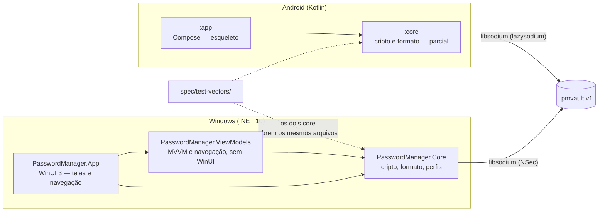
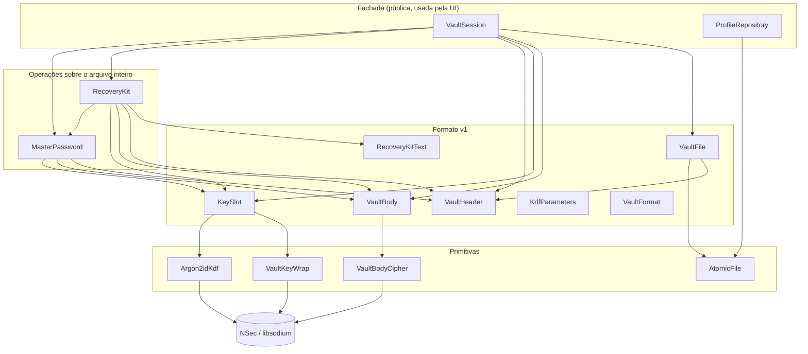
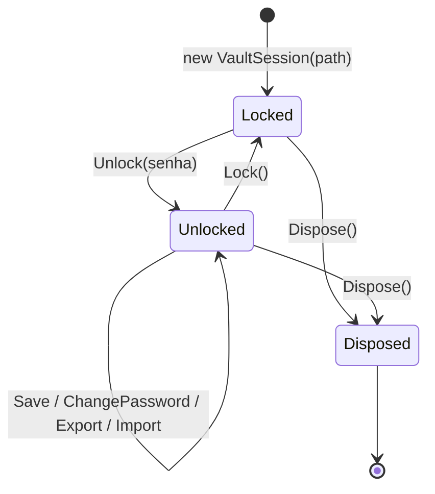
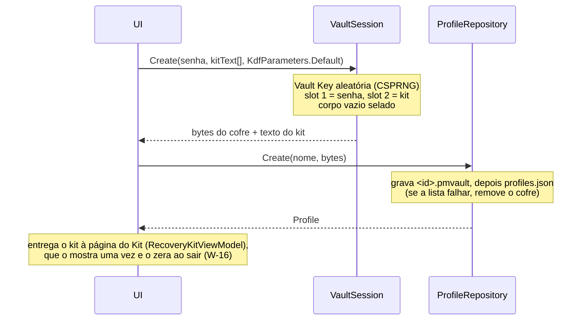
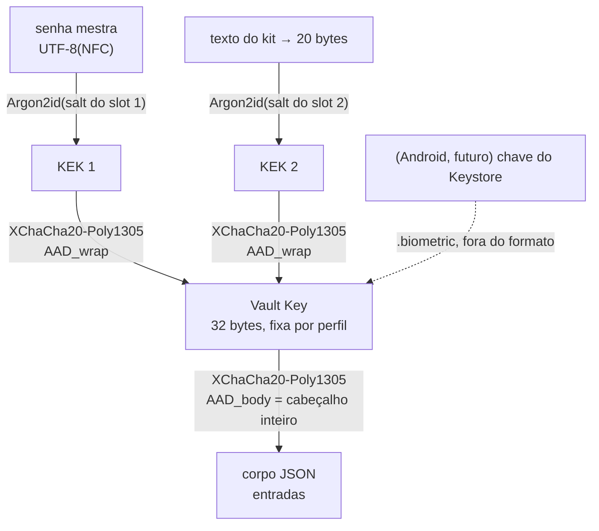
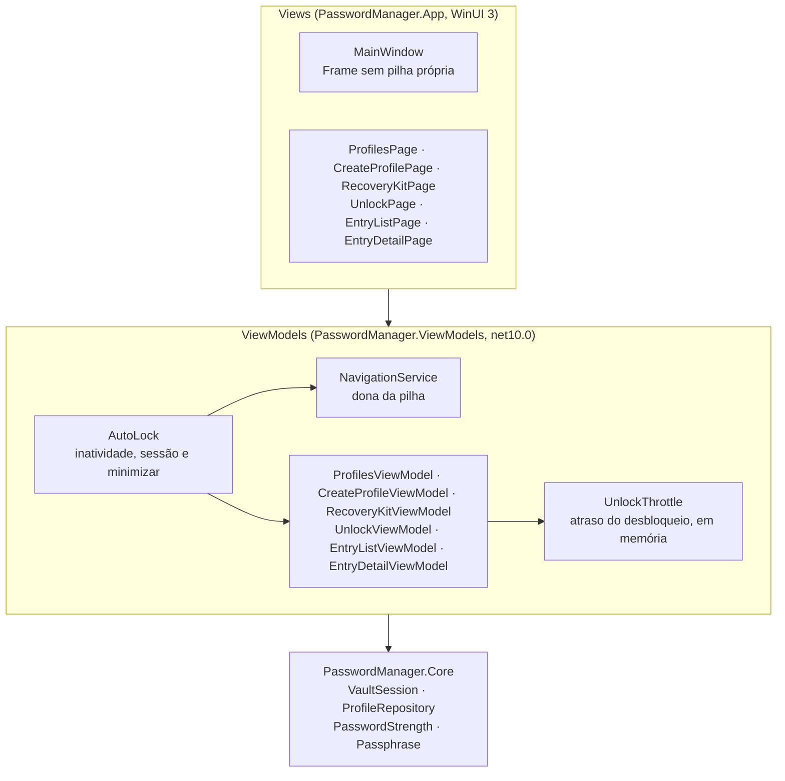
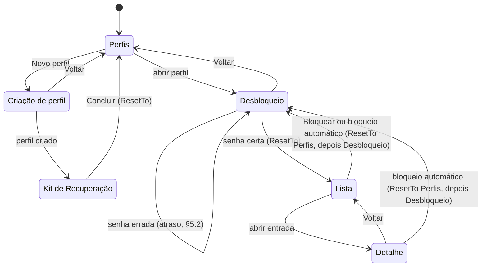

# Arquitetura do sistema

> Retrato do código em 28/10/2026, depois da W-18 (com testes E2E; fases F1 e F2 do [épico Windows](epic-windows-release.md) concluídas, a F2 com a W-11, a W-12, a W-13 e a W-14; a F3 tem a W-15, a W-16, a W-17 e a W-18 prontas, com a medição na máquina modesta da W-17 ainda pendente).
> Deve ser atualizado no mesmo PR de toda mudança relevante (AGENTS.md §9).
> Regras obrigatórias: [AGENTS.md](../AGENTS.md). Layout de bytes: [vault-format.md](vault-format.md). Ameaças: [threat-model.md](threat-model.md).
> Este documento descreve **como o código está organizado**; quando houver conflito, AGENTS.md e vault-format.md prevalecem.

## 1. Visão geral

Gerenciador de senhas offline com dois apps nativos que compartilham **um único formato de arquivo** (`.pmvault` v1):



Princípios que moldam a arquitetura (AGENTS §1): segurança, offline de verdade, simplicidade, leveza.

- **Toda a lógica de cripto e formato fica no `Core`/`core`**, sem dependência de UI. A UI só chama operações de alto nível.
- **Nenhum código de rede** nos dois lados. O Android remove a permissão `INTERNET` no manifest; o Windows não tem pacote de rede e será empacotado sem `internetClient`.
- **Mesma biblioteca base (libsodium)** nas duas plataformas, para que um arquivo de uma abra na outra.

## 2. Estado atual

| Parte | Estado |
|---|---|
| Formato v1 (`vault-format.md`) | Layout fechado (W-01). Congela quando o `core` Android passar nos vetores. |
| `PasswordManager.Core` (Windows) | **Completo para a F1**: KDF, wrap, corpo, arquivo, perfis, troca de senha, Kit de Recuperação, `VaultSession` e vetores (W-02…W-10). Mais `Passwords/` (W-16): estimador de força, gerador de frase-senha e a lista de palavras embutida, fora da pilha do cofre (§4.2). |
| `PasswordManager.App` (WinUI 3) | Telas de perfis, desbloqueio, lista e detalhe ligadas por um `Frame` (W-11), com o fluxo coberto por testes E2E (FlaUI, só Debug). Todo texto da tela vem de `Strings/pt-BR/Resources.resw`, com testes que impedem texto literal (W-12, §9.4). Segue o tema do sistema (inclusive ao vivo e na barra de título), tem nomes acessíveis, funciona só com o teclado e tem contraste AA nos dois temas, tudo coberto por testes (W-13, §9.5). Com o cofre aberto (lista e detalhe), a janela fica fora das capturas de tela (`WDA_EXCLUDEFROMCAPTURE`), também coberto por testes (W-14, §9.6). Seleção de perfis com criação (nome, senha mestra com confirmação), renomear e excluir com confirmação, tudo coberto por testes E2E (W-15, §5.6, §9.3 e §9.5). A criação tem medidor de força só informativo, botão de sugestão de frase-senha e o aviso de que o app não recupera a senha; depois de criar, uma página protegida mostra o Kit de Recuperação uma única vez e só sai por "Concluir", depois de marcar que o kit foi anotado (W-16, §5.1 e §9.2), também coberta por testes E2E. O desbloqueio tem atraso progressivo depois de uma senha mestra errada (1, 2, 4, 8, 16 e depois 30 s) com contagem regressiva na tela; enquanto o Argon2id roda, a página mostra um indicador de progresso com nome acessível e o Voltar fica bloqueado (W-17, §5.2 e §9.2), tudo coberto por testes E2E. O cofre aberto (lista e detalhe) se bloqueia sozinho por inatividade (5 min), ao bloquear a sessão do Windows e, se a opção estiver ligada, ao minimizar; o bloqueio volta a pilha para `[Perfis, Desbloqueio]` (W-18, §5.2 e §9.3), também coberto por testes E2E. Ainda sem edição de entradas, busca nem campo de senha das entradas. Sem pacote MSIX (`WindowsPackageType=None`). |
| `PasswordManager.ViewModels` (`net10.0`, sem WinUI) | Navegação (`NavigationService`, pilha pura) e seis ViewModels de página (Perfis, Criação de perfil, Kit de Recuperação, Desbloqueio, Lista e Detalhe), testados sem janela (W-11; a criação de perfil veio na W-15 e o Kit de Recuperação na W-16). `PageViewModel.AllowsScreenCapture` diz se a janela pode ser capturada com aquela página (W-14, §9.6). O `UnlockThrottle` (W-17) guarda, por perfil e só em memória, o atraso progressivo do desbloqueio; o app cria um e o passa a todos os ViewModels que levam ao desbloqueio (§5.2). O `AutoLock` (W-18) é a política do bloqueio automático, sem WinUI: observa a navegação e manda bloquear a lista aberta (§5.2). |
| `:core` (Android) | Parcial: KDF, wrap, corpo, cabeçalho, slots e arquivo. Faltam Kit de Recuperação, troca de senha, sessão, perfis e o teste dos vetores. |
| `:app` (Android) | Esqueleto: tela vazia de perfis, `FLAG_SECURE`, sem `INTERNET`, sem backup. |
| `spec/test-vectors/` | 4 vetores (`empty`, `entries-unicode`, `recovery-kit`, `export`) abertos pelo Core Windows. |

## 3. Estrutura do repositório

```
AGENTS.md                         regras para pessoas e agentes (CLAUDE.md só importa este arquivo)
THIRD-PARTY-NOTICES.md            avisos de terceiros (lista de palavras EFF, CC BY; §12)
docs/                             formato, ameaças, épico, este documento
spec/test-vectors/                vetores compartilhados (<nome>.pmvault + <nome>.json)
windows/
  global.json                     SDK .NET 10 + runner Microsoft.Testing.Platform (rodar dotnet a partir de windows/)
  Directory.Build.props           Nullable, warnings como erro, analisadores, lockfiles
  Directory.Packages.props        versões NuGet centralizadas
  src/PasswordManager.Core/       Crypto/, Vault/, Storage/, Profiles/, Passwords/
  src/PasswordManager.App/        WinUI 3: Views/, App.xaml.cs (composição), NativeMethods.cs (chamadas Win32 de §9.6 e do bloqueio automático, §5.2), textos em Strings/pt-BR/Resources.resw
  src/PasswordManager.ViewModels/ net10.0 sem WinUI: Navigation/, os ViewModels de página, o UnlockThrottle (atraso do desbloqueio, §5.2) e o AutoLock (bloqueio automático, §5.2)
  tests/PasswordManager.Core.Tests/   xUnit v3, espelha as pastas do Core + TestVectors/
  tests/PasswordManager.ViewModels.Tests/   xUnit v3, ViewModels e fluxo de navegação
  tests/PasswordManager.App.E2E.Tests/      xUnit v3 + FlaUI UIA3, dirige o app Debug real (§9.3); também tem as guardas estáticas de texto em Localization/ (§9.4) e de acessibilidade e tema em Accessibility/ (§9.5)
android/
  gradle/libs.versions.toml       todas as versões
  core/                           com.passwordmanagement.core (crypto/, vault/)
  app/                            com.passwordmanagement.android (Compose)
```

## 4. Core do Windows

### 4.1 Camadas

Cada camada só usa a de baixo. A UI deve usar só o topo (`VaultSession` e `ProfileRepository`).



A pasta `Passwords/` (W-16: `PasswordStrength`, `Passphrase` e `Wordlist`) **não está nesse diagrama**: não usa o formato nem a cripto do cofre e não toca no disco. Ela só serve aos ViewModels da criação de perfil, que medem a senha digitada e sugerem uma frase-senha (§5.1). A única dependência dela é o `RandomNumberGenerator` do .NET.

### 4.2 Responsabilidades

| Pasta | Tipo | Visibilidade | Papel |
|---|---|---|---|
| `Crypto/` | `Argon2idKdf` | pública | Senha (`char`, normalizada em NFC → UTF-8) ou segredo binário → KEK de 32 bytes. Zera os buffers intermediários. |
| | `VaultKeyWrap` | interna | XChaCha20-Poly1305 da Vault Key com a KEK e o `AAD_wrap`. |
| | `VaultBodyCipher` | interna | XChaCha20-Poly1305 do JSON do corpo com o `AAD_body`. |
| `Storage/` | `AtomicFile` | interna | `.tmp` → flush → (`.bak`) → rename. Usado pelo cofre (com `.bak`) e por `profiles.json` (sem `.bak`). |
| `Vault/` | `VaultFormat` | pública | Constantes do formato, espelhadas em `VaultFormat.kt`. |
| | `KdfParameters` | pública | Memória/iterações do Argon2id; `Default` = 64 MiB/3; validação dos limites; leitura de um slot. |
| | `VaultHeader` | pública | `Parse` (validação completa da leitura, na ordem da spec) e `Build` (slots em ordem de tipo). Expõe `BodyOffset` e os `VaultSlotRange`. |
| | `KeySlot` | pública | Cria e abre os slots tipo 1 (senha) e tipo 2 (kit). |
| | `VaultBody` | pública | `Seal`/`Open` do corpo; `Reseal` interno (mesmo conteúdo, cabeçalho novo, nonce novo). |
| | `VaultFile` | pública | `Read` devolve os bytes crus (quem valida é o `VaultHeader.Parse`); `Write` valida antes de tocar o disco e grava atomicamente com `.bak`. Nunca recorre ao `.bak` sozinho. |
| | `MasterPassword` | pública | `Change` (senha atual → nova) e `Reset` (Vault Key já conhecida → nova senha). Só o slot tipo 1 muda. |
| | `RecoveryKit` / `RecoveryKitText` | pública / interna | Gerar, substituir, abrir e redefinir a senha pelo kit; texto Crockford base32 8×4. |
| | `VaultSession` | pública | Fachada com estado: `Create`, `Unlock`, `Lock`, `Save`, `ChangePassword`, `Export`, `Import`. |
| | `VaultEntry`, `VaultContent`, `VaultJsonContext`, `UtcTimestampConverter` | pública / interna | Modelo do corpo e JSON source-generated (camelCase, datas `.fffZ`). `VaultEntry.ToString()` nunca mostra segredos. |
| | `VaultFormatException`, `VaultAuthenticationException` | pública | Erros tipados (ver 8). |
| `Profiles/` | `ProfileRepository` | pública | `profiles.json`: listar, validar nome, criar (grava o cofre e depois a lista), renomear, apagar (lista primeiro, depois `.pmvault`/`.bak`/`.tmp`). |
| | `Profile`, `ProfileNameError`, `ProfileStoreException` | pública | Modelo, erros de validação do nome, erro de armazenamento. |
| `Passwords/` | `PasswordStrength`, `PasswordStrengthLevel` | pública | Estimador de força sem dependência (decisão D4 do épico): `EstimateBits` e `Evaluate` (ver abaixo). Só informativo. |
| | `Passphrase` | pública | `Generate(n)` devolve uma frase-senha em `char[]` (6 palavras da lista EFF curta, minúsculas, separadas por `-`; de 4 a 12 palavras aceitas) e `EntropyBits(n)`. Cada índice vem de `RandomNumberGenerator.GetInt32(1296)`, sem viés de módulo. A frase nunca é uma `string` aqui, e quem chama zera o array. Seis palavras dão cerca de 62 bits e no mínimo 23 caracteres, então a frase sempre passa do mínimo de 12. |
| | `Wordlist` | interna | A EFF Short Wordlist #1, com 1.296 palavras únicas, **embutida como recurso** (`PasswordManager.Core.Passwords.eff_short_wordlist_1.txt`): não há arquivo dela em disco em tempo de execução. Carrega uma vez e falha alto se o recurso não tiver exatamente 1.296 palavras únicas. `Contains(ReadOnlySpan<char>)` consulta sem alocar. Ver §12. |

As APIs de baixo nível trabalham com **bytes do arquivo inteiro** (`ReadOnlySpan<byte> file` → `byte[]` novo). Elas não tocam no disco; só `VaultFile` e `ProfileRepository` fazem I/O. Isso torna cada operação testável em memória e deixa a escrita atômica num único lugar.

**Estimador de força** (`PasswordStrength`, W-16). O D4 do épico foi decidido sem dependência: um port de zxcvbn seria um pacote novo (AGENTS §7) e traria dicionários grandes.

- **Ideia**: o custo da senha é o menor número de bits para descrevê-la como uma sequência de pedaços, achado por programação dinâmica. Um pedaço pode ser:
  - um caractere por força bruta, a `log2` do tamanho do conjunto de classes presentes na senha inteira (minúsculas 26, maiúsculas 26, dígitos 10, símbolos ASCII e espaço 33, qualquer não ASCII 100); um par substituto conta como um caractere;
  - uma palavra de 3 letras ou mais, da lista EFF (palavras de 3 a 5 letras, `log2(1296)` bits) ou da lista própria de senhas comuns (60 palavras em pt-BR e inglês, `static readonly` no arquivo, `log2(60)` bits), casada sobre uma cópia em minúsculas com as trocas de leet (`@`/`4`→a, `3`→e, `1`/`!`→i, `0`→o, `$`/`5`→s, `7`→t); +1 bit se tem maiúscula e +1 se usou leet;
  - um bloco de 1 a 4 caracteres repetido (`blocos*c + log2(vezes)`);
  - uma sequência de 3 ou mais caracteres, seguindo o alfabeto ou os dígitos (passo +1 ou −1) ou uma fileira de teclado (`qwertyuiop`, `asdfghjkl`, `zxcvbnm`, `1234567890`) nos dois sentidos (`c + log2(tamanho) + 1`);
  - um ano `19dd` ou `20dd`, casado na cópia em minúsculas (`log2(200)`).
- **Faixas** (decisão de produto): menos de 30 bits é muito fraca, até 45 fraca, até 60 razoável, até 80 forte, e 80 ou mais muito forte.
- **Segredo**: a senha nunca vira `string`. Só os primeiros 128 caracteres são analisados, em duas cópias em `stackalloc` (minúsculas, e minúsculas com leet) que são limpas num `finally`; cada caractere além disso soma só o custo de força bruta. Um par substituto nunca é partido nessa fronteira. Nunca lança exceção por causa da entrada, e nada é logado.
- **Limite**: é uma heurística pequena, não um zxcvbn. Não conhece nomes, datas fora do formato de ano, nem dicionários grandes. Por isso é só informativa: a única regra que bloqueia continua sendo o mínimo de 12 caracteres.

### 4.3 `VaultSession`: estado e ciclo de vida



- **Enquanto desbloqueada**, guarda a Vault Key num buffer **pinned** (o GC não move nem copia), os bytes do arquivo aberto e o `VaultContent` decifrado.
- **`Lock()`** zera a chave com `CryptographicOperations.ZeroMemory` e descarta o arquivo e o conteúdo. Pode ser chamado várias vezes. Depois de `Dispose`, `Lock`/`Dispose` não fazem nada e o resto lança `ObjectDisposedException`.
- **Uma trava privada em todo membro**: um `Lock` vindo de outra thread espera a gravação em andamento e nunca deixa selar o corpo com a chave zerada. O bloqueio automático (W-18) não depende disso: a troca de sessão chega à thread de UI pela fila do dispatcher (§5.2). A mesma trava serializa as gravações, que o `VaultFile` exige.
- **Estado muda só depois que a gravação dá certo**: em falha de I/O, sessão e disco continuam iguais.
- `Create`, `Unlock`, `ChangePassword`, `Export` e `Import` rodam Argon2id com os parâmetros do cofre (`KdfParameters.Default` nos novos; o tempo medido está abaixo): **a UI deve chamá-los fora da thread de UI**.
- `Create` é estático: devolve os bytes do cofre novo e o texto do kit, e quem grava é o `ProfileRepository.Create`.

**Tempo de desbloqueio medido (W-17)**

Medição de `VaultSession.Unlock` (ler o arquivo, derivar a KEK, desembrulhar a Vault Key e abrir o corpo) com `KdfParameters.Default` (64 MiB, 3 iterações, paralelismo 1), em Release, depois de 1 execução de aquecimento e com 5 medidas. A AGENTS §3.2 pede um desbloqueio entre ~0,5 e 1,5 s; o teste falha se a mediana passar de 1,5 s.

| Máquina | CPU | RAM | Sistema | Mín. | Mediana | Máx. | Data |
|---|---|---|---|---|---|---|---|
| Desenvolvimento (execução 1) | AMD Ryzen 7 9700X, 8 núcleos / 16 threads | 31 GB | Windows 11 (10.0.26200), x64 | 39,9 ms | 40,5 ms | 42,0 ms | 28/10/2026 |
| Desenvolvimento (execução 2) | a mesma | a mesma | o mesmo | 36,4 ms | 37,2 ms | 37,5 ms | 28/10/2026 |
| Máquina modesta | **pendente** (a medir pelo usuário) | | | | | | |

- **A máquina de desenvolvimento não é modesta.** O critério da W-17 ("medido em máquina modesta") só fecha quando a linha de baixo for preenchida. Até lá ela fica **pendente**.
- **Custo padrão**: a mediana de ~40 ms está bem abaixo da faixa de ~0,5 a 1,5 s da AGENTS §3.2 (que fala de um Android de entrada). Se o custo padrão deve subir é decisão do usuário, fora da W-17, que não mudou `KdfParameters.Default` (§13).
- **Comando** (a partir de `windows/`; é um teste explícito, que uma execução normal nunca roda, em `tests/PasswordManager.Core.Tests/Vault/UnlockTimingMeasurement.cs`):

  ```
  dotnet test --project tests/PasswordManager.Core.Tests/PasswordManager.Core.Tests.csproj -c Release --filter-class "PasswordManager.Core.Tests.Vault.UnlockTimingMeasurement" --explicit only --show-live-output on --output Detailed
  ```

  Sem `--output Detailed` as linhas do teste não aparecem no `dotnet test`. O teste cria um cofre fictício numa pasta temporária (apagada no fim) e imprime os parâmetros do KDF, o sistema, a arquitetura, o número de processadores lógicos, a CPU, a memória e o mínimo, a mediana e o máximo.
- **Em outra máquina, sem o SDK**: rode `dotnet build tests/PasswordManager.Core.Tests/PasswordManager.Core.Tests.csproj -c Release`, copie `tests/PasswordManager.Core.Tests/bin/Release/net10.0/` para a máquina (precisa só do runtime .NET 10) e, nessa pasta, rode:

  ```
  PasswordManager.Core.Tests.exe -class "PasswordManager.Core.Tests.Vault.UnlockTimingMeasurement" -explicit only -showLiveOutput
  ```

  A linha da máquina modesta entra na tabela com esses números.

## 5. Fluxos principais

### 5.1 Criar perfil



Na tela de criação (`CreateProfileViewModel`, W-15 e W-16), a parte da UI faz o seguinte:

- Valida antes de qualquer Argon2id: o nome pelas mesmas regras do `ProfileRepository.ValidateDisplayName`; a senha com pelo menos 12 caracteres (contados como escalares Unicode) e a confirmação igual à senha. O mínimo é `CreateProfileViewModel.MinimumPasswordLength`.
- Roda `VaultSession.Create` e `ProfileRepository.Create` em `Task.Run`, com `KdfParameters.Default`. O `await` **não usa `ConfigureAwait(false)`**, para a navegação voltar à thread de UI.
- O texto do kit vai para um buffer. Se o perfil é criado, o buffer **passa para o `RecoveryKitViewModel`** (a `CreateAsync` não o zera nesse caso) e a navegação vai para a página do Kit; em qualquer falha, o `finally` o zera sem mostrá-lo.
- Os dois `char[]` da senha entram no comando (`NewMasterPassword`), que os zera no `finally`, mesmo em falha.
- Com a lista corrompida (`LoadFailed`), o botão de criar fica desabilitado, porque `Create` e `ValidateDisplayName` lançariam exceção.

**Medidor, sugestão e Kit (W-16)**

- **Medidor de força, só informativo.** A cada `PasswordChanged` do campo de senha, a página chama `UpdateStrength`, que grava `Strength` (`PasswordStrength.Evaluate`, faixas em §4.2). O texto "Força da senha: …" e uma barra (`ProgressBar`) seguem esse nível; os dois ficam ocultos com o campo vazio. **Nada é bloqueado pelo medidor**: uma senha fraca de 12 caracteres ou mais é aceita, e a única regra que impede a criação continua sendo o mínimo de 12 (cobre os testes `Create_WeakButTwelveRunes_IsAccepted` e `CreateProfile_StrengthMeter_FollowsPasswordAndDoesNotBlock`).
- **Sugestão de frase-senha.** O botão "Sugerir frase-senha" executa `SuggestPassphraseCommand`: `Passphrase.Generate()` vira `Suggestion` (uma `string`) e o `char[]` é zerado no `finally`. A página põe a frase **nos dois campos de senha** e a mostra em um texto abaixo, sem seleção (não dá para copiá-la), com a dica para memorizar ou anotar. Com a frase nos campos, o usuário só digita o nome e cria. O comando fica indisponível enquanto uma criação roda, como o Voltar, para a frase não mudar debaixo da senha em uso.
- **Quando a sugestão some.** `UpdateStrength` apaga `Suggestion` quando o texto digitado não é vazio e difere dela (o usuário escreveu outra coisa). Campo vazio ou texto igual a mantém, porque a página esvazia os campos depois de cada tentativa de criar e a frase mostrada continua sendo a mesma. `OnNavigatedFrom` apaga `Suggestion` e volta `Strength` para `None`.
- **Aviso de que não há recuperação.** O texto estático da página de criação diz que o app não recupera a senha mestra e que um Kit de Recuperação será mostrado uma única vez; sem a senha e sem o kit, o perfil fica inacessível (AGENTS §3.4).
- **Página do Kit.** Com o perfil criado, `NavigateTo(new RecoveryKitViewModel(kit, repo, nav))` substitui o antigo `GoBack`. A página mostra o título, a explicação, o texto do kit (Crockford base32, 8 grupos de 4), as instruções e a caixa "Anotei o Kit de Recuperação e entendo que, sem a senha mestra e sem o kit, as senhas deste perfil não podem ser recuperadas." (esse é o reconhecimento explícito de que não há recuperação). **Concluir** só fica habilitado com a caixa marcada (`KitSaved` → `DoneCommand.CanExecute`, e o comando ignora uma chamada direta sem a caixa). Concluir faz `ResetTo(new ProfilesViewModel(repo, nav))`, então a lista de perfis volta atualizada e **sem nada para voltar**. A página **não tem Voltar nem Escape**. O `RecoveryKitViewModel` assume o `char[]` do kit e o zera com `Array.Clear` em `OnNavigatedFrom`; depois disso, `KitText` fica vazio. Não há botão de imprimir nem de copiar: copiar exigiria as regras de área de transferência da W-22.
- Com o kit em tela, a janela fica excluída da captura (§9.6), e o texto do kit só existe na tela até sair da página.

### 5.2 Desbloquear, editar, bloquear

1. `new VaultSession(repo.GetVaultPath(id))` → `Unlock(senha)`.
2. `VaultFile.Read` lê os bytes e `VaultHeader.Parse` os valida; `KeySlot` deriva a KEK **só do slot tipo 1** e desembrulha a Vault Key; `VaultBody.Open` decifra o corpo com o cabeçalho inteiro como AAD.
3. A UI lê `Content` e chama `Save(novoConteúdo)`: o corpo é re-selado com nonce novo e gravado atomicamente; o arquivo anterior vira `.bak`.
4. `Lock()` ao sair, ou pelo bloqueio automático (inatividade, sessão do Windows e, com a opção, minimizar; W-18, abaixo).

Senha errada, arquivo adulterado e slot adulterado aparecem todos como a mesma `VaultAuthenticationException`, sem detalhe do motivo.

**Atraso progressivo e progresso (W-17)**

Na tela de desbloqueio (`UnlockViewModel` e `UnlockPage`), o atraso depois de uma senha errada é só da UI (AGENTS §3.4): a proteção real contra tentativas é o Argon2id. A política fica em `UnlockThrottle` (no `ViewModels`, não no `Core`), porque não mexe em cripto nem no formato.

- **Regra**: depois da n-ésima senha errada seguida, o desbloqueio fica bloqueado por `min(2^(n-1), 30)` s: 1, 2, 4, 8, 16, 30, 30… (`UnlockThrottle.DelayAfter`; não estoura com n grande). Só a `VaultAuthenticationException` conta. `VaultFormatException`, `IOException` e `UnauthorizedAccessException` (`UnlockError.VaultUnreadable`) não iniciam atraso. Um desbloqueio com sucesso zera a contagem **daquele perfil**.
- **Estado**: por perfil (`Guid`), **só em memória**, durante a vida do app, atrás de um `System.Threading.Lock`. O `App.OnLaunched` cria um único `UnlockThrottle(TimeProvider.System)` e o passa explicitamente (não há DI) a `ProfilesViewModel`, `CreateProfileViewModel`, `RecoveryKitViewModel`, `UnlockViewModel` e `EntryListViewModel`. Por isso Voltar e abrir o perfil de novo, ou Bloquear e desbloquear de novo, mantêm a contagem regressiva.
- **Não é persistido: reiniciar o app zera o atraso. É um limite aceito.** Quem tem o teclado na mão pode copiar o `.pmvault` e atacá-lo fora do app, então só o Argon2id protege de verdade (AGENTS §3.4). Nenhum arquivo novo em disco (§7).
- **Relógio monotônico e injetado**: `UnlockThrottle(TimeProvider)` usa `GetTimestamp` e `GetElapsedTime`, então mudar a hora do Windows não encurta nem alonga o atraso (coberto por `RemainingDelay_WallClockChanges_DoNotShortenOrExtendTheDelay`). Os testes usam o `ManualTimeProvider` (escrito à mão, com `Advance`), sem esperar em tempo real e sem pacote novo.
- **O ViewModel é síncrono e a View move a contagem**: o `UnlockViewModel` expõe `RetrySeconds` (o tempo que falta, arredondado para cima; 0 quer dizer que pode tentar) e `RefreshRetryDelay()`, que lê o relógio de novo. `OnNavigatedTo` e o fim de cada tentativa errada chamam `RefreshRetryDelay()`. A `UnlockPage` roda um `DispatcherQueueTimer` de 250 ms **só enquanto `RetrySeconds > 0`**, que chama `RefreshRetryDelay()` a cada passo e se para em 0 e no `Unloaded`.
- **Durante a contagem**: o botão Desbloquear fica desabilitado (`UnlockPage.CanSubmit`, que o botão e o Enter dividem) e Enter não faz nada (a tecla é consumida, a senha não é copiada e o campo **mantém o texto**). O `PasswordBox` continua habilitado (o foco não pula) e o Voltar continua permitido. O texto "Aguarde N s para tentar de novo." (`UnlockRetryCountdown`, no resw, §9.4) aparece abaixo das mensagens de erro. Uma chamada direta ao comando é ignorada: o array é zerado, nenhum Argon2id roda e a contagem de erros não muda.
- **Durante o Argon2id**: o `Voltar` e o Escape (que é o acelerador dele) ficam indisponíveis (`GoBackCommand` só executa com `!UnlockCommand.IsRunning`; uma chamada direta também é ignorada), o mesmo padrão da criação de perfil (§9.2). O `ProgressRing` `UnlockProgress` aparece só nesse intervalo (§9.5).
- **Tempo do Argon2id**: ver §4.3. Na máquina de desenvolvimento ele leva ~40 ms, então o indicador mal aparece lá; o comportamento é garantido por teste de ViewModel (abaixo, §9.3) e não pelo olho.

**Bloqueio automático (W-18)**

O cofre aberto (lista ou detalhe, e qualquer página acima delas) é bloqueado por três gatilhos. Todos executam o `LockCommand` da lista aberta, o mesmo do botão Bloquear: a sessão é descartada, as entradas saem da lista e a pilha vira `[Perfis, Desbloqueio]`.

- **Inatividade**: 5 min sem entrada na janela do app (padrão de `AutoLockOptions.Default`). Entrada são `KeyDown`, `PointerPressed`, `PointerMoved` e `PointerWheelChanged` no `RootFrame`, com `handledEventsToo`, então uma tecla ou um clique que um controle consome também conta. Entrada em outro programa não conta: o cofre fecha enquanto o usuário trabalha em outra coisa. A contagem começa quando o cofre abre e usa o relógio monotônico do `TimeProvider` (`GetTimestamp`), então mudar a hora do Windows não a encurta nem alonga. Um `DispatcherQueueTimer` de 1 s chama `CheckIdle` só enquanto `IsVaultOpen` é verdadeiro.
- **Sessão do Windows**: a `MainWindow` chama `WTSRegisterSessionNotification` (só a sessão do app) e troca o procedimento da janela por `SetWindowLongPtrW(GWLP_WNDPROC)`, encadeando com `CallWindowProcW` (não usa `SetWindowSubclass`, que exige comctl32 v6). `WM_WTSSESSION_CHANGE` com `WTS_SESSION_LOCK`, `WTS_CONSOLE_DISCONNECT` ou `WTS_REMOTE_DISCONNECT` bloqueia o cofre. Falha no registro ou na subclasse lança `Win32Exception` na inicialização (fail-closed, como `Protect()`).
- **Minimizar** (desligado por padrão): `WM_SIZE` com `SIZE_MINIMIZED` bloqueia só com `LockOnMinimize` ligado.

O procedimento da janela é um `[UnmanagedCallersOnly]` estático que **só enfileira** o trabalho no `DispatcherQueue`, com prioridade alta, e chama o procedimento anterior (uma exceção ali encerraria o processo). Assim a navegação nunca roda dentro da mensagem, e tudo continua na thread de UI.

Regras:

- **Só cofre aberto**: com Perfis, Desbloqueio, Criação ou Kit, todo gatilho não faz nada. O Kit fica de fora de propósito: bloquear ali perderia um kit que só é mostrado uma vez (§5.1).
- **Gatilho durante o Argon2id**: se chega enquanto um desbloqueio roda, vale só para o cofre que esse desbloqueio abre, e só uma vez. `AutoLock` assina `IsRunning` do `UnlockCommand` e, quando ele vira falso, desassina e bloqueia o cofre recém-aberto, se ele abriu. Uma senha errada não deixa nada pendente. Bloquear de dentro de `Navigated` causaria navegação reentrante, por isso a espera.
- **Sem tentativa falha**: bloquear não toca no `UnlockThrottle`, e a tela de desbloqueio que ele abre mostra `RetrySeconds` zero.
- **Sem persistência**: `AutoLockOptions` (`IdleTimeout`, `LockOnMinimize`) é montado em `App.OnLaunched` e não vai para disco; a W-26 vai montá-lo a partir das configurações. No Debug, dois switches só para o E2E: `--idle-timeout-seconds <n>` (inteiro acima de zero) e `--lock-on-minimize`. Um valor inválido aborta a inicialização, como `--vaults-dir` (§9.1). No Release esse código não é compilado.

### 5.3 Trocar a senha mestra

`ChangePassword(atual, nova)` → `MasterPassword.Change`: abre o slot 1 com a senha atual e cria um slot 1 novo (salt e nonce novos). O slot 2 fica igual, byte a byte. O corpo é re-selado com a **mesma** Vault Key, porque o cabeçalho é AAD. As entradas nunca são cifradas de novo com outra chave.

### 5.4 Kit de Recuperação

- `RecoveryKit.Unlock(file, kitText, vaultKey)`: decodifica o texto (valida antes de gastar Argon2id) e abre **só o slot tipo 2**.
- `RecoveryKit.ResetPassword(file, kitText, novaSenha, params)`: kit → Vault Key → `MasterPassword.Reset`.
- `RecoveryKit.Create(file, vaultKey, params, kitText)`: gera um kit novo e substitui o slot 2; o kit antigo deixa de funcionar.

Esses três ainda não estão expostos pela `VaultSession` (a W-26 decide como a UI os chama).

### 5.5 Exportar e importar

- `Export(senhaDeExportação)` devolve bytes de um `.pmvault` com **Vault Key nova**, exatamente um slot tipo 1 e nenhum kit. Nada é gravado: o app salva via `FileSavePicker` (W-23), nunca em pasta temporária.
- `Import(bytes, senhaDeExportação)` devolve o `VaultContent` decifrado para prévia. A sessão e o disco não mudam; quem chama mescla as entradas e chama `Save` (W-25).
- CSV ainda não existe (W-24/W-25).

### 5.6 Renomear e excluir perfil

A tela de Perfis (W-15) fala com o `ProfileRepository` pelo `ProfilesViewModel`. Os botões Renomear e Excluir ficam em cada item da lista e abrem um `ContentDialog` declarado em `ProfilesPage.xaml`. Nenhuma das duas operações mexe no conteúdo do cofre.

- **Renomear** (`Rename(id, nome)`) troca só o `DisplayName` da entrada. O `id` e os bytes do `.pmvault` ficam iguais. A validação usa `ValidateDisplayName(nome, id)`, que deixa o próprio perfil fora da checagem de nome repetido. Um nome inválido mantém o diálogo aberto com a mensagem; qualquer outro resultado fecha o diálogo e relê a lista.
- **Excluir** tem dois passos. O clique em Excluir só grava `PendingDelete`. O diálogo de confirmação tem **Cancelar como botão padrão**, então Enter e Escape cancelam. Só o botão de excluir chama `ConfirmDelete`, que chama `ProfileRepository.Delete(id)`. Nenhuma senha mestra é pedida: quem tem acesso à pasta pode apagar os arquivos pelo Explorer, então a confirmação protege contra engano, não contra um atacante.
- **Ordem de `Delete`**: remove a entrada de `profiles.json` (gravação atômica) e depois apaga `<id>.pmvault`, `<id>.pmvault.bak` e `<id>.pmvault.tmp`. Nenhum outro arquivo é tocado, nem arquivos órfãos nem os de outros perfis.
- **Falha**: se um arquivo não puder ser apagado (por exemplo, aberto em outro programa), a exceção sobe, `ActionFailed` mostra o aviso na lista e a lista é relida. O arquivo que sobrou fica órfão: a entrada já saiu de `profiles.json`, então a tela não o lista. Nada o apaga automaticamente.

## 6. Chaves e segredos



Regras que o código segue:

- **Nenhum hash da senha é guardado**: a verificação é a própria tag AEAD do slot.
- Senhas e textos de kit entram como `ReadOnlySpan<char>`; chaves como `Span<byte>`. Temporários ficam em `stackalloc` e são zerados em `finally`. Os buffers do chamador nunca são alterados, e é ele quem os zera.
- O `VaultContent` e suas `string` são objetos gerenciados e **não podem ser zerados**; `Lock` só solta as referências (limite aceito em AGENTS §3.5).
- **A UI precisa de `string` para mostrar a frase sugerida e o kit** (W-16): a frase vai para um `TextBlock` e para os dois `PasswordBox`, e o texto do kit para um `TextBlock`. O `Core` devolve `char[]` (`Passphrase.Generate`) e os ViewModels zeram os arrays que possuem, mas as `string` ficam no heap até o GC. É o mesmo limite do `PasswordBox` (§13), e a página do Kit esvazia o `TextBlock` ao sair. O medidor lê o texto do campo a cada tecla, o que cria outra `string` gerenciada por tecla. Nada disso vai para log nem para exceção.
- Exceções nunca carregam segredo nem conteúdo do arquivo.

## 7. Armazenamento em disco

Pasta: `%LOCALAPPDATA%\PasswordManagement\vaults\` (sem pacote) ou `<LocalFolder>\vaults\` (MSIX), via `ProfileRepository.GetDefaultDirectory`.

| Arquivo | Escrito por | Observação |
|---|---|---|
| `profiles.json` | `ProfileRepository` | Em claro, só `id`/`displayName`/`createdAt`. Atômico, **sem** `.bak`. |
| `<id>.pmvault` | `VaultFile.Write` | Atômico, com `.bak` da versão anterior. Nome vem só do `id`. |
| `<id>.pmvault.bak` / `.tmp` | `AtomicFile` | `.tmp` só sobra após queda e é sobrescrito na próxima gravação. |

Não há trava entre processos: quem chama serializa as operações. O atraso do desbloqueio (W-17) não tem arquivo: vive só em memória e some quando o app fecha (§5.2). O bloqueio automático (W-18) também não grava nada.

## 8. Erros

| Exceção | Quando |
|---|---|
| `VaultFormatException` | Arquivo malformado: tamanho, magic, versão, slots, limites do KDF. Lançada antes de qualquer Argon2id. |
| `VaultAuthenticationException` | Falha AEAD: senha/kit errado ou qualquer byte adulterado. Mensagem fixa, sem `InnerException`. |
| `FormatException` | Texto do kit inválido (checado antes do Argon2id). |
| `InvalidOperationException` | Sessão bloqueada; cofre sem slot de kit. |
| `ProfileStoreException` | `profiles.json` inválido (JSON quebrado, `id` repetido, campo ausente…). O arquivo corrompido nunca é sobrescrito. A mensagem não traz nomes de perfil. |
| `IOException` e afins | Falha de disco em `VaultFile`/`ProfileRepository`. Sobem sem tradução; a escrita atômica garante que o arquivo anterior continua inteiro. |
| `ProfileNameError` (enum) | Resultado da validação do nome de perfil, sem exceção. |

## 9. App do Windows

### 9.1 Camadas

Cada camada só usa a de baixo. As Views não chamam o Core: falam só com os ViewModels.



- **Views**: só XAML e `x:Bind` para os ViewModels. Do `Core` elas só conhecem tipos de dado, para mostrar (como `Profile`, `VaultEntry`, `ProfileNameError` e, desde a W-16, o enum `PasswordStrengthLevel`, que escolhe o texto e o valor da barra de força); nenhuma View chama a cripto. A `MainWindow` escuta `NavigationService.Navigated` e chama `Frame.Navigate` com a página do tipo de `Current`; cada caso tem um `typeof` literal, para o trimmer enxergar os tipos. No mesmo handler, a `MainWindow` aplica a afinidade de exibição da página atual, que decide se a janela pode ser capturada (§9.6). A `MainWindow` também recebe o `AutoLock`: alimenta a atividade da janela, roda o timer de inatividade e recebe as mensagens de sessão e de minimizar (§5.2).
- **ViewModels**: `ObservableObject` e `RelayCommand` do CommunityToolkit.Mvvm; nenhum tipo de UI. Expõem estado (`UnlockError`, `RetrySeconds`, `IsEmpty`, `LoadFailed`), e a View escolhe o texto no `.resw`. O `UnlockThrottle` (W-17) não é um ViewModel de página: é a política do atraso do desbloqueio, em memória, que os ViewModels recebem pelo construtor (§5.2).
- **Composição**: `App.OnLaunched` cria o `NavigationService`, o `ProfileRepository`, o `UnlockThrottle` e o `AutoLock` (com `TimeProvider.System`; o `AutoLock` vem antes da janela, para ver toda navegação), entrega o serviço e o `AutoLock` à `MainWindow` e mostra a tela de perfis, passando o `UnlockThrottle` adiante a cada ViewModel que leva ao desbloqueio. As opções do `AutoLock` são `AutoLockOptions.Default` (5 min, sem bloqueio ao minimizar), exceto no Debug, onde `ResolveAutoLockOptions` lê os switches do E2E (§5.2). Não há container de DI. O diretório de cofres vem de `ResolveVaultsDirectory`: no Debug, `--vaults-dir <caminho absoluto>` substitui `ProfileRepository.GetDefaultDirectory()` (usado pelos testes E2E); um valor inválido aborta a inicialização. No Release esse código não é compilado.

### 9.2 Navegação



- **A pilha fica no `NavigationService`**. O `Frame` tem `IsNavigationStackEnabled="False"`, e a View não guarda histórico próprio.
- **Desbloquear troca a pilha inteira** pela Lista (`ResetTo`). Com o cofre aberto, nenhum Voltar leva ao desbloqueio.
- **Criar perfil** empurra a página de criação na pilha. Ela só sai por Voltar (Escape também) ou, depois de criar com sucesso, indo para o Kit de Recuperação. O comando de Voltar fica desabilitado enquanto a criação roda, então a página não pode ser deixada no meio do Argon2id.
- **Kit de Recuperação** (W-16): a criação bem-sucedida empurra a página do Kit (`NavigateTo`), então a pilha fica `[Perfis, Criação, Kit]`. A página **não tem Voltar nem Escape**; só **Concluir** a deixa, e só depois de marcar que o kit foi anotado. Concluir troca a pilha inteira por `[Perfis]` (`ResetTo`, o mesmo padrão do Bloquear), com a lista relida e sem a página de criação para voltar. A pilha é segura só porque nada oferece Voltar no Kit: um gesto global de voltar, se um dia existir, tem que ignorar essa página. Se o app for fechado nela, o perfil já existe mas o kit nunca foi visto (§13).
- **Bloquear** (`EntryListViewModel.Lock`) fecha a sessão, esvazia as entradas e refaz a pilha como `[Perfis]` com `Desbloqueio` atual. Voltar cai em Perfis, nunca na lista. O bloqueio automático (W-18) executa o mesmo comando, então o resultado é igual também a partir do Detalhe (§5.2).
- Cada troca chama `OnNavigatedFrom` da página que sai e `OnNavigatedTo` da que entra, antes de `Navigated`, sempre na thread que chamou (a de UI).
- **Desbloqueio fora da thread de UI**: `UnlockViewModel` roda `VaultSession.Unlock` em `Task.Run`. O `await` **não usa `ConfigureAwait(false)`**: a navegação depois dele precisa voltar à thread de UI, senão `Frame.Navigate` falha.
- **Voltar bloqueado durante o Argon2id** (W-17): enquanto o desbloqueio roda, `GoBackCommand` não executa (o `UnlockViewModel` escuta `IsRunning` do comando e notifica `CanExecuteChanged`, o mesmo padrão da criação de perfil), então nem o botão nem o Escape saem da página. Quem deixa a página nesse momento é só o desbloqueio bem-sucedido, e um segundo passo para trás sairia também de Perfis. Depois de uma senha errada, o Voltar volta a valer, inclusive durante o atraso (§5.2).
- **Atraso**: uma senha errada deixa a página em Desbloqueio com `RetrySeconds > 0`. A volta a Perfis e a nova abertura do mesmo perfil mantêm o atraso, porque o `UnlockThrottle` é do app (§5.2).
- **Senha como `char[]`**: a `UnlockPage` copia o `PasswordBox` para um `char[]` e esvazia o campo. O comando assume o array e o zera no `finally`, mesmo em falha (e, no atraso, sem rodar o Argon2id). O `PasswordBox` só expõe `string`; isso fica como ponto em aberto (§13).
- **Sessão**: a `VaultSession` nasce no `UnlockViewModel`, passa à `EntryListViewModel` ao desbloquear e é descartada no `Lock` ou quando o desbloqueio falha.

### 9.3 Testes E2E

O projeto `windows/tests/PasswordManager.App.E2E.Tests/` abre o `PasswordManager.App.exe` Debug de verdade e o dirige pela UI Automation (FlaUI.UIA3). Os testes de fluxo e de texto usam só padrões de UIA (`Invoke` em botões e itens, `Value` nas caixas de texto e no campo de senha, `Toggle` na caixa de confirmação do kit). Os testes de teclado (`AccessibilityE2ETests`, §9.5) enviam teclas reais (`SendInput`), mas só depois de confirmar que a janela do app está em primeiro plano; se não estiver, o teste falha sem enviar nada. Nenhum clique de mouse é enviado. Os testes de bloqueio automático (`AutoLockE2ETests`, W-18) movem o cursor real com `SendInput` (coordenadas absolutas da tela virtual), não com `Mouse.MoveTo` do FlaUI, porque `SetCursorPos` não gera `PointerMoved` no WinUI 3; também sem clique. Os testes de proteção contra captura (`WindowProtectionE2ETests`, §9.6) leem a afinidade de exibição da janela e a movem para fora da tela e de volta com `SetWindowPos`; não enviam tecla nem clique. Os cinco fluxos de `NavigationE2ETests` cobrem perfis vazios, lista de perfis corrompida, cofre ausente, senha errada e o caminho desbloquear → detalhe → bloquear, seguindo as regras de §9.2. `LocalizationE2ETests` (oito testes) confere, em cada tela, que o texto exibido vem do `.resw` (§9.4). `ProfilesE2ETests` (oito testes) cobre a seleção e a criação de perfis na tela e no disco, descrita abaixo. `UnlockE2ETests` (dois testes, W-17) cobre o atraso progressivo e o indicador de progresso do desbloqueio, também descrito abaixo. `AutoLockE2ETests` (cinco testes, W-18) cobre o bloqueio automático, também descrito abaixo.

- **Isolamento**: cada teste cria uma pasta `pm-e2e-*` em `%TEMP%`, passa o caminho em `--vaults-dir` e a apaga no fim, inclusive após falha. O cofre vem de `spec/test-vectors/entries-unicode.pmvault`, e o `profiles.json` é escrito pelo próprio teste. Os testes nunca tocam em `%LOCALAPPDATA%\PasswordManagement\vaults\`. Se o processo de teste morrer no meio de um teste, o app pode ficar aberto: encerre `PasswordManager.App` manualmente.
- **Uma janela por vez**: `AssemblyInfo.cs` desliga o paralelismo do xUnit, então só existe uma janela do app em cada momento.
- **Ids como contrato**: todo elemento que um teste usa tem `AutomationProperties.AutomationId` (os ids estão nas seis Views), inclusive os títulos das telas e a dica de lista vazia (`ProfilesTitle`, `ProfilesEmptyHint`, `CreateTitle`, `KitTitle`, `UnlockTitle`, `EntriesTitle`). Os testes localizam por id, nunca por texto. Os nomes acessíveis vêm da W-13 (§9.5). Um `Name` novo ou um template reestruturado não pode remover um id.
- **Diálogos**: um `ContentDialog` fechado deixa na árvore do UIA só um grupo vazio com o seu id; quando ele abre, aparece uma janela com esse id. `AppSession` (`FindDialog`, `WaitDialog`, `WaitDialogGone` e `InvokeInDialog`) procura essa janela e acha os botões `PrimaryButton` e `CloseButton` dentro dela, pelos ids dos templates, não pelo texto.
- **Caixas, estado e nomes** (`AppSession`, W-16): `Toggle(id)` marca uma `CheckBox` pelo `TogglePattern`; `IsEnabled(id)` lê se o elemento está habilitado e `WaitEnabled(id)` espera por isso (o `CanExecute` de um comando chega ao botão um instante depois); `WaitName(id, texto)` espera o nome do elemento, porque um texto ligado ao ViewModel pode ficar um instante atrás da entrada.
- **Aparição rápida e texto com valor** (W-17): `AppSession.WaitAppears(id, tempo, intervalo)` consulta o elemento a cada 10 ms e devolve `true` quando o vê, para o que só fica na tela por um instante (como o indicador de progresso). `AppResources.Format(chave, argumentos...)` formata um valor do resw com `{0}` como o app o formata (cultura atual), então o teste compara o nome do `UnlockRetryCountdown` com `Format("UnlockRetryCountdown", 2)` sem repetir o texto.
- **Depois de uma senha errada, o teste espera o fim do atraso.** O botão Desbloquear fica desabilitado por 1 s (a primeira senha errada) e um `Invoke` do UIA num botão desabilitado lança exceção, então `NavigationE2ETests` (senha errada), `LocalizationE2ETests`, `AccessibilityE2ETests` e `WindowProtectionE2ETests` chamam `WaitEnabled("UnlockButton")` antes de digitar a senha certa. Isso acrescenta cerca de 1 s a cada um desses testes. Nenhum teste dorme um tempo fixo para o atraso: todos esperam por nome ou por habilitação.
- **Desbloqueio** (`UnlockE2ETests`, dois testes, W-17; senhas fictícias):
  - `WrongPasswords_DelayDoublesSurvivesBackAndThenUnlocks`, no cofre de teste, confere o atraso passo a passo. A senha errada nº 1 mostra o erro, o nome da contagem é o de 1 s e o botão fica desabilitado, e a contagem some quando ele habilita. A nº 2 mostra a contagem de 2 s e depois a de 1 s, até habilitar. A nº 3 (4 s) segue com Voltar e a reabertura do perfil: a contagem continua na tela e o botão continua desabilitado. Passado o atraso, a senha certa abre a lista;
  - `Unlock_RealCostVault_ShowsProgressOnlyWhileArgon2idRuns` cria um perfil pela tela (então com o custo real, `KdfParameters.Default`), passa pelo Kit, abre o perfil e confere que o `UnlockProgress` não existe antes de desbloquear, que aparece (com `WaitAppears`, 10 ms) enquanto o Argon2id roda e que some quando a lista abre. Isso mostra que a thread de UI continuou desenhando durante o Argon2id.
  - **O custo real é baixo nesta máquina** (~40 ms, §4.3), então esse teste depende de um intervalo curto e poderia falhar por tempo: passou 16 em 16 vezes com a consulta a cada 10 ms. **A prova que não depende de tempo é o teste de ViewModel** `GoBack_WhileArgon2idRuns_IsBlockedUntilTheUnlockEnds`, que usa um perfil com `KdfParameters.Default` e começa o comando sem esperar: `IsRunning` fica verdadeiro, o `GoBackCommand` não executa e a tarefa não terminou; depois do `await`, o Voltar volta a executar.
- **Bloqueio automático** (`AutoLockE2ETests`, cinco testes, W-18; os de inatividade usam `--idle-timeout-seconds 3`, o de minimizar com bloqueio usa `--lock-on-minimize`, e os demais usam o padrão de 5 min):
  - `Idle_LocksFromTheDetailPageWithNoEntryLeft`: sem entrada, o cofre aberto no Detalhe bloqueia; nenhum valor de entrada fica na árvore (`AssertNoEntryVisible`), a afinidade volta a `WDA_NONE`, e Voltar leva a Perfis sem resquício atrás;
  - `Activity_KeyboardAndPointer_KeepTheVaultOpenPastTheTimeout`: teclas e movimento do cursor (sem clique) mantêm o cofre aberto por mais de duas vezes o prazo; parada a entrada, bloqueia;
  - `SessionLock_LocksOnlyAnOpenVault`: `WTS_SESSION_LOCK` em Perfis não faz nada; no Detalhe bloqueia e não deixa entrada visível; `WTS_SESSION_UNLOCK` não reabre nada; e o cofre aberto depois continua aberto, porque nenhum bloqueio ficou pendente;
  - `Minimize_ByDefault_KeepsTheVaultOpen` e `Minimize_WithLockOnMinimize_LocksTheVault`: minimizar e restaurar só bloqueia com `--lock-on-minimize`.
  - O teste de sessão não chama `LockWorkStation`, porque não conseguiria destravar a área de trabalho de novo. Ele posta a mensagem real `WM_WTSSESSION_CHANGE` na janela de verdade, com `PostMessageW`, e a mensagem passa pela mesma procedure, pela fila e pelo `AutoLock` de um bloqueio do sistema. Só a entrega do próprio Windows não é exercitada (§13).
  - `AppSession` ganhou: `Launch(seed, params string[] arguments)` (argumentos extras depois de `--vaults-dir`), `PostSessionChange`, `Minimize` e `Restore` (esperam `IsIconic`), `MovePointerInside` e `ParkPointerOutside` (cursor real, sem clique; o cursor sai da janela para que ele mesmo não conte como entrada) e `AssertNoEntryVisible`, que confere se algum valor semeado aparece como `Name` ou como `Value` de caixa de texto (nunca em campo de senha).
- **Perfis** (`ProfilesE2ETests`, oito testes):
  - criar o primeiro perfil pela tela de criação, passar pela página do Kit e abrir o perfil pelo desbloqueio. Na página do Kit, o nome do `KitText` casa com o formato do kit (`^[0-9A-HJKMNP-TV-Z]{4}(-[0-9A-HJKMNP-TV-Z]{4}){7}$`), a janela está excluída da captura, `KitDone` começa desabilitado e só habilita depois de `Toggle("KitSavedCheck")`. Concluir leva à lista, a janela volta a `WDA_NONE` e o `KitText` some;
  - frase-senha sugerida: `CreateSuggest` mostra uma frase de palavras minúsculas ligadas por `-` (23 caracteres ou mais), o medidor diz "muito forte", e só o nome é digitado; depois do Kit, o desbloqueio abre o cofre com a própria frase;
  - medidor de força: ausente com o campo vazio, "muito fraca" para `aaaaaaaaaaaa`, "muito forte" para uma senha mista longa e fictícia, e `aaaaaaaaaaaa` ainda cria o perfil (o medidor não bloqueia);
  - nome repetido, senha curta e confirmação diferente: cada erro aparece na tela e a pasta fica igual antes e depois (nada é gravado);
  - renomear: cancelar não muda nada; salvar troca o nome e mantém o cofre;
  - excluir: cancelar deixa o perfil e os arquivos iguais; confirmar tira a entrada de `profiles.json` e os três arquivos do perfil (`.pmvault`, `.bak`, `.tmp`), e um cofre órfão da pasta continua intacto;
  - lista corrompida: o botão de criar fica desabilitado.
- **Só Debug**: o gancho `--vaults-dir` existe só no build Debug (`#if DEBUG`). Em Release os testes ficam ignorados com o motivo "E2E tests run only in Debug". O executável é procurado num caminho fixo, `bin\Debug\net10.0-windows10.0.26100.0\<rid>\`; mudar o TFM, o RID ou o `OutputPath` exige atualizar o `.csproj` de E2E.
- **Desktop interativo**: `dotnet test --solution` precisa de uma sessão de usuário desbloqueada, porque as janelas do app abrem e pegam o foco. Para rodar só o E2E, a partir de `windows/`: `dotnet test --project tests/PasswordManager.App.E2E.Tests/PasswordManager.App.E2E.Tests.csproj` (ele compila o app Debug antes).
- **DPI e pixels**: o executável de teste tem manifest `PerMonitorV2` (`app.manifest`), então os retângulos do UIA e as capturas de tela estão em pixels físicos. `NativeMethods.cs` limita o carregamento de DLLs à `System32`.

### 9.4 Textos e localização

Todo texto que o usuário vê sai de `Strings/pt-BR/Resources.resw` (`DefaultLanguage=pt-BR`). A UI é em pt-BR; código, nomes e comentários são em inglês (AGENTS §6). Não há segundo idioma nem camada de tradução.

Convenções:

- **XAML**: o texto estático vem de `x:Uid="Nome"`, e a chave é `Nome.Text`, `Nome.Content` ou `Nome.Header`. Dados vêm de `x:Bind`.
- **Propriedades anexadas**: a chave é `Nome.[using:Microsoft.UI.Xaml.Automation]AutomationProperties.Name`. O uid é o trecho antes do primeiro ponto, e é assim que a W-13 dá nome de acessibilidade às listas e aos controles (§9.5).
- **Code-behind**: só chaves sem ponto, por `ResourceLoader.GetString("Chave")` na View (hoje, `AppTitle` na `MainWindow`, as mensagens das regras de nome em `ProfileNameMessages`, usadas pela página de criação e pelo diálogo de renomear, e o texto do medidor de força em `PasswordStrengthMessages`, usado pela página de criação, e a contagem regressiva do desbloqueio em `UnlockPage.RetryText` (W-17), o quarto usuário de `GetString`). Cada chave fica inline na chamada, para a guarda casá-la com o resw.
- **ViewModels não têm texto**. Expõem estado (`UnlockError`, `RetrySeconds`, `IsEmpty`, `LoadFailed`, `NameError`, `PasswordError`, `Strength`) e a View escolhe a mensagem no resw. Não existe interface de provedor de texto: sem consumidor, ela só acrescentaria código.
- **Texto com valor**: a frase fica no resw com `{0}`, a View formata, e o ViewModel expõe só o número. É o caso da contagem regressiva do desbloqueio (W-17): a chave `UnlockRetryCountdown` ("Aguarde {0} s para tentar de novo.", sem ponto, usada por `GetString`), o `UnlockViewModel` expõe só `RetrySeconds` e `UnlockPage.RetryText` aplica o `string.Format` com a cultura atual.
- **Exceções**: mensagens de exceção são em inglês, para o desenvolvedor, e **nunca chegam à tela**. O ViewModel traduz a exceção em estado, e a View mostra o texto do resw.

**Guardas estáticas** (`windows/tests/PasswordManager.App.E2E.Tests/Localization/`, 54 casos em `LocalizationGuardTests`). Leem os fontes e o resw sem abrir janela e rodam também em Release. O tokenizador de C# é próprio, sem Roslyn, para não adicionar dependência.

- **XAML** (`App`): falha com valor literal em atributo de texto (`Text`, `Content`, `Header`, `PlaceholderText`, `Title`, `ToolTipService.ToolTip`, `AutomationProperties.Name` e afins) e com texto entre as tags. `{}` é o escape do XAML e conta como literal. Aceitos: bindings e markup (`{x:Bind}`, `{StaticResource}`), valores de `x:Double`, `x:Int32`, `x:Boolean`, `Thickness`, `CornerRadius`, `Color` e `GridLength`, e comentários.
- **C#** (`App` e `ViewModels`): falha com todo literal de string (normal, verbatim, interpolado e raw). Aceitos: o argumento de `GetString(`, a mensagem de `new …Exception(` na mesma linha (texto de desenvolvedor), `"--vaults-dir"`, `"--idle-timeout-seconds"` e `"--lock-on-minimize"` (switches só de Debug, casados por inteiro, W-18) e os argumentos de `[LibraryImport(…)]` ou `[DllImport(…)]` (nome da DLL, `EntryPoint`), só quando o literal vem depois do `(` do atributo, na mesma linha e antes do `)`. Um literal depois do `)]` ou na linha seguinte continua sendo reportado.
- **Resw × código**: falha com chave duplicada ou de valor vazio; `x:Uid` sem nenhuma chave `Uid.*`; chave com ponto cujo uid não existe no XAML; chave sem ponto que nenhum `GetString` usa; e `GetString` com chave que não está no resw.
- **Texto esperado** (`AppResources.ExpectedName(uid)`): a chave do `AutomationProperties.Name`, se existir; senão, a única `Text`, `Content` ou `Header` do uid. Os testes E2E usam essa função, então continuam válidos com os nomes de acessibilidade da W-13.

**Varredura E2E** (`LocalizationE2ETests`, oito testes): em cada tela, todo `Text`, `Button`, `Edit`, `List` e `ListItem` com nome precisa vir do resw ou dos dados do teste (nome de perfil, título e usuário das entradas). Ficam de fora:

- a subárvore `TitleBar` e a `ScrollBar`, que o Windows nomeia no idioma do sistema (`Sistema`, `Minimizar`, …);
- elementos sem nome.

Na tela de desbloqueio, a varredura só roda com o campo de senha vazio, porque o botão de mostrar senha do `PasswordBox` recebe nome do WinUI, não do resw. Depois de uma senha errada, o teste confere que o nome do `UnlockRetryCountdown` é o `AppResources.Format("UnlockRetryCountdown", 1)` e passa essa frase à varredura como dado do teste (ela é o resw com o número, que o resw sozinho não tem); se o elemento sumir no meio da varredura, tudo bem. O mesmo vale para a criação: a varredura roda com os campos de senha vazios, e o texto do medidor e o `CreateSuggestionHint` (a sugestão enche os campos) são conferidos por nome, um a um. Na página do Kit, a varredura roda com o texto do kit como dado do teste (`RecoveryKitPage_TextsComeFromResources`). Cada chamada também roda logo depois de a âncora da tela aparecer.

Limite: a E2E roda neste Windows, em pt-BR. Nenhum teste cobre outro idioma do sistema; o app depende de `DefaultLanguage=pt-BR` para isso.

Para rodar só as guardas, a partir de `windows/` (sem janela, também em Release):

```
dotnet test --project tests/PasswordManager.App.E2E.Tests/PasswordManager.App.E2E.Tests.csproj --filter-class PasswordManager.App.E2E.Tests.Localization.LocalizationGuardTests
```

### 9.5 Tema e acessibilidade

A W-13 fixa quatro regras: o app segue o tema do sistema, todo controle interativo tem nome, tudo funciona só com o teclado e o texto tem contraste AA nos dois temas. Cada regra tem uma guarda estática (lê o código e roda também em Release) e um teste E2E no app real (só Debug).

**Tema**

- `App.xaml` não tem `RequestedTheme`: o app segue `AppsUseLightTheme`, ao vivo. A barra de título segue o mesmo modo (`AppWindow.TitleBar.PreferredTheme = TitleBarTheme.UseDefaultAppMode`, em `MainWindow`).
- Cor só por `{ThemeResource}`. Não há `ControlTemplate`, `Opacity` abaixo de 1, `HighContrastAdjustment="None"` nem cor literal em XAML ou C#.
- High Contrast não é ligado em tempo de execução. Vale só a garantia estática: sem cor própria e sem template.
- A barra do medidor de força (`ProgressBar`, W-16) não tem cor própria: `ShowError` (muito fraca e fraca) e `ShowPaused` (razoável) escolhem o estado, e as cores vêm do tema.

**Nomes**

- Botões e campos têm nome pelo `Content` ou `Header` do resw (§9.4). Um controle sem esse texto recebe a chave `AutomationProperties.Name` do resw, ou um binding ou `LabeledBy`.
- As listas têm nome do resw: `ProfilesList` = "Lista de perfis" e `EntriesList` = "Lista de entradas".
- Os diálogos de Perfis têm nome pela chave `ProfileRenameDialog.[using:Microsoft.UI.Xaml.Automation]AutomationProperties.Name` (e `ProfileDeleteDialog`), no mesmo padrão das listas.
- A barra do medidor de força (`CreateStrengthBar`) é nomeada pelo texto `CreateStrength` (`AutomationProperties.LabeledBy`): o sentido está no texto, e a barra não recebe foco.
- O indicador de progresso do desbloqueio (`UnlockProgress`, um `ProgressRing`, W-17) tem nome pela chave `UnlockProgress.[using:Microsoft.UI.Xaml.Automation]AutomationProperties.Name` = "Verificando a senha mestra". `IsActive` e `Visibility` seguem `UnlockCommand.IsRunning`: parado, ele fica `Collapsed`, então o UIA só o vê enquanto o Argon2id roda. Ele não recebe foco.
- A contagem regressiva do desbloqueio (`UnlockRetryCountdown`, um `TextBlock`) **não é uma região ativa** (sem `LiveSetting`): um leitor de tela a anunciaria a cada segundo. O texto está na árvore, com o nome vindo do próprio `Text`, e some quando o atraso termina.
- Os itens são nomeados pelos dados, no `ContainerContentChanging` de cada lista: `Profile.DisplayName` e `VaultEntry.Title`. Não se usa `ToString()`. Os handlers são privados e ligados por `x:Bind` (`OnProfileContainerContentChanging`, `OnEntryContainerContentChanging`).
- Todo controle interativo tem `AutomationProperties.AutomationId` e nome. Os testes de teclado conferem isso em cada tela; itens de lista ficam de fora do id, porque o nome vem dos dados.

**Teclado**

- **Foco inicial**, ao carregar a página: perfis → o item do perfil, quando há perfis, ou Novo perfil quando a lista está vazia; criação → campo de nome; Kit de Recuperação → a caixa "Anotei o Kit de Recuperação"; desbloqueio → campo de senha; lista de entradas → a lista, ou Bloquear quando o cofre está vazio; detalhe → título.
- **Tab e Shift+Tab** seguem a ordem dos controles:
  - perfis: item → Renomear → Excluir → Novo perfil → item (o ciclo passa pelos botões de cada item; não há atalhos extras como F2 ou Delete);
  - criação: nome → senha → confirmação → Sugerir frase-senha → Criar → Voltar → nome (o medidor, a barra e o texto da sugestão não recebem foco);
  - Kit de Recuperação: caixa de confirmação → Concluir, que só entra na ordem depois de a caixa ser marcada (desabilitado, ele não recebe foco);
  - desbloqueio: campo de senha → Desbloquear → Voltar → campo de senha (durante o atraso e enquanto o Argon2id roda, o Desbloquear está desabilitado e não recebe foco; durante o Argon2id o Voltar também);
  - lista de entradas: Tab leva a Bloquear, e outro Tab volta ao último item focado;
  - detalhe: usuário → URL → pasta → notas → Voltar.
- **Setas**: sobem e descem na lista de entradas.
- **Enter**: ativa o item ou o botão focado. No campo de senha, desbloqueia, como o botão; durante o atraso depois de uma senha errada ou enquanto o Argon2id roda, Enter não faz nada (a tecla é consumida, a senha não é lida e o campo mantém o texto). Na confirmação da senha da criação, cria, como o botão. Na página do Kit, Enter em Concluir leva à lista de perfis.
- **Espaço**: marca a caixa "Anotei o Kit de Recuperação", o que habilita Concluir.
- **Escape**: volta, no desbloqueio, na criação e no detalhe. É um `KeyboardAccelerator` Escape oculto nos botões `UnlockBack`, `CreateBack` e `DetailBack`. Na criação e no desbloqueio, o Escape vale só enquanto o botão pode executar: enquanto o Argon2id roda, o `Voltar` está desabilitado e o Escape não faz nada (§9.2). **Na página do Kit, Escape não faz nada**: não há Voltar, e o teste de teclado confere que o `KitText` continua na tela depois dele.
- **Diálogos de Perfis**: Renomear tem o foco no campo de nome ao abrir, e Escape cancela. Excluir tem Cancelar como botão padrão, então Enter cancela; só o botão de excluir apaga (§5.6).
- Ao voltar do detalhe, o foco não vai para a entrada que foi aberta (ponto em aberto, §13).

**Teste de tema** (`ThemeE2ETests`, Debug)

- Troca o `AppsUseLightTheme` real do usuário (`HKCU\Software\Microsoft\Windows\CurrentVersion\Themes\Personalize`) e envia `WM_SETTINGCHANGE` com `ImmersiveColorSet`, como as Configurações. O app precisa trocar ao vivo, barra de título incluída.
- Antes de trocar, grava o valor original em `%TEMP%\pm-e2e-theme-restore`. Restaura no `finally` e apaga esse arquivo. Se o processo morrer no meio, a execução seguinte restaura a partir dele antes de começar (`SystemTheme.RestoreInterrupted`).
- Para restaurar à mão, com o valor original (`1` = claro, `0` = escuro): `reg add "HKCU\Software\Microsoft\Windows\CurrentVersion\Themes\Personalize" /v AppsUseLightTheme /t REG_DWORD /d <valor> /f`. Se o valor original não existia, use `reg delete` para o mesmo valor. O conteúdo do marcador diz `missing` nesse caso.
- Mede os textos visíveis (`ControlType.Text`) de Perfis e Desbloqueio, e a barra de título, em cada tema. O fundo, o valor mais frequente do recorte, tem que ser escuro (luminância relativa ≤ 0,1) ou claro (≥ 0,4). Os textos têm que dar razão ≥ 4,5:1 contra esse fundo.
- Só conta quando o fundo é o mesmo em duas checagens seguidas, porque a troca de tema é animada.
- Só cobre telas com o cofre fechado. Com o cofre aberto, a janela está excluída da captura (`WDA_EXCLUDEFROMCAPTURE`, W-14), e o recorte mostraria o que está atrás dela, não o app (§9.6).
- Razões medidas nas telas atuais: entre 8,4:1 e 18,9:1, nos dois temas.

**Limites**

- O texto dos controles (rótulos de botão, texto dentro de campo) é desenhado pelos templates do WinUI. A medição só alcança os `Text` que o UIA expõe; o contraste desse texto depende das cores de tema.
- High Contrast é checado só estaticamente.

**Guardas estáticas** (`windows/tests/PasswordManager.App.E2E.Tests/Accessibility/AccessibilityGuardTests.cs`, 70 casos; roda também em Release)

Lêem os XAML e o C# de `App` e `ViewModels` como texto, sem janela e sem Roslyn. Regras:

- **Classificação fechada**: todo elemento XAML precisa estar numa lista de interativos ou de passivos. Um tipo novo falha até alguém decidir qual é. `ProgressBar` é passivo (W-16): não recebe foco, e o sentido dele está no texto `CreateStrength`, que o nomeia. `ProgressRing` também é passivo (W-17): não recebe foco, e o nome vem do resw (`UnlockProgress`). `ContentDialog` é passivo: é um contêiner cujos botões são partes do template (nome pelo resw, §9.4), e o conteúdo é checado como qualquer marcação. `Style` e `Setter` também são passivos: só carregam propriedades, como o `HorizontalContentAlignment` que estica o item da lista de perfis.
- **Interativo**: tem `AutomationId` e nome (ver Nomes).
- **Foco**: sem `ControlTemplate`, sem `IsTabStop="False"` em controle interativo, sem `UseSystemFocusVisuals="False"` e sem espessura zero do foco.
- **Tema em XAML**: sem `RequestedTheme`, sem `HighContrastAdjustment="None"`, sem `SolidColorBrush`, gradiente, `AcrylicBrush` ou `Color`, sem propriedade de cor que não seja `{ThemeResource}` e sem `Opacity` abaixo de 1.
- **Tema em C#**: sem `RequestedTheme`, `ElementTheme`, `ApplicationTheme`, `SolidColorBrush`, `ColorHelper`, `Colors`, `Color.FromArgb` ou `TitleBarTheme.Light`/`Dark`. `TitleBarTheme.UseDefaultAppMode` passa. Comentários são ignorados.

Para rodar só as guardas e a matemática de contraste, a partir de `windows/` (sem janela, também em Release):

```
dotnet test --project tests/PasswordManager.App.E2E.Tests/PasswordManager.App.E2E.Tests.csproj --filter-class PasswordManager.App.E2E.Tests.Accessibility.AccessibilityGuardTests
dotnet test --project tests/PasswordManager.App.E2E.Tests/PasswordManager.App.E2E.Tests.csproj --filter-class PasswordManager.App.E2E.Tests.Accessibility.ScreenPixelsTests
```

### 9.6 Proteção contra captura

A W-14 fixa uma regra: com o cofre aberto (lista e detalhe), a janela do app tem `WDA_EXCLUDEFROMCAPTURE` (`SetWindowDisplayAffinity`), e uma captura de tela mostra o que está atrás dela, não o app. Em Perfis e Desbloqueio a afinidade é `WDA_NONE`. O "verificado com Ferramenta de Captura e OBS" do épico virou teste automatizado (ver Testes), sem conferência manual.

**Regra por página, fail-closed**

- `PageViewModel.AllowsScreenCapture` é virtual e o padrão é `false`. Só `ProfilesViewModel` e `UnlockViewModel` sobrescrevem para `true`; `CreateProfileViewModel`, `RecoveryKitViewModel`, `EntryListViewModel` e `EntryDetailViewModel` herdam `false`. A página de criação tem a senha mestra, o botão de mostrar e a frase sugerida, então nunca pode ser capturada. A página do Kit mostra o texto que abre o cofre, então também não: o `ProfilesE2ETests` confere que a janela já está excluída nas duas e que volta a `WDA_NONE` na lista de perfis depois de Concluir.
- Uma página nova (editor, configurações) já nasce protegida e só sai disso se declarar que não mostra nada de um cofre aberto. A do Kit de Recuperação (W-16) nasceu assim, sem sobrescrever nada.
- A regra fica no ViewModel, então é testada sem janela (`ScreenCaptureTests`, 6 testes, incluindo as páginas de criação e do Kit e o fluxo inteiro: a lista de valores de `AllowsScreenCapture` a cada `Navigated`, com Perfis (permite) → Criação (não) → Kit (não) → Perfis (permite) no trecho de criação).

**Ordem na `MainWindow.OnNavigated`**

- **Proteger vem antes do `Frame.Navigate`** e é síncrono: `Protect()` chama `SetWindowDisplayAffinity(_hwnd, WDA_EXCLUDEFROMCAPTURE)` quando a página não permite captura. Assim uma página do cofre nunca é desenhada com a janela capturável.
- **Desproteger vem depois do `Frame.Navigate`** e espera o primeiro quadro desenhado com a página nova: `ScheduleUnprotect()` assina uma vez o `CompositionTarget.Rendered` (`Microsoft.UI.Xaml.Media`). Até esse quadro, o último quadro da lista ainda está na tela e continuaria excluído. Não há plano alternativo com `DispatcherQueue`: o `Rendered` existe no Windows App SDK usado e é o que o código usa.
- **Nova checagem no handler**: `OnRenderedUnprotect` se desassina, limpa `_unprotectPending` e só aplica `WDA_NONE` se a página atual ainda permitir a captura. Se uma página protegida entrou no meio do caminho, a janela continua excluída.
- `_unprotectPending` impede a assinatura dupla. É o caso de Bloquear, que dispara dois `Navigated` seguidos (`ResetTo(Perfis)` e `NavigateTo(Desbloqueio)`, §9.2). `OnClosed` também desassina o handler.

**Falhas**

- Se `WDA_EXCLUDEFROMCAPTURE` não puder ser aplicado, `Protect()` lança `Win32Exception` com o último erro do P/Invoke, antes do `Frame.Navigate`: a página do cofre não é mostrada. No Windows 10 2004 ou mais novo isso só acontece se algo estiver anormal.
- Se `WDA_NONE` falhar, o erro é ignorado: a janela continua excluída, que é o estado seguro.

**`NativeMethods` do App**

- Classe `internal static partial` com `WDA_NONE`, `WDA_EXCLUDEFROMCAPTURE` e `SetWindowDisplayAffinity`, importada com `[LibraryImport("user32.dll", SetLastError = true)]`. Desde a W-18 não é mais a única chamada Win32 do app: também tem `WTSRegisterSessionNotification` e `WTSUnRegisterSessionNotification` (wtsapi32), `SetWindowLongPtrW`, `CallWindowProcW` e `DefWindowProcW` (user32), e as constantes das mensagens de sessão e de minimizar (§5.2). `DefWindowProcW` só é chamado quando o procedimento anterior é nulo, para nunca encadear em um ponteiro nulo.
- `[DefaultDllImportSearchPaths(System32)]` fica no método, não no assembly, para não mudar as cargas de DLL do ponto de entrada gerado pelo XAML (CA5392).
- O `.csproj` do App liga `AllowUnsafeBlocks`, porque o `LibraryImport` gera código `unsafe` (SYSLIB1062). Nenhum pacote novo.
- O nome da DLL no atributo é um literal de string em `.cs` do App; a guarda do W-12 o aceita pela regra dos atributos de importação nativa (§9.4).

**Testes** (`WindowProtectionE2ETests`, só Debug; precisam de desktop interativo, §9.3)

- Os testes leem a afinidade real da janela de fora do processo do app, com `GetWindowDisplayAffinity` sobre o handle da janela (`AppSession.Handle`, `DisplayAffinity()` e `WaitDisplayAffinity(esperado)`, que repete por até 15 s).
- `VaultOpen_WindowIsExcludedFromCaptureOnlyWhileUnlocked` percorre o fluxo e confere a afinidade em cada passo:
  - Perfis e Desbloqueio: `WDA_NONE`, inclusive depois de uma senha errada.
  - Logo depois de a `EntriesList` aparecer, **uma única leitura, sem repetição**, dá `WDA_EXCLUDEFROMCAPTURE`. Isso prova que a janela foi protegida antes de a lista ser desenhada.
  - Detalhe e a volta à lista: `WDA_EXCLUDEFROMCAPTURE`.
  - Bloquear e Voltar a Perfis: `WDA_NONE`.
- `VaultOpen_ScreenCaptureSeesOnlyWhatIsBehindTheWindow` compara a captura com o que há atrás da janela:
  - Captura o recorte da janela (recuado 32 px, para pular borda, sombra e cantos), move a janela para a direita da tela virtual com `SetWindowPos` (`SWP_NOSIZE`, `SWP_NOZORDER`, `SWP_NOACTIVATE`) e captura o mesmo recorte. `ScreenPixels.ChangedFraction` dá a fração de pixels que mudaram (algum canal com diferença acima da tolerância de 24).
  - No Desbloqueio, que é capturável, a fração tem que ser ≥ 5%: é o controle, que prova que o teste enxerga o app. Na lista, excluída, tem que ser ≤ 1%: a captura já mostrava o fundo, nunca as entradas. Depois de Bloquear, volta a ser ≥ 5%.
  - Cada captura só vale quando está assentada (duas seguidas com diferença ≤ 0,1%, a cada 250 ms, por até 5 s). Uma medição só conta se a captura no mesmo lugar, tirada depois de a janela voltar, diferir em até 0,1% da tirada antes de ela sair; senão o teste mede de novo, até 3 vezes, e falha com a mensagem de que precisa de um fundo estático. Uma janela capturável concorda com ela mesma antes e depois, então a repetição nunca esconde uma falha da proteção.
  - A janela volta ao retângulo original no `finally`, com tamanho explícito, caso o DPI mude.
- O segundo teste também mostra que o `WDA_EXCLUDEFROMCAPTURE` esconde o conteúdo do WinUI 3, não só a moldura da janela.
- Os 4 testes de `ChangedFraction` (`ScreenPixelsTests`) rodam sem janela, também em Release, e `ScreenCaptureTests` cobre a regra por página sem janela. A `MainWindow` em si só é coberta por esses dois testes E2E.

**Limites**

- A tela de Desbloqueio continua capturável: o épico pede a proteção "enquanto o cofre estiver aberto", e o teste de tema mede os pixels dela (§9.5). O botão de mostrar senha do `PasswordBox` poderia expor a senha mestra a uma captura. A W-17 decidiu manter assim, porque excluir essa página da captura quebraria os controles de pixels da W-13 (teste de tema) e da W-14 (§13).
- Os diálogos de renomear e excluir de Perfis são capturáveis. Eles mostram só nomes que já estão em claro em `profiles.json`, então a tela de Perfis continua como antes.
- Não são cobertos: miniaturas da barra de tarefas e do Alt+Tab, Área de Trabalho Remota e uma câmera apontada para a tela.
- A versão mínima do Windows é a 10 2004 (19041), a mesma do `TargetPlatformMinVersion`, porque o `WDA_EXCLUDEFROMCAPTURE` não existe antes dela.
- O teste de captura precisa de um fundo estático atrás da janela por cerca de um segundo; vídeo ou animação atrás dela o faria falhar.

Para rodar só os testes novos, a partir de `windows/`:

```
dotnet test --project tests/PasswordManager.ViewModels.Tests/PasswordManager.ViewModels.Tests.csproj --filter-class PasswordManager.ViewModels.Tests.ScreenCaptureTests
dotnet test --project tests/PasswordManager.App.E2E.Tests/PasswordManager.App.E2E.Tests.csproj --filter-class PasswordManager.App.E2E.Tests.WindowProtectionE2ETests
```

## 10. Android `:core`

Mesma divisão de pastas do Windows, com nomes equivalentes:

| Windows | Android | Estado |
|---|---|---|
| `Argon2idKdf`, `VaultKeyWrap`, `VaultBodyCipher` | `crypto/` com os mesmos nomes + `AndroidSodium` (instância do lazysodium) | feito |
| `VaultFormat`, `KdfParameters`, `VaultHeader`, `KeySlot`, `VaultBody`, `VaultFile`, modelos | `vault/` com os mesmos nomes (JSON via kotlinx.serialization) | feito |
| `MasterPassword`, `RecoveryKit`, `VaultSession` | — | pendente |
| `ProfileRepository` | — | pendente |
| `TestVectorTests` | — | pendente: é o que congela o formato v1 |

Os testes unitários rodam na JVM do host com `lazysodium-java` (só no escopo de teste), porque o `.so` do Android não carrega fora do aparelho.

## 11. Testes

| Onde | Como rodar | Cobertura |
|---|---|---|
| `windows/tests/PasswordManager.Core.Tests` | `dotnet test --solution PasswordManager.slnx` **a partir de `windows/`** | 1.219 testes (1.217 rodam; 2 são explícitos e só rodam sob pedido: o gerador de vetores e a medição do tempo de desbloqueio, `UnlockTimingMeasurement`, §4.3): KDF com valores conhecidos, wrap/unwrap, corpo, adulteração byte a byte de cada região, arquivo atômico, perfis, troca de senha, kit, sessão (inclusive concorrência) e vetores. Em `Passwords/` (34, W-16): a lista de palavras bate com a publicada pela EFF (SHA-256 do recurso embutido), a frase-senha, e o estimador com os padrões fracos pinados, as faixas de força e a entrada longa. |
| `windows/tests/PasswordManager.ViewModels.Tests` | `dotnet test --solution PasswordManager.slnx` **a partir de `windows/`** | 179 testes sem janela: `NavigationService` (14), os seis ViewModels de página (Perfis, 27; Criação de perfil, 37, inclusive o medidor, a sugestão e o kit mostrado de verdade, que abre o cofre; Kit de Recuperação, 7; Desbloqueio, 26, inclusive a senha zerada depois do desbloqueio, o atraso de 1, 2, 4, 8, 16 e 30 s, a contagem que arredonda para cima, a chamada ignorada durante o atraso, o atraso que sobrevive a Voltar e o Voltar bloqueado enquanto o Argon2id roda com `KdfParameters.Default`; Lista, 10, inclusive `IsOpen`, que diz se o cofre está aberto; Detalhe, 2), o `UnlockThrottle` (23, com um `ManualTimeProvider` no lugar do relógio: a tabela de atrasos, o reset por sucesso, perfis independentes e a hora do Windows que não mexe no atraso, §5.2), o fluxo Perfis → Desbloqueio → Lista → Detalhe → Voltar → Bloquear → Criação → Kit → Perfis (1), o `AutoLock` (26, §5.2: inatividade, sessão, minimizar, o gatilho durante o Argon2id e a falta de resquício) e a regra de captura de tela por página (`ScreenCaptureTests`, 6, §9.6). |
| `windows/tests/PasswordManager.App.E2E.Tests` | `dotnet test --solution PasswordManager.slnx` **a partir de `windows/`** (só Debug; precisa de desktop interativo) | 5 fluxos de ponta a ponta no app real, dirigido pela UI Automation: perfis vazios, lista corrompida, cofre ausente, senha errada e desbloquear → detalhe → bloquear. Mais 8 de perfis e criação (`ProfilesE2ETests`, §9.3), 2 de desbloqueio (`UnlockE2ETests`, §9.3), 8 testes de texto (`LocalizationE2ETests`, §9.4), 6 de teclado e nomes (`AccessibilityE2ETests`, §9.5), 1 de tema (`ThemeE2ETests`, §9.5) e 2 de proteção contra captura (`WindowProtectionE2ETests`, §9.6) e 5 de bloqueio automático (`AutoLockE2ETests`, §9.3), também só Debug. Ao todo o projeto tem 172 testes: 37 só Debug e 135 que rodam também em Release (as 54 guardas de §9.4, as 70 de §9.5 e os 11 de pixels). |
| `windows/tests/PasswordManager.App.E2E.Tests/Localization` | `dotnet test --project tests/PasswordManager.App.E2E.Tests/PasswordManager.App.E2E.Tests.csproj --filter-class PasswordManager.App.E2E.Tests.Localization.LocalizationGuardTests` **a partir de `windows/`** (roda também em Release; sem janela) | 54 guardas estáticas: texto literal em XAML e C# (inclusive os atributos de importação nativa e os switches de Debug, W-18), e consistência entre o resw, os `x:Uid` e os `GetString` (§9.4). |
| `windows/tests/PasswordManager.App.E2E.Tests/Accessibility` | `dotnet test --project tests/PasswordManager.App.E2E.Tests/PasswordManager.App.E2E.Tests.csproj --filter-class PasswordManager.App.E2E.Tests.Accessibility.AccessibilityGuardTests` **a partir de `windows/`** (roda também em Release; sem janela) | 70 guardas estáticas de classificação, nomes, foco e tema nos XAML e no C# (§9.5). |
| `windows/tests/PasswordManager.App.E2E.Tests/Accessibility` | `dotnet test --project tests/PasswordManager.App.E2E.Tests/PasswordManager.App.E2E.Tests.csproj --filter-class PasswordManager.App.E2E.Tests.Accessibility.ScreenPixelsTests` **a partir de `windows/`** (roda também em Release; sem janela) | 11 testes: 7 da matemática de contraste WCAG (luminância relativa, razão, cor de fundo e pior pixel) usada no teste de tema (§9.5) e 4 de `ChangedFraction`, a comparação de duas capturas usada no teste de proteção contra captura (§9.6). |
| `android/core/src/test` | `./gradlew :core:testDebugUnitTest` (em `android/`) | KDF, wrap, corpo, cabeçalho, slots, arquivo, JSON. |
| `spec/test-vectors/` | lidos pelo `TestVectorTests` | Cofre vazio, Unicode/emoji, kit (64 MiB/3/1 reais) e exportação. O manifesto JSON descreve o resultado esperado de cada um. |

Os vetores foram gerados uma vez por `TestVectorGenerator` (teste explícito, que se recusa a sobrescrever) e são a fonte da verdade. Os testes leem os arquivos commitados, nunca regeneram.

## 12. Dependências

| Plataforma | Pacote | Motivo |
|---|---|---|
| Windows Core | `NSec.Cryptography` | libsodium (Argon2id, XChaCha20-Poly1305) |
| Windows ViewModels | `CommunityToolkit.Mvvm` | `ObservableObject` e `RelayCommand`; sem WinUI nem rede |
| Windows App | `Microsoft.WindowsAppSDK`, `Microsoft.Windows.SDK.BuildTools`, `CommunityToolkit.Mvvm` | WinUI 3 e MVVM |
| Windows Core (dado, não pacote) | EFF Short Wordlist #1, licença CC BY | 1.296 palavras da frase-senha sugerida (W-16), embutidas **sem alteração** no assembly (`Passwords/eff_short_wordlist_1.txt`); a atribuição está em `THIRD-PARTY-NOTICES.md`. Sem pacote novo. |
| Windows testes | `xunit.v3` | testes |
| Windows testes E2E | `FlaUI.UIA3` (traz `FlaUI.Core` e `Interop.UIAutomationClient`) | UI Automation local para dirigir o app; só no projeto de teste, sem rede |
| Android core | `lazysodium-android` + `jna` (aar), `kotlinx-serialization-json` | libsodium e JSON |
| Android app | AndroidX (Compose BOM, Material 3, Activity, Lifecycle, Biometric) | UI e biometria |

Versões fixadas em `Directory.Packages.props` (com lockfiles) e `libs.versions.toml`. Nenhuma dependência de rede ou telemetria. O medidor de força (D4) não trouxe pacote: é o estimador próprio de §4.2. A W-17 também não trouxe: o `TimeProvider` é do .NET e o relógio dos testes (`ManualTimeProvider`) é escrito à mão, sem o pacote `FakeTimeProvider`. A W-18 também não trouxe pacote. A sessão do Windows é lida por `WTSRegisterSessionNotification` (wtsapi32), e a janela é encadeada por `SetWindowLongPtrW` e `CallWindowProcW` (user32): são chamadas do próprio Windows. Não se usou `SystemEvents` (`Microsoft.Win32.SystemEvents`): ele não está no shared framework do WinUI, o que exigiria o pacote, e dispara os eventos na própria thread, o que obrigaria a levar o bloqueio para a UI à mão. A mensagem de sessão chega à janela de verdade, então o E2E pode postá-la (§9.3). `SetWindowSubclass` também ficou de fora, porque exige comctl32 v6.

A outra opção de lista de palavras em pt-BR (Dadoware) foi descartada: licença CC BY-NC (uso não comercial) e 1.484 das 7.776 palavras têm acento, difícil de digitar em outros teclados. A lista grande da EFF (109 KB) também ficou de fora, para manter o app pequeno.

## 13. O que vem a seguir

- **App Windows**: a F3 (perfis e desbloqueio, com Argon2id fora da thread de UI e atraso progressivo) tem a W-15, a W-16, a W-17 e a W-18 prontas: perfis com criação (com medidor de força, sugestão de frase-senha, aviso de que não há recuperação e exibição do Kit de Recuperação), renomeação e exclusão, e o desbloqueio com Argon2id fora da thread de UI, indicador de progresso, atraso progressivo e o tempo medido (§4.3; falta a linha da máquina modesta). A W-18 (bloqueio automático, §5.2) também está pronta, e a F3 fica completa. Depois, F4 (entradas: busca, edição, gerador, área de transferência) e F5 (exportação/importação `.pmvault` e CSV, configurações), conforme o épico.
- **Android `:core`**: completar `MasterPassword`, `RecoveryKit`, `VaultSession` e o teste dos vetores. Quando passar, o formato v1 é congelado.
- **Distribuição (F6)**: ícones, MSIX sem `internetClient`, build de release, assinatura.

### Pontos em aberto

- Depois de `ChangePassword`, o `.bak` ainda abre com a senha antiga até o próximo `Save` (decisão da W-07/W-09, ainda não resolvida).
- `PasswordBox` só expõe `string`: a cópia gerenciada da senha mestra que a `UnlockPage` cria antes de virar `char[]` fica no heap até o GC. A W-17 revisou e **manteve**: o WinUI não tem API que entregue um `char[]`. Limite aceito; revisar na W-32.
- E2E só exercita o app Debug; o binário Release/trimado não é coberto (D5/W-29).
- Decisões D2, D3, D5 e D6 do épico (canal de distribuição, certificado, trimming, versão mínima do Windows). A D4 (medidor de força) foi decidida na W-16: estimador próprio no `Core`, sem dependência (§4.2).
- Ao voltar do detalhe, o foco não retorna à entrada que foi aberta. Restaurar isso é fora de escopo da W-13 (W-19/W-20).
- A tela de Desbloqueio continua capturável (W-14, §9.6). O botão de mostrar senha do `PasswordBox` pode expor a senha mestra a uma captura. A W-17 revisou e **manteve**: excluir a página de Desbloqueio da captura quebraria os controles de pixels da W-13 (teste de tema, §9.5) e da W-14 (controle de ≥ 5% de mudança, §9.6). Revisar na W-32 (a página de criação, que também tem esse botão, já fica fora das capturas).
- **O atraso do desbloqueio reinicia com o app** (W-17). O `UnlockThrottle` é só memória e não é persistido (§5.2): fechar e abrir o app zera a contagem de senhas erradas de todos os perfis. É um limite aceito, porque quem tem acesso ao teclado pode copiar o `.pmvault` e atacá-lo fora do app, e só o Argon2id protege de verdade (AGENTS §3.4). Persistir o atraso exigiria um arquivo novo em disco e não protegeria contra essa cópia.
- **Tempo de desbloqueio na máquina modesta: pendente** (W-17). A medição existe e foi feita na máquina de desenvolvimento (§4.3); o usuário ainda precisa rodar o mesmo comando num PC modesto (por exemplo, 4 núcleos e 4 a 8 GB) e preencher a linha da tabela. Se a mediana passar de 1,5 s, o custo padrão vira decisão do usuário (AGENTS §3.2).
- **Custo padrão do Argon2id** (W-17). Na máquina de desenvolvimento a mediana (~40 ms) está bem abaixo da faixa de ~0,5 a 1,5 s da AGENTS §3.2, então `KdfParameters.Default` (64 MiB/3/1) talvez mereça um aumento. É decisão do usuário, fora da W-17, que não mudou os parâmetros. Os parâmetros ficam no cabeçalho de cada cofre, então um novo padrão só valeria para cofres criados depois, sem quebrar os antigos; convém medir também no Android de entrada antes.
- Miniaturas da barra de tarefas e do Alt+Tab não são verificadas (§9.6).
- O teste de tema (`ThemeE2ETests`) troca por alguns segundos o `AppsUseLightTheme` do usuário e o restaura no fim. Se a execução morrer no meio, a próxima restaura pelo marcador `%TEMP%\pm-e2e-theme-restore` (§9.5).
- Perfis criados antes da W-16 têm um kit cujo texto ninguém viu: o buffer é zerado sem ser mostrado. Isso é inofensivo (o kit só não serve para recuperar a senha). A W-26 pode trocá-lo por um kit novo com `RecoveryKit.Create`.
- **Fechar o app na página do Kit perde o kit.** O perfil e o cofre já estão gravados e sãos, mas ninguém viu o kit (o mesmo caso do item acima); a W-26 pode gerar um novo. A página não tem Voltar, e a pilha `[Perfis, Criação, Kit]` só é segura por isso: um gesto global de voltar, se um dia existir, tem que ignorá-la.
- **Strings gerenciadas da W-16**: a frase sugerida (`TextBlock` e os dois `PasswordBox`), o texto do kit (`TextBlock`) e a leitura do campo de senha a cada tecla pelo medidor criam `string` que não pode ser zerada. É o mesmo limite do `PasswordBox` (§6), aceito por enquanto; revisar na W-32. Nunca podem ir para log nem para exceção.
- **Aviso de terceiros**: a atribuição CC BY da lista de palavras da EFF está só em `THIRD-PARTY-NOTICES.md`. O aviso precisa ir dentro do pacote MSIX ou numa tela "Sobre" (W-28 e W-30; a tela de configurações da W-26 pode abrigá-la).
- **Android**: quando ganhar a criação de perfil, precisa usar a mesma lista de palavras (EFF Short #1, 6 palavras ligadas por `-`) e as mesmas regras e faixas do estimador, para a sugestão e o medidor serem iguais nas duas plataformas.
- O medidor é uma heurística (lista própria de 60 senhas comuns, 128 caracteres analisados) e só informa. Se a qualidade se mostrar insuficiente, a decisão D4 pode ser revista sem mudar o formato do cofre.
- O mínimo de 12 caracteres da senha mestra fica no ViewModel (`CreateProfileViewModel.MinimumPasswordLength`). O Android precisa da mesma regra quando ganhar a criação de perfil.
- **Bloqueio automático: a entrega do Windows não é exercitada** (W-18). O E2E posta `WM_WTSSESSION_CHANGE` na janela (§9.3); nada prova que o Windows chama a janela numa troca de sessão real. O registro é fail-closed na inicialização, mas a entrega em si só se vê em uso.
- **Inatividade conta só entrada no app** (W-18). Teclado e mouse em outro programa não mantêm o cofre aberto; é de propósito (§5.2).
- **Tempo em suspensão** (W-18). Não se afirma se o relógio monotônico conta o tempo de suspensão. Acordar com a senha do Windows passa pelo bloqueio de sessão de qualquer forma.
- **Diálogos e editor futuros** (W-18; W-20). Um diálogo com cofre aberto, ou o editor da W-20, tem que fechar ou avisar o bloqueio, e aceitar a perda de edições não salvas. Hoje não há nenhum: os diálogos de Perfis só existem com o cofre fechado.
- **Opções do bloqueio** (W-18; W-26). `AutoLockOptions` é montado em `App.OnLaunched` e não é gravado. A W-26 vai montá-lo a partir das configurações (tempo de inatividade e bloquear ao minimizar).
- **AGENTS §3.5** (W-18). Cita `SystemEvents.SessionSwitch`, mas a épica aceita as duas APIs. A escolha de WTS está em §12, e o AGENTS.md ficou como está.
