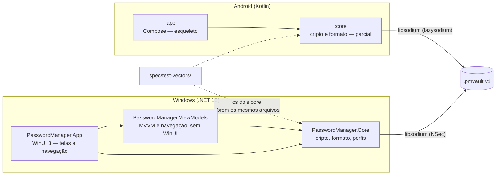
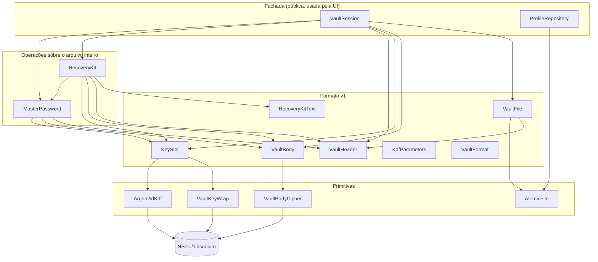
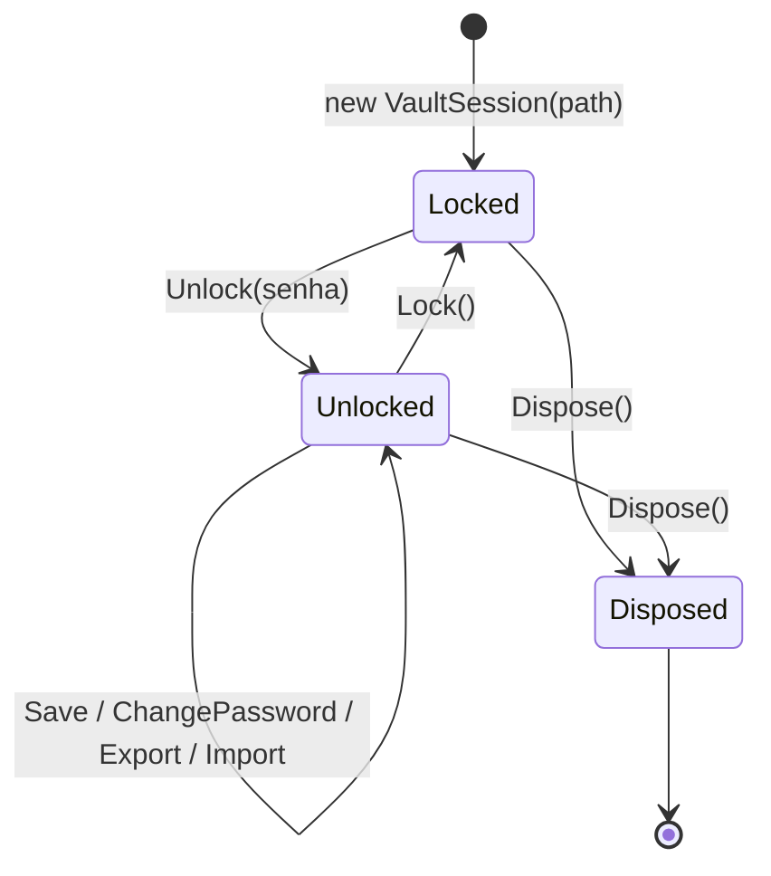
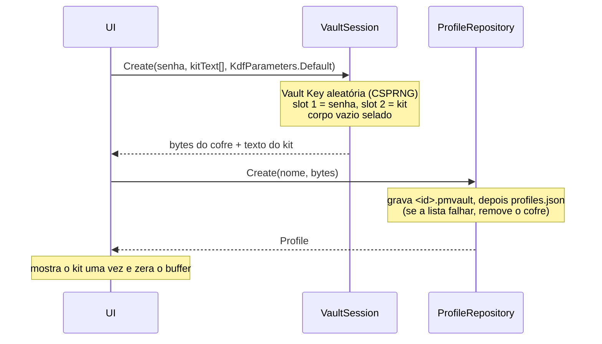
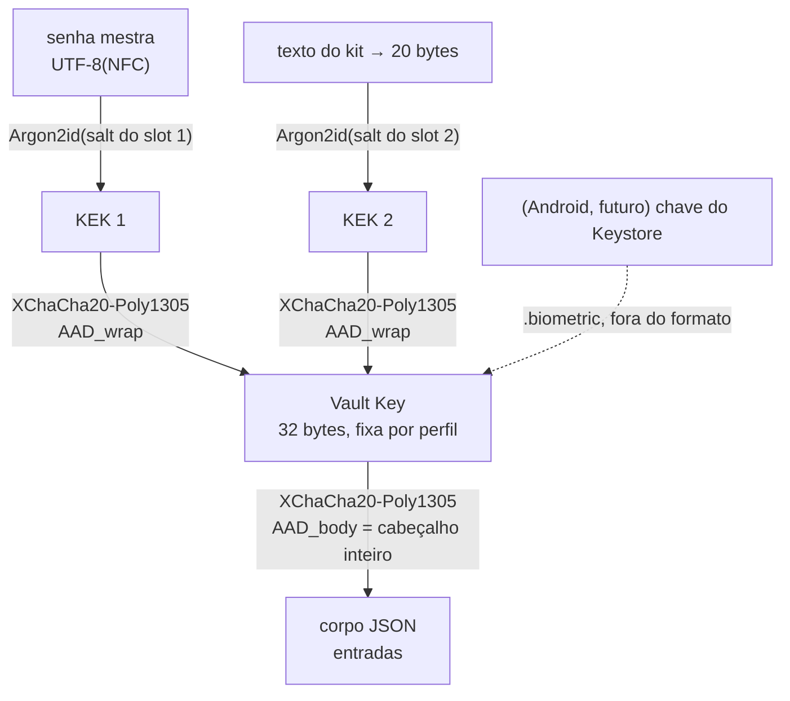
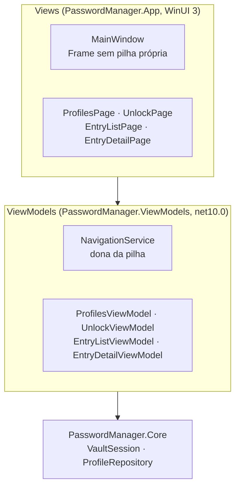
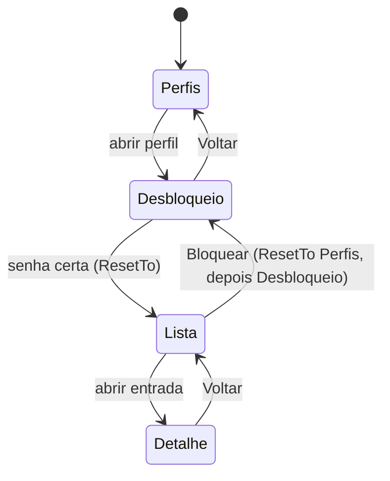

# Arquitetura do sistema

> Retrato do código em out/2026, depois da W-14 (com testes E2E; fases F1 e F2 do [épico Windows](epic-windows-release.md) concluídas, a F2 com a W-11, a W-12, a W-13 e a W-14).
> Deve ser atualizado no mesmo PR de toda mudança relevante (AGENTS.md §9).
> Regras obrigatórias: [AGENTS.md](../AGENTS.md). Layout de bytes: [vault-format.md](vault-format.md). Ameaças: [threat-model.md](threat-model.md).
> Este documento descreve **como o código está organizado**; quando houver conflito, AGENTS.md e vault-format.md prevalecem.

## 1. Visão geral

Gerenciador de senhas offline com dois apps nativos que compartilham **um único formato de arquivo** (`.pmvault` v1):



Princípios que moldam a arquitetura (AGENTS §1): segurança, offline de verdade, simplicidade, leveza.

- **Toda a lógica de cripto e formato fica no `Core`/`core`**, sem dependência de UI. A UI só chama operações de alto nível.
- **Nenhum código de rede** nos dois lados. O Android remove a permissão `INTERNET` no manifest; o Windows não tem pacote de rede e será empacotado sem `internetClient`.
- **Mesma biblioteca base (libsodium)** nas duas plataformas, para que um arquivo de uma abra na outra.

## 2. Estado atual

| Parte | Estado |
|---|---|
| Formato v1 (`vault-format.md`) | Layout fechado (W-01). Congela quando o `core` Android passar nos vetores. |
| `PasswordManager.Core` (Windows) | **Completo para a F1**: KDF, wrap, corpo, arquivo, perfis, troca de senha, Kit de Recuperação, `VaultSession` e vetores (W-02…W-10). |
| `PasswordManager.App` (WinUI 3) | Telas de perfis, desbloqueio, lista e detalhe ligadas por um `Frame` (W-11), com o fluxo coberto por testes E2E (FlaUI, só Debug). Todo texto da tela vem de `Strings/pt-BR/Resources.resw`, com testes que impedem texto literal (W-12, §9.4). Segue o tema do sistema (inclusive ao vivo e na barra de título), tem nomes acessíveis, funciona só com o teclado e tem contraste AA nos dois temas, tudo coberto por testes (W-13, §9.5). Com o cofre aberto (lista e detalhe), a janela fica fora das capturas de tela (`WDA_EXCLUDEFROMCAPTURE`), também coberto por testes (W-14, §9.6). Ainda sem edição de entradas, busca, criação de perfil nem campo de senha das entradas. Sem pacote MSIX (`WindowsPackageType=None`). |
| `PasswordManager.ViewModels` (`net10.0`, sem WinUI) | Navegação (`NavigationService`, pilha pura) e quatro ViewModels de página, testados sem janela (W-11). `PageViewModel.AllowsScreenCapture` diz se a janela pode ser capturada com aquela página (W-14, §9.6). |
| `:core` (Android) | Parcial: KDF, wrap, corpo, cabeçalho, slots e arquivo. Faltam Kit de Recuperação, troca de senha, sessão, perfis e o teste dos vetores. |
| `:app` (Android) | Esqueleto: tela vazia de perfis, `FLAG_SECURE`, sem `INTERNET`, sem backup. |
| `spec/test-vectors/` | 4 vetores (`empty`, `entries-unicode`, `recovery-kit`, `export`) abertos pelo Core Windows. |

## 3. Estrutura do repositório

```
AGENTS.md                         regras para pessoas e agentes (CLAUDE.md só importa este arquivo)
docs/                             formato, ameaças, épico, este documento
spec/test-vectors/                vetores compartilhados (<nome>.pmvault + <nome>.json)
windows/
  global.json                     SDK .NET 10 + runner Microsoft.Testing.Platform (rodar dotnet a partir de windows/)
  Directory.Build.props           Nullable, warnings como erro, analisadores, lockfiles
  Directory.Packages.props        versões NuGet centralizadas
  src/PasswordManager.Core/       Crypto/, Vault/, Storage/, Profiles/
  src/PasswordManager.App/        WinUI 3: Views/, App.xaml.cs (composição), NativeMethods.cs (a única chamada Win32, §9.6), textos em Strings/pt-BR/Resources.resw
  src/PasswordManager.ViewModels/ net10.0 sem WinUI: Navigation/ e os ViewModels de página
  tests/PasswordManager.Core.Tests/   xUnit v3, espelha as pastas do Core + TestVectors/
  tests/PasswordManager.ViewModels.Tests/   xUnit v3, ViewModels e fluxo de navegação
  tests/PasswordManager.App.E2E.Tests/      xUnit v3 + FlaUI UIA3, dirige o app Debug real (§9.3); também tem as guardas estáticas de texto em Localization/ (§9.4) e de acessibilidade e tema em Accessibility/ (§9.5)
android/
  gradle/libs.versions.toml       todas as versões
  core/                           com.passwordmanagement.core (crypto/, vault/)
  app/                            com.passwordmanagement.android (Compose)
```

## 4. Core do Windows

### 4.1 Camadas

Cada camada só usa a de baixo. A UI deve usar só o topo (`VaultSession` e `ProfileRepository`).



### 4.2 Responsabilidades

| Pasta | Tipo | Visibilidade | Papel |
|---|---|---|---|
| `Crypto/` | `Argon2idKdf` | pública | Senha (`char`, normalizada em NFC → UTF-8) ou segredo binário → KEK de 32 bytes. Zera os buffers intermediários. |
| | `VaultKeyWrap` | interna | XChaCha20-Poly1305 da Vault Key com a KEK e o `AAD_wrap`. |
| | `VaultBodyCipher` | interna | XChaCha20-Poly1305 do JSON do corpo com o `AAD_body`. |
| `Storage/` | `AtomicFile` | interna | `.tmp` → flush → (`.bak`) → rename. Usado pelo cofre (com `.bak`) e por `profiles.json` (sem `.bak`). |
| `Vault/` | `VaultFormat` | pública | Constantes do formato, espelhadas em `VaultFormat.kt`. |
| | `KdfParameters` | pública | Memória/iterações do Argon2id; `Default` = 64 MiB/3; validação dos limites; leitura de um slot. |
| | `VaultHeader` | pública | `Parse` (validação completa da leitura, na ordem da spec) e `Build` (slots em ordem de tipo). Expõe `BodyOffset` e os `VaultSlotRange`. |
| | `KeySlot` | pública | Cria e abre os slots tipo 1 (senha) e tipo 2 (kit). |
| | `VaultBody` | pública | `Seal`/`Open` do corpo; `Reseal` interno (mesmo conteúdo, cabeçalho novo, nonce novo). |
| | `VaultFile` | pública | `Read` devolve os bytes crus (quem valida é o `VaultHeader.Parse`); `Write` valida antes de tocar o disco e grava atomicamente com `.bak`. Nunca recorre ao `.bak` sozinho. |
| | `MasterPassword` | pública | `Change` (senha atual → nova) e `Reset` (Vault Key já conhecida → nova senha). Só o slot tipo 1 muda. |
| | `RecoveryKit` / `RecoveryKitText` | pública / interna | Gerar, substituir, abrir e redefinir a senha pelo kit; texto Crockford base32 8×4. |
| | `VaultSession` | pública | Fachada com estado: `Create`, `Unlock`, `Lock`, `Save`, `ChangePassword`, `Export`, `Import`. |
| | `VaultEntry`, `VaultContent`, `VaultJsonContext`, `UtcTimestampConverter` | pública / interna | Modelo do corpo e JSON source-generated (camelCase, datas `.fffZ`). `VaultEntry.ToString()` nunca mostra segredos. |
| | `VaultFormatException`, `VaultAuthenticationException` | pública | Erros tipados (ver 8). |
| `Profiles/` | `ProfileRepository` | pública | `profiles.json`: listar, validar nome, criar (grava o cofre e depois a lista), renomear, apagar (lista primeiro, depois `.pmvault`/`.bak`/`.tmp`). |
| | `Profile`, `ProfileNameError`, `ProfileStoreException` | pública | Modelo, erros de validação do nome, erro de armazenamento. |

As APIs de baixo nível trabalham com **bytes do arquivo inteiro** (`ReadOnlySpan<byte> file` → `byte[]` novo). Elas não tocam no disco; só `VaultFile` e `ProfileRepository` fazem I/O. Isso torna cada operação testável em memória e deixa a escrita atômica num único lugar.

### 4.3 `VaultSession`: estado e ciclo de vida



- **Enquanto desbloqueada**, guarda a Vault Key num buffer **pinned** (o GC não move nem copia), os bytes do arquivo aberto e o `VaultContent` decifrado.
- **`Lock()`** zera a chave com `CryptographicOperations.ZeroMemory` e descarta o arquivo e o conteúdo. Pode ser chamado várias vezes. Depois de `Dispose`, `Lock`/`Dispose` não fazem nada e o resto lança `ObjectDisposedException`.
- **Uma trava privada em todo membro**: um `Lock` vindo de outra thread (troca de sessão do Windows, W-18) espera a gravação em andamento e nunca deixa selar o corpo com a chave zerada. A mesma trava serializa as gravações, que o `VaultFile` exige.
- **Estado muda só depois que a gravação dá certo**: em falha de I/O, sessão e disco continuam iguais.
- `Create`, `Unlock`, `ChangePassword`, `Export` e `Import` rodam Argon2id (~1 s com os parâmetros padrão): **a UI deve chamá-los fora da thread de UI**.
- `Create` é estático: devolve os bytes do cofre novo e o texto do kit, e quem grava é o `ProfileRepository.Create`.

## 5. Fluxos principais

### 5.1 Criar perfil



### 5.2 Desbloquear, editar, bloquear

1. `new VaultSession(repo.GetVaultPath(id))` → `Unlock(senha)`.
2. `VaultFile.Read` lê os bytes e `VaultHeader.Parse` os valida; `KeySlot` deriva a KEK **só do slot tipo 1** e desembrulha a Vault Key; `VaultBody.Open` decifra o corpo com o cabeçalho inteiro como AAD.
3. A UI lê `Content` e chama `Save(novoConteúdo)`: o corpo é re-selado com nonce novo e gravado atomicamente; o arquivo anterior vira `.bak`.
4. `Lock()` ao sair, por inatividade ou na troca de sessão.

Senha errada, arquivo adulterado e slot adulterado aparecem todos como a mesma `VaultAuthenticationException`, sem detalhe do motivo.

### 5.3 Trocar a senha mestra

`ChangePassword(atual, nova)` → `MasterPassword.Change`: abre o slot 1 com a senha atual e cria um slot 1 novo (salt e nonce novos). O slot 2 fica igual, byte a byte. O corpo é re-selado com a **mesma** Vault Key, porque o cabeçalho é AAD. As entradas nunca são cifradas de novo com outra chave.

### 5.4 Kit de Recuperação

- `RecoveryKit.Unlock(file, kitText, vaultKey)`: decodifica o texto (valida antes de gastar Argon2id) e abre **só o slot tipo 2**.
- `RecoveryKit.ResetPassword(file, kitText, novaSenha, params)`: kit → Vault Key → `MasterPassword.Reset`.
- `RecoveryKit.Create(file, vaultKey, params, kitText)`: gera um kit novo e substitui o slot 2; o kit antigo deixa de funcionar.

Esses três ainda não estão expostos pela `VaultSession` (a W-26 decide como a UI os chama).

### 5.5 Exportar e importar

- `Export(senhaDeExportação)` devolve bytes de um `.pmvault` com **Vault Key nova**, exatamente um slot tipo 1 e nenhum kit. Nada é gravado: o app salva via `FileSavePicker` (W-23), nunca em pasta temporária.
- `Import(bytes, senhaDeExportação)` devolve o `VaultContent` decifrado para prévia. A sessão e o disco não mudam; quem chama mescla as entradas e chama `Save` (W-25).
- CSV ainda não existe (W-24/W-25).

## 6. Chaves e segredos



Regras que o código segue:

- **Nenhum hash da senha é guardado**: a verificação é a própria tag AEAD do slot.
- Senhas e textos de kit entram como `ReadOnlySpan<char>`; chaves como `Span<byte>`. Temporários ficam em `stackalloc` e são zerados em `finally`. Os buffers do chamador nunca são alterados, e é ele quem os zera.
- O `VaultContent` e suas `string` são objetos gerenciados e **não podem ser zerados**; `Lock` só solta as referências (limite aceito em AGENTS §3.5).
- Exceções nunca carregam segredo nem conteúdo do arquivo.

## 7. Armazenamento em disco

Pasta: `%LOCALAPPDATA%\PasswordManagement\vaults\` (sem pacote) ou `<LocalFolder>\vaults\` (MSIX), via `ProfileRepository.GetDefaultDirectory`.

| Arquivo | Escrito por | Observação |
|---|---|---|
| `profiles.json` | `ProfileRepository` | Em claro, só `id`/`displayName`/`createdAt`. Atômico, **sem** `.bak`. |
| `<id>.pmvault` | `VaultFile.Write` | Atômico, com `.bak` da versão anterior. Nome vem só do `id`. |
| `<id>.pmvault.bak` / `.tmp` | `AtomicFile` | `.tmp` só sobra após queda e é sobrescrito na próxima gravação. |

Não há trava entre processos: quem chama serializa as operações.

## 8. Erros

| Exceção | Quando |
|---|---|
| `VaultFormatException` | Arquivo malformado: tamanho, magic, versão, slots, limites do KDF. Lançada antes de qualquer Argon2id. |
| `VaultAuthenticationException` | Falha AEAD: senha/kit errado ou qualquer byte adulterado. Mensagem fixa, sem `InnerException`. |
| `FormatException` | Texto do kit inválido (checado antes do Argon2id). |
| `InvalidOperationException` | Sessão bloqueada; cofre sem slot de kit. |
| `ProfileStoreException` | `profiles.json` inválido (JSON quebrado, `id` repetido, campo ausente…). O arquivo corrompido nunca é sobrescrito. A mensagem não traz nomes de perfil. |
| `IOException` e afins | Falha de disco em `VaultFile`/`ProfileRepository`. Sobem sem tradução; a escrita atômica garante que o arquivo anterior continua inteiro. |
| `ProfileNameError` (enum) | Resultado da validação do nome de perfil, sem exceção. |

## 9. App do Windows

### 9.1 Camadas

Cada camada só usa a de baixo. As Views não chamam o Core: falam só com os ViewModels.



- **Views**: só XAML e `x:Bind` para os ViewModels. A `MainWindow` escuta `NavigationService.Navigated` e chama `Frame.Navigate` com a página do tipo de `Current`; cada caso tem um `typeof` literal, para o trimmer enxergar os tipos. No mesmo handler, a `MainWindow` aplica a afinidade de exibição da página atual, que decide se a janela pode ser capturada (§9.6).
- **ViewModels**: `ObservableObject` e `RelayCommand` do CommunityToolkit.Mvvm; nenhum tipo de UI. Expõem estado (`UnlockError`, `IsEmpty`, `LoadFailed`), e a View escolhe o texto no `.resw`.
- **Composição**: `App.OnLaunched` cria o `NavigationService` e o `ProfileRepository`, entrega o serviço à `MainWindow` e mostra a tela de perfis. Não há container de DI. O diretório de cofres vem de `ResolveVaultsDirectory`: no Debug, `--vaults-dir <caminho absoluto>` substitui `ProfileRepository.GetDefaultDirectory()` (usado pelos testes E2E); um valor inválido aborta a inicialização. No Release esse código não é compilado.

### 9.2 Navegação



- **A pilha fica no `NavigationService`**. O `Frame` tem `IsNavigationStackEnabled="False"`, e a View não guarda histórico próprio.
- **Desbloquear troca a pilha inteira** pela Lista (`ResetTo`). Com o cofre aberto, nenhum Voltar leva ao desbloqueio.
- **Bloquear** (`EntryListViewModel.Lock`) fecha a sessão, esvazia as entradas e refaz a pilha como `[Perfis]` com `Desbloqueio` atual. Voltar cai em Perfis, nunca na lista.
- Cada troca chama `OnNavigatedFrom` da página que sai e `OnNavigatedTo` da que entra, antes de `Navigated`, sempre na thread que chamou (a de UI).
- **Desbloqueio fora da thread de UI**: `UnlockViewModel` roda `VaultSession.Unlock` em `Task.Run`. O `await` **não usa `ConfigureAwait(false)`**: a navegação depois dele precisa voltar à thread de UI, senão `Frame.Navigate` falha.
- **Senha como `char[]`**: a `UnlockPage` copia o `PasswordBox` para um `char[]` e esvazia o campo. O comando assume o array e o zera no `finally`, mesmo em falha. O `PasswordBox` só expõe `string`; isso fica como ponto em aberto.
- **Sessão**: a `VaultSession` nasce no `UnlockViewModel`, passa à `EntryListViewModel` ao desbloquear e é descartada no `Lock` ou quando o desbloqueio falha.

### 9.3 Testes E2E

O projeto `windows/tests/PasswordManager.App.E2E.Tests/` abre o `PasswordManager.App.exe` Debug de verdade e o dirige pela UI Automation (FlaUI.UIA3). Os testes de fluxo e de texto usam só padrões de UIA (`Invoke` em botões e itens, `Value` nas caixas de texto e no campo de senha). Os testes de teclado (`AccessibilityE2ETests`, §9.5) enviam teclas reais (`SendInput`), mas só depois de confirmar que a janela do app está em primeiro plano; se não estiver, o teste falha sem enviar nada. Nenhum clique de mouse é enviado. Os testes de proteção contra captura (`WindowProtectionE2ETests`, §9.6) leem a afinidade de exibição da janela e a movem para fora da tela e de volta com `SetWindowPos`; não enviam tecla nem clique. Os cinco fluxos de `NavigationE2ETests` cobrem perfis vazios, lista de perfis corrompida, cofre ausente, senha errada e o caminho desbloquear → detalhe → bloquear, seguindo as regras de §9.2. `LocalizationE2ETests` (cinco testes) confere, em cada tela, que o texto exibido vem do `.resw` (§9.4).

- **Isolamento**: cada teste cria uma pasta `pm-e2e-*` em `%TEMP%`, passa o caminho em `--vaults-dir` e a apaga no fim, inclusive após falha. O cofre vem de `spec/test-vectors/entries-unicode.pmvault`, e o `profiles.json` é escrito pelo próprio teste. Os testes nunca tocam em `%LOCALAPPDATA%\PasswordManagement\vaults\`. Se o processo de teste morrer no meio de um teste, o app pode ficar aberto: encerre `PasswordManager.App` manualmente.
- **Uma janela por vez**: `AssemblyInfo.cs` desliga o paralelismo do xUnit, então só existe uma janela do app em cada momento.
- **Ids como contrato**: todo elemento que um teste usa tem `AutomationProperties.AutomationId` (os ids estão nas quatro Views), inclusive os títulos das telas e a dica de lista vazia (`ProfilesTitle`, `ProfilesEmptyHint`, `UnlockTitle`, `EntriesTitle`). Os testes localizam por id, nunca por texto. Os nomes acessíveis vêm da W-13 (§9.5). Um `Name` novo ou um template reestruturado não pode remover um id.
- **Só Debug**: o gancho `--vaults-dir` existe só no build Debug (`#if DEBUG`). Em Release os testes ficam ignorados com o motivo "E2E tests run only in Debug". O executável é procurado num caminho fixo, `bin\Debug\net10.0-windows10.0.26100.0\<rid>\`; mudar o TFM, o RID ou o `OutputPath` exige atualizar o `.csproj` de E2E.
- **Desktop interativo**: `dotnet test --solution` precisa de uma sessão de usuário desbloqueada, porque as janelas do app abrem e pegam o foco. Para rodar só o E2E, a partir de `windows/`: `dotnet test --project tests/PasswordManager.App.E2E.Tests/PasswordManager.App.E2E.Tests.csproj` (ele compila o app Debug antes).
- **DPI e pixels**: o executável de teste tem manifest `PerMonitorV2` (`app.manifest`), então os retângulos do UIA e as capturas de tela estão em pixels físicos. `NativeMethods.cs` limita o carregamento de DLLs à `System32`.

### 9.4 Textos e localização

Todo texto que o usuário vê sai de `Strings/pt-BR/Resources.resw` (`DefaultLanguage=pt-BR`). A UI é em pt-BR; código, nomes e comentários são em inglês (AGENTS §6). Não há segundo idioma nem camada de tradução.

Convenções:

- **XAML**: o texto estático vem de `x:Uid="Nome"`, e a chave é `Nome.Text`, `Nome.Content` ou `Nome.Header`. Dados vêm de `x:Bind`.
- **Propriedades anexadas**: a chave é `Nome.[using:Microsoft.UI.Xaml.Automation]AutomationProperties.Name`. O uid é o trecho antes do primeiro ponto, e é assim que a W-13 dá nome de acessibilidade às listas e aos controles (§9.5).
- **Code-behind**: só chaves sem ponto, por `ResourceLoader.GetString("Chave")` na View (hoje, `AppTitle` na `MainWindow`).
- **ViewModels não têm texto**. Expõem estado (`UnlockError`, `IsEmpty`, `LoadFailed`) e a View escolhe a mensagem no resw. Não existe interface de provedor de texto: sem consumidor, ela só acrescentaria código.
- **Texto com valor**: a frase fica no resw com `{0}`, a View formata, e o ViewModel expõe só o número (ex.: a contagem regressiva da W-17).
- **Exceções**: mensagens de exceção são em inglês, para o desenvolvedor, e **nunca chegam à tela**. O ViewModel traduz a exceção em estado, e a View mostra o texto do resw.

**Guardas estáticas** (`windows/tests/PasswordManager.App.E2E.Tests/Localization/`, 51 casos em `LocalizationGuardTests`). Leem os fontes e o resw sem abrir janela e rodam também em Release. O tokenizador de C# é próprio, sem Roslyn, para não adicionar dependência.

- **XAML** (`App`): falha com valor literal em atributo de texto (`Text`, `Content`, `Header`, `PlaceholderText`, `Title`, `ToolTipService.ToolTip`, `AutomationProperties.Name` e afins) e com texto entre as tags. `{}` é o escape do XAML e conta como literal. Aceitos: bindings e markup (`{x:Bind}`, `{StaticResource}`), valores de `x:Double`, `x:Int32`, `x:Boolean`, `Thickness`, `CornerRadius`, `Color` e `GridLength`, e comentários.
- **C#** (`App` e `ViewModels`): falha com todo literal de string (normal, verbatim, interpolado e raw). Aceitos: o argumento de `GetString(`, a mensagem de `new …Exception(` na mesma linha (texto de desenvolvedor), `"--vaults-dir"` (switch só de Debug) e os argumentos de `[LibraryImport(…)]` ou `[DllImport(…)]` (nome da DLL, `EntryPoint`), só quando o literal vem depois do `(` do atributo, na mesma linha e antes do `)`. Um literal depois do `)]` ou na linha seguinte continua sendo reportado.
- **Resw × código**: falha com chave duplicada ou de valor vazio; `x:Uid` sem nenhuma chave `Uid.*`; chave com ponto cujo uid não existe no XAML; chave sem ponto que nenhum `GetString` usa; e `GetString` com chave que não está no resw.
- **Texto esperado** (`AppResources.ExpectedName(uid)`): a chave do `AutomationProperties.Name`, se existir; senão, a única `Text`, `Content` ou `Header` do uid. Os testes E2E usam essa função, então continuam válidos com os nomes de acessibilidade da W-13.

**Varredura E2E** (`LocalizationE2ETests`, cinco testes): em cada tela, todo `Text`, `Button`, `Edit`, `List` e `ListItem` com nome precisa vir do resw ou dos dados do teste (nome de perfil, título e usuário das entradas). Ficam de fora:

- a subárvore `TitleBar` e a `ScrollBar`, que o Windows nomeia no idioma do sistema (`Sistema`, `Minimizar`, …);
- elementos sem nome.

Na tela de desbloqueio, a varredura só roda com o campo de senha vazio, porque o botão de mostrar senha do `PasswordBox` recebe nome do WinUI, não do resw. Cada chamada também roda logo depois de a âncora da tela aparecer.

Limite: a E2E roda neste Windows, em pt-BR. Nenhum teste cobre outro idioma do sistema; o app depende de `DefaultLanguage=pt-BR` para isso.

Para rodar só as guardas, a partir de `windows/` (sem janela, também em Release):

```
dotnet test --project tests/PasswordManager.App.E2E.Tests/PasswordManager.App.E2E.Tests.csproj --filter-class PasswordManager.App.E2E.Tests.Localization.LocalizationGuardTests
```

### 9.5 Tema e acessibilidade

A W-13 fixa quatro regras: o app segue o tema do sistema, todo controle interativo tem nome, tudo funciona só com o teclado e o texto tem contraste AA nos dois temas. Cada regra tem uma guarda estática (lê o código e roda também em Release) e um teste E2E no app real (só Debug).

**Tema**

- `App.xaml` não tem `RequestedTheme`: o app segue `AppsUseLightTheme`, ao vivo. A barra de título segue o mesmo modo (`AppWindow.TitleBar.PreferredTheme = TitleBarTheme.UseDefaultAppMode`, em `MainWindow`).
- Cor só por `{ThemeResource}`. Não há `ControlTemplate`, `Opacity` abaixo de 1, `HighContrastAdjustment="None"` nem cor literal em XAML ou C#.
- High Contrast não é ligado em tempo de execução. Vale só a garantia estática: sem cor própria e sem template.

**Nomes**

- Botões e campos têm nome pelo `Content` ou `Header` do resw (§9.4). Um controle sem esse texto recebe a chave `AutomationProperties.Name` do resw, ou um binding ou `LabeledBy`.
- As listas têm nome do resw: `ProfilesList` = "Lista de perfis" e `EntriesList` = "Lista de entradas".
- Os itens são nomeados pelos dados, no `ContainerContentChanging` de cada lista: `Profile.DisplayName` e `VaultEntry.Title`. Não se usa `ToString()`. Os handlers são privados e ligados por `x:Bind` (`OnProfileContainerContentChanging`, `OnEntryContainerContentChanging`).
- Todo controle interativo tem `AutomationProperties.AutomationId` e nome. Os testes de teclado conferem isso em cada tela; itens de lista ficam de fora do id, porque o nome vem dos dados.

**Teclado**

- **Foco inicial**, ao carregar a página: perfis → a lista de perfis, quando há perfis; desbloqueio → campo de senha; lista de entradas → a lista, ou Bloquear quando o cofre está vazio; detalhe → título.
- **Tab e Shift+Tab** seguem a ordem do documento:
  - perfis: a lista é a única parada;
  - desbloqueio: campo de senha → Desbloquear → Voltar → campo de senha;
  - lista de entradas: Tab leva a Bloquear, e outro Tab volta ao último item focado;
  - detalhe: usuário → URL → pasta → notas → Voltar.
- **Setas**: sobem e descem na lista de entradas.
- **Enter**: ativa o item ou o botão focado. No campo de senha, desbloqueia, como o botão.
- **Escape**: volta, no desbloqueio e no detalhe. É um `KeyboardAccelerator` Escape oculto nos botões `UnlockBack` e `DetailBack`.
- Ao voltar do detalhe, o foco não vai para a entrada que foi aberta (ponto em aberto, §13).

**Teste de tema** (`ThemeE2ETests`, Debug)

- Troca o `AppsUseLightTheme` real do usuário (`HKCU\Software\Microsoft\Windows\CurrentVersion\Themes\Personalize`) e envia `WM_SETTINGCHANGE` com `ImmersiveColorSet`, como as Configurações. O app precisa trocar ao vivo, barra de título incluída.
- Antes de trocar, grava o valor original em `%TEMP%\pm-e2e-theme-restore`. Restaura no `finally` e apaga esse arquivo. Se o processo morrer no meio, a execução seguinte restaura a partir dele antes de começar (`SystemTheme.RestoreInterrupted`).
- Para restaurar à mão, com o valor original (`1` = claro, `0` = escuro): `reg add "HKCU\Software\Microsoft\Windows\CurrentVersion\Themes\Personalize" /v AppsUseLightTheme /t REG_DWORD /d <valor> /f`. Se o valor original não existia, use `reg delete` para o mesmo valor. O conteúdo do marcador diz `missing` nesse caso.
- Mede os textos visíveis (`ControlType.Text`) de Perfis e Desbloqueio, e a barra de título, em cada tema. O fundo, o valor mais frequente do recorte, tem que ser escuro (luminância relativa ≤ 0,1) ou claro (≥ 0,4). Os textos têm que dar razão ≥ 4,5:1 contra esse fundo.
- Só conta quando o fundo é o mesmo em duas checagens seguidas, porque a troca de tema é animada.
- Só cobre telas com o cofre fechado. Com o cofre aberto, a janela está excluída da captura (`WDA_EXCLUDEFROMCAPTURE`, W-14), e o recorte mostraria o que está atrás dela, não o app (§9.6).
- Razões medidas nas telas atuais: entre 8,4:1 e 18,9:1, nos dois temas.

**Limites**

- O texto dos controles (rótulos de botão, texto dentro de campo) é desenhado pelos templates do WinUI. A medição só alcança os `Text` que o UIA expõe; o contraste desse texto depende das cores de tema.
- High Contrast é checado só estaticamente.

**Guardas estáticas** (`windows/tests/PasswordManager.App.E2E.Tests/Accessibility/AccessibilityGuardTests.cs`, 70 casos; roda também em Release)

Lêem os XAML e o C# de `App` e `ViewModels` como texto, sem janela e sem Roslyn. Regras:

- **Classificação fechada**: todo elemento XAML precisa estar numa lista de interativos ou de passivos. Um tipo novo falha até alguém decidir qual é.
- **Interativo**: tem `AutomationId` e nome (ver Nomes).
- **Foco**: sem `ControlTemplate`, sem `IsTabStop="False"` em controle interativo, sem `UseSystemFocusVisuals="False"` e sem espessura zero do foco.
- **Tema em XAML**: sem `RequestedTheme`, sem `HighContrastAdjustment="None"`, sem `SolidColorBrush`, gradiente, `AcrylicBrush` ou `Color`, sem propriedade de cor que não seja `{ThemeResource}` e sem `Opacity` abaixo de 1.
- **Tema em C#**: sem `RequestedTheme`, `ElementTheme`, `ApplicationTheme`, `SolidColorBrush`, `ColorHelper`, `Colors`, `Color.FromArgb` ou `TitleBarTheme.Light`/`Dark`. `TitleBarTheme.UseDefaultAppMode` passa. Comentários são ignorados.

Para rodar só as guardas e a matemática de contraste, a partir de `windows/` (sem janela, também em Release):

```
dotnet test --project tests/PasswordManager.App.E2E.Tests/PasswordManager.App.E2E.Tests.csproj --filter-class PasswordManager.App.E2E.Tests.Accessibility.AccessibilityGuardTests
dotnet test --project tests/PasswordManager.App.E2E.Tests/PasswordManager.App.E2E.Tests.csproj --filter-class PasswordManager.App.E2E.Tests.Accessibility.ScreenPixelsTests
```

### 9.6 Proteção contra captura

A W-14 fixa uma regra: com o cofre aberto (lista e detalhe), a janela do app tem `WDA_EXCLUDEFROMCAPTURE` (`SetWindowDisplayAffinity`), e uma captura de tela mostra o que está atrás dela, não o app. Em Perfis e Desbloqueio a afinidade é `WDA_NONE`. O "verificado com Ferramenta de Captura e OBS" do épico virou teste automatizado (ver Testes), sem conferência manual.

**Regra por página, fail-closed**

- `PageViewModel.AllowsScreenCapture` é virtual e o padrão é `false`. Só `ProfilesViewModel` e `UnlockViewModel` sobrescrevem para `true`; `EntryListViewModel` e `EntryDetailViewModel` herdam `false`.
- Uma página nova (exibição do Kit de Recuperação, editor, configurações) já nasce protegida e só sai disso se declarar que não mostra nada de um cofre aberto.
- A regra fica no ViewModel, então é testada sem janela (`ScreenCaptureTests`, 4 testes, incluindo o fluxo inteiro: a lista de valores de `AllowsScreenCapture` a cada `Navigated`).

**Ordem na `MainWindow.OnNavigated`**

- **Proteger vem antes do `Frame.Navigate`** e é síncrono: `Protect()` chama `SetWindowDisplayAffinity(_hwnd, WDA_EXCLUDEFROMCAPTURE)` quando a página não permite captura. Assim uma página do cofre nunca é desenhada com a janela capturável.
- **Desproteger vem depois do `Frame.Navigate`** e espera o primeiro quadro desenhado com a página nova: `ScheduleUnprotect()` assina uma vez o `CompositionTarget.Rendered` (`Microsoft.UI.Xaml.Media`). Até esse quadro, o último quadro da lista ainda está na tela e continuaria excluído. Não há plano alternativo com `DispatcherQueue`: o `Rendered` existe no Windows App SDK usado e é o que o código usa.
- **Nova checagem no handler**: `OnRenderedUnprotect` se desassina, limpa `_unprotectPending` e só aplica `WDA_NONE` se a página atual ainda permitir a captura. Se uma página protegida entrou no meio do caminho, a janela continua excluída.
- `_unprotectPending` impede a assinatura dupla. É o caso de Bloquear, que dispara dois `Navigated` seguidos (`ResetTo(Perfis)` e `NavigateTo(Desbloqueio)`, §9.2). `OnClosed` também desassina o handler.

**Falhas**

- Se `WDA_EXCLUDEFROMCAPTURE` não puder ser aplicado, `Protect()` lança `Win32Exception` com o último erro do P/Invoke, antes do `Frame.Navigate`: a página do cofre não é mostrada. No Windows 10 2004 ou mais novo isso só acontece se algo estiver anormal.
- Se `WDA_NONE` falhar, o erro é ignorado: a janela continua excluída, que é o estado seguro.

**`NativeMethods` do App**

- Classe `internal static partial` com `WDA_NONE`, `WDA_EXCLUDEFROMCAPTURE` e `SetWindowDisplayAffinity`, importada com `[LibraryImport("user32.dll", SetLastError = true)]`. É a única chamada Win32 do app.
- `[DefaultDllImportSearchPaths(System32)]` fica no método, não no assembly, para não mudar as cargas de DLL do ponto de entrada gerado pelo XAML (CA5392).
- O `.csproj` do App liga `AllowUnsafeBlocks`, porque o `LibraryImport` gera código `unsafe` (SYSLIB1062). Nenhum pacote novo.
- O nome da DLL no atributo é um literal de string em `.cs` do App; a guarda do W-12 o aceita pela regra dos atributos de importação nativa (§9.4).

**Testes** (`WindowProtectionE2ETests`, só Debug; precisam de desktop interativo, §9.3)

- Os testes leem a afinidade real da janela de fora do processo do app, com `GetWindowDisplayAffinity` sobre o handle da janela (`AppSession.Handle`, `DisplayAffinity()` e `WaitDisplayAffinity(esperado)`, que repete por até 15 s).
- `VaultOpen_WindowIsExcludedFromCaptureOnlyWhileUnlocked` percorre o fluxo e confere a afinidade em cada passo:
  - Perfis e Desbloqueio: `WDA_NONE`, inclusive depois de uma senha errada.
  - Logo depois de a `EntriesList` aparecer, **uma única leitura, sem repetição**, dá `WDA_EXCLUDEFROMCAPTURE`. Isso prova que a janela foi protegida antes de a lista ser desenhada.
  - Detalhe e a volta à lista: `WDA_EXCLUDEFROMCAPTURE`.
  - Bloquear e Voltar a Perfis: `WDA_NONE`.
- `VaultOpen_ScreenCaptureSeesOnlyWhatIsBehindTheWindow` compara a captura com o que há atrás da janela:
  - Captura o recorte da janela (recuado 32 px, para pular borda, sombra e cantos), move a janela para a direita da tela virtual com `SetWindowPos` (`SWP_NOSIZE`, `SWP_NOZORDER`, `SWP_NOACTIVATE`) e captura o mesmo recorte. `ScreenPixels.ChangedFraction` dá a fração de pixels que mudaram (algum canal com diferença acima da tolerância de 24).
  - No Desbloqueio, que é capturável, a fração tem que ser ≥ 5%: é o controle, que prova que o teste enxerga o app. Na lista, excluída, tem que ser ≤ 1%: a captura já mostrava o fundo, nunca as entradas. Depois de Bloquear, volta a ser ≥ 5%.
  - Cada captura só vale quando está assentada (duas seguidas com diferença ≤ 0,1%, a cada 250 ms, por até 5 s). Uma medição só conta se a captura no mesmo lugar, tirada depois de a janela voltar, diferir em até 0,1% da tirada antes de ela sair; senão o teste mede de novo, até 3 vezes, e falha com a mensagem de que precisa de um fundo estático. Uma janela capturável concorda com ela mesma antes e depois, então a repetição nunca esconde uma falha da proteção.
  - A janela volta ao retângulo original no `finally`, com tamanho explícito, caso o DPI mude.
- O segundo teste também mostra que o `WDA_EXCLUDEFROMCAPTURE` esconde o conteúdo do WinUI 3, não só a moldura da janela.
- Os 4 testes de `ChangedFraction` (`ScreenPixelsTests`) rodam sem janela, também em Release, e `ScreenCaptureTests` cobre a regra por página sem janela. A `MainWindow` em si só é coberta por esses dois testes E2E.

**Limites**

- A tela de Desbloqueio continua capturável: o épico pede a proteção "enquanto o cofre estiver aberto", e o teste de tema mede os pixels dela (§9.5). O botão de mostrar senha do `PasswordBox` poderia expor a senha mestra a uma captura (ponto em aberto, §13).
- Não são cobertos: miniaturas da barra de tarefas e do Alt+Tab, Área de Trabalho Remota e uma câmera apontada para a tela.
- A versão mínima do Windows é a 10 2004 (19041), a mesma do `TargetPlatformMinVersion`, porque o `WDA_EXCLUDEFROMCAPTURE` não existe antes dela.
- O teste de captura precisa de um fundo estático atrás da janela por cerca de um segundo; vídeo ou animação atrás dela o faria falhar.

Para rodar só os testes novos, a partir de `windows/`:

```
dotnet test --project tests/PasswordManager.ViewModels.Tests/PasswordManager.ViewModels.Tests.csproj --filter-class PasswordManager.ViewModels.Tests.ScreenCaptureTests
dotnet test --project tests/PasswordManager.App.E2E.Tests/PasswordManager.App.E2E.Tests.csproj --filter-class PasswordManager.App.E2E.Tests.WindowProtectionE2ETests
```

## 10. Android `:core`

Mesma divisão de pastas do Windows, com nomes equivalentes:

| Windows | Android | Estado |
|---|---|---|
| `Argon2idKdf`, `VaultKeyWrap`, `VaultBodyCipher` | `crypto/` com os mesmos nomes + `AndroidSodium` (instância do lazysodium) | feito |
| `VaultFormat`, `KdfParameters`, `VaultHeader`, `KeySlot`, `VaultBody`, `VaultFile`, modelos | `vault/` com os mesmos nomes (JSON via kotlinx.serialization) | feito |
| `MasterPassword`, `RecoveryKit`, `VaultSession` | — | pendente |
| `ProfileRepository` | — | pendente |
| `TestVectorTests` | — | pendente: é o que congela o formato v1 |

Os testes unitários rodam na JVM do host com `lazysodium-java` (só no escopo de teste), porque o `.so` do Android não carrega fora do aparelho.

## 11. Testes

| Onde | Como rodar | Cobertura |
|---|---|---|
| `windows/tests/PasswordManager.Core.Tests` | `dotnet test --solution PasswordManager.slnx` **a partir de `windows/`** | ~1.180 testes: KDF com valores conhecidos, wrap/unwrap, corpo, adulteração byte a byte de cada região, arquivo atômico, perfis, troca de senha, kit, sessão (inclusive concorrência) e vetores. |
| `windows/tests/PasswordManager.ViewModels.Tests` | `dotnet test --solution PasswordManager.slnx` **a partir de `windows/`** | 45 testes sem janela: `NavigationService`, os quatro ViewModels de página (inclusive a senha zerada depois do desbloqueio), o fluxo Perfis → Desbloqueio → Lista → Detalhe → Voltar → Bloquear e a regra de captura de tela por página (`ScreenCaptureTests`, §9.6). |
| `windows/tests/PasswordManager.App.E2E.Tests` | `dotnet test --solution PasswordManager.slnx` **a partir de `windows/`** (só Debug; precisa de desktop interativo) | 5 fluxos de ponta a ponta no app real, dirigido pela UI Automation: perfis vazios, lista corrompida, cofre ausente, senha errada e desbloquear → detalhe → bloquear. Detalhes em §9.3. Mais 5 testes de texto (`LocalizationE2ETests`, §9.4), 4 de teclado e nomes (`AccessibilityE2ETests`, §9.5), 1 de tema (`ThemeE2ETests`, §9.5) e 2 de proteção contra captura (`WindowProtectionE2ETests`, §9.6), também só Debug. |
| `windows/tests/PasswordManager.App.E2E.Tests/Localization` | `dotnet test --project tests/PasswordManager.App.E2E.Tests/PasswordManager.App.E2E.Tests.csproj --filter-class PasswordManager.App.E2E.Tests.Localization.LocalizationGuardTests` **a partir de `windows/`** (roda também em Release; sem janela) | 51 guardas estáticas: texto literal em XAML e C# (inclusive os atributos de importação nativa), e consistência entre o resw, os `x:Uid` e os `GetString` (§9.4). |
| `windows/tests/PasswordManager.App.E2E.Tests/Accessibility` | `dotnet test --project tests/PasswordManager.App.E2E.Tests/PasswordManager.App.E2E.Tests.csproj --filter-class PasswordManager.App.E2E.Tests.Accessibility.AccessibilityGuardTests` **a partir de `windows/`** (roda também em Release; sem janela) | 70 guardas estáticas de classificação, nomes, foco e tema nos XAML e no C# (§9.5). |
| `windows/tests/PasswordManager.App.E2E.Tests/Accessibility` | `dotnet test --project tests/PasswordManager.App.E2E.Tests/PasswordManager.App.E2E.Tests.csproj --filter-class PasswordManager.App.E2E.Tests.Accessibility.ScreenPixelsTests` **a partir de `windows/`** (roda também em Release; sem janela) | 11 testes: 7 da matemática de contraste WCAG (luminância relativa, razão, cor de fundo e pior pixel) usada no teste de tema (§9.5) e 4 de `ChangedFraction`, a comparação de duas capturas usada no teste de proteção contra captura (§9.6). |
| `android/core/src/test` | `./gradlew :core:testDebugUnitTest` (em `android/`) | KDF, wrap, corpo, cabeçalho, slots, arquivo, JSON. |
| `spec/test-vectors/` | lidos pelo `TestVectorTests` | Cofre vazio, Unicode/emoji, kit (64 MiB/3/1 reais) e exportação. O manifesto JSON descreve o resultado esperado de cada um. |

Os vetores foram gerados uma vez por `TestVectorGenerator` (teste explícito, que se recusa a sobrescrever) e são a fonte da verdade. Os testes leem os arquivos commitados, nunca regeneram.

## 12. Dependências

| Plataforma | Pacote | Motivo |
|---|---|---|
| Windows Core | `NSec.Cryptography` | libsodium (Argon2id, XChaCha20-Poly1305) |
| Windows ViewModels | `CommunityToolkit.Mvvm` | `ObservableObject` e `RelayCommand`; sem WinUI nem rede |
| Windows App | `Microsoft.WindowsAppSDK`, `Microsoft.Windows.SDK.BuildTools`, `CommunityToolkit.Mvvm` | WinUI 3 e MVVM |
| Windows testes | `xunit.v3` | testes |
| Windows testes E2E | `FlaUI.UIA3` (traz `FlaUI.Core` e `Interop.UIAutomationClient`) | UI Automation local para dirigir o app; só no projeto de teste, sem rede |
| Android core | `lazysodium-android` + `jna` (aar), `kotlinx-serialization-json` | libsodium e JSON |
| Android app | AndroidX (Compose BOM, Material 3, Activity, Lifecycle, Biometric) | UI e biometria |

Versões fixadas em `Directory.Packages.props` (com lockfiles) e `libs.versions.toml`. Nenhuma dependência de rede ou telemetria.

## 13. O que vem a seguir

- **App Windows**: F3 (perfis e desbloqueio, com Argon2id fora da thread de UI e atraso progressivo), F4 (entradas: busca, edição, gerador, área de transferência) e F5 (exportação/importação `.pmvault` e CSV, configurações), conforme o épico.
- **Android `:core`**: completar `MasterPassword`, `RecoveryKit`, `VaultSession` e o teste dos vetores. Quando passar, o formato v1 é congelado.
- **Distribuição (F6)**: ícones, MSIX sem `internetClient`, build de release, assinatura.

### Pontos em aberto

- Depois de `ChangePassword`, o `.bak` ainda abre com a senha antiga até o próximo `Save` (decisão da W-07/W-09, ainda não resolvida).
- `PasswordBox` só expõe `string`: a cópia gerenciada da senha mestra que a `UnlockPage` cria antes de virar `char[]` fica no heap até o GC. Limite aceito por enquanto; revisar na W-17 e na W-32.
- E2E só exercita o app Debug; o binário Release/trimado não é coberto (D5/W-29).
- Decisões D2–D6 do épico (canal de distribuição, certificado, medidor de força, trimming, versão mínima do Windows).
- Ao voltar do detalhe, o foco não retorna à entrada que foi aberta. Restaurar isso é fora de escopo da W-13 (W-19/W-20).
- A tela de Desbloqueio continua capturável (W-14, §9.6). O botão de mostrar senha do `PasswordBox` pode expor a senha mestra a uma captura; revisar na W-16/W-17.
- Miniaturas da barra de tarefas e do Alt+Tab não são verificadas (§9.6).
- O teste de tema (`ThemeE2ETests`) troca por alguns segundos o `AppsUseLightTheme` do usuário e o restaura no fim. Se a execução morrer no meio, a próxima restaura pelo marcador `%TEMP%\pm-e2e-theme-restore` (§9.5).
