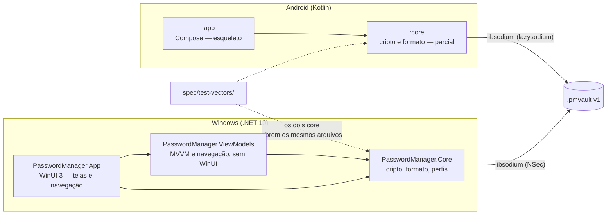
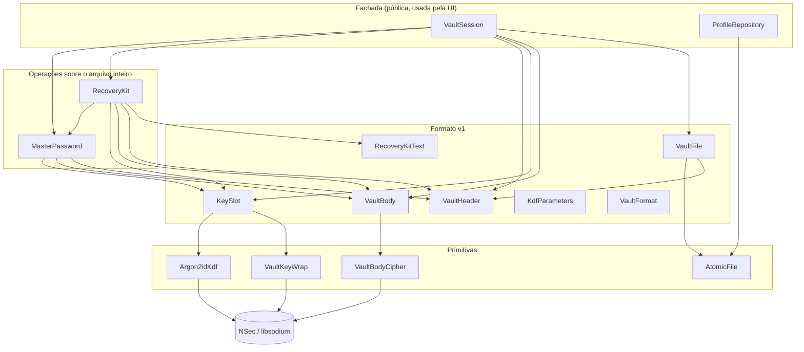
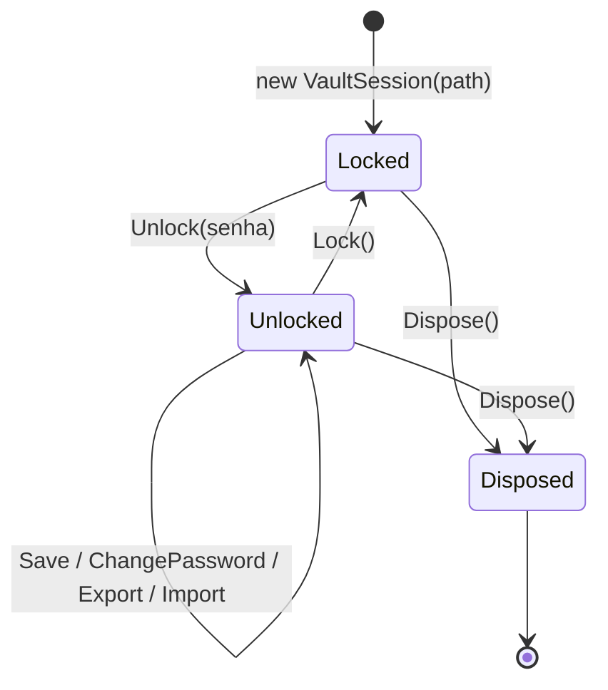
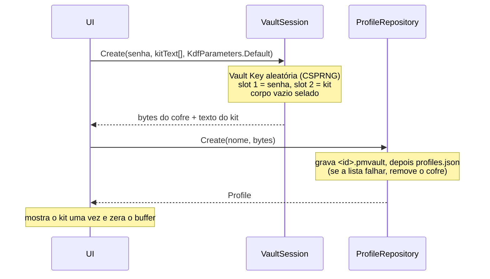
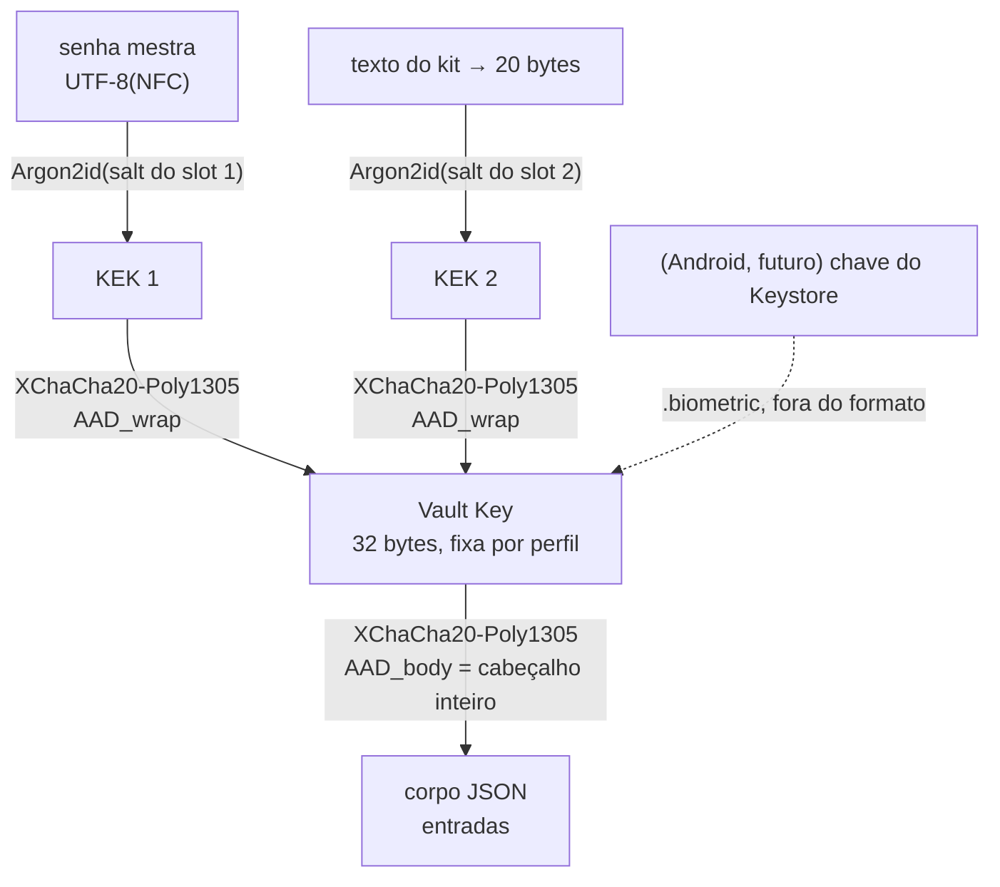
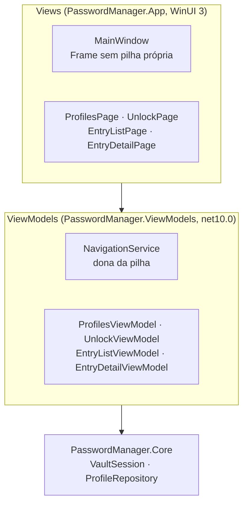
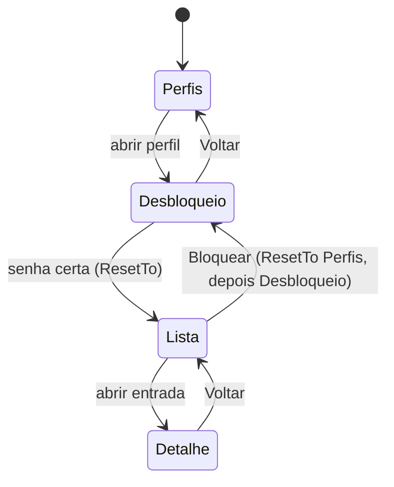

# Arquitetura do sistema

> Retrato do código em out/2026, depois da W-11 (fase F1 do [épico Windows](epic-windows-release.md) concluída; a W-11 da F2 também).
> Deve ser atualizado no mesmo PR de toda mudança relevante (AGENTS.md §9).
> Regras obrigatórias: [AGENTS.md](../AGENTS.md). Layout de bytes: [vault-format.md](vault-format.md). Ameaças: [threat-model.md](threat-model.md).
> Este documento descreve **como o código está organizado**; quando houver conflito, AGENTS.md e vault-format.md prevalecem.

## 1. Visão geral

Gerenciador de senhas offline com dois apps nativos que compartilham **um único formato de arquivo** (`.pmvault` v1):



Princípios que moldam a arquitetura (AGENTS §1): segurança, offline de verdade, simplicidade, leveza.

- **Toda a lógica de cripto e formato fica no `Core`/`core`**, sem dependência de UI. A UI só chama operações de alto nível.
- **Nenhum código de rede** nos dois lados. O Android remove a permissão `INTERNET` no manifest; o Windows não tem pacote de rede e será empacotado sem `internetClient`.
- **Mesma biblioteca base (libsodium)** nas duas plataformas, para que um arquivo de uma abra na outra.

## 2. Estado atual

| Parte | Estado |
|---|---|
| Formato v1 (`vault-format.md`) | Layout fechado (W-01). Congela quando o `core` Android passar nos vetores. |
| `PasswordManager.Core` (Windows) | **Completo para a F1**: KDF, wrap, corpo, arquivo, perfis, troca de senha, Kit de Recuperação, `VaultSession` e vetores (W-02…W-10). |
| `PasswordManager.App` (WinUI 3) | Telas de perfis, desbloqueio, lista e detalhe ligadas por um `Frame` (W-11). Ainda sem edição de entradas, busca, criação de perfil nem campo de senha das entradas. Sem pacote MSIX (`WindowsPackageType=None`). |
| `PasswordManager.ViewModels` (`net10.0`, sem WinUI) | Navegação (`NavigationService`, pilha pura) e quatro ViewModels de página, testados sem janela (W-11). |
| `:core` (Android) | Parcial: KDF, wrap, corpo, cabeçalho, slots e arquivo. Faltam Kit de Recuperação, troca de senha, sessão, perfis e o teste dos vetores. |
| `:app` (Android) | Esqueleto: tela vazia de perfis, `FLAG_SECURE`, sem `INTERNET`, sem backup. |
| `spec/test-vectors/` | 4 vetores (`empty`, `entries-unicode`, `recovery-kit`, `export`) abertos pelo Core Windows. |

## 3. Estrutura do repositório

```
AGENTS.md                         regras para pessoas e agentes (CLAUDE.md só importa este arquivo)
docs/                             formato, ameaças, épico, este documento
spec/test-vectors/                vetores compartilhados (<nome>.pmvault + <nome>.json)
windows/
  global.json                     SDK .NET 10 + runner Microsoft.Testing.Platform (rodar dotnet a partir de windows/)
  Directory.Build.props           Nullable, warnings como erro, analisadores, lockfiles
  Directory.Packages.props        versões NuGet centralizadas
  src/PasswordManager.Core/       Crypto/, Vault/, Storage/, Profiles/
  src/PasswordManager.App/        WinUI 3: Views/, App.xaml.cs (composição), textos em Strings/pt-BR/Resources.resw
  src/PasswordManager.ViewModels/ net10.0 sem WinUI: Navigation/ e os ViewModels de página
  tests/PasswordManager.Core.Tests/   xUnit v3, espelha as pastas do Core + TestVectors/
  tests/PasswordManager.ViewModels.Tests/   xUnit v3, ViewModels e fluxo de navegação
android/
  gradle/libs.versions.toml       todas as versões
  core/                           com.passwordmanagement.core (crypto/, vault/)
  app/                            com.passwordmanagement.android (Compose)
```

## 4. Core do Windows

### 4.1 Camadas

Cada camada só usa a de baixo. A UI deve usar só o topo (`VaultSession` e `ProfileRepository`).



### 4.2 Responsabilidades

| Pasta | Tipo | Visibilidade | Papel |
|---|---|---|---|
| `Crypto/` | `Argon2idKdf` | pública | Senha (`char`, normalizada em NFC → UTF-8) ou segredo binário → KEK de 32 bytes. Zera os buffers intermediários. |
| | `VaultKeyWrap` | interna | XChaCha20-Poly1305 da Vault Key com a KEK e o `AAD_wrap`. |
| | `VaultBodyCipher` | interna | XChaCha20-Poly1305 do JSON do corpo com o `AAD_body`. |
| `Storage/` | `AtomicFile` | interna | `.tmp` → flush → (`.bak`) → rename. Usado pelo cofre (com `.bak`) e por `profiles.json` (sem `.bak`). |
| `Vault/` | `VaultFormat` | pública | Constantes do formato, espelhadas em `VaultFormat.kt`. |
| | `KdfParameters` | pública | Memória/iterações do Argon2id; `Default` = 64 MiB/3; validação dos limites; leitura de um slot. |
| | `VaultHeader` | pública | `Parse` (validação completa da leitura, na ordem da spec) e `Build` (slots em ordem de tipo). Expõe `BodyOffset` e os `VaultSlotRange`. |
| | `KeySlot` | pública | Cria e abre os slots tipo 1 (senha) e tipo 2 (kit). |
| | `VaultBody` | pública | `Seal`/`Open` do corpo; `Reseal` interno (mesmo conteúdo, cabeçalho novo, nonce novo). |
| | `VaultFile` | pública | `Read` devolve os bytes crus (quem valida é o `VaultHeader.Parse`); `Write` valida antes de tocar o disco e grava atomicamente com `.bak`. Nunca recorre ao `.bak` sozinho. |
| | `MasterPassword` | pública | `Change` (senha atual → nova) e `Reset` (Vault Key já conhecida → nova senha). Só o slot tipo 1 muda. |
| | `RecoveryKit` / `RecoveryKitText` | pública / interna | Gerar, substituir, abrir e redefinir a senha pelo kit; texto Crockford base32 8×4. |
| | `VaultSession` | pública | Fachada com estado: `Create`, `Unlock`, `Lock`, `Save`, `ChangePassword`, `Export`, `Import`. |
| | `VaultEntry`, `VaultContent`, `VaultJsonContext`, `UtcTimestampConverter` | pública / interna | Modelo do corpo e JSON source-generated (camelCase, datas `.fffZ`). `VaultEntry.ToString()` nunca mostra segredos. |
| | `VaultFormatException`, `VaultAuthenticationException` | pública | Erros tipados (ver 8). |
| `Profiles/` | `ProfileRepository` | pública | `profiles.json`: listar, validar nome, criar (grava o cofre e depois a lista), renomear, apagar (lista primeiro, depois `.pmvault`/`.bak`/`.tmp`). |
| | `Profile`, `ProfileNameError`, `ProfileStoreException` | pública | Modelo, erros de validação do nome, erro de armazenamento. |

As APIs de baixo nível trabalham com **bytes do arquivo inteiro** (`ReadOnlySpan<byte> file` → `byte[]` novo). Elas não tocam no disco; só `VaultFile` e `ProfileRepository` fazem I/O. Isso torna cada operação testável em memória e deixa a escrita atômica num único lugar.

### 4.3 `VaultSession`: estado e ciclo de vida



- **Enquanto desbloqueada**, guarda a Vault Key num buffer **pinned** (o GC não move nem copia), os bytes do arquivo aberto e o `VaultContent` decifrado.
- **`Lock()`** zera a chave com `CryptographicOperations.ZeroMemory` e descarta o arquivo e o conteúdo. Pode ser chamado várias vezes. Depois de `Dispose`, `Lock`/`Dispose` não fazem nada e o resto lança `ObjectDisposedException`.
- **Uma trava privada em todo membro**: um `Lock` vindo de outra thread (troca de sessão do Windows, W-18) espera a gravação em andamento e nunca deixa selar o corpo com a chave zerada. A mesma trava serializa as gravações, que o `VaultFile` exige.
- **Estado muda só depois que a gravação dá certo**: em falha de I/O, sessão e disco continuam iguais.
- `Create`, `Unlock`, `ChangePassword`, `Export` e `Import` rodam Argon2id (~1 s com os parâmetros padrão): **a UI deve chamá-los fora da thread de UI**.
- `Create` é estático: devolve os bytes do cofre novo e o texto do kit, e quem grava é o `ProfileRepository.Create`.

## 5. Fluxos principais

### 5.1 Criar perfil



### 5.2 Desbloquear, editar, bloquear

1. `new VaultSession(repo.GetVaultPath(id))` → `Unlock(senha)`.
2. `VaultFile.Read` lê os bytes e `VaultHeader.Parse` os valida; `KeySlot` deriva a KEK **só do slot tipo 1** e desembrulha a Vault Key; `VaultBody.Open` decifra o corpo com o cabeçalho inteiro como AAD.
3. A UI lê `Content` e chama `Save(novoConteúdo)`: o corpo é re-selado com nonce novo e gravado atomicamente; o arquivo anterior vira `.bak`.
4. `Lock()` ao sair, por inatividade ou na troca de sessão.

Senha errada, arquivo adulterado e slot adulterado aparecem todos como a mesma `VaultAuthenticationException`, sem detalhe do motivo.

### 5.3 Trocar a senha mestra

`ChangePassword(atual, nova)` → `MasterPassword.Change`: abre o slot 1 com a senha atual e cria um slot 1 novo (salt e nonce novos). O slot 2 fica igual, byte a byte. O corpo é re-selado com a **mesma** Vault Key, porque o cabeçalho é AAD. As entradas nunca são cifradas de novo com outra chave.

### 5.4 Kit de Recuperação

- `RecoveryKit.Unlock(file, kitText, vaultKey)`: decodifica o texto (valida antes de gastar Argon2id) e abre **só o slot tipo 2**.
- `RecoveryKit.ResetPassword(file, kitText, novaSenha, params)`: kit → Vault Key → `MasterPassword.Reset`.
- `RecoveryKit.Create(file, vaultKey, params, kitText)`: gera um kit novo e substitui o slot 2; o kit antigo deixa de funcionar.

Esses três ainda não estão expostos pela `VaultSession` (a W-26 decide como a UI os chama).

### 5.5 Exportar e importar

- `Export(senhaDeExportação)` devolve bytes de um `.pmvault` com **Vault Key nova**, exatamente um slot tipo 1 e nenhum kit. Nada é gravado: o app salva via `FileSavePicker` (W-23), nunca em pasta temporária.
- `Import(bytes, senhaDeExportação)` devolve o `VaultContent` decifrado para prévia. A sessão e o disco não mudam; quem chama mescla as entradas e chama `Save` (W-25).
- CSV ainda não existe (W-24/W-25).

## 6. Chaves e segredos



Regras que o código segue:

- **Nenhum hash da senha é guardado**: a verificação é a própria tag AEAD do slot.
- Senhas e textos de kit entram como `ReadOnlySpan<char>`; chaves como `Span<byte>`. Temporários ficam em `stackalloc` e são zerados em `finally`. Os buffers do chamador nunca são alterados, e é ele quem os zera.
- O `VaultContent` e suas `string` são objetos gerenciados e **não podem ser zerados**; `Lock` só solta as referências (limite aceito em AGENTS §3.5).
- Exceções nunca carregam segredo nem conteúdo do arquivo.

## 7. Armazenamento em disco

Pasta: `%LOCALAPPDATA%\PasswordManagement\vaults\` (sem pacote) ou `<LocalFolder>\vaults\` (MSIX), via `ProfileRepository.GetDefaultDirectory`.

| Arquivo | Escrito por | Observação |
|---|---|---|
| `profiles.json` | `ProfileRepository` | Em claro, só `id`/`displayName`/`createdAt`. Atômico, **sem** `.bak`. |
| `<id>.pmvault` | `VaultFile.Write` | Atômico, com `.bak` da versão anterior. Nome vem só do `id`. |
| `<id>.pmvault.bak` / `.tmp` | `AtomicFile` | `.tmp` só sobra após queda e é sobrescrito na próxima gravação. |

Não há trava entre processos: quem chama serializa as operações.

## 8. Erros

| Exceção | Quando |
|---|---|
| `VaultFormatException` | Arquivo malformado: tamanho, magic, versão, slots, limites do KDF. Lançada antes de qualquer Argon2id. |
| `VaultAuthenticationException` | Falha AEAD: senha/kit errado ou qualquer byte adulterado. Mensagem fixa, sem `InnerException`. |
| `FormatException` | Texto do kit inválido (checado antes do Argon2id). |
| `InvalidOperationException` | Sessão bloqueada; cofre sem slot de kit. |
| `ProfileStoreException` | `profiles.json` inválido (JSON quebrado, `id` repetido, campo ausente…). O arquivo corrompido nunca é sobrescrito. A mensagem não traz nomes de perfil. |
| `IOException` e afins | Falha de disco em `VaultFile`/`ProfileRepository`. Sobem sem tradução; a escrita atômica garante que o arquivo anterior continua inteiro. |
| `ProfileNameError` (enum) | Resultado da validação do nome de perfil, sem exceção. |

## 9. App do Windows

### 9.1 Camadas

Cada camada só usa a de baixo. As Views não chamam o Core: falam só com os ViewModels.



- **Views**: só XAML e `x:Bind` para os ViewModels. A `MainWindow` escuta `NavigationService.Navigated` e chama `Frame.Navigate` com a página do tipo de `Current`; cada caso tem um `typeof` literal, para o trimmer enxergar os tipos.
- **ViewModels**: `ObservableObject` e `RelayCommand` do CommunityToolkit.Mvvm; nenhum tipo de UI. Expõem estado (`UnlockError`, `IsEmpty`, `LoadFailed`), e a View escolhe o texto no `.resw`.
- **Composição**: `App.OnLaunched` cria o `NavigationService` e o `ProfileRepository`, entrega o serviço à `MainWindow` e mostra a tela de perfis. Não há container de DI.

### 9.2 Navegação



- **A pilha fica no `NavigationService`**. O `Frame` tem `IsNavigationStackEnabled="False"`, e a View não guarda histórico próprio.
- **Desbloquear troca a pilha inteira** pela Lista (`ResetTo`). Com o cofre aberto, nenhum Voltar leva ao desbloqueio.
- **Bloquear** (`EntryListViewModel.Lock`) fecha a sessão, esvazia as entradas e refaz a pilha como `[Perfis]` com `Desbloqueio` atual. Voltar cai em Perfis, nunca na lista.
- Cada troca chama `OnNavigatedFrom` da página que sai e `OnNavigatedTo` da que entra, antes de `Navigated`, sempre na thread que chamou (a de UI).
- **Desbloqueio fora da thread de UI**: `UnlockViewModel` roda `VaultSession.Unlock` em `Task.Run`. O `await` **não usa `ConfigureAwait(false)`**: a navegação depois dele precisa voltar à thread de UI, senão `Frame.Navigate` falha.
- **Senha como `char[]`**: a `UnlockPage` copia o `PasswordBox` para um `char[]` e esvazia o campo. O comando assume o array e o zera no `finally`, mesmo em falha. O `PasswordBox` só expõe `string`; isso fica como ponto em aberto.
- **Sessão**: a `VaultSession` nasce no `UnlockViewModel`, passa à `EntryListViewModel` ao desbloquear e é descartada no `Lock` ou quando o desbloqueio falha.

## 10. Android `:core`

Mesma divisão de pastas do Windows, com nomes equivalentes:

| Windows | Android | Estado |
|---|---|---|
| `Argon2idKdf`, `VaultKeyWrap`, `VaultBodyCipher` | `crypto/` com os mesmos nomes + `AndroidSodium` (instância do lazysodium) | feito |
| `VaultFormat`, `KdfParameters`, `VaultHeader`, `KeySlot`, `VaultBody`, `VaultFile`, modelos | `vault/` com os mesmos nomes (JSON via kotlinx.serialization) | feito |
| `MasterPassword`, `RecoveryKit`, `VaultSession` | — | pendente |
| `ProfileRepository` | — | pendente |
| `TestVectorTests` | — | pendente: é o que congela o formato v1 |

Os testes unitários rodam na JVM do host com `lazysodium-java` (só no escopo de teste), porque o `.so` do Android não carrega fora do aparelho.

## 11. Testes

| Onde | Como rodar | Cobertura |
|---|---|---|
| `windows/tests/PasswordManager.Core.Tests` | `dotnet test --solution PasswordManager.slnx` **a partir de `windows/`** | ~1.180 testes: KDF com valores conhecidos, wrap/unwrap, corpo, adulteração byte a byte de cada região, arquivo atômico, perfis, troca de senha, kit, sessão (inclusive concorrência) e vetores. |
| `windows/tests/PasswordManager.ViewModels.Tests` | `dotnet test --solution PasswordManager.slnx` **a partir de `windows/`** | 41 testes sem janela: `NavigationService`, os quatro ViewModels de página (inclusive a senha zerada depois do desbloqueio) e o fluxo Perfis → Desbloqueio → Lista → Detalhe → Voltar → Bloquear. |
| `android/core/src/test` | `./gradlew :core:testDebugUnitTest` (em `android/`) | KDF, wrap, corpo, cabeçalho, slots, arquivo, JSON. |
| `spec/test-vectors/` | lidos pelo `TestVectorTests` | Cofre vazio, Unicode/emoji, kit (64 MiB/3/1 reais) e exportação. O manifesto JSON descreve o resultado esperado de cada um. |

Os vetores foram gerados uma vez por `TestVectorGenerator` (teste explícito, que se recusa a sobrescrever) e são a fonte da verdade. Os testes leem os arquivos commitados, nunca regeneram.

## 12. Dependências

| Plataforma | Pacote | Motivo |
|---|---|---|
| Windows Core | `NSec.Cryptography` | libsodium (Argon2id, XChaCha20-Poly1305) |
| Windows ViewModels | `CommunityToolkit.Mvvm` | `ObservableObject` e `RelayCommand`; sem WinUI nem rede |
| Windows App | `Microsoft.WindowsAppSDK`, `Microsoft.Windows.SDK.BuildTools`, `CommunityToolkit.Mvvm` | WinUI 3 e MVVM |
| Windows testes | `xunit.v3` | testes |
| Android core | `lazysodium-android` + `jna` (aar), `kotlinx-serialization-json` | libsodium e JSON |
| Android app | AndroidX (Compose BOM, Material 3, Activity, Lifecycle, Biometric) | UI e biometria |

Versões fixadas em `Directory.Packages.props` (com lockfiles) e `libs.versions.toml`. Nenhuma dependência de rede ou telemetria.

## 13. O que vem a seguir

- **App Windows**: F2 (W-12 textos, W-13 tema e acessibilidade, W-14 `WDA_EXCLUDEFROMCAPTURE`), depois F3 (perfis e desbloqueio, com Argon2id fora da thread de UI e atraso progressivo), F4 (entradas: busca, edição, gerador, área de transferência) e F5 (exportação/importação `.pmvault` e CSV, configurações), conforme o épico.
- **Android `:core`**: completar `MasterPassword`, `RecoveryKit`, `VaultSession` e o teste dos vetores. Quando passar, o formato v1 é congelado.
- **Distribuição (F6)**: ícones, MSIX sem `internetClient`, build de release, assinatura.

### Pontos em aberto

- Depois de `ChangePassword`, o `.bak` ainda abre com a senha antiga até o próximo `Save` (decisão da W-07/W-09, ainda não resolvida).
- `PasswordBox` só expõe `string`: a cópia gerenciada da senha mestra que a `UnlockPage` cria antes de virar `char[]` fica no heap até o GC. Limite aceito por enquanto; revisar na W-17 e na W-32.
- Decisões D2–D6 do épico (canal de distribuição, certificado, medidor de força, trimming, versão mínima do Windows).
